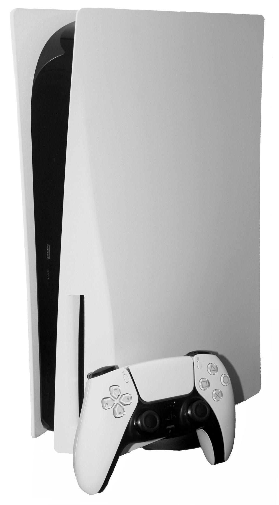
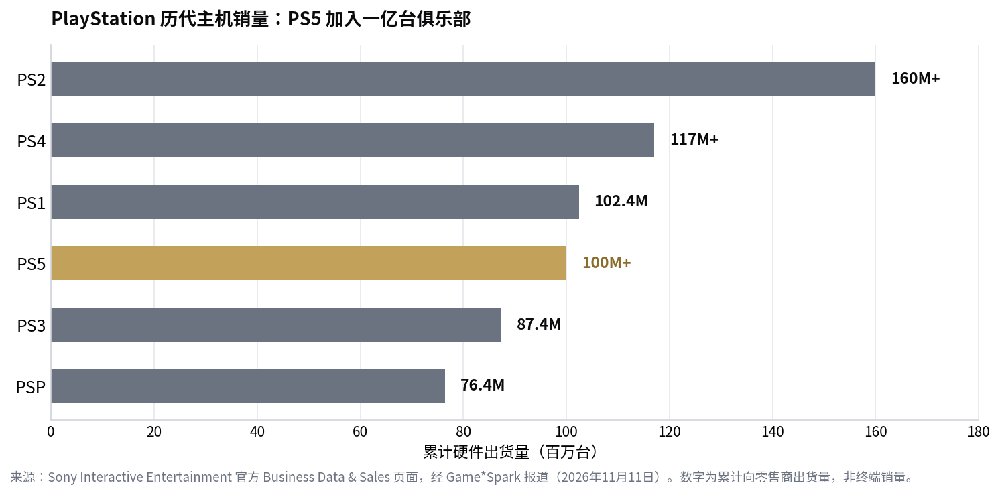

> [English version](/life/ps5-100-million-units/)

*初代 PlayStation 5 主机与 DualSense 手柄。照片来自 Wikimedia Commons。*

## 里程碑

Sony Interactive Entertainment 更新了官方 Business Data & Sales 页面的累计硬件数字：截至 **2026 年 11 月 10 日**，PlayStation 5 出货量突破**一亿台**。9 月底时为 **9,790 万台**，也就是说最近约 40 天里又出了约 **210 万台**——快到 Game*Spark 此前预测"要到 2027 年 2 月第三季度财报时才能确认"的时间表被提前了三个月。这些数字是向零售商的出货量，不是终端销量，这是索尼一贯的统计口径。

PS5 是第四款跨过一亿台的 PlayStation，排在 PS2、PS4 与初代 PlayStation 之后：

*PlayStation 历代主机销量：PS5 加入一亿台俱乐部。来源：Sony Interactive Entertainment 官方 Business Data & Sales 页面，经 Game*Spark 报道（2026 年 11 月 11 日）。数字为累计向零售商出货量，非终端销量。*

索尼同时公布，PS5 与 PS4 的累计软件销量已超过 **17.95 亿份**。

## 它是怎么走到这里的：最快的开局，然后是失去的两年

这六年走到一亿台的路不是一条直线。它的开头出人意料地是 PlayStation 历史上最快的开局。PS5 于 2020 年 11 月 12 日在新冠疫情之中发售，2021 年 7 月就达到了 1,000 万台出货量——发售后约八个月，是五代编号 PlayStation 中最快达到 1,000 万台的一次。需求从来不是问题，供应才是：在大约两年的时间里，这台主机是真的很难买到，缺货由疫情时期的半导体短缺、黄牛与物流混乱共同造成。2021、2022 年写"失去的一代"的分析师，对货架的判断没有错，对结局的判断错了。

与 PS2 的对比很有启发性。PS2 用五年九个月达到一亿台（据索尼 2005 年的公告），最终超过 1.6 亿台，至今仍是有史以来最畅销的主机。PS4 用约五年七个月跨过这条线，最终超过 1.17 亿台。按这个标准，PS5 用了将近六年，是第三快达到这一里程碑的 PlayStation——落后于它的两位前辈，但领先于索尼制造的其他所有主机，也领先于 PS3——后者最终停在 8,740 万台，从未加入这个俱乐部。PS5 还在 2025 年内超过了 PS3 的终身总量，在一亿台这个节点上，整个 PlayStation 家族里排在它前面的只有 PS2 与 PS4。从生命周期对齐的角度看，画面比标题更复杂：五周年时，PS5 的进度其实领先于 PS4 同期的约 8,600 万台——也就是说，"比 PS4 慢"这个说法对终点线成立，对比赛的过程并不成立。疫情偷走了 PS5 生命的中段，而它用后半段把时间补了回来。

这段历史还说明了一件事：一亿台这个数字的含金量，不在于它有多圆，而在于它是在什么样的开局下拿到的。一台发售时买不到、买到时还在涨价的主机，能在六年里加入一亿台俱乐部，本身就是对"失去的一代"这个判断的反驳。2022 年写下那个判断的人没有错，他们只是没有料到，一台主机的命运可以由后半程改写。

## 六年，比 PS4 稍慢一点

这个里程碑绕不开与 PS4 的对比——而索尼大概希望你谨慎地做这个对比。PS4 在 2019 年 4–6 月那个季度突破一亿台，也就是发售后**五年半多一点**。2020 年 11 月发售的 PS5 用了**约六年**。稍慢，原因并不难猜：疫情中首发、随后大约两年持续缺货、买得到的时候还中途涨过价。

正是这个背景让数字变得有意思，而不只是一个整数。PS5 是在 2021、2022 年被分析师写成"失去的一代"的开局下冲过一亿台的，而且没有靠 PS2、PS4 后期那种降价来拉动，也没有等它最大的系统级卖点游戏先发售。

## 价格故事：没有哪一代 PlayStation 这样涨过价

PS5 的旅程有一个方面是真正前所未有的，不是疫情，而是价格。此前每一代 PlayStation 主机的价格都是随时间下降的；PS5 走了相反的方向，而且走了两次。标准版 PS5（带光驱）2020 年 11 月发售时售价 $499.99。索尼 2025 年 8 月在美国涨价 $50，随后在 2026 年 3 月 27 日宣布、4 月 2 日起再次涨价，理由是"全球经济环境持续承压"。现在美国售价是：标准版 $649.99，数字版 $599.99，PS5 Pro $899.99。标准版比发售价高了 $150，约 30%——这是游戏主机历史上从未有过的涨价轨迹，更不用说是一台已经六岁的主机。

涨价的背景，是全行业内存与存储元件的短缺，索尼将其与 AI 数据中心的需求联系起来：PS5 里用的内存，正被建设 AI 基础设施的公司成批买走。研究机构 Omdia 估计，2025 年年中内存占基础版 PS5 元件成本的至少 20%。市场立刻有了反应：Circana 的数据显示，美国 PlayStation 主机销量在新价格生效的第一个月（4 月）同比下跌 30%，尽管主机的平均售价涨到了约 $672，同比上涨 33%。索尼首席财务官陶琳（Lin Tao）在 11 月 5 日表示，PS5 的销量正在逐步下滑，出货量已连续四个季度同比下降。

这就是一亿台里程碑背后的悖论：索尼卖的主机更少了、价格更高了，市场还在买——而里程碑还是来了，靠的是前五年积累的装机量，而不是当下的需求。老的主机剧本说，世代末期要降价来扩大受众；索尼做的是反向操作，赌的是每个玩家的软件与服务收入增长得足够快，可以弥补新增玩家减少的损失。这场赌注能不能成立，是一亿台这个整数背后真正的问题，答案会先在假日季里显现：如果 GTA VI 能在 $649.99 的价位上带动硬件，涨价就是妙手；如果不能，涨价就是 PS5 第六年成为最慢一年的原因。

## 接下来的故事才是全部

这个时间点不是巧合。**《GTA VI》将于 11 月 19 日**登陆 PS5 与 Xbox Series X/S——首发没有 PC 版——索尼同一天还推出新配色**午夜黑** PS5 数字版。PS5 与 Xbox Series X/S 的预载已于 11 月 10 日午夜开启。GTA VI 是游戏史上规模最大的发售，落在一亿台官宣后八天、假日季的起点。

但有个插曲，而且网上已经吵起来了：GTA VI 已确认在 PS5、PS5 Pro 与 Xbox Series X/S 上以 **30fps** 为目标，主机版首发**没有 60fps 性能模式**（Gadgets360）。据报游戏还要占用约 **210GB SSD 空间**。对于一个靠性能模式卖自己的主机世代来说，旗舰大作首发只有 30fps，是索尼没想要的话题——也是一些买家宁可等日后 PC 版、而不现在买硬件的理由。

索尼本周的其他动作指向同一方向——压榨现有装机量，而不是扩大它。11 月 PlayStation Plus 阵容由**《死亡搁浅 2：沙滩之上》**（11 月 17 日）、**《Hell Let Loose》**（11 月 11 日）与**《勇者斗恶龙 III HD-2D 重制版》**（11 月 17 日）领衔，共 10 款游戏。而在同一份公告里，PlayStation 表示 **PS Plus PC 应用将于 12 月 10 日停用**——按它自己的说法，是因为 PC 上几乎没人用。

## GTA VI，用数字说话

扛起假日季的那款游戏，值得单独算一笔账，因为它周围的数字是游戏行业从未见过的。Take-Two——Rockstar 的母公司——在 11 月 9 日的第二财季财报里告诉投资者，也就是发售前十天，预购已达到"前所未有的水平"（unprecedented levels），预计将迎来"历史性的一年"。董事长兼 CEO Strauss Zelnick 说，早期需求大多落在 $99.99 的终极版上，而不是 $79.99 的标准版。PlayStation 在 11 月 10 日表示，GTA VI 是 PlayStation Store 历史上预购量最高的游戏，微软对其自家商店也说了同样的话。Take-Two 重申了 2027 财年 80 亿至 82 亿美元的净预订额（net bookings）展望——这个目标只有靠这一款游戏才能实现——并对包含发售在内的 10 月至 12 月季度给出 33.5 亿至 35 亿美元的净预订额指引。

赌注的大小，在与前作的对比里看得最清楚。《GTA V》自 2013 年以来已售出约 2.35 亿份，三天之内收入突破 10 亿美元；GTA VI 经历了两次延期——最初定于 2025 年秋季，推迟到 2026 年 5 月，再推迟到 11 月 19 日——带着一个用了十三年时间积累受众的系列前来。这款游戏在字面意义上也是 PS5 有史以来要装下的最大的东西：据报安装需要 210GB，而这台主机的可用存储空间从发售时起就是一个被抱怨的点。但这些都没有削弱需求。问题已经不再是 GTA VI 会不会成为史上最大的发售——预购纪录已经回答了这个问题——而是它会是一次硬件事件，还是一次软件事件：它是会把主机卖给还没有主机的人，还是会把一款 $79.99 的游戏卖给已经拥有主机的那一亿人。索尼赌的是前者。在发售前八天宣布一亿台里程碑，是索尼在告诉市场它已经拥有了受众；发售将告诉市场，这个受众是不是还在增长。

## 索尼真正的生意：硬件不赚钱，服务赚钱

还有一层经常被忽略的背景：索尼今天的 PlayStation 生意，早就不只是卖主机了。根据索尼 2026 财年（截至 2026 年 3 月 31 日）的财报，游戏与网络服务（G&NS）部门营收约 4,6857 亿日元（约 311 亿美元），营业利润 4,633 亿日元创下纪录；PlayStation Network 月活用户 1.25 亿，PlayStation Plus 订阅用户 4,700 万，2025 财年软件销量 3.179 亿份。这些数字说明了一件事：主机的意义已经从"利润来源"变成了"入口"——真正的钱来自订阅、来自软件、来自每个玩家每年在生态里的持续消费。

这就是为什么涨价 30% 的同时索尼的利润还能创纪录：每台主机卖得少了，但每个玩家的平均消费涨了。PS Plus 的 11 月阵容——《死亡搁浅 2》《Hell Let Loose》《勇者斗恶龙 III HD-2D 重制版》领衔的 10 款游戏——与同一份公告里 PS Plus PC 应用将于 12 月 10 日停用的决定，指向同一个方向：索尼正在收缩战线，把资源集中在主机这个它能赚钱的入口上，而不是分散到 PC 这种"几乎没人用"的渠道里。一亿台主机的价值，不在于主机本身，而在于它背后 1.25 亿月活用户构成的、可持续收费的生态。理解了这一点，就会明白索尼为什么敢在主机涨价的同时还对装机量如此淡定：它赌的不是卖出更多主机，而是让已经拥有的每一台主机赚更多的钱。

## 一亿台之后：PS5 还能走多远

一亿台是一个里程碑，但对索尼来说，它更像是一道算术题的起点。PS4 的最终成绩是 1.17 亿台，PS5 要追上它，还差约 1,700 万台；PS2 的 1.6 亿台则要再多 6,000 万台，几乎不可能。2025 财年 PS5 的出货量是 1,600 万台——如果按这个速度，追上 PS4 需要一年多一点的时间。但速度正在放慢：出货量已连续四个季度同比下降，首席财务官也承认销量在逐步下滑。假日季与 GTA VI 是变量最大的一个季度：如果它能像业界预期的那样带动硬件，PS5 有可能在假日季里一举缩小大部分差距；如果它只是一次软件事件——一亿人买游戏、没几个人买主机——追赶 PS4 的时间就会被拉长到 2027 年甚至更久。

还有一个结构性的问题：PS4 晚年是靠降价冲量的，而 PS5 晚年是在涨价。PS4 的降价与 Slim 机型让它在生命末期还能吸引价格敏感的买家；PS5 的涨价则把这条路堵死了——一台六岁的主机卖 $649.99，不太可能靠价格吸引新用户。这意味着 PS5 追赶 PS4 的方式只能是"靠大作拉动"，而不是"靠降价拉动"。GTA VI 是这种方式能拿出的最大的一张牌，而它之后还有没有同级别的牌，是一个 open question。索尼的第一方工作室当然还有作品在路上，但没有哪一款能与 GTA VI 的量级相比。这就是为什么这个假日季如此重要：它不仅决定 PS5 能不能追上 PS4，还决定了 PS5 的生命曲线是"靠大作续命"，还是"靠降价续命"——而后者的大门，索尼自己已经关上了。

从更长的时间线看，PS5 的故事还有一个注脚值得记住：它是第一台在"主机世代"的概念本身受到质疑时达到一亿台的主机。当它发售时，人们在讨论云游戏会不会取代主机、手机会不会吃掉主机市场；当它达到一亿台时，主机不仅没有消失，反而在 AI 抢走了内存产能、价格涨了 30% 的情况下守住了自己的位置。这个事实本身，就是对"主机已死"这个每隔几年就会出现一次的判断的又一次反驳。至于 PS5 最终会停在 1.17 亿还是 1.3 亿，答案要到 2027 年才会揭晓——但无论停在哪里，它已经证明了一件事：一台主机可以在疫情、缺货与涨价的三重打击下，仍然走进一亿台俱乐部。而这在 2022 年，是没有人敢预测的。

## 30fps 之争：为什么一个帧率数字能吵起来

GTA VI 确认在 PS5、PS5 Pro 与 Xbox Series X/S 上以 30fps 为目标、首发没有 60fps 性能模式，这个消息在网上的争论程度，几乎不亚于游戏本身。理解这场争论，需要回到 PS5 这一代主机的自我定位：从发售起，"性能模式"就是 PS5 卖给玩家的一个核心承诺——4K、光追、高帧率，三者至少能选其二。而 GTA VI 作为这一代最受期待的大作，首发只有 30fps，等于在告诉玩家，这个世代的旗舰硬件跑不动这个世代的旗舰游戏。这对索尼来说是一个它没有想要的话题：它把"买 PS5 Pro 能不能跑 60fps"这个问题，变成了"连 Pro 都跑不到 60fps"这个答案。

但这场争论也有另一面。Rockstar 的游戏从来不是以帧率见长的——《GTA V》与《荒野大镖客 2》的首发版本同样锁定 30fps，而它们的画面密度、世界规模与模拟复杂度，恰恰是帧率的代价。开放世界游戏的瓶颈往往不在 GPU，而在 CPU：要模拟一座城市里成千上万个 NPC、车辆与物理交互，CPU 的预算比 GPU 更紧张。PS5 的 CPU 在 2020 年是够用的，在 2026 年面对 GTA VI 这种规模的世界时，30fps 可能不是"优化不到位"，而是"在现有硬件上能做到的最好选择"。这也是为什么一些玩家会选择等待日后的 PC 版——不是因为他们不喜欢主机，而是因为他们相信，几年后的 PC 硬件能以 60fps 甚至更高帧率跑同一款游戏，而主机版永远停留在 30fps。这种等待本身，就是对 PS5 硬件寿命的一次投票：它说明玩家已经开始用"PC 版什么时候出"来衡量主机版的价值，而这对索尼来说，是比 30fps 本身更值得警惕的信号。

## 结论

一亿台是个里程碑，不是终点线，老实说要两面看。一面是：一台疫情中首发、缺货两年、中途涨价的主机，六年里加入了一亿台俱乐部——这在 2022 年看起来是乐观的预测。另一面是：它比 PS4 慢，而下一程要靠一款 30fps、占 210GB 的游戏。

而对玩家来说，一亿台这个数字本身没有太多实际意义——它不会让你的主机跑得更快，也不会让 GTA VI 多一帧。它的意义在于它回答了一个六年前没人能回答的问题：一台在疫情中发售、缺货两年、中途涨价的主机，能不能活下来？答案是能，而且活得不错。剩下的那个问题——它能不能超过 PS4——会在未来一年里，由假日季的销量、由 GTA VI 的后劲、由索尼会不会终于降价来回答。真正值得盯的数字不是一亿，而是 **1.17 亿**——PS4 的最终总量，也是 PS5 需要追上的差距。如果 GTA VI 像业界预期的那样带动硬件，PS5 会在假日季超过 PS4 的最终成绩，"比 PS4 慢"的说法就此消失。如果没有，六年的速度看起来就会像天花板，而不是地板。

## 来源

- Sony Interactive Entertainment，Business Data & Sales 页面，经 Game*Spark，"PS5 Surpasses 100 Million Units Worldwide in Its Sixth Year"，2026 年 11 月 11 日（截至 11 月 10 日破亿；9 月 30 日 9,790 万；PS2 1.6 亿+、PS4 1.17 亿+、PS1 1.024 亿、PS3 8,740 万、PSP 7,640 万；PS4 约五年半破亿；GTA VI 与午夜黑 11 月 19 日）。
- The World Insiders，"PlayStation 5 sales pass 100 million ahead of GTA VI"，2026 年 11 月 11 日（截至 11 月 10 日破亿；累计软件超 17.95 亿份；GTA VI 11 月 19 日，首发无 PC 版）。
- Insider Gaming，2026 年 11 月 11 日（PS5 超一亿台；2020 年 11 月发售）。
- Gadgets360，2026 年 11 月 11 日（GTA VI 在 PS5、PS5 Pro、Xbox Series S/X 上目标 30fps；首发无 60fps 性能模式；11 月 10 日午夜开启预载；据报约 210GB SSD）。
- CGMagazine，"PlayStation Plus Announces 10 Games and The Death of the PC App"，2026 年 11 月 11 日（11 月阵容由死亡搁浅 2、Hell Let Loose、勇者斗恶龙 III HD-2D 领衔；PS Plus PC 应用 12 月 10 日停用）。
