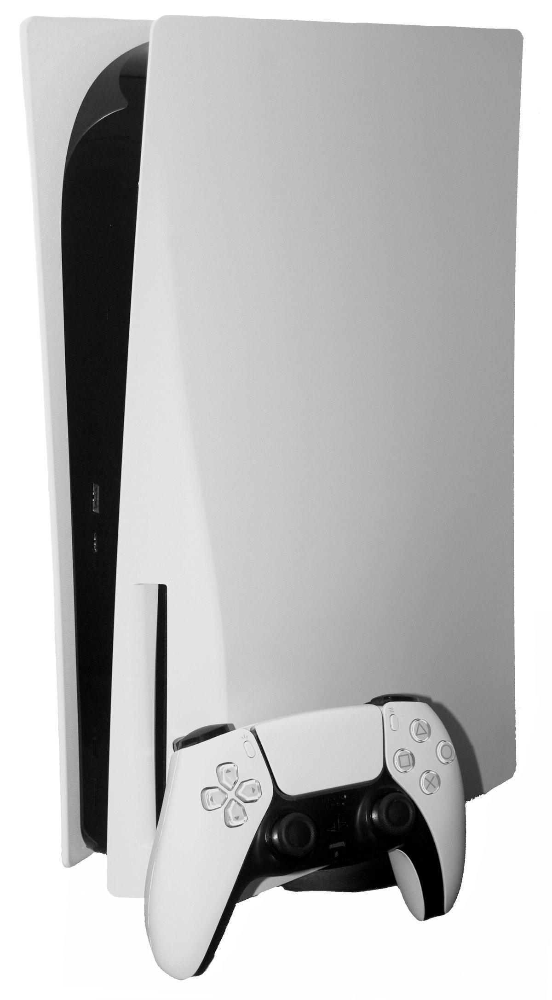
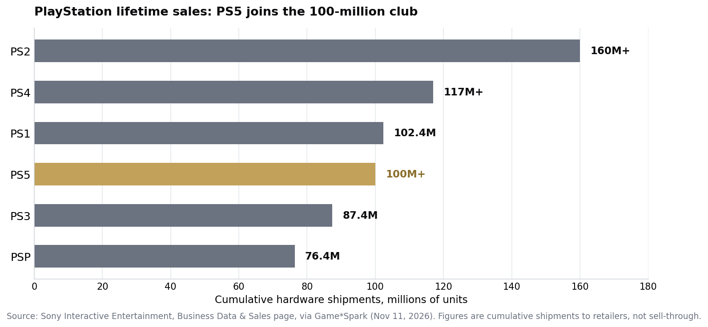

> [中文版 Chinese version](/life/ps5-100-million-units-zh/)

*The original PlayStation 5 console with a DualSense controller. Photo via Wikimedia Commons.*

## The milestone

Sony Interactive Entertainment updated the cumulative hardware figures on its official Business Data & Sales page: PlayStation 5 shipments passed **100 million units as of November 10, 2026**. The console stood at **97.9 million** at the end of September, which means roughly **2.1 million units shipped in about 40 days** — fast enough that Game*Spark, which had predicted the milestone would only become clear around February 2027 at the third-quarter earnings announcement, was beaten by three months. The figures are shipments to retailers, not sell-through to consumers, which is Sony's standard reporting basis.

The PS5 is the **fourth PlayStation** to cross 100 million, after the PS2, PS4, and the original PlayStation:

*PlayStation lifetime sales: PS5 joins the 100-million club. Source: Sony Interactive Entertainment, Business Data & Sales page, via Game*Spark (November 11, 2026). Figures are cumulative shipments to retailers, not sell-through.*

Sony also put cumulative software sales across PS5 and PS4 at **more than 1.795 billion units**.

## How it got here: the fastest start, then two lost years

The six-year journey to 100 million was not a straight line. It began, improbably, as the fastest start in PlayStation history. The PS5 launched on November 12, 2020, in the middle of the COVID-19 pandemic, and reached 10 million shipments in July 2021 — about eight months after launch, the fastest start to 10 million among the five numbered PlayStation generations. The demand was never the problem. The supply was: for roughly two years, the console was genuinely hard to buy, with shortages driven by the pandemic-era semiconductor crunch, scalpers, and logistics chaos. Analysts who in 2021 and 2022 wrote about a lost generation were not wrong about the shelves. They were wrong about the ending.

The comparison with the PS2 is instructive. The PS2 reached 100 million in five years and nine months, according to Sony's 2005 announcement, and went on to more than 160 million — still the best-selling console of all time. The PS4 crossed the line in about five years and seven months and finished at more than 117 million. By that measure the PS5, at almost six years, is the third-fastest PlayStation to reach the mark — behind both of its predecessors, but ahead of every other console Sony has made, and ahead of the PS3, which finished at 87.4 million and never joined the club at all. The PS5 also passed the PS3's lifetime total during 2025, and at 100 million it trails only the PS2 and PS4 in the franchise's history.

## Six years, and slightly slower than the PS4

The milestone invites the comparison Sony would rather you make carefully. The PS4 reached 100 million in the April–June 2019 quarter — just over **five and a half years** after its launch. The PS5, released in November 2020, took **about six years**. Slightly slower, and the reasons are not mysterious: a launch into a pandemic, roughly two years of supply shortages that made the console genuinely hard to buy, and mid-generation price increases along the way.

That context is what makes the number interesting rather than merely round. The PS5 cleared 100 million *despite* a start that, in 2021 and 2022, had analysts writing about a lost generation. It did it without a price cut of the kind that powered the PS2 and PS4 late in their lives, and it did it before its biggest system-seller has even arrived.

## The price story no other PlayStation had

There is one respect in which the PS5's journey is genuinely unprecedented, and it is not the pandemic. It is the price. Every prior PlayStation generation saw hardware prices decline over time; the PS5 has moved in the opposite direction twice. The standard PS5 with a disc drive launched at $499.99 in November 2020. Sony raised US prices by $50 in August 2025, and then again — announcing on March 27, 2026, effective April 2 — citing "continued pressures in the global economic landscape." The standard model now costs $649.99 in the United States, the Digital Edition $599.99, and the PS5 Pro $899.99. The standard model's increase from its launch price is $150, or about 30% — an upward pricing trajectory no console in history has followed, let alone a six-year-old one.

The increases come amid an industry-wide shortage of memory and storage components, which Sony has linked to demand from AI data centres: the same memory that goes into a PS5 is being bought in bulk by the companies building AI infrastructure, and research firm Omdia estimated that memory accounted for at least 20% of the base PS5's component bill in mid-2025.

That is the paradox at the heart of the 100-million milestone: Sony is selling fewer consoles, at higher prices, to a market that is still buying — and the milestone arrived anyway, carried by the installed base built in the first five years rather than by current demand. The old console playbook said you cut the price late in the generation to widen the audience; Sony is doing the opposite, and the bet is that software and services revenue per player can grow fast enough to compensate for fewer new players. Whether that bet holds is the real question behind the round number, and the answer will show up first in the holiday quarter: if GTA VI moves hardware at $649.99, the price increases were a masterstroke; if it does not, they were the reason the PS5's sixth year was its slowest.

## What comes next is the whole story now

The timing is not an accident. **Grand Theft Auto VI launches November 19** for PS5 and Xbox Series X/S — no PC version at launch — and Sony is releasing the PS5 Digital Edition in a new **Midnight Black** colour the same day. Pre-loading opened on PS5 and Xbox Series X/S at midnight on November 10. GTA VI is the biggest launch in the industry's history, and it lands eight days after the 100-million announcement, at the start of the holiday quarter.

There is a wrinkle, and it is already an argument online: GTA VI is confirmed to target **30fps on PS5, PS5 Pro, and Xbox Series X/S**, with **no 60fps Performance mode on consoles at launch** (Gadgets360). The game is also reported to take up around **210GB of SSD storage**. For a console generation that sold itself on performance modes, a flagship that launches at 30fps is a talking point Sony did not ask for — and a reason some buyers may wait for the inevitable PC version rather than buy hardware now.

The rest of Sony's week points the same direction — toward squeezing the installed base rather than expanding it. The November PlayStation Plus lineup is headlined by **Death Stranding 2: On the Beach** (November 17), **Hell Let Loose** (November 11), and **Dragon Quest III HD-2D Remake** (November 17), ten games in all. And in the same announcement, PlayStation said the **PS Plus PC app will be discontinued on December 10** — the service is, in its own words, leaving PC behind because hardly anyone used it there.

## GTA VI, by the numbers

The game carrying the holiday quarter deserves its own accounting, because the numbers around it are unlike anything the industry has seen. Take-Two, Rockstar's parent company, told investors in its fiscal second-quarter results on November 9 — ten days before launch — that pre-orders were at "unprecedented levels" and that it expected "an historic year." Chairman and CEO Strauss Zelnick said most of the early demand was landing on the $99.99 Ultimate Edition rather than the $79.99 Standard Edition. PlayStation said on November 10 that GTA VI was the most pre-ordered game in the history of the PlayStation Store, and Microsoft said the same about its own store. Take-Two reiterated its fiscal 2027 outlook of $8.0 billion to $8.2 billion in net bookings — a target reachable only because of this one title — and guided the October-to-December quarter, which contains the release, to $3.35 billion to $3.5 billion in net bookings.

The stakes are visible in the comparison with the predecessor. Grand Theft Auto V has sold about 235 million units since 2013, and took three days to pass $1 billion in revenue; GTA VI arrives after two delays — originally slated for fall 2025, pushed to May 2026, then to November 19 — with the weight of a franchise that has had thirteen years to build its audience. The game is also, in a literal sense, the biggest thing the PS5 has ever had to hold: a reported 210GB install, against a console whose usable storage was already a complaint at launch.

## The verdict

One hundred million is a milestone, not a finish line, and the honest read is two-sided. On one side: a console that launched into a pandemic, spent two years out of stock, and raised its price mid-generation still joined the 100-million club in six years — a result that would have looked optimistic in 2022. On the other: it took longer than the PS4, and the next leg depends on a single game that runs at 30fps and eats 210GB of storage.

The number to watch is not 100 million. It is **117 million** — the PS4's final total, and the gap the PS5 has to close. If GTA VI moves hardware the way the industry expects, the PS5 passes the PS4's final tally during the holiday quarter and the "slower than PS4" framing disappears. If it doesn't, the six-year pace starts to look like the ceiling, not the floor.

## Sources

- Sony Interactive Entertainment, Business Data & Sales page, via Game*Spark, "PS5 Surpasses 100 Million Units Worldwide in Its Sixth Year," November 11, 2026 (100M as of November 10; 97.9M at September 30; PS2 160M+, PS4 117M+, PS1 102.4M, PS3 87.4M, PSP 76.4M; PS4 reached 100M in ~5.5 years; GTA VI and Midnight Black on November 19).
- The World Insiders, "PlayStation 5 sales pass 100 million ahead of GTA VI," November 11, 2026 (100M as of November 10; cumulative software over 1.795 billion units; GTA VI November 19, no PC version at launch).
- Insider Gaming, November 11, 2026 (PS5 over 100 million units; launch November 2020).
- Gadgets360, November 11, 2026 (GTA VI targets 30fps on PS5, PS5 Pro, Xbox Series S/X; no 60fps Performance mode at launch; pre-load November 10 at midnight; reported ~210GB SSD).
- CGMagazine, "PlayStation Plus Announces 10 Games and The Death of the PC App," November 11, 2026 (November lineup headlined by Death Stranding 2, Hell Let Loose, Dragon Quest III HD-2D Remake; PS Plus PC app discontinued December 10).
