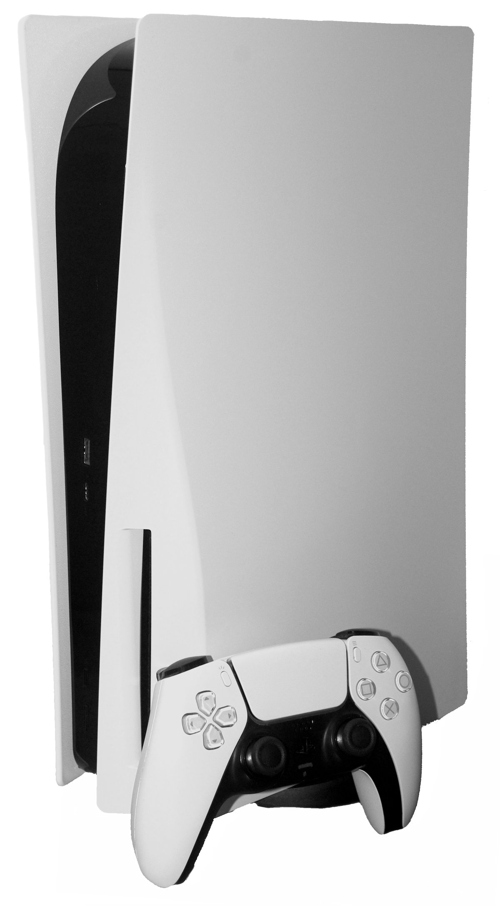
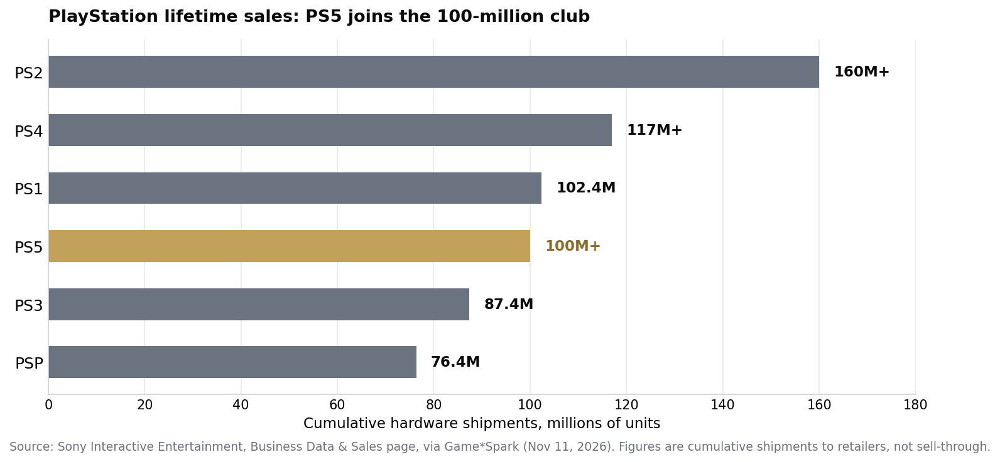

> [中文版 Chinese version](/life/ps5-100-million-units-zh/)

*The original PlayStation 5 console with a DualSense controller. Photo via Wikimedia Commons.*

## The milestone

Sony Interactive Entertainment updated the cumulative hardware figures on its official Business Data & Sales page: PlayStation 5 shipments passed **100 million units as of November 10, 2026**. The console stood at **97.9 million** at the end of September, which means roughly **2.1 million units shipped in about 40 days** — fast enough that Game*Spark, which had predicted the milestone would only become clear around February 2027 at the third-quarter earnings announcement, was beaten by three months. The figures are shipments to retailers, not sell-through to consumers, which is Sony's standard reporting basis.

The PS5 is the **fourth PlayStation** to cross 100 million, after the PS2, PS4, and the original PlayStation:

*PlayStation lifetime sales: PS5 joins the 100-million club. Source: Sony Interactive Entertainment, Business Data & Sales page, via Game*Spark (November 11, 2026). Figures are cumulative shipments to retailers, not sell-through.*

Sony also put cumulative software sales across PS5 and PS4 at **more than 1.795 billion units**.

## Six years, and slightly slower than the PS4

The milestone invites the comparison Sony would rather you make carefully. The PS4 reached 100 million in the April–June 2019 quarter — just over **five and a half years** after its launch. The PS5, released in November 2020, took **about six years**. Slightly slower, and the reasons are not mysterious: a launch into a pandemic, roughly two years of supply shortages that made the console genuinely hard to buy, and mid-generation price increases along the way.

That context is what makes the number interesting rather than merely round. The PS5 cleared 100 million *despite* a start that, in 2021 and 2022, had analysts writing about a lost generation. It did it without a price cut of the kind that powered the PS2 and PS4 late in their lives, and it did it before its biggest system-seller has even arrived.

## What comes next is the whole story now

The timing is not an accident. **Grand Theft Auto VI launches November 19** for PS5 and Xbox Series X/S — no PC version at launch — and Sony is releasing the PS5 Digital Edition in a new **Midnight Black** colour the same day. Pre-loading opened on PS5 and Xbox Series X/S at midnight on November 10. GTA VI is the biggest launch in the industry's history, and it lands eight days after the 100-million announcement, at the start of the holiday quarter.

There is a wrinkle, and it is already an argument online: GTA VI is confirmed to target **30fps on PS5, PS5 Pro, and Xbox Series X/S**, with **no 60fps Performance mode on consoles at launch** (Gadgets360). The game is also reported to take up around **210GB of SSD storage**. For a console generation that sold itself on performance modes, a flagship that launches at 30fps is a talking point Sony did not ask for — and a reason some buyers may wait for the inevitable PC version rather than buy hardware now.

The rest of Sony's week points the same direction — toward squeezing the installed base rather than expanding it. The November PlayStation Plus lineup is headlined by **Death Stranding 2: On the Beach** (November 17), **Hell Let Loose** (November 11), and **Dragon Quest III HD-2D Remake** (November 17), ten games in all. And in the same announcement, PlayStation said the **PS Plus PC app will be discontinued on December 10** — the service is, in its own words, leaving PC behind because hardly anyone used it there.

## The verdict

One hundred million is a milestone, not a finish line, and the honest read is two-sided. On one side: a console that launched into a pandemic, spent two years out of stock, and raised its price mid-generation still joined the 100-million club in six years — a result that would have looked optimistic in 2022. On the other: it took longer than the PS4, and the next leg depends on a single game that runs at 30fps and eats 210GB of storage.

The number to watch is not 100 million. It is **117 million** — the PS4's final total, and the gap the PS5 has to close. If GTA VI moves hardware the way the industry expects, the PS5 passes the PS4's final tally during the holiday quarter and the "slower than PS4" framing disappears. If it doesn't, the six-year pace starts to look like the ceiling, not the floor.

## Sources

- Sony Interactive Entertainment, Business Data & Sales page, via Game*Spark, "PS5 Surpasses 100 Million Units Worldwide in Its Sixth Year," November 11, 2026 (100M as of November 10; 97.9M at September 30; PS2 160M+, PS4 117M+, PS1 102.4M, PS3 87.4M, PSP 76.4M; PS4 reached 100M in ~5.5 years; GTA VI and Midnight Black on November 19).
- The World Insiders, "PlayStation 5 sales pass 100 million ahead of GTA VI," November 11, 2026 (100M as of November 10; cumulative software over 1.795 billion units; GTA VI November 19, no PC version at launch).
- Insider Gaming, November 11, 2026 (PS5 over 100 million units; launch November 2020).
- Gadgets360, November 11, 2026 (GTA VI targets 30fps on PS5, PS5 Pro, Xbox Series S/X; no 60fps Performance mode at launch; pre-load November 10 at midnight; reported ~210GB SSD).
- CGMagazine, "PlayStation Plus Announces 10 Games and The Death of the PC App," November 11, 2026 (November lineup headlined by Death Stranding 2, Hell Let Loose, Dragon Quest III HD-2D Remake; PS Plus PC app discontinued December 10).
