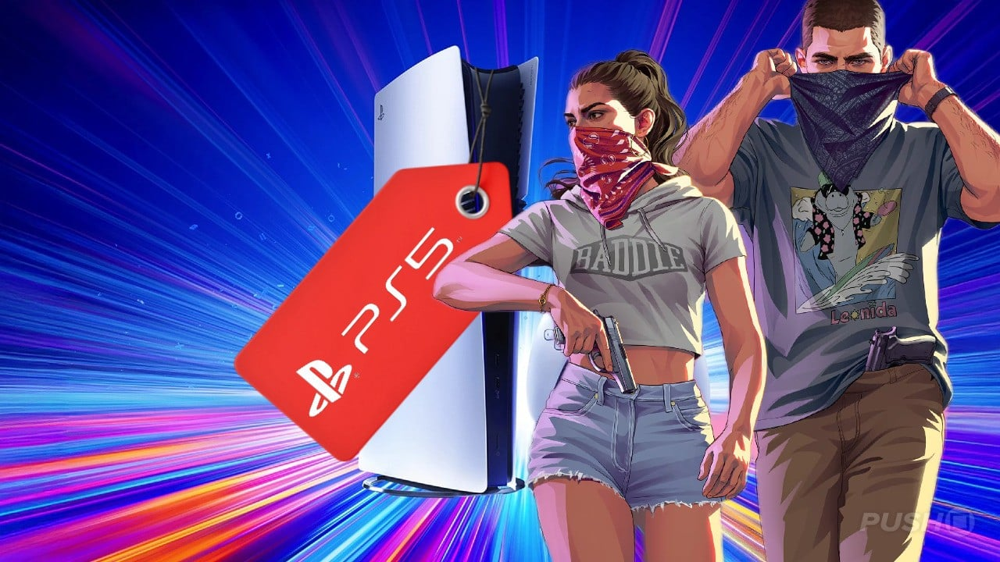
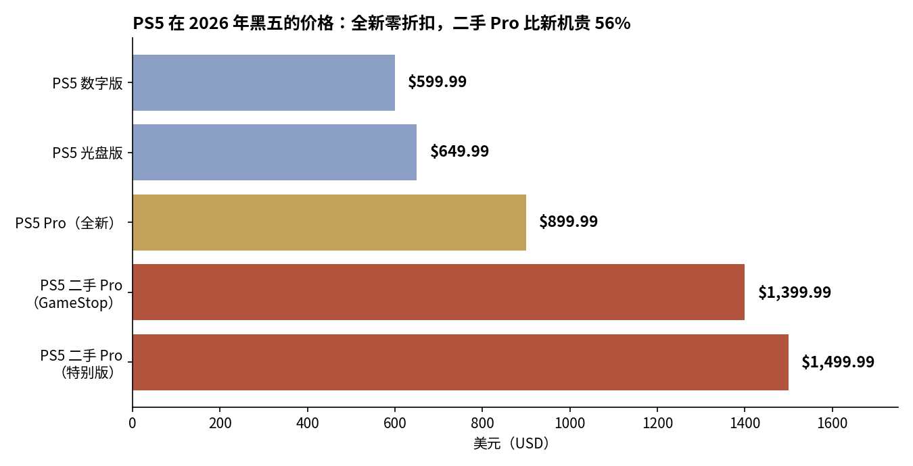

> [English version 英文版](/life/ps5-sold-out-black-friday-no-discount/)

*图片来源：Push Square，2026年11月25日。*

## 今天的新闻

Push Square 在 **2026年11月25日** 上午——黑五前两天——报道：自上周《GTA VI》发售以来，索尼正在为 PlayStation 5 的需求发愁。美国多家主流零售商，包括索尼自家的 **PS Direct** 官方商店，主机已完全售罄，只剩个别门店的零星库存。而在今年黑五，索尼对 PS5 硬件的促销是：**没有促销**。Push Square 的解读是：大概是因为它连原价的需求都满足不了，打折自然无从谈起。

最后一句就是整个故事的全部。黑五折扣是用来清库存的工具。而索尼在 2026 年 11 月面对的问题恰恰相反：不是库存，是配给。一台连货架都站不住的产品，不需要折扣；尤其是在一年中需求最旺的这一周——它十年来最大的游戏正在把新买家拉进商店。

*本文是本站昨天 Sony GTA VI 硬件数据一文的跟进：今天的新进展是售罄本身，以及"今年确认没有任何主机折扣"。*

## 与昨天相比，新发生了什么

昨天本站写过索尼的内部发售数据：11月19日至22日四天内，超过 **3,900万** 名 PS5 玩家启动了 GTA VI；11月19日当天新联网激活的 PS5 数量创下主机 2020 年发售以来、除年末假期外的单日最高纪录；这些新激活的主机中，约 **70%** 开机第一款游戏就是 GTA VI。Circana 分析师 Mat Piscatella 在 Bluesky 上补充了需求曲线：截至 11月14日那一周，美国 PS5 硬件购买量同比增长 **2.4 倍**——那时游戏甚至还没发售。

今天的新闻，是这条曲线撞上有限供应链的结果。需求涨 2.4 倍，不会带来出货涨 2.4 倍：主机供应在几个月前就由零部件订单、组装产能和物流定死了。需求冲击的结果只有一个：空货架。顺序值得想买机器的人看清楚：需求冲击在发售前就可测量，发售日创下激活纪录，六天后官方直营店断货。这不需要任何爆料就能预判——这是算术遇上固定产能计划。

## 价格阶梯（截至11月25日）

以下价格均为 **2026年11月25日** 查询的 snapshot，后续可能变动。

- **PS5 光盘版：649.99 美元**——索尼自 2026年4月2日涨价后的官方建议价。
- **PS5 数字版：599.99 美元。**
- **PS5 Pro：899.99 美元**——比 4 月涨价前的 749.99 美元贵 150 美元，比 2024 年发售价贵 200 美元。
- **索尼今年黑五主机折扣：0 美元。** 官方大促 11月16日开始、持续到 11月30日，内容包括游戏（PlayStation Store 最高 25 折）、配件（DualSense 减 20 美元、DualSense Edge 减 30 美元、Pulse Elite 耳机减 40 美元、PS VR2 减 100 美元）和 PlayStation Plus 会员（Premium 最高 67 折）——唯独没有任何一款主机。
- **对比去年：每款机型减 100 美元**，2025年11月19日开始。
- **官方唯一"便宜买法"：** PlayStation 官方翻新机——Slim 数字版 **499 美元**、光盘版 **549 美元**，各比现行新机价低 100 美元（据 IGN 黑五报道）。
- **短缺的价格：** GameStop 二手 PS5 Pro 标价 **1,399.99 美元**——比新机贵 56%——特别版二手标价 **1,499.99 美元**。Video Games Chronicle 10 月报道，GameStop 内部备忘录称这种"二手比新机贵"是"故意的"（intentional），且该标价此后一直维持。

*作者自制图。价格来源：索尼自2026年4月2日起执行的建议价；GameStop 二手标价据 VGC、Tom's Guide、Engadget 报道。2026年11月25日 snapshot，后续可能变动。*

从下往上读这个阶梯，它描述的是一个三层市场。最底层：索尼把去年的硬件翻新后卖给你，给的正是它拒绝在新机上给的那个折扣。中间层：新机价格比八个月前高 100–150 美元，且没有任何节日 relief。最顶层：二级市场——在 GameStop 这里还是"建制化"的、带备忘录的——把 Pro 定性为它现在的真实身份：一件稀缺品，价格由最没耐心的那个买家决定，而不是由索尼的价目表决定。

## 索尼为什么不能"多造一点"

有两条约束，都在 GTA VI 发售前很久就看得见。

第一条是**内存成本**。索尼在 2026年4月2日上调全部 PS5 价格，理由是"全球经济环境持续承压"；行业报道普遍把压力的主要来源指向 DRAM 与闪存价格——它们被数据中心需求一路抬高。Engadget 10 月的报道引用摩根大通 2026年8月的一份估算：到今年年底，DRAM 价格将比 PS5 Pro 在 2024 年发售时累计上涨约 **400%**。一台主机按物料成本看，很大程度上就是"内存产品 + 一款游戏"。当你最大的成本项翻了两番，你的选择只有三个：涨价、接受更薄的利润、少造机器。索尼 2026 年的行为显示它选了第一个，并且在 Pro 上可以说还选了第三个：Engadget 转述的 9 月报道称，索尼内部备忘录预计 PS5 Pro 的短缺将持续，因为生产节奏已经放缓。

第二条约束是**需求从来就不会平滑**。与发售数据一同披露的索尼季度数字显示：7–9 月季度 PS5 硬件出货量同比下降 **35%，至 260 万台**。一个按下滑基线做生产计划的平台方，不会为一款游戏的发售周订出节日级 surge 的产能；它会按趋势订货，然后让尖峰把渠道清空。这次尖峰用了六天。

有一种体面的说法认为，这对索尼甚至是最优解。每台以 649.99 美元而不是打折后 549.99 美元卖出的主机，都是从内存账单里抢回来的利润；而在礼品季卖断货，制造的是广告买不到的东西：看得见的稀缺。反 argument 在于尾巴：GTA VI 是一个十年量级的平台，每一周想买 PS5 的人买不到，就是一周的时间让这个买家重新考虑——买 PC、买 Switch 2（今年唯一有真正黑五主机套装的主机，减 50 美元）、或者干脆用手头已有的硬件等 GTA VI 的第二波内容。索尼在把"急迫感"变现，而急迫感是会衰减的。

## 网上正在吵什么

今天售罄新闻下面的评论区明显分成两派，两边都有真道理。

一派说：*这又是 2020 年。* 一台进入第六年的主机，不应该以高于发售价的价格卖断货。主机本该随生命周期变便宜、变好买；PS5 在两个轴上都反着来，而"内存成本螺旋上升"在这一派听来，是一个恰好能涨收入的永久借口。

另一派说：*产品就是游戏本身。* 按索尼自己的口径，GTA VI 是史上最大的娱乐产品发售，70% 的新主机开机第一件事就是它；一台能玩它的机器，这一周就值市场说的那个价。没有人"应得"在发售窗口期对全娱乐行业最抢手的东西打折。

诚实的综合是：两派在从两端描述同一个事实——主机生意的旧契约（硬件随时间变便宜、靠软件赚钱）已经被零部件经济学暂停了。索尼不打折，不是因为贪婪或大方，而是因为它补不上打折会卖掉的那些货：这是一条供给曲线。但契约被暂停，仍然等于预期被打破，买家完全有理由注意到：这台机器第六年的价格，比发售当年还高。

## 如果你要买，怎么做

- **送礼刚需：** 在正规一方零售商看到原价货就下手。官方翻新路线（499/549 美元）是唯一的官方折扣，且走索尼自己的保修通道；任何来自陌生卖家、低于这个价格的"好 deal"，先按骗局处理，直到证明不是。
- **自用：** 理性的选择是耐心。补货会跟上发售尖峰——索尼有充分的动机在 12 月持续喂节日渠道——翻新店的补货节奏也独立于零售。基于目前证据不会发生的是降价：2026 年黑五没有主机折扣，而一台 649.99 美元卖断货的公司，不会在 12 月降价。
- **不要付 GameStop 的二手价。** 1,399.99 美元买一台二手 Pro，是为绝望标的价格，标价方自己的备忘录都写了加价是故意的。全新 Pro 899.99 美元会补货；二手溢价买到的只有"立刻拿到"这一件事。
- **盯对信号：** 看 PS Direct 的库存状态，不要看社交媒体上的补货传言。索尼自家店最先断货，也会最先发出渠道回补的信号。

## 结论

PS5 在 2026 年黑五的故事，是一个"缺席"的故事：没有折扣、没有库存、没有道歉——还有一张 4 月涨上去、再没下来过的价目表。GTA VI 给了索尼这台主机一生中最强的一周需求，供应链回敬的是空货架和一个把旗舰定价到新机之上的二手市场。如果用"能否把最大的软件时刻转化为硬件势能"来评判平台方，这一周是分裂的结论：软件数字是历史级的，硬件运营则明显不是为自家营销制造的这个时刻而建的。主机会补回来的。2027 年真正有趣的问题是：价格还会不会回来。

*来源：Push Square《GTA 6 Causes PS5 Consoles to Sell Out in US Before Black Friday》，2026年11月25日；索尼 GTA VI 发售内部数据，2026年11月24日披露；Circana 分析师 Mat Piscatella（Bluesky，PS5 购买量同比 2.4 倍，截至11月14日的一周）；IGN《Will PS5 Consoles Be On Sale for Black Friday?》，2026年11月；PlayStation 黑五 2026 官方大促清单（11月16–30日）；Video Games Chronicle、Tom's Guide、Engadget 关于 GameStop 二手 PS5 Pro 定价（1,399.99–1,499.99 美元，2026年10月）的报道。全部价格为 2026年11月25日 snapshot，后续可能变动。*
