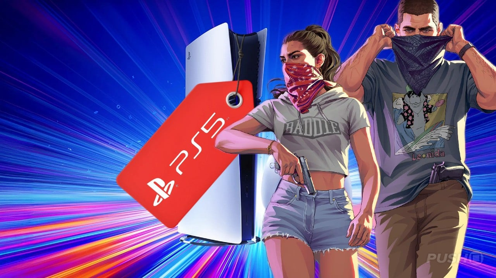
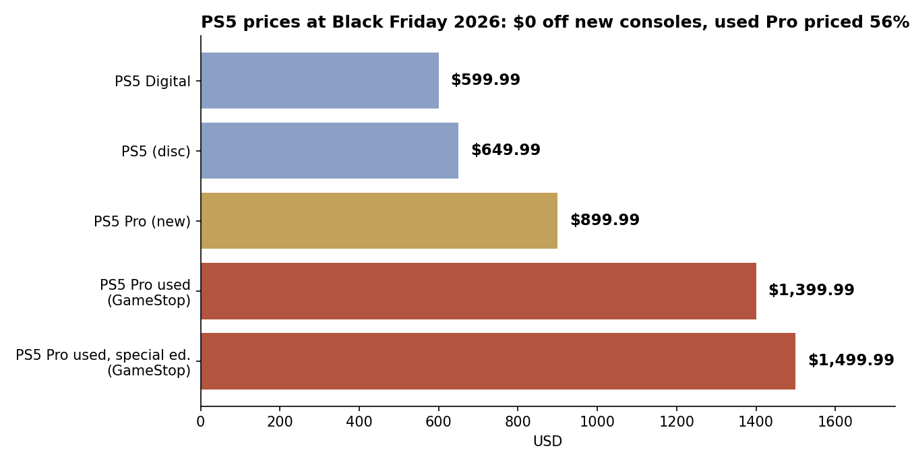

> [中文版 Chinese version](/life/ps5-sold-out-black-friday-no-discount-zh/)

*Image: Push Square, November 25, 2026.*

## The news, dated today

Push Square reported on the morning of **November 25, 2026** — two days before Black Friday — that Sony is struggling to meet demand for the PlayStation 5 following last week's release of *Grand Theft Auto VI*. Many major retailers in the United States, including Sony's own **PS Direct** store, are completely sold out of the system, with only isolated pockets of in-store stock remaining. The platform holder is running **no promotions on PS5 hardware this Black Friday** — in Push Square's reading, presumably because it cannot meet demand even at full price.

That last clause is the whole story. A Black Friday discount is a tool for moving inventory. Sony's problem in November 2026 is the opposite of inventory: it is allocation. You do not discount the product you cannot keep on the shelf, and you especially do not discount it during the one week of the year when your biggest game in a decade is pulling new buyers into stores.

*This is a follow-up to yesterday's post on Sony's GTA VI hardware numbers; the new development today is the sell-out itself and the confirmed absence of any console deal.*

## What changed since yesterday

Yesterday this site covered Sony's internal launch figures: more than **39 million** unique PS5 players launched GTA VI between November 19 and 22, Sony recorded its largest number of newly connected PS5 consoles on a single day since the console's 2020 launch outside the year-end holidays (on November 19), and GTA VI was the first game played on roughly **70%** of those newly connected consoles. Circana analyst Mat Piscatella, writing on Bluesky, added the demand curve underneath: PS5 hardware purchases in America rose **2.4× year over year** through the week ending November 14 — before the game was even out.

Today's news is what that curve does to a finite supply chain. A 2.4× demand spike does not produce 2.4× shipments; console supply is set months in advance by component orders, assembly capacity and freight. It produces empty shelves. The sequence matters for anyone trying to buy one this week: the demand shock was measurable before launch, the launch day set an activation record, and six days later the direct store is out. None of this required a leak to predict — it is arithmetic meeting a fixed production plan.

## The price ladder, as of November 25

Every figure below is a price snapshot checked on **November 25, 2026**, and is subject to change.

- **PS5 (disc): $649.99** in the US — Sony's recommended price since its increase on April 2, 2026.
- **PS5 Digital Edition: $599.99.**
- **PS5 Pro: $899.99** — up $150 from its $749.99 price before April, and $200 above its 2024 launch price.
- **Sony's Black Friday console discount: $0.** The official sale, live since November 16 and running to November 30, covers games (up to 75% off in the PlayStation Store), accessories ($20 off a DualSense, $30 off the DualSense Edge, $40 off the Pulse Elite headset, $100 off PS VR2) and PlayStation Plus memberships (up to 33% off Premium) — but no console, at any tier.
- **Last year, for contrast: $100 off every PS5 model**, starting November 19, 2025.
- **The one official way to pay less:** a refurbished PS5 direct from PlayStation — **$499** for the Slim Digital Edition and **$549** for the disc edition, each $100 under the current new price, per IGN's Black Friday coverage.
- **The shortage price:** GameStop lists pre-owned PS5 Pro consoles at **$1,399.99** — 56% above the price of a new one — with special-edition variants at **$1,499.99**. Video Games Chronicle reported in October that an internal GameStop memo described the used-above-new pricing as "intentional," and the listings have held since.

*Author's chart. Prices: Sony recommended prices in force since April 2, 2026; GameStop pre-owned listings reported by VGC, Tom's Guide and Engadget. Snapshot as of November 25, 2026, subject to change.*

Read the ladder from bottom to top and it describes a market in three layers. At the bottom, Sony sells you last year's hardware, refurbished, for the discount it refuses to give you on a new box. In the middle, the new consoles sit at prices $100–$150 higher than they were eight months ago, with no seasonal relief. At the top, the secondary market — institutionalised, in GameStop's case, with a memo — prices the Pro as what it currently is: a scarce good whose value is set by the most impatient buyer, not by Sony's price list.

## Why Sony cannot simply make more

Two constraints bind, and both were visible long before GTA VI shipped.

The first is **memory cost**. Sony raised every PS5 price on April 2, 2026, citing continued pressures in the global economic landscape; reporting across the industry attributes the squeeze substantially to DRAM and flash prices, which have been bid up by data-centre demand. Engadget's October coverage cited an August 2026 JPMorgan estimate that DRAM prices would end the year up roughly **400%** from when the PS5 Pro launched in 2024. A console is, in bill-of-materials terms, substantially a memory product with a game attached. When your largest cost line quadruples, your choices are to raise prices, accept thinner margins, or build fewer units — and Sony's 2026 behaviour shows it choosing the first and, on the Pro, arguably the third: September reporting relayed by Engadget described internal Sony memos expecting the PS5 Pro shortage to persist as production rates slowed.

The second constraint is that **the demand was never going to be smooth**. Sony's own quarterly numbers, reported alongside the launch data, show PS5 hardware shipments fell **35% year over year to 2.6 million units** in the July–September quarter. A platform holder planning production against a declining baseline does not order a holiday-sized surge for a single game's launch week; it orders for the trend and lets the spike clear the channel. The spike cleared it in six days.

There is a respectable argument that this is fine — even optimal — for Sony. Every console sold at $649.99 instead of a discounted $549.99 is margin recovered against the memory bill, and a sold-out console in November generates the one thing advertising cannot buy: visible scarcity during the gift season. The counter-argument is about the tail. GTA VI is a decade-long platform, and every week a would-be PS5 owner cannot find a console is a week in which that buyer reconsiders — a PC, a Switch 2 (the only console with an actual Black Friday bundle this year, $50 off), or simply waiting for the second wave of GTA VI content on hardware they already own. Sony is monetising urgency. Urgency decays.

## The argument happening online

The comment sections under today's sell-out news split into two camps, and both have a real point.

Camp one: *this is 2020 again.* A console generation in its sixth year should not be sold out at a price higher than its launch price. Consoles are supposed to get cheaper and more plentiful over their lives; the PS5 has done the reverse on both axes, and "spiralling memory costs" reads, to this camp, as a permanent excuse that happens to raise revenue.

Camp two: *the product is the game.* GTA VI is the largest entertainment launch in history by Sony's own accounting, 70% of new consoles booted it first, and a machine that plays it is worth what the market says it is worth this week. Nobody is owed a discount on the most demanded object in entertainment during its launch window.

The honest synthesis is that both camps are describing the same fact from different ends: the console business's old contract — hardware gets cheaper over time, software makes the money — has been suspended by component economics. Sony is not discounting because it cannot replace the units a discount would sell. That is not greed or generosity; it is a supply curve. But a suspended contract is still a broken expectation, and buyers are entitled to notice that the machine costs more in year six than it did at launch.

## What to do if you are buying

- **If you need one for a gift:** buy the first unit you find at MSRP from a first-party retailer. The refurbished direct route ($499/$549) is the only sanctioned discount and it carries Sony's own warranty path; treat any "deal" below that from an unfamiliar seller as a scam until proven otherwise.
- **If you are buying for yourself:** the rational move is patience. Restocks will follow the launch spike — Sony has every incentive to feed the holiday channel through December — and the refurbished store restocks independently of retail. What will not happen, on current evidence, is a price cut: there is no 2026 Black Friday console discount, and a company selling out at $649.99 does not cut in December.
- **Do not pay the GameStop used price.** $1,399.99 for a pre-owned Pro is a price for desperation, quoted by a retailer whose own memo says the markup is intentional. The new Pro at $899.99 restocks; the used premium buys you nothing but immediacy.
- **Watch the right signal:** PS Direct stock status, not social-media restock rumours. Sony's own store sold out first and will signal the channel refilling first.

## The verdict

The PS5's Black Friday story in 2026 is an absence: no deal, no stock, no apology — and a price list that went up in April and stayed there. GTA VI gave Sony the strongest demand week in the console's life, and the supply chain gave back empty shelves and a used market pricing its flagship above new. If you judge a platform holder by whether it can turn its biggest software moment into hardware momentum, this week is a split decision: the software numbers are historic, and the hardware operation is visibly not built for the moment its own marketing created. The consoles will come back in stock. The interesting question for 2027 is whether the prices ever come back down.

*Sources: Push Square, "GTA 6 Causes PS5 Consoles to Sell Out in US Before Black Friday," November 25, 2026; Sony internal GTA VI launch data reported November 24, 2026; Circana's Mat Piscatella via Bluesky (PS5 purchases 2.4× year over year, week ending November 14); IGN, "Will PS5 Consoles Be On Sale for Black Friday?" November 2026; PlayStation Black Friday 2026 official sale listing (November 16–30); Video Games Chronicle, Tom's Guide and Engadget on GameStop pre-owned PS5 Pro pricing ($1,399.99–$1,499.99, October 2026). All prices are snapshots as of November 25, 2026, subject to change.*
