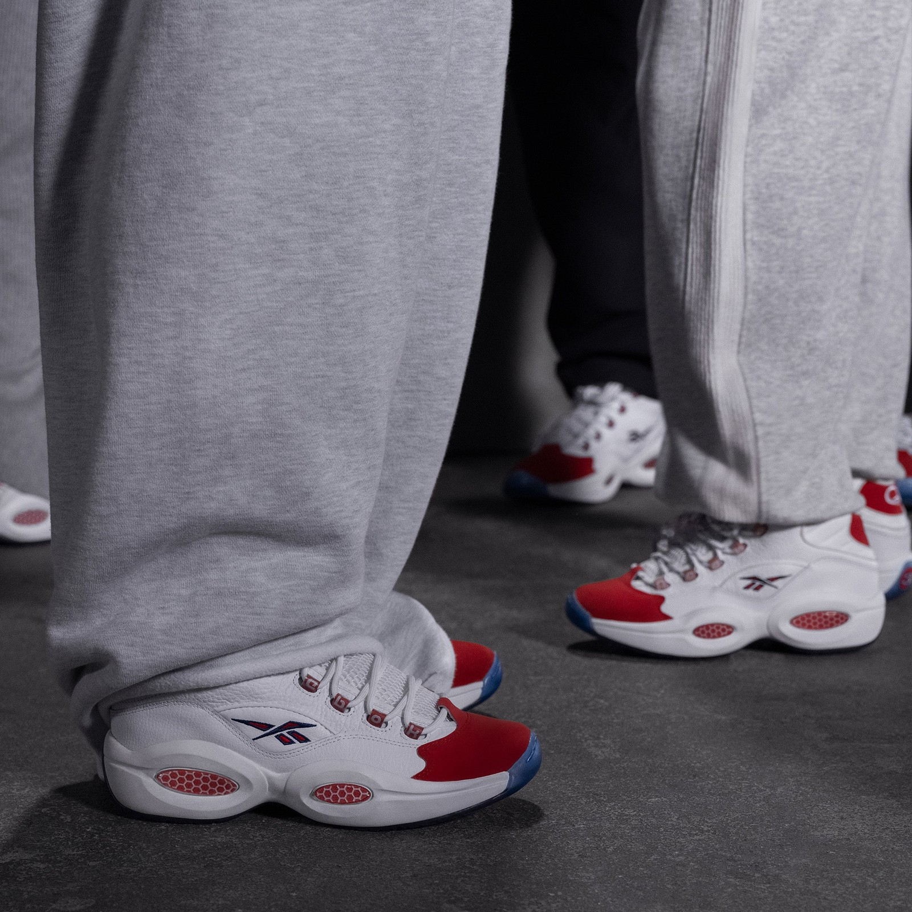
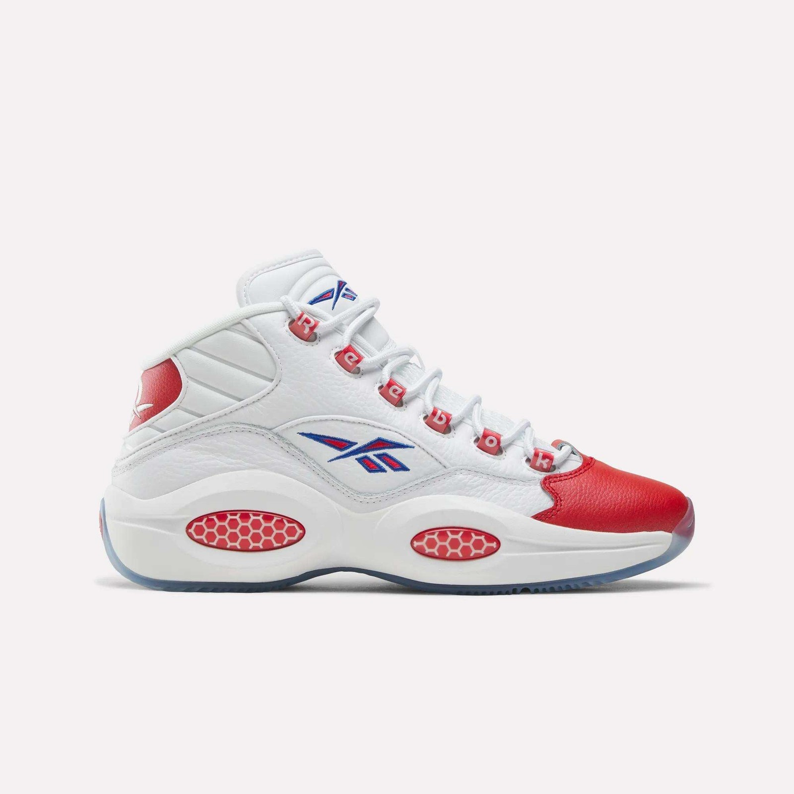
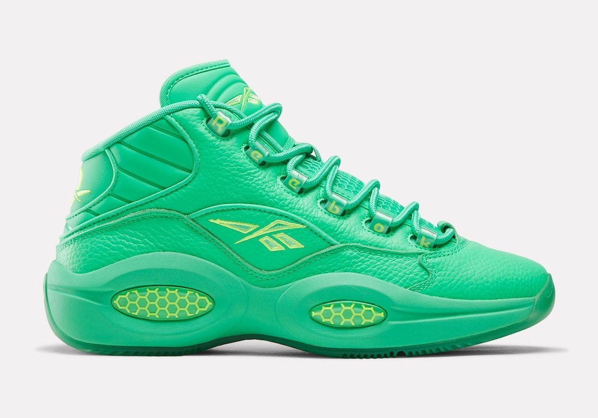
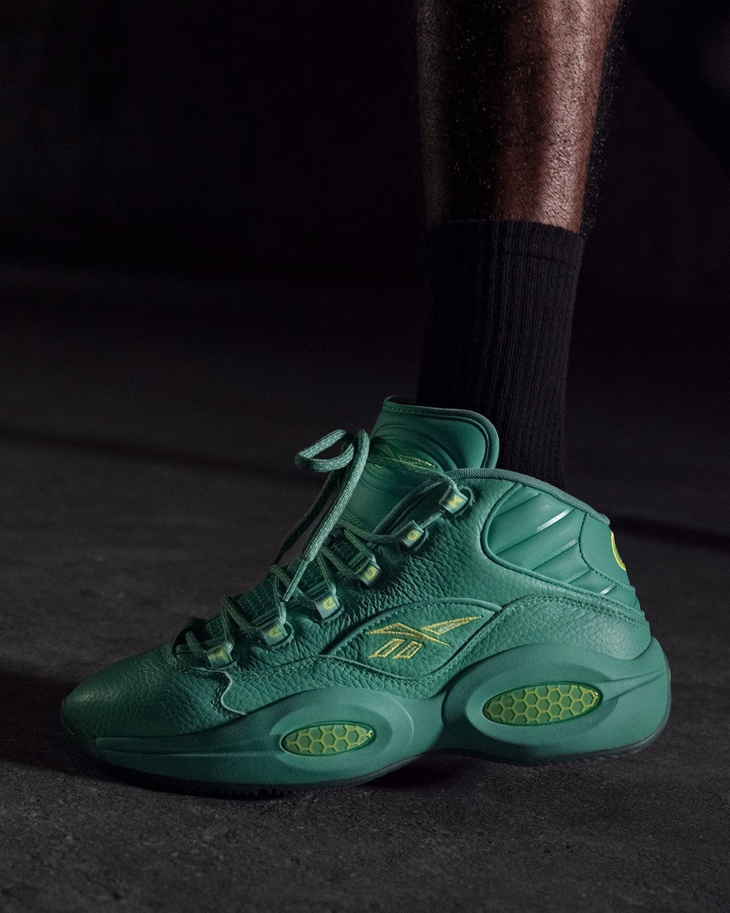
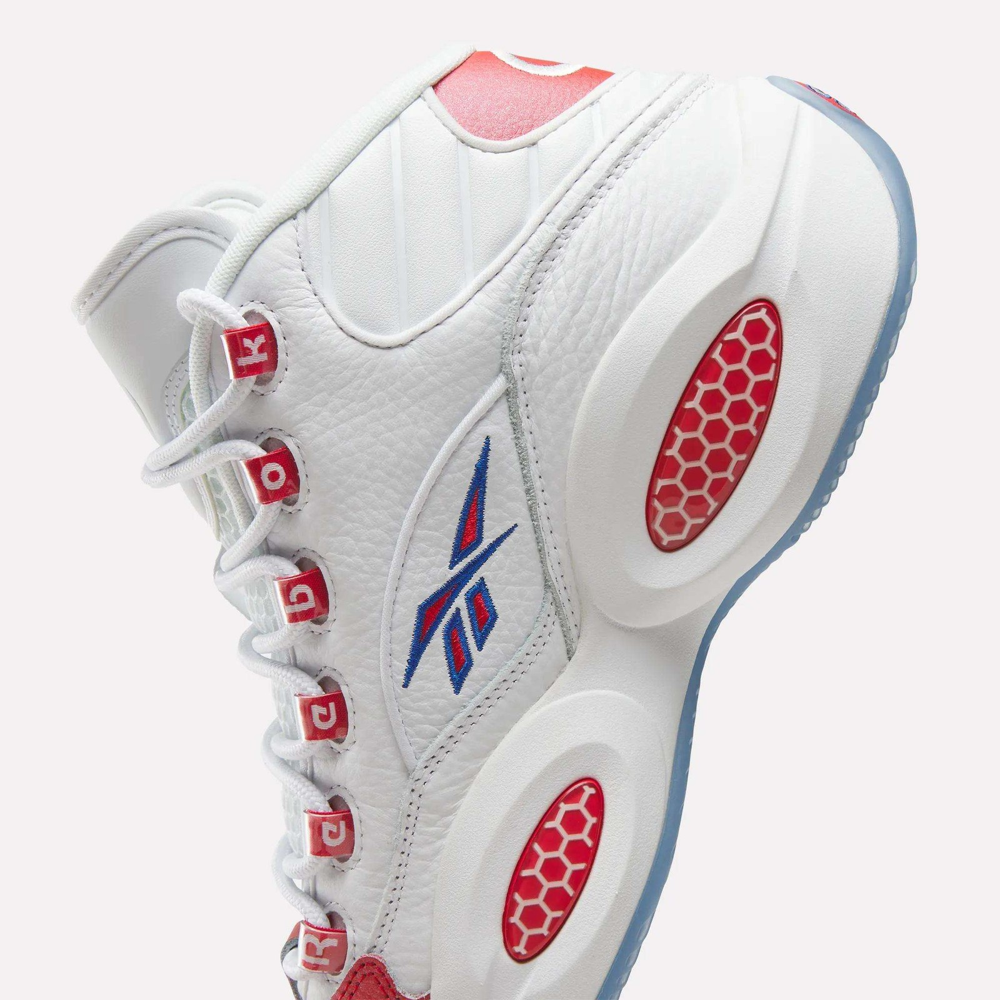
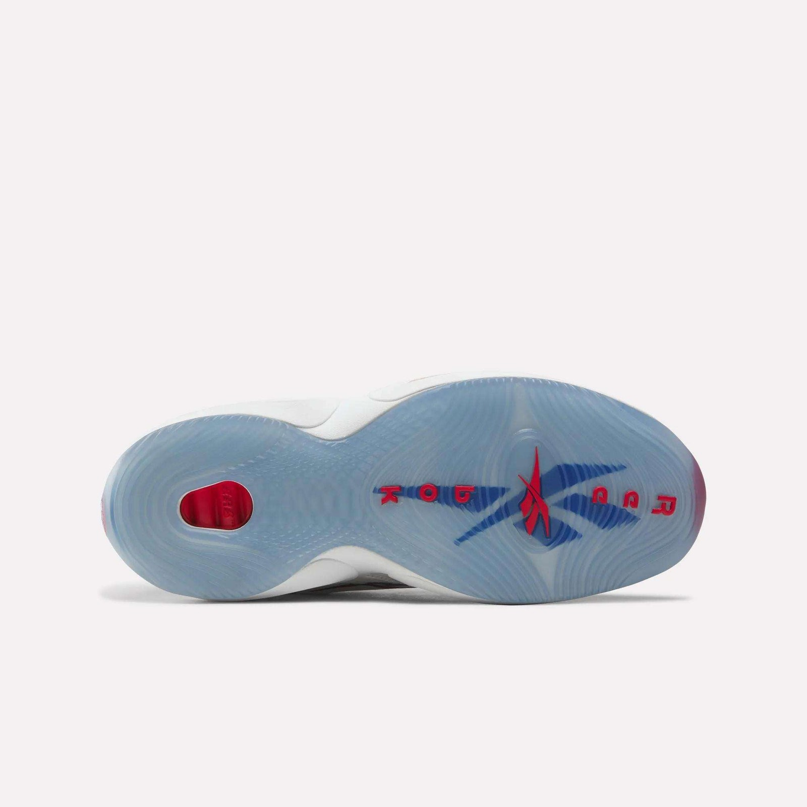

> [English version](/life/reebok-question-mid-recoded/)

一个 21 岁的乔治城新秀把问号变成签名鞋的三十年后，Reebok 再一次提出了 Question——而这一次，品牌对“为什么不一样”出奇地坦白。Question Mid Recoded 今天、2026 年 11 月 10 日星期二上午 10 点（美东时间）在 Reebok 官网与 Foot Locker 发售，售价 $170，两个配色：原版“Red Toe”与全新“30th Anniversary Green”。它看起来就是 1996 年那双鞋。但鞋身之下，几乎全都变了。

这个区别就是整篇文章的主题。Reebok 复刻 Question Mid 的次数已经多到数不过来——2016 年 20 周年、2020 年 25 周年回归、2023 年 Vintage 版、2024 年又来一轮——原样再版已经说不出任何新东西。Reebok 篮球全球产品总监 Kevin Duke 对 Andscape 把这句实话说了出来：“我们知道这不该是一次标准的再发售，那个故事我们已经讲过了。”一个品牌亲口承认自己的复刻项目已经无话可说，这比听起来要罕见得多。而 Recoded 就是 Reebok 拿出的替代方案：留住所有人一眼认得出的鞋身与配色，把鞋底下的东西全部重建，让它今天真的能上场打球。

先说一句实话：这不是一篇上脚评测。鞋今天早上才发售，还没有任何一家独立媒体对市售版做过有意义的长期实测。下面是一篇长篇初看：事实、Reebok 官方描述的技术（以及不同说法之间对不上的地方）、让这双鞋重要的历史，以及 $170 这个价格到底在买什么——能核实的说法和不能核实的说法会分开写。

*Question Mid Recoded “Red Toe” 上脚，Reebok 官方宣传照。鞋身是 1996 年原版——珠光红鞋头、系带孔拼出品牌名、蜂窝状中底窗口——底下是重建的工具。图片：Reebok，经 Because Sneakers。*

## 事实一览

| | |
|---|---|
| **型号** | Reebok Question Mid Recoded |
| **配色** | “Red Toe”（Footwear White / Vector Red / Vector Blue）· “30th Anniversary Green”（Optical Emerald / Optical Emerald / Lime） |
| **货号** | Red Toe 100263452 · Green 100263451 |
| **发售时间** | 2026 年 11 月 10 日星期二上午 10:00（美东时间） |
| **售价** | 每个配色 $170（2026 年 11 月 10 日查询的价格快照，以 Reebok 官网及多家零售商为准，价格可能变动） |
| **发售渠道** | 美国：Reebok 官网与 Foot Locker（独家零售合作方）；11 月 16 日起全球发售 |
| **发售活动** | Reebok 与 Foot Locker 将在发售当天于费城举办沉浸式快闪活动——那是艾弗森成为艾弗森的城市 |
| **定位** | 1996 年 Question Mid 的 30 周年重建版——同一鞋身、同一原版配色，全新的缓震、抓地、鞋楦与稳定性 |

## “Recoded”到底改了什么

先说没变的部分，因为这正是这次企划的要点。高级粒面皮革鞋面回来了，珠光红鞋头依然是第一眼看到的东西，系带孔依然沿着鞋带排拼出 R-E-E-B-O-K，中足的 Vector 标志依然是刺绣，中底上那两个椭圆形的蜂窝窗口也还在。从一个房间的另一头看过去，这就是艾弗森新秀年穿的那双鞋。这种辨识度本身就是产品；其余的都是工程。

变的是脚底下和鞋楦里面。Reebok 篮球设计师 Anthony Hale 主导了这个项目，品牌给出的任务是：留住 1996 年的外观，改变这双鞋的实际功能。改动清单如下：

- **全新缓震。**Reebok 描述为中底内置的 Super Critical Foam Pod（超临界发泡泡棉）——轻量化的超临界泡棉——后跟配 SuperFloat 缓震舱与 Energy Return System（ERS），取代了原版蜂窝 Hexalite 的缓震角色。原版 Question 用的 Hexalite 蜂窝结构单元，在 1996 年确实算反应灵敏；以今天的标准看，它又硬又重，Reebok 也不假装不是这样。
- **中底稳定片。**中底加入稳定片，提供抗扭转支撑与场上控制力——这是原版从来没有的部件，也是这双鞋真的打算被穿去打球的最明确信号。
- **重新开发的抓地纹路。**外底保留了原版抓地纹路的图纸、重新打磨纹路本身，以适应现代比赛，最后以原版标志性的半透明蓝色收尾。
- **重塑的鞋面。**高级皮革鞋面重新裁剪，穿着更宽容，前掌空间更大——这是对真正穿鞋的人影响最大的改动，也是过去 Question 偏窄的老问题的一次回应。

技术故事里有一个真实的疑点，值得直说，因为这类细节在发售报道里常常被抹平。Reebok 自己的产品页面写的是“全新可见 Hexalite 中底窗口”搭配 SuperFloat 后跟缓震舱，而 Andscape 对同一项目的报道则把超临界泡棉描述为取代原版 Hexalite 的更轻替代品，并加上新的稳定片。照片里窗口明明白白还在，红色的蜂窝也在。窗口后面到底还是 Hexalite，还是现在框住的是泡棉——Reebok 的营销文案与设计师的说法似乎给出了不同的答案，品牌至今没有统一口径。诚实的读法是：蜂窝外观无论如何都保留了；下面的缓震是新的。在有人把鞋切开、或者 Reebok 出面澄清之前，这里的“Hexalite”应当被理解为一种设计语言，而不是材料声明。

工具的来源同样具体——这是故事的另一半。Recoded 借用的是 Engine A 的工具，那是 Reebok 去年与 Angel Reese 一起重启的实战篮球线。这让这双纪念鞋同时成为新项目的样板：Reebok 不只是在庆祝一双 30 年前的鞋，也是在证明自己重启的实战平台能扛得起它。

*“Red Toe”侧面：白色粒面皮革、珠光红鞋头、红色后跟、蓝色 Vector 标志，以及中底里的红色蜂窝窗口。图片：Reebok，经 Because Sneakers。*

## 为什么 1996 年至今仍然重要

要理解为什么重建这双特定的鞋是一件大事，得回到 Question 当年背负的东西。这双鞋诞生于 1996 年，是艾弗森的第一双签名鞋——比后来的 Answer 系列还要早——而且它一出生就带着一场争论。鞋名从来不是装饰。Kevin Duke 对 Andscape 说，它“字面意义上就是以人们对一个身材矮小的新秀的问号命名的”。艾弗森当时 21 岁，官方身高六英尺、体重 165 磅，是乔治城出来的状元秀，而联盟的传统看法是：一个这么小、打法这么野的后卫，撑不了多久。他用新秀赛季场均 23.5 分、7.5 次助攻回应，联盟得分榜第七，拿下最佳新秀。

决定性的画面出现在第二年三月。1997 年 3 月 12 日，新秀艾弗森在费城弧顶对上迈克尔·乔丹，一个向左的犹豫步、把球猛地拉回，然后在乔丹伸手扑空的同时跳投命中。他穿的就是 Question。一场比赛造就不了一个职业生涯，但那一个回合让每个觉得自己是弱者的小孩都得到了验证，也把这双鞋和艾弗森的身份焊在了一起，再也没有任何营销能买到这种效果。Question 从此与地垄辫、纹身、护臂和 crossover 变向分不开了，也与一种挑战联盟对球星样子的期待的打法与公众形象分不开了。

商业层面紧随文化而来。Reebok 在 2001 年与艾弗森签下终身合同，据报道其中包括一笔信托基金，将在他 2030 年满 55 岁时解锁。如今他是 Reebok 篮球副总裁，与担任部门总裁的沙奎尔·奥尼尔一起，领导品牌篮球业务的重建。Recoded 换句话说，是这个新班子做的第一个纪念项目——老班子的鞋，由新班子的项目重建。

这也是为什么这双鞋在艾弗森退役很久之后，依然是潮流圈的主力。珠光鞋头、系带孔拼字、蜂窝窗口和粗壮的中帮比例，让它在一个全是重磅篮球鞋的年代里拥有足够的视觉辨识度，然后又活过了那个年代。时至今日，走在任何一座大城市里，你还是能一眼认出那个红色鞋头。任何重建的风险都是破坏人们认得的东西；Recoded 的赌注是：把底下的东西全换掉，同时让从房间另一头看过去的一切保持原样。

## 两个配色

**“Red Toe”（100263452）**是大多数人想到 Question 时脑子里浮现的那一双，它领衔发售也正是这个原因。白色粒面皮革、珠光红鞋头、红色后跟、蓝色 Vector 标志、拼出 Reebok 字样的红色系带孔、半透明蓝色外底。这是艾弗森新秀年穿的配色，是晃过乔丹那场比赛的配色，是此后每一次复刻都小心保护的配色。Team RBK.B 的运动员 Tounde Yessoufou 已经穿着 Recoded 版 Red Toe 打过比赛——这是这双鞋目前最接近实战验证的东西，也是 Reebok 刻意发出的信号：这双鞋要出现在球场上，而不只是货架上。

**“30th Anniversary Green”（100263451）**是新来的那双，也是设计上更有意思的决定。整双鞋包在光学翡翠绿里，Vector 标志的描边、后跟的 Question 标志和蜂窝气垫上点缀着莱姆黄。绿色是 30 周年的传统颜色，Reebok 也明确表示它代表更新与新的开始——是这套装里面向未来的那一半，与面向过去的 Red Toe 并列。这是一双很张扬的鞋，而且理应如此：如果 Red Toe 是档案，Green 就是一份声明，宣告这次周年纪念讲的是接下来会发生什么，而不只是 1996 年发生过什么。

*“30th Anniversary Green”：整鞋光学翡翠绿，Vector 标志、后跟品牌字与蜂窝窗口上点缀莱姆黄。绿色是 30 周年的传统颜色，Reebok 将其定义为更新。图片：Reebok，经 Sneaker Bar Detroit。*

*Green 配色上脚，Reebok 官方宣传照。全绿的呈现让鞋身读起来与 Red Toe 完全不同——更厚重、更大胆，更像一件宣言单品，而不是档案单品。图片：Reebok，经 Sneaker Bar Detroit。*

## Protro 的打法——以及谁在等它

Reebok 做的事，模板是 Nike 的，Reebok 也没有藏着掖着。Kobe Protro 系列证明了一件事：一双退役的实战鞋，只要把工具重建而不是原样再发，就能重新回到球场上——外观不变，脚感现代——Nike 把这套打法变成了篮球鞋里最可靠的套路之一。本月同在货架上的直接对照就是 Kobe 8 Protro，Nike 定价 $200。Reebok 在一双比 Kobe 8 还要老四岁的鞋上，跑的是同一套打法。

区别在于谁在等它。Nike 做 Kobe 系列时，受众已经在那儿了：十年被压抑的需求、现成的实战社群、一个从未冷却的复刻市场。Reebok 是在现组受众。它的实战篮球项目去年才重启，Recoded 落地的时候，这个项目还在证明自己——这就是为什么借用 Engine A 的工具很重要，为什么 Yessoufou 的实战首秀很重要。这双鞋要同时干两份活：让想买 Red Toe 的怀旧买家得到记忆中一模一样的鞋，同时让一个二十年没想过 Reebok 篮球的实战买家相信，这双值得系上鞋带。

这份双重任务也解释了定价。$170 的 Recoded，高于它借用工具的实战鞋——Engine A Pump 在 Reebok 官网标价 $160，Avatar Engine A 26 是 $140——低于 $200 的 Kobe 8 Protro。它的定位是一个混合体：在自己借用的产品线之上收一份情怀溢价，在它要回应的对手之下保持价格优势。对一双过去几年只靠怀旧竞争的鞋来说，为工具收费是更有意思的赌注。赌注对不对，取决于泡棉、稳定片和抓地力是不是真的能打——而除了 Reebok 自己，目前没人知道答案。

值得一提的还有这次 30 周年的另一项实验，因为它说明 Reebok 对待这一年的认真程度。今年 8 月，品牌把 Question 交给 Zellerfeld 做了 3D 打印版：Question 96/26，全 3D 打印的再诠释，Lilac 与 Stone 两个配色，8 月 25 日发售，$169。那是从未来 approaching 这次周年纪念。Recoded 是从过去 approaching 同一次纪念——同一双鞋，重建而非重新想象。两个相反的方向，三个月之内，同一个生日。这比 Question 以往任何一次周年企划都要更有野心，也说明 Reebok 把 30 周年当作一个平台，而不只是一次发售。

## 谁该买——以及该盯着什么

**如果你**多年来一直想要一双 Question，却始终不喜欢为 1996 年的缓震付复刻价，那就买 Red Toe。这是第一版诚实地把自己做成能狠狠穿的 Question，而且配色是最具决定性的那一个。它也是两双里更稳妥的选择：最容易辨认、最不容易过时、五年后看起来依然正确。

**如果你**想要的是周年纪念款而不是档案款——而且喜欢张扬的鞋——那就买 Green。全翡翠绿的呈现是一份声明，上脚最好看、最引人注目。同时它也是长期来看风险更高的选择：宣言式配色比它身边的原版老得更快。

**如果你**真的打算穿它去打球，那就等一等。目前还没有任何独立实测，场上最重要的两件事——新泡棉与稳定片到底行不行、重塑后的鞋楦尺码准不准——都还没有答案。Reebok 说鞋面在前掌更宽敞了，这对宽脚是好消息，对过去穿 Question 习惯买小半码的人则是个提醒。如果可以，先去 Foot Locker 试穿再决定，并且把第一批实测报告——而不是发售报道——当作真正的评测。

还有两个实际提醒。第一，这双鞋在美国的零售渠道是 Foot Locker 独家，加上 Reebok 官网，所以没有多家零售商抽签的混乱，排队只在两个地方。第二，全球发售从 11 月 16 日开始，美国以外的人一周后还有一次机会。两双鞋都没有被定位为限量——这是一次发售，不是一次突袭——但 Red Toe 的热门尺码在发售日当天还是会走得很快，因为三十年的需求不会在一个早上消失。

*让 Question 在一个房间里一眼可辨的细节：拼出 R-E-E-B-O-K 的系带孔、刺绣 Vector 标志、红色的蜂窝中底窗口。图片：Reebok，经 Because Sneakers。*

*重新开发的外底：半透明蓝色，Vector 标志与 Reebok 字样，以及可见的红色后跟缓震舱。抓地纹路沿用原版图纸，为现代比赛重新打磨。图片：Reebok，经 Because Sneakers。*

## 结论

Question Mid Recoded 是 Reebok 篮球重启以来最有意思的动作——不是因为它就是今年最好的鞋，而是因为它把一个策略明明白白地说了出来：复刻的故事讲完了，所以品牌把鞋重建了，而不是再版。这比再出一个配色要难，也比再贴一个周年徽章要诚实。

它成不成，要在两个地方见分晓。球场上，看泡棉、稳定片和抓地力到底是真正的实战升级，还是套在旧鞋身上的新词。市场上，看 $170 这个价格——高于 Reebok 自家的实战线、低于 Nike 的 Protro 旗舰——能不能找到为功能而不是为回忆买单的人。

目前来看，Red Toe 是稳妥的推荐，Green 是好玩的选择，而这双鞋本身提出的问题值得再问一次：一双 30 年的标志，不再只是回忆、重新变成装备的时候，会发生什么？Reebok 的答案今天发售。实测报告会告诉我们，这个答案对不对。

---

*来源：Reebok 官方产品图与发售信息，经 Because Sneakers 与 Sneaker Bar Detroit；Andscape 关于 Recoded 项目的报道（Kevin Duke 访谈），经 Because Sneakers 转引；Sole Retriever 发售指南；Sports Illustrated 的 30 周年报道；Men’s Journal 关于 Question 96/26 的报道。价格为 2026 年 11 月 10 日查询的快照，可能变动。本文为初看，不是上脚评测——撰写时尚未有针对市售版的独立实测发表。*
