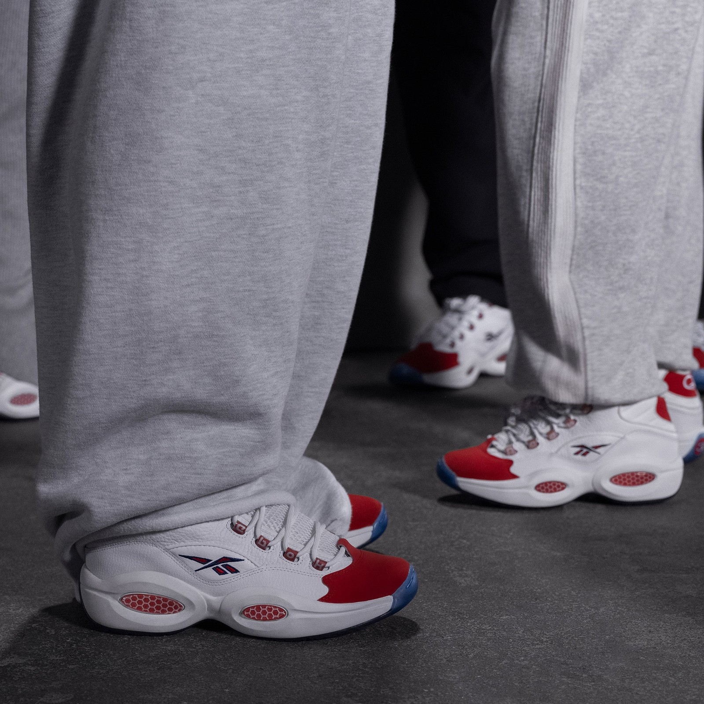
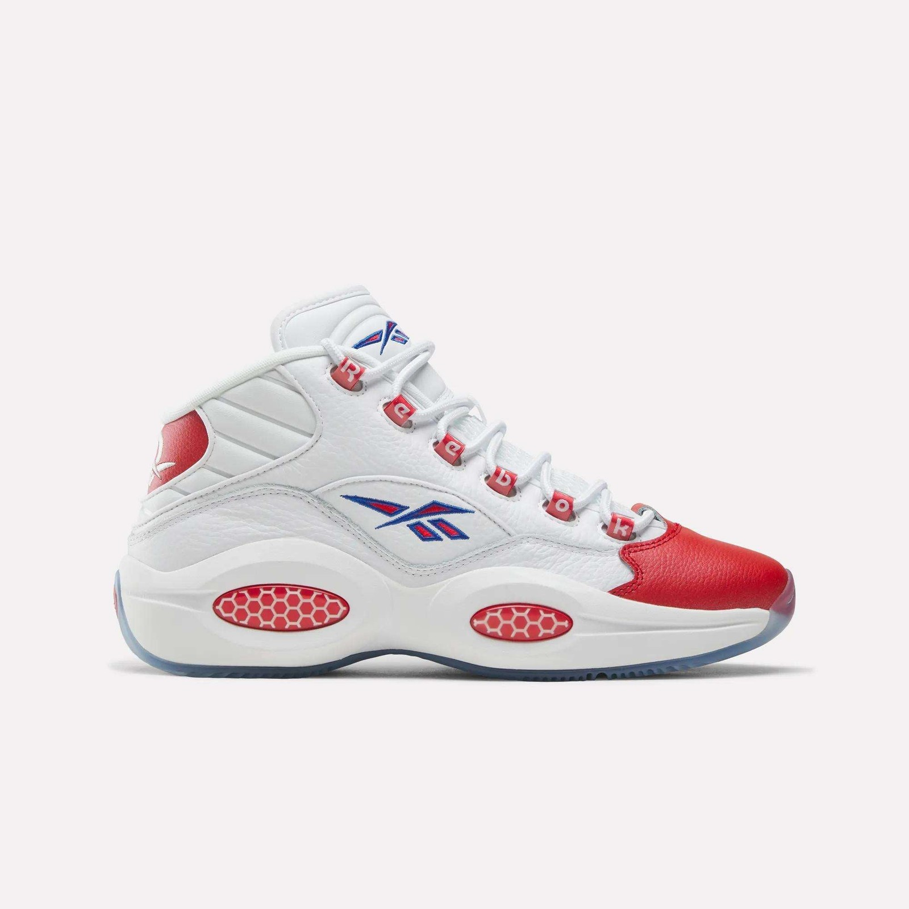
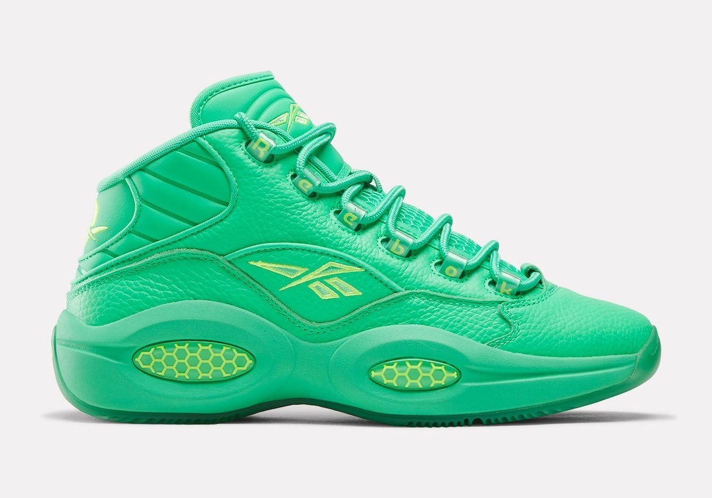
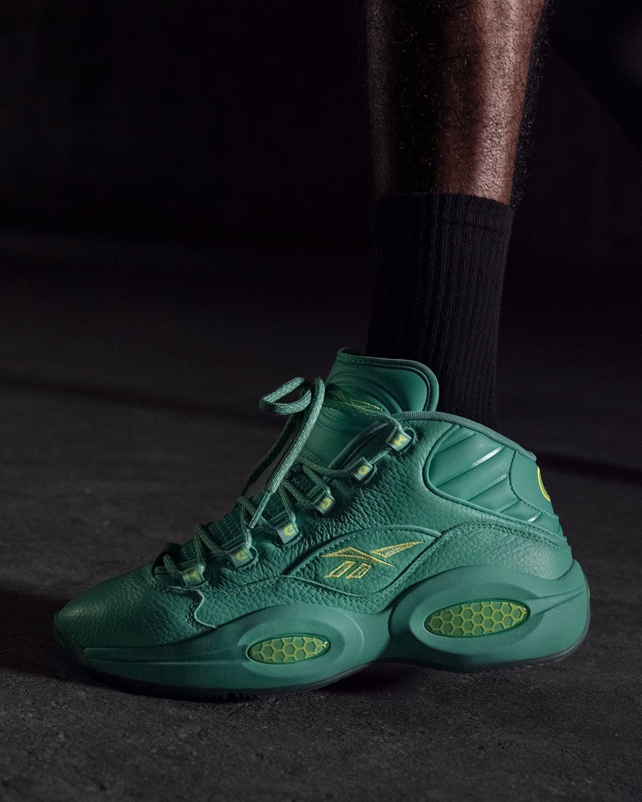
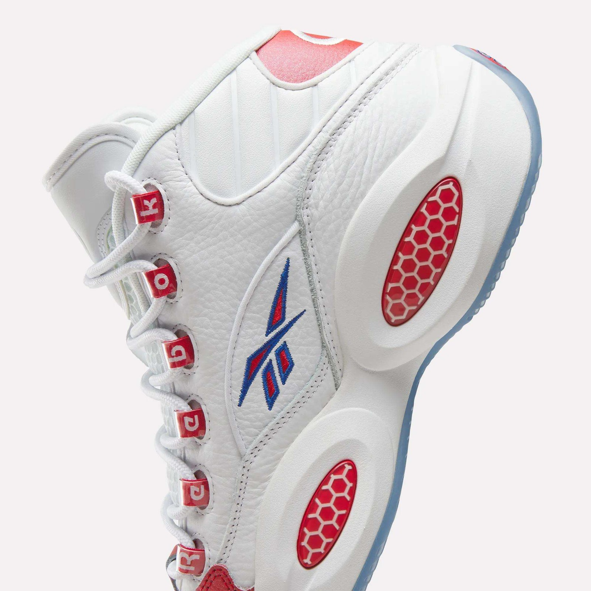
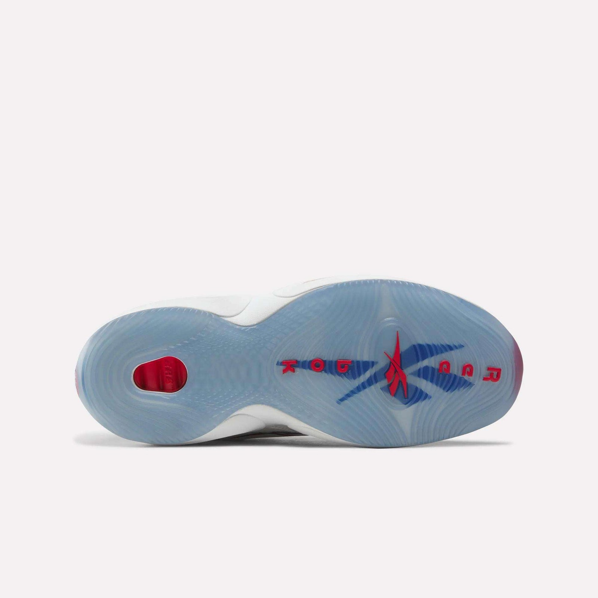

> [中文版 Chinese version](/life/reebok-question-mid-recoded-zh/)

Thirty years after a 21-year-old rookie from Georgetown turned a question mark into a signature shoe, Reebok is asking the Question again — and the brand is unusually honest about why this one is different. The Question Mid Recoded launches today, Tuesday, November 10, 2026, at 10 a.m. ET on Reebok.com and at Foot Locker for $170, in two colorways: the original “Red Toe” and a new “30th Anniversary Green.” It looks like the 1996 shoe. Underneath, almost everything has changed.

That distinction is the whole story. Reebok has retroed the Question Mid so many times — the 20th anniversary in 2016, a 25th-anniversary return in 2020, a Vintage version in 2023, another run in 2024 — that a straight reissue no longer says anything new. Kevin Duke, Reebok Basketball’s global product director, told Andscape the quiet part out loud: “We knew this shouldn’t be a standard re-release. We’d told that story before.” A brand admitting its own retro program has run out of things to say is rarer than it sounds. The Recoded is what Reebok is doing instead: keeping the silhouette and the colorway everybody recognizes, and rebuilding the shoe underneath them so it can be played in today.

One honest note up front: this is not a wear-test review. The shoes go on sale this morning, and no independent publication has put meaningful miles on a retail pair yet. What follows is a long first look — the facts, the technology as Reebok describes it (and where the descriptions disagree), the history that makes this shoe matter, and what the $170 price is actually buying — with the claims that can be checked separated from the ones that cannot.

*The Question Mid Recoded “Red Toe,” worn in Reebok’s campaign imagery. The silhouette is the 1996 original — pearlized red toe, ghillie lacing, honeycomb midsole windows — over rebuilt tooling. Image: Reebok, via Because Sneakers.*

## The facts

| | |
|---|---|
| **Model** | Reebok Question Mid Recoded |
| **Colorways** | “Red Toe” (Footwear White / Vector Red / Vector Blue) · “30th Anniversary Green” (Optical Emerald / Optical Emerald / Lime) |
| **Style codes** | Red Toe 100263452 · Green 100263451 |
| **Release date** | Tuesday, November 10, 2026, 10:00 a.m. ET |
| **Retail price** | $170 each (price snapshot as of November 10, 2026, per Reebok and multiple retailers; subject to change) |
| **Where** | Reebok.com and Foot Locker (exclusive retail partner) in the US; global rollout from November 16, 2026 |
| **Launch event** | Reebok and Foot Locker are hosting an immersive Philadelphia pop-up on launch day, in the city where Iverson became Iverson |
| **What it is** | A rebuild of the 1996 Question Mid for the shoe’s 30th anniversary — same silhouette and original colorway, new cushioning, traction, fit and stability |

## What “Recoded” actually means

Start with what did not change, because that is the point of the exercise. The premium tumbled leather upper returns, the pearlized red toe cap is still the first thing you see, the ghillie lacing still spells out R-E-E-B-O-K down the eyestay, the Vector logo is still embroidered on the midfoot, and the oval honeycomb windows are still cut into the midsole. From across a room, this is the shoe Allen Iverson wore as a rookie. That recognition is the product; everything else is engineering.

What changed is underfoot and inside the fit. Reebok Basketball designer Anthony Hale led the project, and the brief, as the brand describes it, was to hold the 1996 aesthetic while changing what the shoe does. The list of changes:

- **New cushioning.** Reebok describes a Super Critical Foam Pod in the midsole — a lightweight supercritical foam — with a SuperFloat heel pod and an Energy Return System (ERS) in the heel, replacing the original honeycomb Hexalite as the cushioning story. The original Question used Hexalite, a honeycomb-structured unit that was genuinely responsive for 1996; by modern standards it is firm and heavy, and Reebok is not pretending otherwise.
- **A stability plate.** A midsole plate is added for torsional support and control on court — the kind of component the original never had, and the clearest sign this shoe is meant to be played in rather than shelved.
- **Redeveloped traction.** The outsole keeps the original traction geometry as its drawing and reworks the pattern itself for the modern game, finished in the translucent blue that was part of the original’s look.
- **A reshaped upper.** The premium leather upper has been re-cut for a more forgiving fit, with added room through the toe box — the one change most likely to matter to anyone who found past Questions narrow.

There is one genuine wrinkle in the technology story, and it is worth stating plainly because it is the kind of thing that gets smoothed over in launch coverage. Reebok’s own product page describes “new visible Hexalite midsole windows” alongside a SuperFloat heel pod, while Andscape’s reporting on the same project describes supercritical foam pods as a lighter alternative to the original Hexalite cushioning, with a new stability plate added. The windows are plainly still there in the photography, red honeycomb and all. Whether Hexalite is still behind them, or whether the windows now frame foam, is a point Reebok’s marketing copy and its designer appear to answer differently, and the brand has not reconciled the two. The honest reading: the honeycomb look is preserved either way; the cushioning underneath it is new. Until somebody cuts a pair open or Reebok clarifies, treat “Hexalite” here as a design language, not a materials claim.

The tooling, meanwhile, comes from somewhere specific — and that is the second half of the story. The Recoded borrows from Engine A, the performance basketball line Reebok relaunched last year with Angel Reese. That makes the anniversary shoe a proof point for the new program as much as a tribute to the old one: Reebok is not just celebrating a 30-year-old shoe, it is demonstrating that its restarted performance platform can carry one.

*The “Red Toe” in profile: white tumbled leather, pearlized red toe cap, red heel panel, blue Vector logo, and the red honeycomb windows in the midsole. Image: Reebok, via Because Sneakers.*

## Why 1996 still matters

To understand why a rebuild of this particular shoe is an event, you have to go back to what the Question was attached to. The shoe arrived in 1996 as Allen Iverson’s first signature shoe, ahead of the Answer line that followed it — and it arrived attached to an argument. The name was never decoration. As Kevin Duke told Andscape, it is “literally named for the question marks around him being an undersized rookie.” Iverson was 21, listed at six feet and 165 pounds, the No. 1 overall pick out of Georgetown, and the league’s conventional wisdom said a guard that small, with that style, would not last. He answered by averaging 23.5 points and 7.5 assists as a rookie, finishing seventh in the league in scoring, and taking Rookie of the Year.

The defining image came the following March. On March 12, 1997, the rookie matched up against Michael Jordan at the top of the key in Philadelphia, gave a hard left-to-right hesitation, snapped the ball back, and drained the jumper as Jordan reached for air. He did it in the Questions. A single play does not make a career, but that one validated every kid who felt like an underdog, and it welded the shoe to Iverson’s identity in a way no marketing campaign could have bought. The Question became inseparable from the cornrows, the tattoos, the arm sleeve, the crossover — and from a style of play and a public identity that challenged what the league expected a star to look like.

The business side followed the culture. Reebok signed Iverson to a lifetime contract in 2001, reported to include a trust fund that unlocks when he turns 55 in 2030. He is now Vice President of Reebok Basketball, working alongside Shaquille O’Neal, who runs the division as president, to steer the brand’s basketball rebuild. The Recoded is, among other things, the first anniversary project of that regime — the old guard’s shoe, rebuilt by the new guard’s program.

That is also why the shoe survived as a lifestyle staple long after Iverson stopped playing. The pearlized toe, the ghillie lacing, the honeycomb windows and the chunky mid-cut proportions gave it enough visual identity to compete in an era full of consequential basketball footwear, and then to outlive the era entirely. You can still walk through any major city and spot that red toe cap. The risk of any rebuild is that it breaks the thing people recognize; the Recoded’s bet is that it can change everything underneath while changing nothing you see from across the room.

## The two colorways

**“Red Toe” (100263452)** is the one most people picture when they think of the Question, and it leads the launch for exactly that reason. White tumbled leather, a pearlized red toe cap, a red heel panel, a blue Vector logo, red lace eyelets spelling Reebok, and the translucent blue outsole. It is the colorway Iverson wore as a rookie, the one from the Jordan crossover, the one every retro since has protected. Team RBK.B athlete Tounde Yessoufou has already worn the Recoded Red Toe in a game — the closest thing to on-court validation the shoe has so far, and a deliberate signal that Reebok wants this pair seen on a floor, not just on a shelf.

**“30th Anniversary Green” (100263451)** is the newcomer, and the more interesting design decision. The whole shoe is covered in optical emerald, with lime accents on the Vector outline, the Question logo on the heel and the honeycomb pods. Green is the traditional color for a 30th anniversary, and Reebok is explicit that it represents renewal and new beginnings — the forward-looking half of the pack, standing next to the backward-looking half. It is a loud shoe, and it is supposed to be: if the Red Toe is the archive, the Green is the statement that the anniversary is about what comes next, not just what happened in 1996.

*The “30th Anniversary Green”: an all-over optical emerald upper with lime accents on the Vector logo, the heel branding and the honeycomb pods. Green is the traditional 30th-anniversary color, and Reebok frames it as renewal. Image: Reebok, via Sneaker Bar Detroit.*

*The Green pair on foot in Reebok’s campaign imagery. The all-green execution makes the silhouette read very differently from the Red Toe — chunkier, louder, more like a statement piece than an archive piece. Image: Reebok, via Sneaker Bar Detroit.*

## The Protro playbook — and who is waiting for it

The template for what Reebok is doing is Nike’s, and Reebok is not hiding it. The Kobe Protro line established that a retired performance shoe can be put back on the floor if the tooling is rebuilt rather than reissued — same look, modern ride — and Nike has turned that into one of the most reliable plays in basketball footwear. The Kobe 8 Protro, which Nike prices at $200 for its own November release, is the direct comparison sitting on the same shelf this month. Reebok is running the same play on a shoe four years older than the Kobe 8.

The difference is who is waiting for it. Nike had an audience in place for the Kobe line: a decade of pent-up demand, a built-in performance community, and a retro market that never cooled. Reebok is assembling one. Its performance basketball program was only restarted last year, and the Recoded lands while that program is still proving itself — which is why borrowing Engine A tooling matters, and why the Yessoufou on-court debut matters. The shoe has to do two jobs at once: satisfy the nostalgia buyer who wants the Red Toe exactly as remembered, and convince a performance buyer who has not thought about Reebok basketball in twenty years that this one is worth lacing up.

That dual job also explains the price. At $170, the Recoded sits above the performance shoes whose tooling it borrows — the Engine A Pump is listed at $160 and the Avatar Engine A 26 at $140 on Reebok’s own site — and below the Kobe 8 Protro at $200. It is positioned as a hybrid: a heritage markup over the line it is built from, undercutting the model it is answering. For a shoe whose retro versions have spent years competing on nostalgia alone, charging for tooling is the more interesting bet. Whether it is the right bet depends on whether the foam, the plate and the traction actually perform — and nobody outside Reebok knows that yet.

There is a second 30th-anniversary experiment worth mentioning, because it shows how seriously Reebok is taking this year. In August, the brand ran the Question through Zellerfeld and printed one: the Question 96/26, a fully 3D-printed reinterpretation in Lilac and Stone, released August 25 for $169. That was the anniversary approached from the future. The Recoded is the same anniversary approached from the past — same shoe, rebuilt rather than reimagined. Two opposite directions, three months apart, one birthday. It is a more ambitious anniversary program than the Question has ever had, and it suggests Reebok sees the 30th as a platform, not a single drop.

## Who should buy it — and what to watch

**Buy the Red Toe if** you have wanted a Question for years and never loved the idea of paying retro prices for 1996 cushioning. This is the first version of the shoe that is honest about being built to be worn hard, and the colorway is the definitive one. It is also the safer of the two pairs: the most recognizable, the most likely to hold its appeal, the one that will still look right in five years.

**Buy the Green if** you want the anniversary pair rather than the archive pair — and if you like loud shoes. The all-emerald execution is a statement, and it is the colorway that will photograph best and get noticed most. It is also the riskier buy in the long run: statement colorways age faster than the originals they sit next to.

**Wait if** you actually plan to play in them. No independent wear test exists yet, and the two things that matter most on court — whether the new foam and plate deliver, and whether the reshaped fit runs true — are unproven. Reebok says the upper is roomier through the toe box, which is good news for wide feet and a warning for anyone who sized down in past Questions. If you can, try them on at Foot Locker before committing, and treat the first wear-test reports — not the launch coverage — as the real review.

Two practical notes. First, this is a Foot Locker exclusive at retail in the US, alongside Reebok.com, so the usual multi-retailer raffle scramble does not apply; the line forms in two places. Second, the global rollout starts November 16, so anyone outside the US has a second window a week later. Neither pair is being positioned as limited — this is a launch, not a drop — but the Red Toe in popular sizes will still move fast on day one, because thirty years of demand does not disappear in a morning.

*The details that make a Question recognizable across a room: ghillie eyelets spelling R-E-E-B-O-K, the embroidered Vector logo, and the red honeycomb windows in the midsole. Image: Reebok, via Because Sneakers.*

*The redeveloped outsole: translucent blue with the Vector logo and Reebok wordmark, and a visible red heel pod. The traction geometry follows the original’s drawing, reworked for the modern game. Image: Reebok, via Because Sneakers.*

## Verdict

The Question Mid Recoded is the most interesting thing Reebok Basketball has done since it restarted, and not because it is the best shoe of the year. It is interesting because it is a strategy stated out loud: the retro story was used up, so the brand rebuilt the shoe instead of reissuing it. That is a harder thing to do than another colorway, and a more honest thing to sell than another anniversary badge.

Whether it works will be decided in two places. On the court, by whether the foam, the plate and the traction are real performance upgrades or just new words on an old silhouette. And in the market, by whether the $170 price — above Reebok’s own performance line, below Nike’s Protro flagship — finds buyers who want the shoe for what it does, not just for what it reminds them of.

For now, the Red Toe is the easy recommendation and the Green is the fun one, and the shoe itself is a question worth asking again: what happens when a 30-year-old icon stops being a memory and starts being equipment? Reebok’s answer drops today. The wear tests will tell us if it was the right one.

---

*Sources: Reebok official product imagery and release information, via Because Sneakers and Sneaker Bar Detroit; Andscape’s reporting on the Recoded project, as quoted by Because Sneakers (Kevin Duke interview); Sole Retriever’s release guide; Sports Illustrated’s coverage of the 30th anniversary; Men’s Journal on the Question 96/26. Prices are a snapshot as of November 10, 2026, and are subject to change. This is a first look, not a wear-test review — no independent wear testing of retail pairs had been published at the time of writing.*
