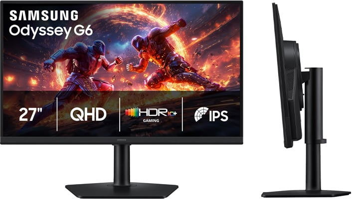
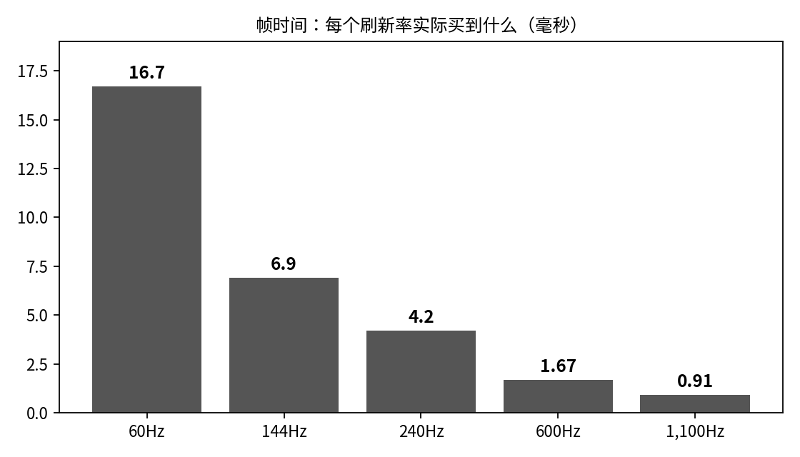
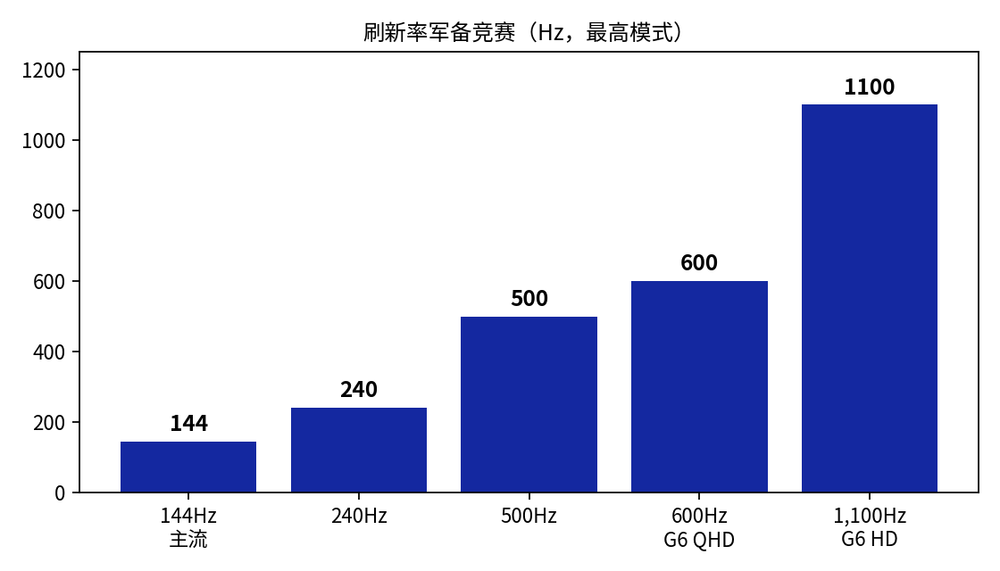

> [English version 英文版](/life/samsung-odyssey-g6-1100hz/)

*Odyssey G6（G60H）。图片：Samsung，经 HotHardware 2026 年 11 月 24 日发售报道。*

## Samsung 在 11 月 23 日发布了什么

Samsung Electronics America 于 2026 年 11 月 23 日宣布 Odyssey G6（G60H），将这台 27 英寸显示器描述为全球首款支持最高 **1,100Hz** 刷新率的游戏显示器。来自 Samsung 自家公告的完整确认规格，比标题更有意思：

- **面板：** 27 英寸级 Fast IPS，原生 **QHD（2,560 × 1,440）**。
- **Dual Mode（双模式）：** **QHD 下最高 600Hz**，或 **HD 下最高 1,100Hz**——模式切换本质上是分辨率切换。
- **响应时间：** **1ms 灰阶（GtG）**，Samsung 的小字注明该数字为内部测试条件下"Extreme"模式设置的截断平均值。
- **新功能：** **Odyssey Clear Motion**，一项减少运动模糊的算法，Samsung 表示将在此之后带到更多 Odyssey 机型。
- **HDR 与同步：** HDR10+ Gaming、Black Equalizer、NVIDIA G-SYNC Compatible 与 AMD FreeSync Premium——Samsung 自己的脚注同时注明 FreeSync Premium 不支持 1,100Hz，且 AMD Radeon RX 6 系列及以下不支持 1,000Hz 或更高刷新率。
- **接口：** 一个 DisplayPort 2.1、两个 HDMI 2.1、Auto Source Switch+；支持旋转、俯仰、竖屏与高度调节。
- **价格与时间：** 美国 **899.99 美元**，**12 月起**在全美零售渠道铺开——价格为 2026 年 11 月 24 日查询的 snapshot，subject to change。HotHardware 报道发售日 Amazon 挂牌 894.29 美元，提醒人们街价变得比新闻稿快。
- **平台限定（Samsung 自家脚注）：** macOS 不支持 Dual Mode，也不支持原生 600Hz 上限。这是一台 Windows PC 游戏显示器。

Samsung 还把这次发布框定为守擂：公告引用的 IDC 数据显示，Samsung 按金额计已连续七年（2019 至 2025）是全球第一游戏显示器品牌。G60H 正是一个按金额领先的市场领导者会出的货——一款光环产品，它的任务是让产品线里其余机型显得价格合理。

## 所谓的"坑"是算术，不是营销

每一个刷新率标题背后都藏着一道除法题，那就公开算。刷新率是每秒帧数；玩家真正体验到的量是**帧时间**——每一帧停留在屏幕上的时长，以及你作出反应时画面可能有多旧。

60Hz 时，一帧持续 **16.7 毫秒**。144Hz 时 **6.9ms**。240Hz 时 **4.2ms**。G6 在 QHD 下的上限 600Hz 时 **1.67ms**。1,100Hz 时 **0.91ms**。

*作者制图。帧时间 = 1,000 除以刷新率。作为参照，人类反应时间通常为 150–250ms；这些速度下的竞争对象是运动清晰度与输入新鲜度，不是原始反应。*

从左往右读这张图，整个产品品类的故事就出现了。从 60Hz 到 144Hz，减少约 10ms 的陈旧感——任何人都能感觉到的蜕变。从 240Hz 到 600Hz，减少约 2.5ms。从 600Hz 到 1,100Hz，减少 **0.76ms**。每一次翻倍买到的只有上一次的一半，而行业已经一路翻倍翻进了剩余奖赏以零点几毫秒计的地盘。Club386 的发售报道还对面板本身提出了一个相关点：真正的 1,100Hz 体验要求像素响应达到或低于 0.91ms 的帧时间，而 Samsung 的 1ms GtG 数字——平均值、截断值、内部条件——恰好坐在那条边界上，而不是舒服地在边界之内。这不是指控；这正是"第一"的实际含义。任何速度上的第一款产品，都是以最少余量够到那个数字的那一款。

然后是分辨率的交换，Samsung 诚实地写了，标题省略了。1,100Hz 模式是 **HD**——Club386 与 HotHardware 的报道将其识别为 720p 级别，是 G6 原生 QHD 像素数的四分之一，不过 Samsung 的公告没有印出确切的 HD 分辨率。在 27 英寸屏幕上，720p 肉眼可见地发虚：文字、远处目标与精细细节都要为速度付费。竞技射击玩家几十年来一直自愿用低分辨率换帧数，所以对那个特定受众，这个交换熟悉而理性。对其他所有人来说，他们每天真正会用的产品是 600Hz 的 QHD 模式——而需要说清的是，这本身也是一个极端规格，几乎没有当前的游戏与显卡组合能在高画质下以原生分辨率 sustained 跑满它。

## 谁能喂得动这台东西？

显示器不产生帧；它显示 PC 送来的东西。一台 1,100Hz 显示器被喂以 240fps 的游戏，就是一次带更好扫描输出的 240Hz 体验。诚实地喂满它需要三件事同时成立：游戏引擎愿意渲染到 1,000fps 以上（竞技作品在低设置、顶级硬件下可以；大多数游戏不行，许多还有远低于此的上限）、GPU 与 CPU 能在 720p 下产出这些帧而不让 CPU 成为瓶颈——这正是本站昨天在《GTA VI》30fps 锁语境下写过的那堵 CPU 受限的墙，只不过位于帧率宇宙的另一端——以及软件栈跟得上。最后一点上，HotHardware 指出微软今年早些时候已更新 Windows 11，支持报告 1,000Hz 以上刷新率的显示器，在任何这种显示器能买到之前就铺好了路。Samsung 的脚注再补上同步方面的限定：FreeSync Premium 的上限低于 1,100Hz，老款 Radeon 显卡完全不支持四位数刷新率。

这些都不让 G60H 成为骗局。它们让它成为一件专家器械，其标题模式针对的是一个狭窄、真实、被充分理解的用例——精英竞技游戏，在那里 720p 下的运动清晰度是理性交换，玩家们早已把链条里其他一切都优化到同样的零点几毫秒。而 Odyssey Clear Motion 可以说是这款产品里对更广泛人群更有用的公告：一项旨在提升高速场景感知清晰度的去模糊算法，Samsung 说它将推广到其他机型。功能会扩散；光环规格大多留在它们发布时所在的产品线顶端。

*作者制图。早期数字为历代游戏显示器最高模式的代表值；G6 的两个模式为 Samsung 2026 年 11 月 23 日确认的 Dual Mode 规格。*

## 购买问题，直接回答

899.99 美元的 G60H，价格相当于一张能打的游戏 PC 显卡，或一台 4K OLED 显示器，或——用本周另一条新闻作参照——大致是下一代主机定价讨论中传闻区间的入口。所以直接回答，分三部分：

**如果你打竞技**，玩的作品真能以极端帧率渲染，本来就自愿用低分辨率，并且有与之匹配的 PC，这就是第一台精确为你造的显示器，而 QHD 600Hz 给你一个在其他一切场景下不妥协的模式。你就是市场。你们人数不多，Samsung 知道。

**如果你玩的是其他一切**，这里诚实的产品是一台 27 英寸 QHD Fast IPS、最高 600Hz、接口齐全、带 HDR10+ Gaming——一个你将在其上限的一小部分上使用的强规格，而在同一个 900 美元价位，OLED 的对比度与响应特性也在竞争同一笔预算。等独立评测。截至 11 月 24 日，一篇都没有；Club386 的报道明确建议在消费前等待独立测试，对于一款关键数字全是内部测试平均值的同类首款面板，这是正确的姿态。

**如果你看的是行业**，G60H 真正的意义在方向。刷新率竞赛已经到达这样一个点：显示器不再是链条任何一环的瓶颈——不是游戏、不是 GPU、不是操作系统，也不是（在 0.76ms 的边际收益下）任何能推广到专家之外的人类感知。按金额连续七年第一的 Samsung 还是把这个数字出了货，因为在成熟品类里，盒子上的数字就是营销。预期 1,100Hz 会被回应，预期回应在实践中同样狭窄，并预期大多数玩家的真实进步继续出现在不光鲜的地方：面板响应一致性、Clear Motion 这类去模糊技术、以及去年极端规格的价格下坠。

G6 是一个真正的第一，一份把限定条件印在自己脚注里的诚实规格表，和一台几乎没人应该在今年 12 月买的产品。这三句都值得说，因为只说第一句的发售报道是广告，只说最后一句的报道会错过这台机器存在的原因。它存在是为了守一条线——第一名，连守七年——守在这样一个确切的时刻：这条线已经不再关乎玩家能感知什么，而关乎一份规格表能宣称什么。Samsung 宣称了 1,100。这个宣称是真的。脚注，才是产品。

*来源：Samsung Electronics America 公告，2026 年 11 月 23 日（规格、Dual Mode、Odyssey Clear Motion、899.99 美元美国价格、12 月零售铺开、macOS 与 FreeSync 脚注、IDC 游戏显示器排名）；HotHardware 发售报道，2026 年 11 月 24 日（Amazon 894.29 美元当日 snapshot 挂牌、Windows 11 对 1,000Hz 以上刷新率的支持）；Club386 发售报道，2026 年 11 月 24 日（720p 级别 HD 模式、1,040Hz CES 原型机历史、响应时间分析、建议等待独立测试）。价格为 2026 年 11 月 24 日 snapshot，subject to change。截至发稿，尚无 G60H 的独立评测。*
