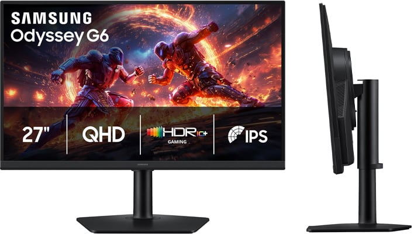
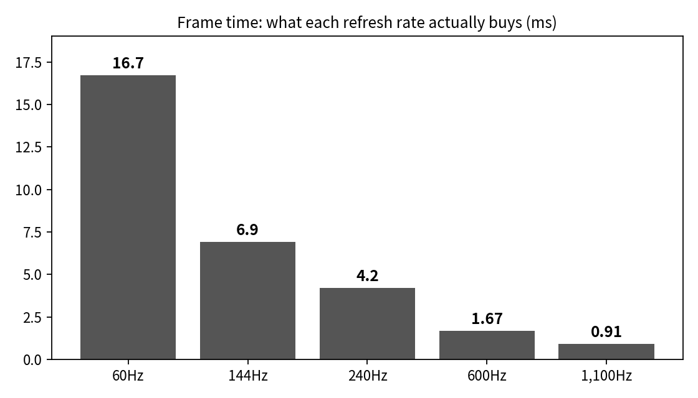
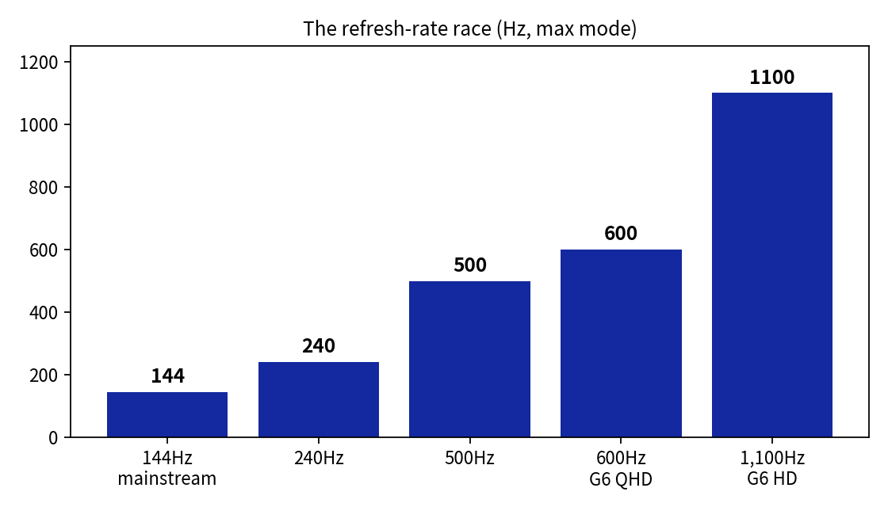

> [中文版 Chinese version](/life/samsung-odyssey-g6-1100hz-zh/)

*The Odyssey G6 (G60H). Image: Samsung, via HotHardware's November 24, 2026 launch coverage.*

## What Samsung launched on November 23

Samsung Electronics America announced the Odyssey G6 (G60H) on November 23, 2026, describing the 27-inch monitor as the world's first gaming display to support a refresh rate of up to **1,100Hz**. The full, confirmed specification from Samsung's own announcement is more interesting than the headline:

- **Panel:** 27-inch class Fast IPS, native **QHD (2,560 × 1,440)**.
- **Dual Mode:** up to **600Hz at QHD**, or up to **1,100Hz in HD** — the mode switch is a resolution switch.
- **Response time:** **1ms gray-to-gray**, with Samsung's fine print noting the figure is a truncated average under internal test conditions in an "Extreme" mode setting.
- **New feature:** **Odyssey Clear Motion**, a blur-reduction algorithm Samsung says it will bring to more Odyssey models after this one.
- **HDR and sync:** HDR10+ Gaming, Black Equalizer, NVIDIA G-SYNC Compatible and AMD FreeSync Premium — with Samsung's own footnote that FreeSync Premium does not support 1,100Hz, and that AMD Radeon RX 6-series and below do not support 1,000Hz or higher.
- **Ports:** one DisplayPort 2.1, two HDMI 2.1, Auto Source Switch+; adjustable swivel, tilt, pivot and height.
- **Price and timing:** **$899.99** in the United States, rolling out at US retailers nationwide **beginning in December** — a price snapshot as of November 24, 2026, subject to change. HotHardware reported an Amazon listing at $894.29 on launch day, a reminder that street prices move faster than press releases.
- **Platform caveat, in Samsung's own footnote:** macOS does not support Dual Mode or the native 600Hz maximum. This is a Windows PC gaming monitor.

Samsung also framed the launch as a defence of a streak: per IDC data cited in the announcement, Samsung has been the global No. 1 gaming-monitor brand by value for seven consecutive years, 2019 through 2025. The G60H is what a market leader ships when its lead is measured in value, not volume — a halo product whose job is to make the rest of the line look reasonably priced.

## The catch is arithmetic, not marketing

Every refresh-rate headline hides a division problem, so let us do it in the open. Refresh rate is frames per second; the quantity a player actually experiences is **frame time** — how long each frame stays on screen, and how stale the image can be when you react to it.

At 60Hz, a frame lasts **16.7 milliseconds**. At 144Hz, **6.9ms**. At 240Hz, **4.2ms**. At the G6's QHD maximum of 600Hz, **1.67ms**. At 1,100Hz, **0.91ms**.

*Author's chart. Frame time is 1,000 divided by refresh rate. Human reaction time, for scale, is typically 150–250ms; the contest at these speeds is over motion clarity and input freshness, not raw reaction.*

Read the chart from the left and the story of the whole product category appears. Going from 60Hz to 144Hz removes about 10ms of staleness — a transformation anyone can feel. Going from 240Hz to 600Hz removes about 2.5ms. Going from 600Hz to 1,100Hz removes **0.76ms**. Each doubling buys half as much as the last, and the industry has now doubled its way into territory where the remaining prize is measured in fractions of a millisecond. Club386's launch coverage made a related point about the panel itself: a true 1,100Hz experience wants pixel response at or under the 0.91ms frame time, and Samsung's 1ms GtG figure — an average, truncated, under internal conditions — sits right at that boundary rather than comfortably inside it. That is not an accusation; it is what "first" means in practice. The first product at any speed is the one that reaches the number with the least margin to spare.

Then there is the resolution trade, which Samsung states honestly and the headline omits. The 1,100Hz mode is **HD** — reporting from Club386 and HotHardware identifies it as 720p-class, a quarter of the G6's native QHD pixel count, though Samsung's announcement does not print the exact HD resolution. On a 27-inch screen, 720p is visibly soft: text, distant targets and fine detail all pay for the speed. Competitive players in arena shooters have voluntarily run low resolutions for decades in exchange for frames, so for that specific audience the trade is familiar and rational. For everyone else, the product they will actually use, every day, is the 600Hz QHD mode — which is itself, it should be said, an extreme specification that almost no current game and GPU combination sustains at native resolution in demanding titles.

## Who can even feed this thing?

A monitor does not generate frames; it displays what the PC delivers. A 1,100Hz display fed a 240fps game is a 240Hz experience with better scan-out. Feeding it honestly requires three things to be true at once: a game engine that will render past 1,000fps (competitive titles at low settings on top-end hardware can; most games cannot, and many are capped far lower), a GPU and CPU that can produce those frames at 720p without the CPU becoming the bottleneck — the same CPU-bound wall this site wrote about yesterday in the context of *GTA VI*'s 30fps lock, at the opposite end of the frame-rate universe — and a software stack that keeps up. On that last point, HotHardware noted that Microsoft updated Windows 11 earlier this year to support monitors reporting refresh rates above 1,000Hz, groundwork laid before any such monitor existed to buy. Samsung's footnotes add the sync caveats: FreeSync Premium tops out below 1,100Hz, and older Radeon cards do not support four-digit refresh at all.

None of this makes the G60H a trick. It makes it a specialist instrument whose headline mode addresses a narrow, real, well-understood use case — elite competitive play, where motion clarity at 720p is a rational trade and where players already optimise everything else in the chain to the same fractions of a millisecond. Odyssey Clear Motion is arguably the more broadly useful announcement inside the product: a blur-reduction algorithm aimed at the perceived clarity of fast scenes, which Samsung says will spread to other models. Features spread; halo specifications mostly stay at the top of the line where they were launched.

*Author's chart. Earlier figures are representative maxima of successive gaming-monitor generations; the G6's two modes are Samsung's confirmed Dual Mode specifications, November 23, 2026.*

## The buying question, answered plainly

At $899.99, the G60H costs as much as a competent gaming PC's GPU, or a 4K OLED monitor, or — to use this week's other news — roughly the rumoured entry territory of next-generation console pricing discussions. So the plain answer, in three parts:

**If you compete** in a title that can actually render at extreme frame rates, play at low resolution by choice already, and have the PC to match, this is the first monitor built exactly for you, and 600Hz-at-QHD gives you a no-compromise mode for everything else. You are the market. There are not many of you, and Samsung knows it.

**If you play everything else**, the honest product here is a 27-inch QHD Fast IPS at up to 600Hz with good ports and HDR10+ Gaming — a strong specification you will use at a fraction of its ceiling, in a market where OLED's contrast and response characteristics compete for the same $900. Wait for independent reviews. As of November 24, there are none; Club386's coverage explicitly recommended waiting for independent testing before spending, and that is the correct posture toward any first-of-its-kind panel whose key figures are internal-test averages.

**If you are watching the industry**, the G60H's real significance is directional. The refresh-rate race has reached the point where the display is no longer the bottleneck in any part of the chain — not the game, not the GPU, not the operating system, and not, at 0.76ms of marginal gain, human perception in any way that generalises beyond specialists. Samsung, the value leader for seven straight years, shipped the number anyway, because in a mature category the number on the box is the marketing. Expect 1,100Hz to be answered, expect the answers to be equally narrow in practice, and expect the actual progress for most players to keep arriving in the unglamorous places: panel response consistency, blur reduction like Clear Motion, and prices falling on last year's extremes.

The G6 is a genuine first, an honest spec sheet with its caveats printed in its own footnotes, and a product almost nobody should buy this December. All three of those are worth saying, because the launch coverage that says only the first is advertising, and the coverage that says only the last misses why the machine exists. It exists to hold a line — No. 1, seven years running — at the exact moment the line stopped being about what players can perceive and became about what a spec sheet can claim. Samsung claimed 1,100. The claim is true. The footnote is the product.

*Sources: Samsung Electronics America announcement, November 23, 2026 (specifications, Dual Mode, Odyssey Clear Motion, $899.99 US price, December retail rollout, macOS and FreeSync footnotes, IDC gaming-monitor ranking); HotHardware launch coverage, November 24, 2026 (Amazon $894.29 listing as a same-day snapshot, Windows 11 >1,000Hz support); Club386 launch coverage, November 24, 2026 (720p-class HD mode, 1,040Hz CES prototype history, response-time analysis, recommendation to await independent reviews). Prices are snapshots as of November 24, 2026 and are subject to change. No independent reviews of the G60H existed as of publication.*
