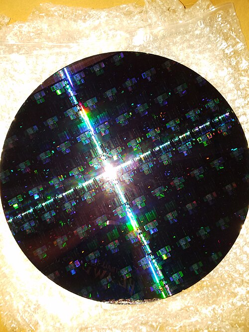
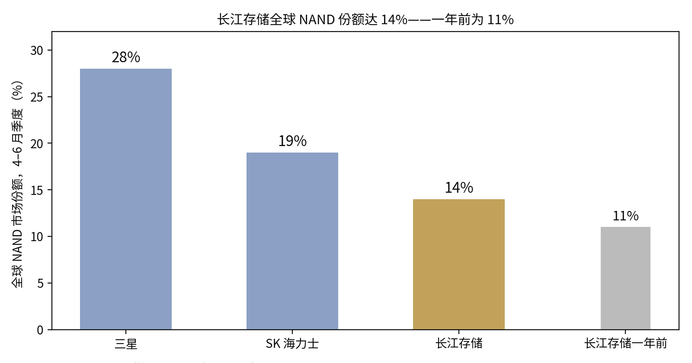

> [English version 英文版](/life/samsung-sk-hynix-ymtc-xtacking-license/)

*图片：一片 12 英寸硅晶圆。摄影：2x910，来自 Wikimedia Commons。*

## 报道本身：三位匿名知情人士、零公开确认、一个不寻常的说法

**2026 年 11 月 25 日**，**日经亚洲**援引**三位知情人士**报道称，**三星电子**与 **SK 海力士**已分别通过**交叉授权**安排，同意使用中国 NAND 闪存厂商**长江存储**（YMTC）开发的一项芯片堆叠技术的部分内容。这项技术叫 **Xtacking**，是长江存储的 3D NAND 架构，**2018 年**首次发布，**2019 年**起用于量产。同一周，韩联社 Infomax、Investing.com 以及一长串行业与财经媒体跟进了这条消息，来源都指向日经。

证据状态必须先说清楚，因为本文会认真对待这条报道，但不会假装它已被证实：**三家公司没有一家公开确认任何协议。**三星对日经拒绝就授权安排置评，同时主动表示，随着层数攀升，晶圆键合技术相比传统 NAND 制造有若干优势。协议的条款、金额、起始时间一概没有披露。下文所有涉及“协议”的内容，都归属于日经的报道，读者应按这个强度来采信。没有争议的是周边的事实地貌——层数竞赛、长江存储的份额、它的专利储备、以及三家公司共同的技术走向——而这片地貌，正是这条报道显得可信、且若属实则重要的原因。

## Xtacking 是什么：堆叠为什么撞上了墙

要理解为什么会有人买这项授权，得先理解 3D NAND 给自己制造的难题。NAND 闪存把数据存在存储单元里；过去十年，行业降低每比特成本的主路线，是把这些单元在垂直方向越堆越高——从 32 层到 64、128、176、232 层，再到 2026 年闪存峰会上展示的产品：**三星 400 层以上的第十代 V-NAND** 与 **SK 海力士的 375 层**产品。存储阵列之下，是控制它的 CMOS 电路——负责读写与寻址的逻辑部分。传统布局里，逻辑与阵列做在同一片晶圆上，逻辑挤占硅片面积，约束阵列的设计，还要承受阵列工艺的热预算：阵列需要的每一步高温工艺，逻辑晶体管都得陪着熬一遍。

Xtacking 在 2018 年给出的答案是：不要再共用一片晶圆。存储阵列在一片晶圆上做，CMOS 控制电路在另一片独立的晶圆上做——各自的工艺为各自的任务优化，互不背对方的热预算与设计约束——然后把两片晶圆面对面**键合**在一起，用高密度垂直互连连通，成品表现得像一颗芯片。长江存储自 2018 年起一直主张，这种混合键合方案能改善密度（逻辑不再以同样方式抢占阵列的面积）、速度（控制电路可以用更先进的逻辑工艺制造）与制造灵活性（阵列与逻辑的良率可以独立管理，一片坏的逻辑晶圆不会连累一片好的阵列晶圆，反之亦然）。

多年里，韩国厂商走的是另一种几何：在单片晶圆上把存储单元直接堆在控制电路上方，这条路线把它们带过了 300 层的区间。日经报道把这次授权的时点，框定为单晶圆路线触及极限的时刻——当层数迈向并越过 400 层，在一片晶圆上完成一切的结构与工艺约束收紧，晶圆对晶圆键合就从长江存储的“偏门备选”，变成了全行业的路。三星对日经的那句表态——键合能减少层数堆高时出现的结构限制、从而实现更高密度——是该公司可能给出的、最接近公开承认这一方向的说法。需要补一句准确性注记：三星与长江存储专利的接触据称并非始于本周——后续报道引用的韩国消息称，三星去年已取得长江存储混合键合相关专利的授权。11 月这条报道若属实，等于把这层覆盖扩展到了两家韩国巨头。

## 动机是防御性的——而这正是重点

日经报道里最重要的一句，是最不“好听”的那句。据日经引用的业内高管说法，以及后续报道对协议性质的概括，这些安排**在很大程度上是防御性的**：目的与其说是获取韩国人没有的能力，不如说是当自家基于键合的产品走进长江存储早早布局、且布局广泛的专利领地时，**降低与长江存储发生专利纠纷的风险**。长江存储自称已在全球提交**超过 12,000 件专利**；报道引用的美国专利商标局记录显示，仅 2018 年以来在美国的申请就**超过 4,000 件**；公司拥有**超过 8,000 名工程师**。这样规模的专利储备，握在一家率先押中了全行业正在汇聚之技术的公司手里——任何审慎的三星或 SK 海力士，都会选择授权而不是诉讼。交叉授权——双方互相授予对方使用自家专利组合的权利——正是为这种局面准备的标准工具：它把一场潜在的禁令加赔偿之战，变成一笔安静的、有边界的经营成本。

所以请把这条新闻读对：这不是韩国工程师“佩服”中国技术的故事，也不是长江存储“赢下”NAND 的故事。这是**专利引力**的故事。长江存储在 2018 年、还是个无名之辈时，对一项技术下了架构层面的赌注——堆叠的物理规律最终把所有人都逼向了这项技术——并用数千件申请把这场赌注写成了文件。十年之后，地球上最大的两家存储厂商，据报道判断：为和平付费，比在法庭上测试那些专利更便宜。这是市场份额本身会低估的一种“抵达”：你可以无视对手的产品，但当你自己的路线图要从对手的专利里穿过去时，你无视不了它的专利。

*作者自制图。数据：Counterpoint Research，日经亚洲 2026-11-25 引用。*

## 份额数字：十年历史的公司，14%

商业背景让专利故事更锋利。据日经引用的 **Counterpoint Research** 数据，在 **4–6 月季度**，长江存储拿下**全球 NAND 市场 14% 的份额**，高于一年前的 **11%**，几乎追平美光与铠侠，仅次于**三星（28%）**与 **SK 海力士（19%）**。一家 2016 年成立的公司，多年来在美国贸易限制下运转——限制切断了它与先进设备生态的许多联系，重到财经报道经常直接称其被列入黑名单——却仍然拿走了全球 NAND 支出里大约每七美元中的一美元，同时建起了上文所述的专利位置。

请把这两个事实放在一起看，因为它们的组合才是真正的新闻。制裁与出口管制的设计目标，是拖慢目标企业在*制造*上的攀升，按各种口径衡量，它们确实给长江存储施加了真实成本。但 Xtacking 这一幕展示了它们堵不上的通道：**在全行业后来都需要的一项技术上，提前积累的知识产权**。管制可以不给一家公司设备，却没法让它的架构被“反发明”、让它的专利被“反申请”，也没法阻止行业龙头出于商业理性得出“授权这项架构才是合理选择”的结论。如果日经报道属实，授权价值与正当性此刻正流向那家受限企业，付款方恰恰是限制措施在某种程度上意在扶持的两家公司。这并不是说管制从不奏效——而是说，管制作用于供应链，不作用于时机已到的想法；把这两者混为一谈的政策制定者，会继续被这样的故事打个措手不及。

## 接下来看什么，以及诚实的不确定性

三条后续将决定这件事是注脚还是里程碑。第一，**确认**：三星、SK 海力士或长江存储的任何公开声明、监管披露或财报电话会确认，都会把一条信源扎实的报道变成既定事实；而持续沉默——在这个经常让交叉授权无声通过的行业里——什么也证明不了。第二，**产品**：真正的检验是三星的 400 层以上一代与 SK 海力士的后续产品，是否以能追溯到被授权组合的晶圆键合架构出货——拆解分析会在一两年内讲完这个故事。第三，**政治**：一笔被报道的、从美国的韩国盟友流向受美国限制的中国冠军的授权价值，落进华盛顿的时机很微妙——就在同一周，MATCH 法案的讨论还在争论是否把长江存储写入法条、进一步收紧设备出口。授权协议并不违反出口管制——专利不是设备——但它在那场辩论里的观感不会被忽视。

目前的判断是：把这笔交易当作**已报道、未证实**，把它的可信度本身当作发现。当三位知情人士告诉日经，全球最大的两家 NAND 厂商已交叉授权一家十年历史、受限制的中国对手的堆叠专利——而两家韩国公司没有一家否认、其中一家还在同一语境里公开夸这项技术——“惊讶”的举证责任已经换边了。五年前，中韩之间存储技术授权的方向只有一条。本周最站得住的读法是：在这个技术上具体、商业上真实的角落里，它现在双向流动。

*来源：日经亚洲（2026-11-25），经韩联社 Infomax（2026 年 11 月）、Investing.com、Crypto Briefing、亚洲日报（2026-11-26/27）报道与汇总；市场份额数据为 Counterpoint Research（日经亚洲引用）；2026 闪存峰会产品数字（三星 400 层以上 V-NAND、SK 海力士 375 层 NAND）出自同一批报道。截至 2026-11-27，三星、SK 海力士与长江存储均未公开确认授权协议本身，全文均按“据报道”表述。*
