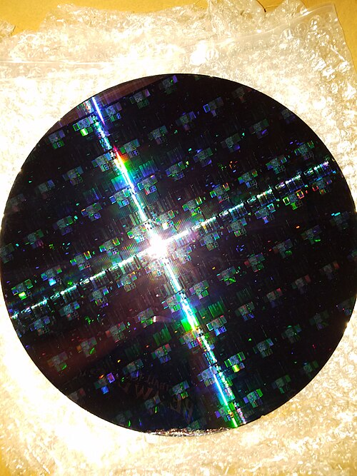
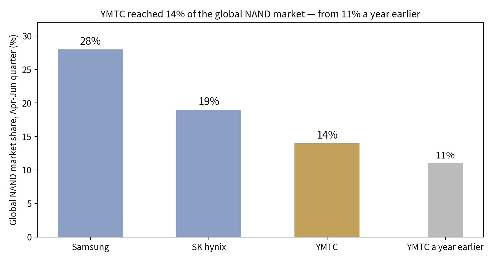

> [中文版 Chinese version](/life/samsung-sk-hynix-ymtc-xtacking-license-zh/)

*Image: A 12-inch silicon wafer. Photo: 2x910, via Wikimedia Commons.*

## The report: three unnamed sources, zero confirmations, one remarkable claim

On **November 25, 2026**, **Nikkei Asia** reported — citing **three people briefed on the matter** — that **Samsung Electronics** and **SK hynix** have each agreed, through **cross-licensing arrangements**, to use parts of a chip-stacking technology developed by **Yangtze Memory Technologies Co. (YMTC)**, the Chinese NAND flash maker based in Wuhan. The technology is **Xtacking**, YMTC's 3D NAND architecture, first unveiled in **2018** and applied to mass production from **2019**. The story was picked up the same week by Yonhap Infomax, Investing.com and a long tail of trade and financial outlets, all citing Nikkei.

The evidentiary status needs to be stated plainly, because this post will treat the report seriously without pretending it is confirmed: **none of the three companies has confirmed any agreement on the record.** Samsung declined to comment on the licensing arrangements to Nikkei, while volunteering that wafer-bonding technology offers several advantages over conventional NAND manufacturing as layers climb. No terms, no fees, no start dates have been disclosed. Everything attributed to "the deal" below is attributed to Nikkei's reporting, and readers should hold it at exactly that strength. What is not in dispute is the surrounding factual landscape — the layer race, YMTC's market share, its patent estate, and the technical direction all three companies are travelling — and that landscape is what makes the reported deal plausible, and important if true.

## What Xtacking is, and why stacking hit a wall

To see why anyone would license this, you have to understand the problem 3D NAND created for itself. NAND flash stores data in memory cells; for the past decade, the industry's main route to cheaper bits has been to stack those cells in ever taller vertical strings — from 32 layers to 64, 128, 176, 232, and now, in the products shown at the 2026 Flash Memory Summit, **Samsung's 400-plus-layer tenth-generation V-NAND** and **SK hynix's 375-layer** part. Underneath the memory array sits the CMOS circuitry that controls it — the logic that reads, writes and addresses the cells. In the conventional layout, that logic is built on the same wafer, around and under the array, and it consumes silicon area, constrains how the array can be designed, and subjects the logic transistors to the thermal budget of the array's fabrication — every high-temperature step the array needs is a step the logic must survive.

Xtacking's answer, demonstrated by YMTC in 2018, is to stop sharing a wafer. Build the memory array on one wafer and the CMOS control circuits on a second, separate wafer — each process optimised for its own job, each free of the other's thermal and design constraints — and then **bond the two wafers together**, face to face, with dense vertical interconnects, so the finished stack behaves as a single chip. YMTC has argued since 2018 that this hybrid-bonding approach improves density (the logic no longer steals area from the array's footprint in the same way), speed (the control circuits can be built in a more advanced logic process) and manufacturing flexibility (array and logic yields can be managed independently, and a bad wafer of one kind does not doom a good wafer of the other).

For years, the Korean makers pursued a different geometry: stacking the memory cells directly above the control circuitry on a single wafer, an approach that carried them through the 300-layer range. Nikkei's reporting frames the licensing moment as the point where that single-wafer route runs into its limits — as layer counts push toward and past 400, the structural and process constraints of doing everything on one wafer tighten, and wafer-to-wafer bonding stops being YMTC's eccentric alternative and becomes the industry's road. Samsung's own comment to Nikkei — that bonding reduces the structural limits that arise as layers are stacked, allowing higher density — is as close to a public concession of that direction as the company is likely to give. It is worth noting, for accuracy, that Samsung's engagement with YMTC patents reportedly did not begin this week: Korean reporting cited in the follow-up coverage says Samsung obtained rights to YMTC hybrid-bonding-related patents last year. The November report, if accurate, extends that coverage to both Korean giants.

## The motive is defensive — and that is the point

The most important sentence in Nikkei's account is the least flattering one. Per an industry executive quoted by Nikkei, and per the research characterising the agreements in follow-up coverage, the deals are **largely defensive**: the goal is less to acquire a capability the Koreans lack than to **reduce the risk of patent disputes** with YMTC as their own bonding-based products approach the territory YMTC patented early and broadly. YMTC says it has filed **more than 12,000 patents globally**; US Patent and Trademark Office records cited in the coverage show **over 4,000 US filings since 2018 alone**; the company employs **more than 8,000 engineers**. A patent estate of that size, held by a company that pioneered the exact technique the industry is converging on, is not something a prudent Samsung or SK hynix litigates if it can license instead. Cross-licensing — where each side grants the other rights under its own portfolio — is the standard instrument for exactly this situation: it converts a potential injunction-and-royalties fight into a quiet, bounded cost of doing business.

Read correctly, then, this is not a story about Korean engineers admiring Chinese technology, and it is not a story about YMTC "winning" NAND. It is a story about **patent gravity**. YMTC made an architectural bet in 2018, when it was a nobody, on the technique that the physics of stacking eventually forced on everyone — and it papered that bet with thousands of filings. A decade later, the two largest memory makers on earth reportedly judge it cheaper to pay for peace than to test those filings in court. That is a form of technological arrival that market share alone understates: you can ignore a rival's products; you cannot ignore a rival's patents when your own roadmap walks through them.

*Author's chart. Data: Counterpoint Research, as cited by Nikkei Asia, November 25, 2026.*

## The share numbers: a decade-old company at 14%

The commercial backdrop makes the patent story sharper. According to **Counterpoint Research** data cited by Nikkei, in the **April–June quarter** YMTC held **14% of the global NAND market**, up from **11% a year earlier** — nearly matching Micron and Kioxia, and sitting behind only **Samsung (28%)** and **SK hynix (19%)**. A company founded in 2016, which has operated for years under US trade restrictions that cut it off from much of the advanced equipment ecosystem — restrictions significant enough that financial coverage routinely describes it as blacklisted — has nonetheless taken roughly one dollar in seven spent on NAND flash worldwide, while building the patent position described above.

Hold those two facts together, because their combination is the actual news. Sanctions and export controls are designed to slow a targeted firm's *manufacturing* ascent, and by various measures they have imposed real costs on YMTC. But the Xtacking episode shows a channel they do not close: **intellectual property accumulated early, in a technique the whole industry later needs**. Controls can deny a company tools; they cannot retroactively uninvent its architecture or unfile its patents, and they cannot stop the industry's leaders from concluding, on commercial grounds, that licensing that architecture is the rational move. If the Nikkei report is accurate, the licensing revenue and legitimacy now flow *toward* the restricted firm from the two companies the restrictions were, in part, meant to advantage. That is not an argument that controls never work — it is an argument that they work on supply chains, not on ideas whose time has come, and policymakers who conflate the two will keep being surprised by stories like this one.

## What to watch, and the honest uncertainties

Three follow-ups will determine whether this becomes a footnote or a landmark. First, **confirmation**: any on-record statement, regulatory filing or earnings-call acknowledgement from Samsung, SK hynix or YMTC would convert a well-sourced report into established fact; continued silence, in an industry that often lets cross-licenses pass unannounced, would prove nothing either way. Second, **products**: the real test is whether Samsung's 400-plus-layer generation and SK hynix's successors ship with wafer-bonded architectures whose lineage traces to the licensed portfolio — teardowns will tell that story within a year or two. Third, **politics**: a reported flow of licensing value from America's Korean allies to a US-restricted Chinese champion lands in a Washington already debating, in the MATCH Act discussions covered this same week, whether to name YMTC in statute and tighten tool exports further. A licensing deal does not violate export controls — patents are not equipment — but its optics will not go unnoticed in that debate.

The judgement, for now: treat the deal as **reported, not confirmed**, and treat its plausibility as the finding. When three people briefed on the matter tell Nikkei that the world's two biggest NAND makers have cross-licensed the stacking patents of a ten-year-old, restricted Chinese rival — and when neither Korean company will deny it, and one of them publicly praises the technique in the same breath — the burden of surprise has shifted. Five years ago, the direction of memory-technology licensing between China and Korea ran one way. The most defensible reading of this week is that, in this one technically specific and commercially real corner, it now runs both.

*Sources: Nikkei Asia, November 25, 2026, as reported and summarised by Yonhap Infomax (November 2026), Investing.com, Crypto Briefing and Aju Press (November 26-27, 2026); market-share data from Counterpoint Research as cited by Nikkei Asia; Flash Memory Summit 2026 product figures (Samsung 400-plus-layer V-NAND, SK hynix 375-layer NAND) as reported in the same coverage. The licensing agreements themselves have not been confirmed on the record by Samsung, SK hynix or YMTC as of November 27, 2026, and are described throughout as reported.*
