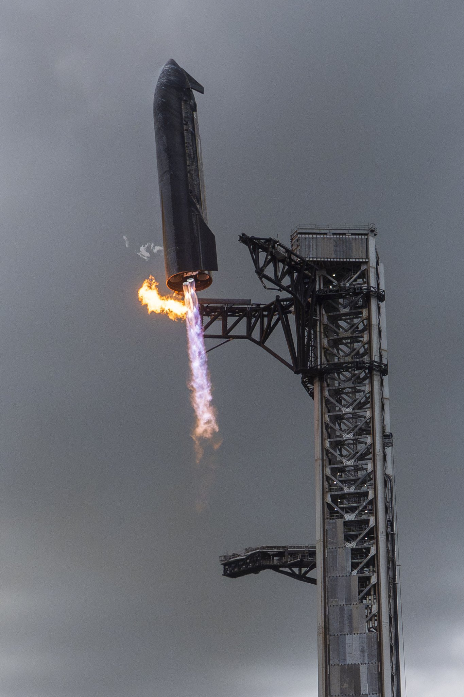
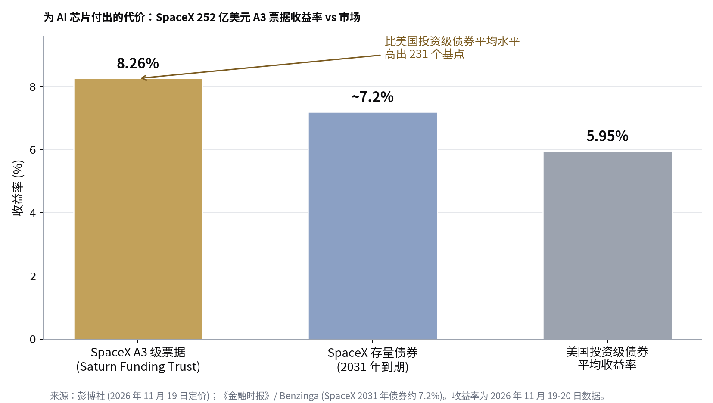
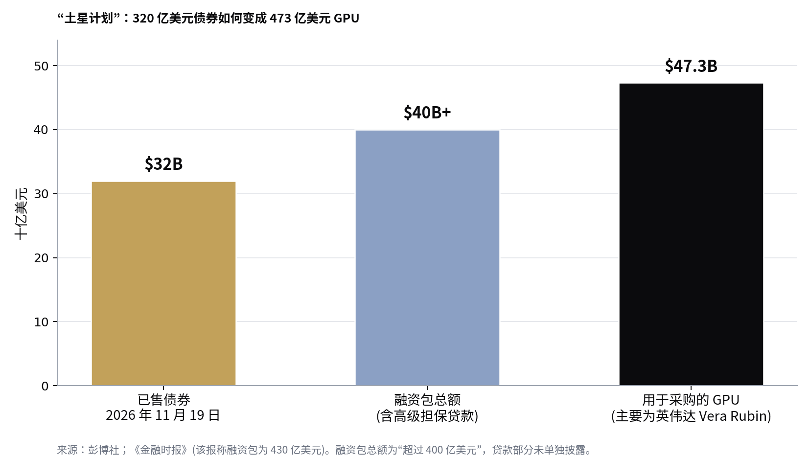

> [English version 英文版](/life/spacex-32b-ai-chip-debt/)

*2026 年 11 月 14 日，星舰第十五次试飞，“舰 42”被发射塔机械臂接住——返回上面级首次被成功回收。照片：SpaceX，CC BY 4.0，经 Wikimedia Commons。*

2026 年 11 月 19 日星期四，SpaceX 发售了约 320 亿美元债券，用来买 AI 芯片。按公司自己的说法，这是史上最大的一笔 GPU 融资。同时，它也是今年最贵的投资级债券发行之一。最大的一笔——约 252 亿美元的 A3 级票据——定价收益率为 8.259%，据最先报道此事的彭博社。而当天美国投资级债券的平均收益率是 5.95%。

2026 年末 AI 大建的全部故事，就藏在这两个数字之间的缺口里。SpaceX——全球最值钱的非上市公司、刚刚上市、拥有人类历史上最强火箭舰队——为买电脑芯片，付出了比投资级债券平均水平高出 231 个基点的利息。交易仍然完成了，而且一天之内就以大额成交：据彭博社，约 260 亿美元在发售前已被预先认购，最后一笔 60 亿美元的 A3 票据在周四当天发售。市场愿意为 AI 大建出钱，只是不再假装这场大建没有风险。而这笔交易的定价，将成为整个行业未来融资的参照系。

要理解这笔交易的分量，先看它发生的时机。就在一周前的 11 月 12 日，SpaceX 宣布投资超过 740 亿美元建设两座 AI 超算园区——得州 Starbase 超过 240 亿美元，亚利桑那州 Cochise County 约 500 亿美元。一个月前，它刚完成史上最大的 IPO。同一周，Anthropic 以每股 83 美元定价上市，募资约 1048 亿美元。SpaceX 的 AI 业务一个季度就从 8 亿美元收入长到 76 亿美元。所有事情都在同一时刻加速：建园区、买芯片、上市、接大客户。而这笔 320 亿美元的债，就是为加速买单的那张账单。问题不在于 SpaceX 有没有钱，而在于当买的东西贬值很快、当付钱的收入大多来自一家客户、当抵押品原则上可以被发射上天时，钱会贵成什么样。

市场的第一反应也值得记录。据 TipRanks，消息传出后 SpaceX 股价下跌；据 Stocktwits，周五盘前股价跌破了 IPO 价格。就在前一天，市场还在为 Anthropic 的上市欢呼——83 美元的定价、1048 亿美元的募资、史上最大 IPO。24 小时之内，同一批投资者看了一眼 SpaceX 为买芯片付出的代价，态度就变了。股市可以为故事涨，债市只为数字买单，而 8.259% 这个数字，比任何故事都诚实。

## SpaceX 到底卖了什么

首先要搞清交易结构，因为结构本身就是故事。借这 320 亿美元的不是 SpaceX，而是一家叫 Saturn Funding Trust 的特殊目的载体（SPV）。这家信托由阿波罗全球管理（Apollo Global Management）支持的实体管理：它发债、用募来的钱买英伟达芯片——主要是下一代 Vera Rubin 系统——再把硬件租给 SpaceX，租期约五年。据彭博社，租约从 2027 年上半年 GPU 到货时开始，租期 5 到 5.25 年。高盛和阿波罗安排了这次发售，它属于一个总额超过 400 亿美元的融资包——《金融时报》称之为 430 亿美元——其中还包括一笔高级担保贷款。整个融资包为约 473 亿美元的 GPU 采购提供资金。

这次发售分三部分进行。据彭博社，最大的一笔是约 252 亿美元的 A3 级票据，收益率 8.259%。其余两笔规模较小，收益率也都在 8% 以上——也就是说，整整 320 亿美元的融资，成本都在 8% 上方。买家阵容堪称华尔街全明星：据《金融时报》，贝莱德、高盛资产管理、KKR 相关基金都做了锚定认购，PIMCO 一家就认购了 40 亿美元。这些机构不是投机客，而是全球最大的长期资金管理者。他们愿意买，但要按他们的价钱买。

这笔交易早有预告。10 月 26 日，SpaceX 宣布与一家阿波罗管理的实体签订了约 400 亿美元主融资租赁的约束性承诺，称之为史上最大的 GPU 融资。11 月的债券发售就是这份承诺的执行——一份新闻稿上的数字，变成了有真实票息的真实债务。据彭博社，设立信托的目的，是让这笔借款不出现在 SpaceX 的资产负债表上，从而保住公司的投资级信用评级。对一家刚刚上市、同时还要为火箭、卫星和数据中心筹钱的公司来说，报表上的杠杆率和评级至关重要。

## SPV，用大白话解释

特殊目的载体就是一家为了一件事而设立的独立法人公司。这里的那件事是：拥有 473 亿美元的英伟达芯片，再租给 SpaceX。债券持有人的索偿对象是这家信托，不是 SpaceX。他们的保障有两层：芯片本身，以及 SpaceX 无论如何都要按约付五年租金的承诺。

这份承诺异常绝对。据彭博社，即使芯片坏了、即使发生公司无法控制的事件——比如自然灾害——SpaceX 也必须继续付租金。信用市场的行话叫“地狱或洪水”租赁（hell or high water）：天塌下来租金也得付。正是这句话让这批债券得以评上投资级。据《金融时报》，穆迪给了这批票据 A3 评级——比 SpaceX 自身的评级还高一级，KBRA 给了 A-。票据 2032 年到期，但本金在四年之内还清，这就限制了债权人暴露在风险中的时间。

评级机构看了一堆 GPU 和一份五年租约，得出结论：这批债券比 SpaceX 本身还安全。这个逻辑在一定范围内成立：资产真实、可出售，租金无条件，期限短。但它建立在两个从未在这种规模上验证过的假设之上。第一，五年后的英伟达 GPU 在二手市场还值足够的钱，能在违约时兜底。第二，SpaceX 的租金会一直付下去，而付租金的业务收入集中在一家可以在 90 天内退出的客户手里——后面细说。

这种结构并不新鲜。航空公司几十年来就是这么买飞机的：通过租赁载体融资，飞机归载体所有，航空公司付租金，资产负债表保持干净。电信行业在光纤热潮里也用过类似手法，下场不太愉快。结构本身是经过验证的，问题在于标的资产能不能保值。对飞机来说，答案是肯定的——一架十年机龄的波音 737 还有明确的二手市场和残值曲线。对 GPU 来说，诚实的答案是没人知道，因为从来没有人以这种规模、这种期限为 GPU 融过资。一块 2027 年的顶级芯片，到 2030 年落后三代，到时候值多少钱，取决于一个今天几乎还不存在的二手 AI 加速器市场。评级机构评的是法律结构，买家定价的是这个未知数——而 8.259% 这个数字，就是这个未知数的价格。

还有一点值得注意：表外处理并不意味着债务消失了。钱是真的借了，利息是真的要付，只是它不列在 SpaceX 的资产负债表上。这对上市公司尤其重要：评级、股价、未来融资的成本，都与报表上的杠杆率挂钩。SpaceX 用一家信托把 320 亿美元挪出了报表，但风险并没有挪走——它只是换了一个地方待着，等着被重新定价。

如果最坏的情况发生，会怎么样？假设 SpaceX 付不起租金，信托可以收回芯片并出售，用卖芯片的钱还债券持有人。这就是“有担保”的全部含义。但这里有个微妙之处：担保品的价值取决于到时候有没有人愿意买二手 Vera Rubin 系统。买家可能是其他云厂商、可能是中小型 AI 公司、也可能是英伟达自己回购——但这些都没有合同保证。信托的设计假定二手市场会存在，而且价格足够高。评级机构在给 A3 的时候，也是这么假定的。整个 320 亿美元的交易，建立在一个人人都希望存在、但还没有人见过的市场之上。这不是说它不会存在——AI 芯片的二手市场很可能随着时间出现，就像二手飞机、二手服务器市场那样。但在它出现之前，债券持有人承担的是一种“市场会成熟”的风险，而 8.259% 的收益率里，有一部分就是为这个风险付的价钱。

## 为什么是现在？AI 融资的转折点

要理解为什么是 SpaceX、为什么是现在，得先看 AI 大建的融资是怎么一步步走到举债这一步的。2023 到 2025 年，算力扩张主要靠三类钱：风险投资、上市公司发股、以及微软、谷歌、亚马逊、Meta 这四家超大规模云厂商自己的现金流。这四家公司每年在资本开支上花掉数千亿美元，靠的是每年上千亿美元的经营现金流——借钱只是补充，不是主力。

2026 年，局面变了。需求的增长速度超过了巨头的资产负债表扩张速度，于是出现了一批新角色：CoreWeave 这样的“新云厂商”（neocloud），专门租 GPU 再转租给 AI 公司；甲骨文这样的传统厂商，all-in 转向 AI 基础设施；以及 SpaceX 这样的新进入者，用火箭公司的资产负债表去支撑数据中心业务。这些玩家的共同点是：没有巨头那样的现金流，却有同样量级的资本开支需求。缺口只能靠债来填。

于是就有了今天的局面：甲骨文一年借 430 亿美元，CoreWeave 靠抵押 GPU 借钱，SpaceX 发 320 亿美元债券。这不是某个公司的个别选择，而是整个行业进入新阶段的标志。第一阶段的算力是靠股权和利润建起来的，第二阶段的算力是靠借来的钱建起来的。两者最大的区别在于：股权亏了可以等，债务到期必须还。AI 大建从此有了还款日。

还有一个背景：利率环境。零利率时代里，投资级债券的收益率只有 2% 上下，资金几乎是白给的；2026 年的市场已经完全不同，基准利率高企，投资者对久期和信用风险都要求更高的补偿。SpaceX 的交易之所以引人注目，不只是因为它规模大，更因为它发生在这样一个时点：市场正在重新学习如何为 AI 定价，而第一份认真的答卷上写着 8.259%。

## 收益率就是判决书

收益率就是价格，而价格就是观点。买债券的人要求多高的收益率，就等于他们认为自己承担了多大的风险，并用钱把这个判断表达出来。发售当天，美国投资级债券的平均收益率为 5.95%，据彭博社。SpaceX 自身 2031 年到期的存量债券收益率约为 7.2%，据《金融时报》。而新发的 A3 级票据——投资级、有实物资产担保、有无条件租约——收益率为 8.259%。

*SpaceX 新发的芯片担保票据，收益率比它自己的无担保债券还高。来源：彭博社（2026 年 11 月 19 日定价）；《金融时报》/ Benzinga（2031 年债券约 7.2%）。收益率为 2026 年 11 月 19–20 日数据。*

这个排序很不寻常。新票据的评级比 SpaceX 自身还高、有特定资产担保、期限更短，收益率却比 SpaceX 自己的无担保债券高出约 106 个基点。正常市场里不会这样：有担保、评级更高、期限更短的债应该更便宜。而在这里，它成了公司资本结构里最贵的一张纸。评级说这批债比 SpaceX 本身更安全，市场却说要收更多的钱才肯买——评级和市场，两个人里总有一个错了，而市场是用真金白银下注的那一个。

市场同时在说三件事。第一，评级描述的是结构，不是经济实质：评级机构评的是法律保护，买家定价的是仓库里的 GPU 三年后会贬值多少的风险。第二，规模本身就是风险：单笔 252 亿美元，债券市场要消化这么大一笔同类资产，投资者要收消化费。第三，AI 这笔交易，过去两年被当作确定性定价，现在被当作一场赌注定价。

利息的算术很直观。按 8.259% 计算，仅最大这一笔，每年利息就约 21 亿美元（我们的计算：252 亿 × 8.259%）——这还不包括电费、人力和其他任何开支。做个对比：据 SpaceX 向美国证监会（SEC）提交的文件（经 Bitcoin.com News 报道），其 Super Intelligence 业务整个第三季度的营业利润为 4.31 亿美元。这是一个盈利的季度，但跟一笔融资里一个分档每年 21 亿美元的利息比起来，实在太小。这门生意必须在很长时间里保持极快的增长，这笔账才算得过来。这不是批评，而是这笔交易自己的逻辑——诚实地说出来而已。

还有一个角度：8.259% 是什么概念？它比美国投资级债券的平均水平高出 231 个基点（一个基点是 0.01%，231 个基点就是 2.31%）。在债券市场里，2.31% 的利差不是零头，而是整整一个信用等级的差距。更重要的是，这批票据的收益率已经逼近甚至超过了许多垃圾级债券的水平——而它挂着投资级的牌子。这种“投资级评级、垃圾级价格”的组合，在历史上并不常见，通常只在市场对评级本身产生怀疑的时候出现。投资者不是在质疑穆迪的算术，而是在说：评级模型没有、也不可能充分定价一种全新的资产——大规模融资购买的、快速贬值的 AI 芯片。

最值得琢磨的，是新票据与 SpaceX 自身存量债券之间的倒挂。按常理，有担保、评级更高、期限更短的债，应该比公司自己的无担保债便宜；但这里反过来了：新票据比 SpaceX 2031 年到期的存量债贵了约 106 个基点。市场其实在说，评级机构看的是法律文件，而买家看的是经济实质。法律文件说，信托拥有芯片、租金无条件、四年还清本金；经济实质说，芯片会贬值、客户会离开、二手市场还不存在。当法律和经济发生冲突时，市场永远跟着经济走——而 106 个基点，就是市场为这种冲突标出的价格。

这个数字还有另一层含义：它会成为 SpaceX 未来融资的锚。SpaceX 的计划不止这一笔：740 亿美元的园区要建，下一代芯片要买，星舰要继续飞。每一笔新融资，市场都会拿 8.259% 来比价——如果下一笔更贵，说明市场对 SpaceX 的信心在下降；如果更便宜，说明这笔交易建立的模板得到了认可。更重要的是，320 亿美元只是开始：473 亿美元的设备里，债券覆盖了 320 亿，剩下的缺口由高级担保贷款和其他承诺补足，而未来几年的芯片采购还会需要新的融资。SpaceX 的 AI 业务从此要像一家公用事业公司那样经营：稳定的租金收入，覆盖稳定的利息支出。它的商业模式不再只是“造火箭、发卫星”，而是“借钱、买芯片、收租、还钱”。

那么问题来了：既然风险这么明显，为什么还有人买？答案是，买家和评级机构看的不是同一张表。Shorecliff Asset Management 首席投资官 Grant Nachman 对《金融时报》表示，这笔交易结构巧妙，可能会吸引那些寻求高收益投资级债券的保险公司。保险公司和养老基金有硬性规定：只能买投资级债券。在投资级债券平均收益率只有 5.95% 的市场里，一张评级 A3、收益率 8.26% 的票据是稀缺品——它让这些机构在不违反规定的前提下，多赚 230 个基点。这就是这笔交易能够成立的另一半原因：市场上存在一批被迫购买投资级债券、又渴望更高收益的买家。SpaceX 的结构恰好满足了他们的需求：评级够高，收益够高。对买家来说，8.259% 不是风险的警告，而是机会的定价。同一笔交易，悲观者看到的是 231 个基点的风险溢价，乐观者看到的是 231 个基点的超额收益。谁对谁错，要到 2030 年才知道。

## 泄露天机的那条条款

这周最能说明问题的地方不是数字，而是一条贷款方想要、但未必拿到的契约条款。据《金融时报》报道，为这笔融资提供资金的贷款方要求加入限制条款，禁止 SpaceX 把英伟达芯片发射到太空。他们的担忧——据《金融时报》报道，并经 Investor's Business Daily 和 TipRanks 援引——很直白：如果 SpaceX 违约，放在田纳西州数据中心里的芯片可以被收回、拖走、转卖；绕着地球转的芯片不行。至于这条限制最终是否写进了贷款文件，《金融时报》称尚不清楚。SpaceX 则表示，这些芯片将用于其控股、控制并运营的美国数据中心。

这段话值得慢慢读。整个秋天，马斯克一直在谈轨道数据中心：在 Baron Capital 的会议上他说，SpaceX 的 StarMind 轨道超级计算机——基于英伟达 Vera Rubin 芯片——将于 2027 年第三季度开始发射，最终几乎所有 AI 算力都会搬到轨道上。我们之前写过这篇报道：马斯克的判断是，太空有无限的太阳能和天然的散热条件，轨道算力终将比地面便宜；谷歌数据中心能源负责人的判断恰恰相反，认为天基算力的成本可能是地面建设的 100 倍，物理规律——真空散热、辐射损伤、无法触及的维修——站在地面这一边。两个人的模型差了两个数量级，总有一个是错的。

就在债券发售前几天，SpaceX 首次用发射塔机械臂接住了一枚星舰上面级：11 月 13–14 日的第十五次试飞中，“舰 42”在轨道上待了约 22 小时，部署了 26 颗星链卫星，然后被接住。这是人类第一次从轨道上接住返回的上面级。能把轨道数据中心送上天的火箭，肉眼可见地正在工作。这次试飞并非完美——助推器没能回收，在返程点火提前结束、燃料不足后被转到海上溅落并爆炸——但接住上面级本身就是里程碑。

而现在，借给 SpaceX 320 亿美元的人看了这个愿景，说：很好，但别拿我们的抵押品去实现。这是整个 AI 热潮里最诚实的一次尽职调查。贷款方的工作不是相信未来，而是给“未来没有到来”的情形定价。轨道数据中心的设想可能是对的，马斯克也可能说对了——发射成本降到足够低会改变这笔账。但债券持有人没法收回一个设想，只能收回一件东西，放在一个地方，有个装卸码头。“不许上天”这条条款，就是市场在它愿意出钱的愿景和它愿意承保的愿景之间划出的一条线，而这是两条不同的线。

这条条款里还有第二层意思。2027 年买的 Vera Rubin 系统今天是顶尖货，到 2030 年就落后了三代，它的转卖价值取决于一个二手 AI 加速器市场——这个市场目前几乎还不存在。抵押品只有留在能找到、能维护、能出售的地方才有价值：一栋楼里，在地面上，有个街道地址。抵押品一旦离开地球，回收价值就归零，评级也就归零。条款与太空无关，它关乎整笔交易建立在贬值硬件的转卖价值之上，而房间里的每个人都知道这一点。

更值得玩味的是这条条款的谈判地位。据《金融时报》，目前不清楚它是否写进了最终文件。这本身就说明了问题：如果 SpaceX 完全掌握主动权，贷款方连提都不会提；如果贷款方完全掌握主动权，条款一定会写进去。现实介于两者之间——贷款方有足够的担忧去要求，有没有足够的筹码拿到手，则是另一回事。而答案会告诉我们，在这场 AI 大建里，到底是借钱的人说了算，还是出钱的人说了算。

这种“限制抵押品用途”的条款，在项目融资里其实并不罕见。飞机租赁里，合同会规定飞机不能飞去某些国家、不能改装、必须按时保养；船舶融资里，船不能开进战区、不能长期停在不受监管的港口。贷款方的逻辑从来都是一样的：抵押品的价值取决于它在哪里、以什么状态存在。SpaceX 这笔交易的不同之处在于，限制的对象不是地理位置或用途，而是“星球”——抵押品不能离开地球。这听起来像科幻小说里的条款，但它遵循的恰恰是最传统的信贷逻辑。历史上，任何一种新抵押品出现时，贷款方都会先写下类似的限制：铁路时代，机车不能开出抵押登记的州；航空时代，飞机不能飞往战区；现在，芯片不能飞往轨道。每一次，限制条款的出现都标志着一种新资产正式进入了信贷市场——而市场对它的理解，还处在“先限制、再学习”的阶段。

## 到底是谁在为这一切买单？

租约的好坏取决于租金，租金的好坏取决于租户的客户。SpaceX 的 Super Intelligence 业务——包括算力服务、软件和 X 平台——2026 年第三季度收入 75.6 亿美元，高于一年前的 8.13 亿美元，增长 9.3 倍，占公司当季总收入 145.8 亿美元的一半以上，据 SpaceX 向 SEC 提交的文件。这是一个惊人的数字：一年前，AI 业务还只是个 8 亿美元的零头；一年后，它成了公司一半的收入。同一份文件还显示，该业务第三季度营业利润 4.31 亿美元，扭转了一年前 17.2 亿美元的亏损——AI 业务不仅长得快，而且已经开始赚钱。

但钱从哪里来？文件里只以“客户 B”代称的一家客户，占 SpaceX 当季全部收入的 34.5%——按我们的计算约 50 亿美元。彭博社 10 月 29 日援引知情人士报道，这家客户是 Anthropic。两家公司均未公开证实这一身份。另一家大客户“客户 A”——据报道与美国政府机构有关——占 16.6%，占比低于一年前的约 20%。换句话说，SpaceX 最大的客户不再是美国政府，而是一家 AI 公司；而这家 AI 公司一家，就占了公司三分之一以上的收入。

Anthropic 10 月 26 日的 IPO 招股书给出了这段关系的硬数字：与 SpaceX.AI LLC 签订的英伟达 GPU 算力协议，总额最高 1205 亿美元，期限到 2029 年；据彭博社对招股书的解读，全部约定算力交付后，每月费用约 31 亿美元，从 12 月开始。最初的协议——见 SpaceX 5 月的 IPO 招股书——是每月 12.5 亿美元，到 2029 年 5 月。短短六个月，这段关系的规模翻了两倍半。

但招股书里还有一句话，债券持有人看了应该睡不着：最初的不可取消期在 2027 年 1 月和 3 月结束之后，任何一方都可以提前 90 天通知终止协议。名义上，Anthropic 是个 1205 亿美元的客户；实际上，从 2027 年初起，它是个 90 天的客户。债券持有人借的是五年的钱，租金却由一家三个月就能走人的客户在实质上兜底。1205 亿美元是上限，不是承诺；真正锁定的，只有最初几个月的不可取消期。

这不是说 Anthropic 会走——它需要算力，而且刚刚以每股 83 美元的价格完成 IPO，募资约 1048 亿美元，定价日是 11 月 18 日，就在债券发售前一天。它是新上市公司里资金最充裕的一家。但“大概率会留下来”和“合同规定必须留下来”是两回事，两者之间的差距，正是 8.259% 这个收益率在定价的东西。债券市场看了一眼 1205 亿美元的标题，读了 90 天的条款，然后收了相应的价钱。

马斯克对需求并不担心。11 月 18 日，他在 X 上回应了 OpenAI 首席执行官萨姆·奥特曼在 Semafor 活动上的言论——奥特曼说芯片厂商高估了 OpenAI 的需求，许多供应商各自假定自己能卖掉大部分产能给 OpenAI 和 Anthropic，但这两家公司的需求其实是有限的。马斯克写道：“SpaceX 假定对 OpenAI 的销售额为零。如果 OpenAI 没有看到需求超快增长，那说明他们的产品有问题。”这既是对老对手的一击，也是一份信心声明：SpaceX 不需要 OpenAI，因为 Anthropic、谷歌和其他人会把它的产能全部吃掉。

奥特曼的警告即便被马斯克驳回，也值得认真对待，因为它讲的是算术，不是热情：如果每家芯片厂商、每家新云厂商都在自己的预测里数了同一笔 OpenAI 订单，全行业的需求就是被重复计算过的。AMD 与 OpenAI 有一笔最高 6 吉瓦 GPU 的供应协议；标普称 OpenAI 约占甲骨文剩余履约义务的一半，截至 8 月底为 6640 亿美元。一家客户的胃口，支撑着天文数字般的已宣布产能；如果这胃口比所有人假设加起来还小，某家的数据中心就会空着。马斯克和奥特曼不可能都对——而 320 亿美元的债，押的是马斯克是对的。

公平地说，SpaceX 不是只有 AI 这一门生意。它的收入结构里还有星链——全球最大的卫星互联网星座，以及发射服务和政府合同。文件显示，另一家大客户“客户 A”占收入的 16.6%，据报道与美国政府机构有关。星链的收入稳定、现金流好，发射业务有技术壁垒。这些业务的存在，意味着 SpaceX 不会因为 AI 业务的一次波动就倒下。但这并不能消除这笔交易的风险，因为债券的还款来源不是 SpaceX 的整体现金流，而是信托持有的芯片和 SpaceX 的租金承诺。星链赚再多钱，租金还是要由 AI 业务来付；AI 业务的租金，还是要由 Anthropic 这样的客户来付。集团层面的多元化，保护的是股东，不是债券持有人——而这笔交易里，债券持有人恰恰是出钱的人。

## 这件事比 SpaceX 更大

甲骨文就是那个警示性的对照。据 TIKR 对公司财报的分析，甲骨文 2026 财年（截至 5 月）的自由现金流为负 237 亿美元，资本开支 557 亿美元之后。包括租赁在内的总债务，从 2022 财年的 759 亿美元翻了一倍多，达到 2026 财年的 1670 亿美元。标普 7 月将甲骨文下调至 BBB-——仅比垃圾级高一级——明确指出 OpenAI 是关键信用风险，并预计 2027 财年赤字将扩大到约负 420 亿美元。更能说明问题的是时间线：10 月 28 日，甲骨文在投资者日上承诺，2027 至 2030 财年的融资上限就是 200 亿美元；不到一周，11 月 2 日，公司就提交文件要发 100 亿美元股票和 100 亿美元债券，把四年的额度一次性用光。承诺的寿命只有五天。

OpenAI 自己呢？据《华尔街日报》，其第三季度调整后营业亏损 109 亿美元（计入股权激励为 135 亿美元）。处在需求故事正中心的那家公司，正以每年 400 多亿美元的速度亏钱，而为它建产能的公司正在借钱建。标普的判断是，OpenAI 约占甲骨文 6640 亿美元积压订单的一半——而 OpenAI 9 月底的年化收入约为 500 亿美元，也就是说，仅甲骨文这一家的承诺，就相当于 OpenAI 六年多的收入。微软最近还退出了与甲骨文的一份合同，让积压订单对 OpenAI 的依赖更重。

SpaceX 几乎在每个维度上都比甲骨文强：AI 业务已经盈利（第三季度营业利润 4.31 亿美元，扭转了一年前 17.2 亿美元的亏损）；锚定客户刚刚完成了史上最大的 IPO；融资是结构化的、有担保的、短期的；芯片从第一天起就有明确的、签了合同的用途。但行进的方向是一样的：AI 大建已经进入债务融资阶段。第一阶段靠股权和全球最大科技公司的现金流出钱；第二阶段靠借来的钱，其中很多以硬件本身做担保。甲骨文仅在 2026 财年就借了 430 亿美元债、发了 50 亿美元股票。CoreWeave 与 OpenAI 已披露的合同约 224 亿美元，对应约 1325 亿美元的积压订单。而现在，SpaceX 以 8.259% 的利率借了 320 亿美元买芯片再租出去。

*“土星计划”的三个数字。债券发售是已落地的部分；400 多亿美元融资包与 473 亿美元设备之间的缺口，由高级担保贷款和其他承诺补足。来源：彭博社；《金融时报》（该报称融资包为 430 亿美元）。*

债务本身不是问题——历史上的每一次工业大建，铁路、电气化、电信、集装箱航运，都是大规模举债建成的，其中成功的那一些，留下了下一个经济体赖以运行的基础设施。问题从来不是“有没有债”，而是“现金流能不能覆盖债务”。对 SpaceX 来说，这个问题现在有了具体的数字形式：AI 业务必须产生足够的租金——来自可以在 90 天内离开的客户——来覆盖仅这一笔每年约 20 亿美元的利息，外加四年内还清的本金，再加上下一代芯片的成本，而下一代芯片在这一代还清之前就得买。跑步机就是商业模式：需求一直涨，它就运转得非常漂亮；需求一停，它就立刻出问题。

历史上有过类似的时刻。2000 年前后的光纤热潮里，电信公司也是借钱铺光缆，抵押品就是光缆本身；需求预测也是建立在“流量每年翻倍”的假设上；最后的结果是，需求确实增长了，但产能增长得更快，一大批公司破产，光缆以几分钱一美元的价格被拍卖。AI 与光纤有一个关键区别：光纤铺下去不用再花钱，而 GPU 每两三年就要换代，折旧是持续的、刚性的。这意味着 AI 的跑步机转得更快——停下来休息的代价更大。

还有一个视角值得单独说：这笔交易里唯一稳赚不赔的，是英伟达。473 亿美元的采购订单，不管 SpaceX 的租金能不能收回来、Anthropic 会不会在 90 天后离开、债券持有人最后拿回多少钱，英伟达都已经把芯片卖出去了。SpaceX 承担杠杆风险，Anthropic 承担需求风险，债券持有人承担信用风险，英伟达承担的只是按时交货的责任。Vera Rubin 系统是这笔交易的标的，也是整个 AI 大建里最稀缺的资源——有多少家公司在排队买，有多少融资是为了买它，看看 SpaceX、甲骨文、CoreWeave 的资产负债表就知道了。只要 AI 大建继续，英伟达就是收过路费的那一个；如果大建放缓，英伟达的订单会先缩水，但它手里拿的是现金，不是别人的欠条。在这场 320 亿美元的赌局里，庄家和赌客都下了注，只有卖筹码的人稳赚。

## 蓝图，还是警告？

两者都是，而且并不矛盾。作为蓝图，“土星计划”是真正令人印象深刻的金融工程，而且会被复制。它解决了 AI 大建的核心难题：硬件太贵，任何一家公司的资产负债表都扛不住；贬值太快，发不了 30 年期的债；客户太集中，做不了无担保贷款。SPV、绝对租约、短期摊销、投资级评级——每一个部件都针对其中一个难题。贝莱德、KKR、高盛资产管理、PIMCO（据《金融时报》，承诺了 40 亿美元）都买了。如果你经营一家新云厂商，你的银行家已经在拿这笔交易当模板给你看了。未来一两年，很可能出现一批结构相似的 GPU 融资，有的比这笔更大，有的更激进。

作为警告，这笔交易同样明确。市场给 A3 评级的票据开出 8.259%——这不是一笔常规融资的价格，而是市场觉得它聪明、但不放心的价格。贷款方试图禁止轨道发射，就是信号：押注最大的人得出结论，抵押品只有在地面上、在能收回的地方才有价值。集中度风险——一家客户、34.5% 的收入、90 天退出——是整个结构的中心风险，也是收益率在定价的风险。还有时机值得注意：据 TipRanks，消息传出后 SpaceX 股价下跌，周五盘前跌破了 IPO 价格——刚刚还在庆祝 Anthropic 上市的股市，看了一眼这笔债的成本就退缩了。股市和债市在同一天给出了不同的答案：股市曾经相信故事，债市只相信数字。

还有一种可能值得认真考虑：这笔交易真正的风险不在于 Anthropic 离开，而在于 Anthropic 留下来、但付得更慢。1205 亿美元是总额上限，不是付款时间表；如果 Anthropic 的算力需求增长放缓，SpaceX 的租金收入就会低于预期，而利息一分都不会少。债券的期限是五年，Anthropic 的不可取消期只有几个月，两者的错配就是这笔交易的核心。CoreWeave 的模式也面临同样的问题：它与 OpenAI 已披露的合同约 224 亿美元，但 OpenAI 的付款能力取决于它能不能持续融资——而 OpenAI 一个季度就亏 109 亿美元。整个 AI 产业链正在互相赊账：芯片厂商赊给云厂商，云厂商赊给模型公司，模型公司靠下一轮融资付款。只要每一环都按时兑现，链条就能转下去；任何一环卡住，压力会立刻向上传导。

我的判断是：这笔交易能成，恰恰是它应该让人紧张的原因。它能成，是因为它是被设计成能成的——结构合理、今天的需求真实、今天的锚定客户资金充足。但经过设计的风险转移并不会消除风险，只是转移风险。风险已经从 SpaceX 的资产负债表转移到一家信托，从信托转移到债券持有人，再从债券持有人转移到一个假设上：Anthropic 的需求到 2029 年还在，二手 Vera Rubin 系统到 2030 年还值钱。每一个环节都合理，没有一个能保证。比投资级平均水平高出的 231 个基点，就是市场对“合理”与“保证”之间距离的诚实估价。

接下来要看什么。第一，轨道限制是否写进了最终文件——《金融时报》称尚不清楚，答案会说明贷款方到底有多少话语权。第二，Anthropic 作为上市公司第一份季报：算力支出放缓的任何迹象，都会让整个结构一夜之间重新定价。第三，二手 AI 加速器市场——今天几乎还不存在，而整个 SPV 模式悄悄依赖它。第四，下一家复制这个模板的新云厂商拿到的是同样的价格，还是更差的价格。如果下一笔交易的定价比 8.259% 还宽，说明模板正在变贵，而不是变便宜——那就是 AI 繁荣的债务阶段存在上限的信号。

第五，交付本身。GPU 预计 2027 年上半年到货，租约随之开始。但英伟达 Vera Rubin 是新一代系统，量产爬坡、供应链、电力配套——任何一个环节延迟，都会推迟租金收入的开始时间，而债券的利息从第一天就开始计算。第六，SpaceX 自己的执行力：740 亿美元的园区要建，亚利桑那州的项目还在早期，土地、电力、施工许可，每一项都可能拖期。第七，利率环境：如果美联储的政策转向，整个债券市场的定价都会变，8.259% 在今天看来是高价，在明年可能显得便宜——或者更贵。

对普通观察者来说，这笔交易的意义不在于 SpaceX 一家公司，而在于它揭示了 AI 大建的真实成本结构。过去两年，市场谈论 AI 时谈的是模型、参数、基准分数；现在，谈论的应该是资产负债表、租金、利息和抵押品。一块芯片从工厂到数据中心，要经过设计、制造、融资、租赁、折旧、转卖，每一步都有人要赚钱、有人要承担风险。SpaceX 的交易把这个链条完整地展示了出来：英伟达赚钱，SpaceX 借钱，Anthropic 付租金，债券持有人收利息，贷款方写条款。链条上的每一个人都在赌同一样东西——需求会一直涨。只要这个赌注是对的，链条上的每个人都能赚钱；一旦错了，链条会从最薄弱的一环断开。而 8.259% 这个数字，就是市场给这条链条的薄弱程度标的价。

第八，SpaceX 自己的 740 亿美元园区计划：得州和亚利桑那州的建设同样需要融资，而 8.259% 这笔交易的成本，将成为所有后续融资的参照系。

SpaceX 这个月先是用塔接住了一艘飞船，然后借了 320 亿美元买电脑芯片。两件都是非凡的壮举。只有其中一件附带了一条条款：抵押品不许离开地球。这条条款是整笔交易里最重要的一句话——因为正是这句话里，市场不再相信故事，开始为风险定价。而当下一笔同样结构的融资出现时，它的定价会告诉我们：市场认为这只是一次性的高价，还是一场长期昂贵的融资时代的开始。

*本文的价格与收益率均为 2026 年 11 月 19–20 日的报道数据，为当日快照、随时会变。来源：彭博社；《金融时报》；SpaceX 2026 年第三季度 SEC 文件与 Anthropic 招股书；标普全球评级；甲骨文 2026 财年业绩；《华尔街日报》（以上均经 SOURCES.md 所列的二手报道援引）。*
