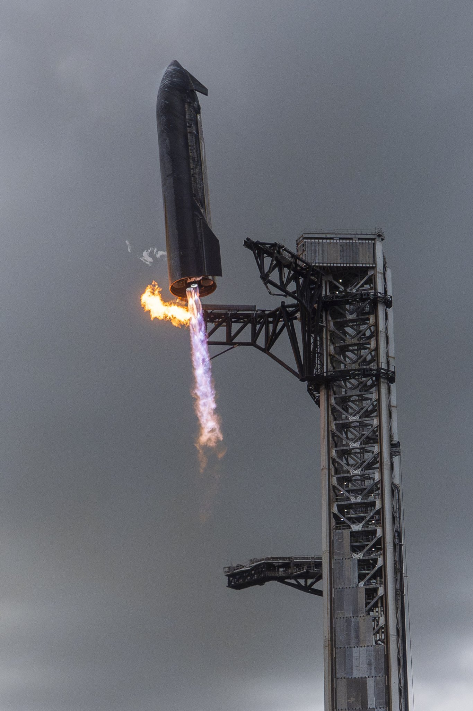
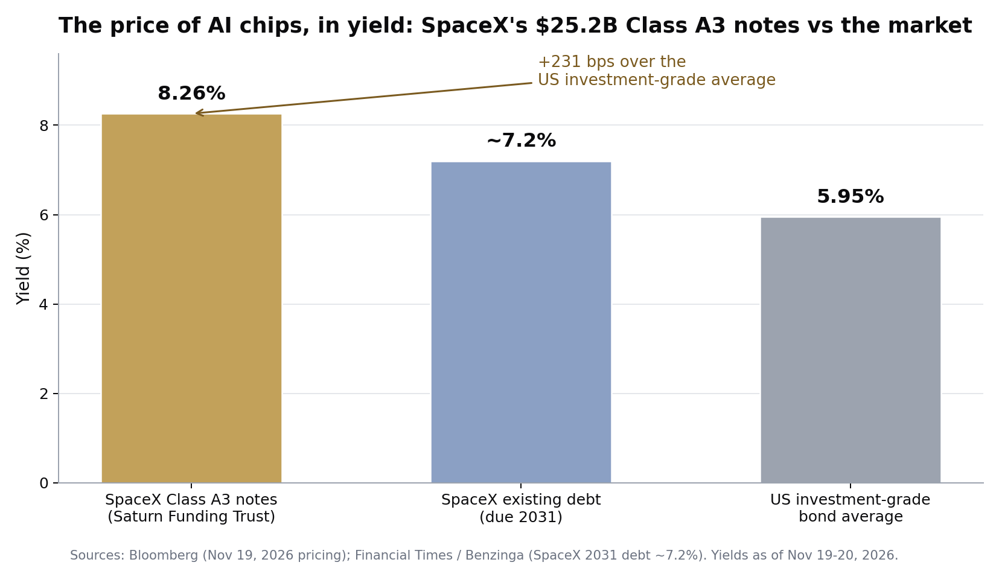
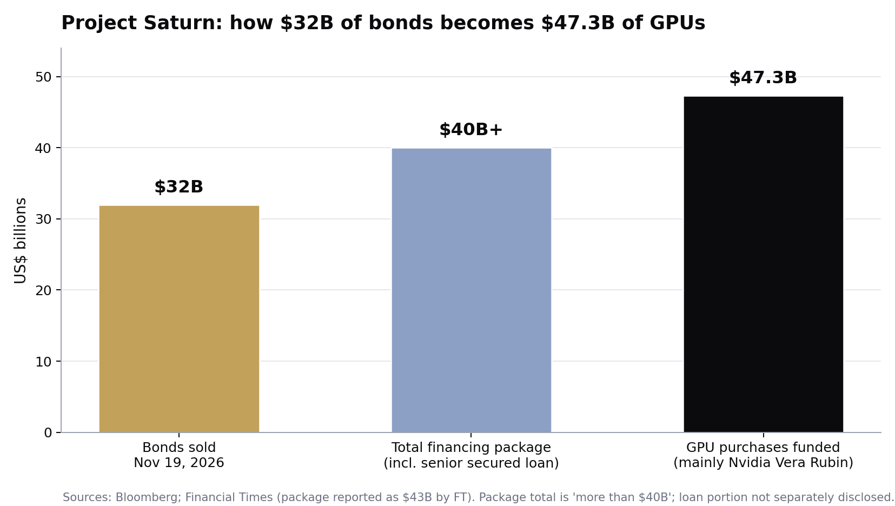

> [中文版 Chinese version](/life/spacex-32b-ai-chip-debt-zh/)

*Ship 42 caught by the launch tower's arms on Starship Flight 15, November 14, 2026 — the first catch of a returning upper stage. Photo: SpaceX, CC BY 4.0, via Wikimedia Commons.*

On Thursday, November 19, 2026, SpaceX sold about $32 billion of bonds to buy AI chips — the largest GPU financing ever arranged, by the company's own description. It was also one of the most expensive investment-grade borrowings of the year. The largest piece, roughly $25.2 billion of Class A3 notes, was priced to yield 8.259%, according to Bloomberg, which first reported the deal. The average yield on U.S. investment-grade bonds that day was 5.95%.

The story of the AI buildout in late 2026 sits in the gap between those two numbers. SpaceX — the world's most valuable private company, freshly public — paid 231 basis points more than the average high-grade borrower to buy computer chips. About $26 billion was pre-committed, according to Bloomberg. The market will finance the AI buildout. It just no longer pretends it is risk-free.

## What SpaceX actually sold

SpaceX did not borrow $32 billion. A special-purpose vehicle called Saturn Funding Trust did. The trust, managed by an entity backed by Apollo Global Management, sells the bonds, buys Nvidia chips — mainly next-generation Vera Rubin systems — and leases the hardware to SpaceX for about five years, starting in the first half of 2027, according to Bloomberg. Goldman Sachs and Apollo arranged the sale, inside a broader package of more than $40 billion — the Financial Times puts it at $43 billion — that also includes a senior secured loan. The whole package funds about $47.3 billion of GPU purchases.

It was telegraphed: on October 26, SpaceX announced a binding commitment for an approximately $40 billion master finance lease with an Apollo-managed entity, calling it the largest GPU financing ever. The point of the trust, according to Bloomberg, is to keep the borrowing off SpaceX's balance sheet.

## The SPV, in plain language

A special-purpose vehicle is a separate legal company created to do one thing — here, own $47.3 billion of Nvidia chips and rent them to SpaceX. The bondholders' claim is on the trust, not on SpaceX. Their security is the chips themselves, plus SpaceX's promise to keep paying rent for roughly five years no matter what.

That promise is unusually absolute. According to Bloomberg, SpaceX must keep paying even if the chips break down, or if an event outside its control — a natural disaster, say — intervenes: a "hell or high water" lease. It is what makes the bonds investment grade at all. Moody's rated the notes A3 — one notch above SpaceX itself — and KBRA rated them A-minus, according to the Financial Times. The notes mature in 2032, but principal is repaid in under four years.

The agencies looked at a pile of GPUs and a five-year rental contract and concluded the bonds were safer than SpaceX. The logic holds as far as it goes. But it rests on two untested assumptions: that a five-year-old GPU will still be worth enough on resale to cover a default, and that the rent keeps being paid by a business whose revenue is concentrated in one customer with a 90-day exit clause.

## The yield is the verdict

A yield is a price, and prices are opinions. The average U.S. investment-grade bond yielded 5.95% on the day of the sale, according to Bloomberg. SpaceX's own existing debt due in 2031 yielded about 7.2%, according to the Financial Times. The new Class A3 notes — rated A3, investment grade, backed by hard assets and an unconditional lease — yielded 8.259%.

*SpaceX's new chip-backed notes pay more than its own unsecured debt. Sources: Bloomberg (Nov 19, 2026 pricing); FT / Benzinga (2031 debt, about 7.2%). Yields as of Nov 19–20, 2026.*

That ordering is remarkable: the new notes are rated higher than SpaceX itself, secured by specific assets, and short-dated — yet they pay roughly 106 basis points more than SpaceX's own unsecured bonds. In a normal market, secured, higher-rated, shorter debt is cheaper debt. Here it is the most expensive paper in the company's capital structure.

The rating describes the structure; the buyers price the economics. And the AI trade, priced as a certainty for two years, is now priced as a bet.

The coupon arithmetic is stark. At 8.259%, the largest tranche alone costs about $2.1 billion a year in interest (our arithmetic: $25.2 billion × 8.259%) — before power, staff, or anything else. For scale, SpaceX's entire Super Intelligence segment reported $431 million of operating income in the third quarter, per its SEC filing as reported by Bitcoin.com News. The business must grow very fast, for a long time, for this math to work.

## The clause that gives the game away

The most revealing detail of the week was not a number. It was a covenant lenders wanted and may or may not have gotten. According to the Financial Times, lenders backing the financing sought restrictions to prevent SpaceX from launching the Nvidia chips into orbit. Their concern, as reported by the FT and summarized by Investor's Business Daily and TipRanks: if SpaceX defaulted, chips in a Tennessee data center can be repossessed, trucked away, and resold. Chips circling the Earth cannot. It is unclear whether the restriction made it into the final documents, the FT reported. SpaceX has said the financed chips will be used in U.S. data centers it majority-owns, controls, and operates.

Musk has spent the autumn talking about orbital data centers: at the Baron Capital conference he said SpaceX's StarMind orbital supercomputers, built on Nvidia Vera Rubin chips, would start launching in the third quarter of 2027. Days before the bond sale, SpaceX caught a Starship upper stage with the launch tower's arms for the first time, on Flight 15 (November 13–14). The rocket that would carry orbital data centers into space is, visibly, working.

And now the people lending SpaceX $32 billion have looked at that vision and said, in effect: wonderful, but not with our collateral. That is the most honest due diligence in the entire AI boom. A lender's job is not to believe in the future; it is to price what happens if the future does not arrive. The orbital thesis may be right. But a bondholder cannot repossess a thesis. It can only repossess a thing, in a place, with a loading dock.

There is a second message in the clause. A Vera Rubin system bought in 2027 is the cutting edge today; in 2030 it is three generations behind, and its resale value depends on a secondary market for used AI accelerators that barely exists at scale. The collateral only works if the chips stay where they can be found, serviced, and sold — in a building, on the ground, with a street address. The clause is not about space; it is about the fact that the whole structure rests on the resale value of depreciating hardware.

## Who is actually paying for this?

A lease is only as good as the rent, and the rent is only as good as the tenant's customers. SpaceX's Super Intelligence segment reported $7.56 billion of revenue in the third quarter of 2026, up from $813 million a year earlier — a 9.3-fold increase, more than half of the company's $14.58 billion total, according to its SEC filing. One customer, identified only as "Customer B," accounted for 34.5% of SpaceX's entire quarterly revenue — about $5 billion, by our arithmetic. Bloomberg reported on October 29, citing a person familiar with the matter, that the customer is Anthropic; neither company has confirmed that publicly.

Anthropic's IPO filing, dated October 26, puts hard numbers on the relationship: agreements with SpaceX.AI LLC for Nvidia-GPU compute worth up to $120.5 billion through 2029, at about $3.1 billion a month once all capacity is delivered, starting in December, according to Bloomberg. The original agreement was $1.25 billion a month.

But the filing also contains the sentence that should keep a bondholder awake: after non-cancelable periods ending in January and March 2027, either side can terminate on 90 days' notice. Anthropic is, on paper, a $120.5 billion customer; in practice, from early 2027, it is a 90-day customer. The bondholders are lending for five years against rent underwritten by a customer who can walk away in three months.

That does not mean Anthropic will walk away — it needs the compute, and it has just raised about $104.8 billion in its IPO, priced at $83 a share on November 18, the day before the bond sale. But "probably will stay" and "contractually must stay" are different things, and the gap is exactly what the 8.259% yield is pricing.

Musk is not worried about demand. On November 18, replying to OpenAI CEO Sam Altman's remarks at a Semafor event that chipmakers were overcounting OpenAI's demand, Musk posted on X: "SpaceX is assuming zero sales to OpenAI. If OpenAI is not seeing demand rising super fast, then something is wrong with their products." Altman deserves to be taken seriously even so: his warning is about arithmetic, not enthusiasm. If every chipmaker and neocloud counts the same OpenAI order in its own forecast, demand is double-counted by construction — and one customer's appetite underpins an enormous amount of announced capacity.

## The pattern is bigger than SpaceX

Oracle is the cautionary comparison. Its free cash flow was negative $23.7 billion in fiscal 2026 (the year to May), after capital expenditure of $55.7 billion, per TIKR's analysis of its filings. Total debt, including leases, more than doubled from $75.9 billion in fiscal 2022 to $167 billion in fiscal 2026. S&P downgraded Oracle to BBB- in July — one notch above junk — explicitly citing OpenAI as a key credit risk, and expects the deficit to widen to roughly negative $42 billion in fiscal 2027. OpenAI itself posted a third-quarter adjusted operating loss of $10.9 billion, according to the Wall Street Journal ($13.5 billion including stock-based compensation). The company at the center of the demand story is losing more than $40 billion a year — and the companies building capacity for it are borrowing to do so.

SpaceX is stronger than Oracle on almost every dimension: its AI business is already profitable ($431 million of operating income in Q3, reversing a $1.72 billion loss a year earlier); its anchor customer just completed the largest IPO in history; its financing is structured, secured, and short-dated. But the direction of travel is the same: the AI buildout has entered its debt-financed phase, paid for with borrowed money, much of it secured against the hardware itself. And now SpaceX has borrowed $32 billion at 8.259% to buy chips it will rent out.

*Project Saturn in three numbers. The gap between the $40 billion-plus package and the $47.3 billion of equipment is covered by the senior secured loan and other commitments. Sources: Bloomberg; FT (package reported as $43 billion).*

Debt is not inherently a problem — every industrial buildout in history was debt-financed at scale. The question is whether the cash flow covers it. For SpaceX that now has a numerical form: the AI business must generate enough rent, from customers who can leave on 90 days' notice, to cover roughly $2 billion a year of interest on this tranche alone, plus principal repaid in under four years, plus the next generation of chips, needed before this generation is paid off. The treadmill is the business model: it works while demand rises, and terribly the moment demand pauses.

## Blueprint or warning?

Both. As a blueprint, Project Saturn is genuinely impressive financial engineering, and it will be copied. It solves the central problem of the AI buildout: the hardware is too expensive for any single balance sheet, it depreciates too fast for a 30-year bond, and the customers are too concentrated for unsecured lending. The SPV, the absolute lease, the short amortization, the investment-grade rating — each piece addresses one of those problems, and BlackRock, KKR, Goldman Sachs Asset Management, and Pimco (which committed $4 billion, according to the FT) all bought in.

As a warning, the deal is equally clear. The market charged 8.259% for A3-rated paper — not the price of a routine financing, but of one the market finds clever and not comfortable. The lenders' attempt to ban orbital launches is the tell: the people with the most money at stake concluded the collateral only has value on the ground, where it can be repossessed. The concentration risk — one customer, 34.5% of revenue, a 90-day exit — is the central risk of the structure, and it is the risk the yield is pricing. SpaceX's shares fell after the news, according to TipRanks, dropping below the IPO price in pre-market trading on Friday, according to Stocktwits.

My judgment: the deal works, and that is precisely why it should make you nervous. It works because it is engineered to work — the structure is sound, the demand is real today, the anchor customer is well-funded today. But engineered structures transfer risk; they do not eliminate it. The risk now rests on the assumption that Anthropic's demand will still be there in 2029 and that a used Vera Rubin system will still be worth something in 2030. Every link is plausible. None is guaranteed. The 231 basis points over the investment-grade average is the market's honest estimate of the distance between plausible and guaranteed.

What to watch next: whether the orbital restriction made it into the final documents — the FT reported it was unclear. Anthropic's first quarterly report as a public company: any sign its compute spending is slowing would reprice this structure overnight. And whether the next neocloud that copies this template gets the same price, or worse — if it prices wider than 8.259%, the template is getting more expensive, not cheaper.

SpaceX caught a spaceship with a tower this month, then borrowed $32 billion to buy computer chips. Both are extraordinary feats. Only one came with a clause saying the collateral is not allowed to leave the planet — the sentence in which the market stopped believing the story and started pricing the risk.

*Prices and yields are as reported for November 19–20, 2026 — a snapshot subject to change. Sources: Bloomberg; Financial Times; SpaceX's Q3 2026 SEC filing and Anthropic's S-1; S&P Global Ratings; Oracle's fiscal 2026 results; the Wall Street Journal (all via the secondary coverage listed in SOURCES.md).*
