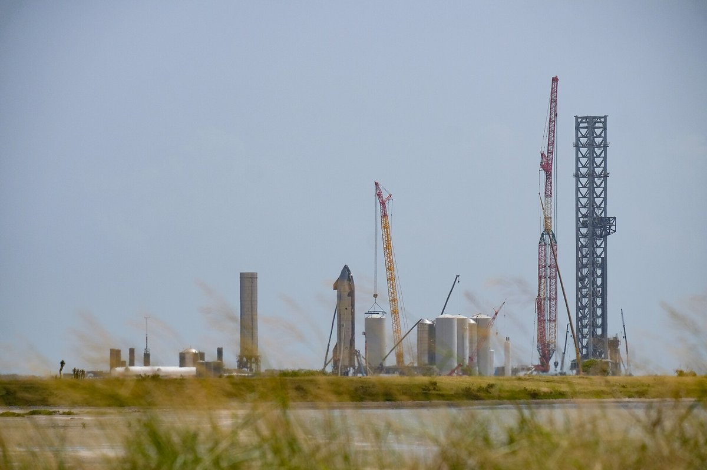
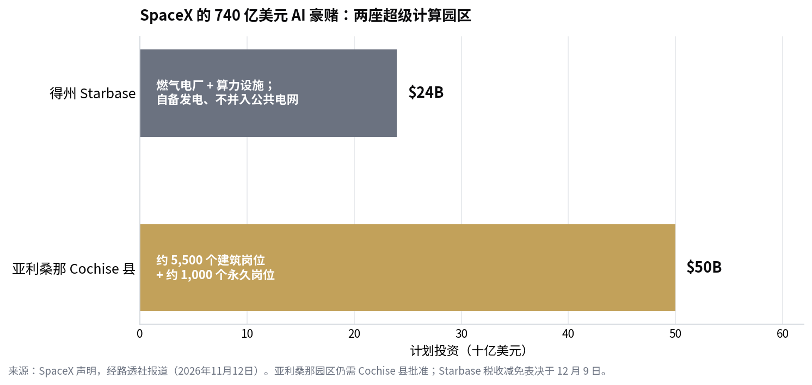

> [English version](/life/spacex-74b-ai-campuses/)

*得州 Boca Chica 的 Starbase 发射场。照片来自 Wikimedia Commons（CC BY-SA 2.0）。*

## 官宣

SpaceX 在 11 月 12 日周四宣布，计划在两座 AI 超级计算园区投入**超过 740 亿美元**：一座位于得州 Starbase，另一座位于亚利桑那州 Cochise 县（路透社）。其中 **Starbase 约 240 亿美元，亚利桑那约 500 亿美元**。

亚利桑那园区将创造约 **5,500 个建筑岗位和 1,000 个永久岗位**，但仍需 Cochise 县批准，而且反对声音已经组织起来：一份 **2,400 人签名的请愿书**要求官员拒绝许可，县里的公开听证会定在 12 月。Starbase 园区则**自备发电，不并入公共电网**；本周早些时候公司表示正在规划一座燃气电厂和超算设施，Starbase 市委员会将于 **12 月 9 日**审议该项目的税收减免申请。

*SpaceX 计划中的 AI 园区投资。来源：SpaceX 声明，经路透社报道（2026年11月12日）。*

## 字面意义上的"公司城"

这次官宣中 Starbase 那一半，落地的不是一块中立的土地。Starbase 不只是一个挂了名字的发射场——它是一座正式建制的城市，而且实际上由 SpaceX 在运转。2025 年 5 月 3 日，Boca Chica 发射场周边的居民以 212 票对 6 票通过投票，决定把这片社区建制为 Starbase 市，5 月 20 日正式完成建市。城市人口约 500 人，绝大多数是 SpaceX 员工及其家属。市长是 Bobby Peden——SpaceX 得州测试与发射业务副总裁，市委员会掌握着原本属于 Cameron 县的土地分区与建筑许可审批权。SpaceX 早在 2024 年就已把公司总部从加州 Hawthorne 迁到了 Starbase。

这让 12 月 9 日的税收减免投票有了一种在别处会显得很奇怪的含义。决定是否给 SpaceX 减税的机构，是一个选民绝大多数是 SpaceX 员工、由一位 SpaceX 高管领导的市政府。这并不违法——Starbase 是得州法律下真实的市政单位，属于 C 类普通法城市（Type C general-law city），而不是 SpaceX 的子公司——但它改变了"地方批准"这个词的意思。在得州，12 月 9 日的投票几乎可以肯定会通过。SpaceX 真正的许可之战在亚利桑那，在那里它没有这种主场优势。

这段历史本身也值得多说一句。Boca Chica 原本是 20 世纪 60 年代末形成的一个偏远海滨小社区，SpaceX 从 2012 年起陆续买地建星舰工厂，2018 年之后整个村子几乎被公司买下。马斯克 2021 年 3 月首次公开提出把 Boca Chica 建制为 Starbase 市，2024 年公司正式向 Cameron 县提交建市申请。换句话说，从买地、建厂、搬总部到建市，SpaceX 用了十几年时间，把一个发射场一步步变成了自己说了算的行政单位。740 亿美元里的得州一半，就落在这个单位的管辖范围里。

## 一家火箭公司为什么要这么干

数字解释了这次转向。SpaceX 在 2026 年 6 月上市，其 AI 业务在第三季度的收入占比**已超过一半**——这门生意早已不止于火箭和星链。按收入算，它现在主要是一家 AI 公司，顺便发射火箭。

IPO 本身就定下了这件事的量级。SpaceX 于 2026 年 6 月 12 日在纳斯达克上市，以每股 135 美元发行 5.556 亿股，募资 750 亿美元——人类历史上规模最大的 IPO，超过沙特阿美 2019 年 294 亿美元纪录的两倍多。上市几天内股价一度冲到 225.64 美元，公司市值短暂接近 3 万亿美元。这个估值里装着三门性格截然不同的生意。星链是现金引擎：作为上市公司的第一个完整季度（第二季度），它贡献了约 43 亿美元收入和约 16.6 亿美元经营利润，截至 6 月 30 日订阅用户达到 1,200 万，星座卫星超过 11,000 颗。发射业务收入约 10 亿美元，还在亏损。而 AI 业务——Grok、X 平台和 AI 基础设施，建立在 2026 年 2 月完成收购的 xAI 之上——收入约 26 亿美元，经营亏损约 12.6 亿美元。从这个角度看，740 亿美元的园区计划就是 AI 业务试图摆脱"亏损户"身份、变成护城河的尝试：从租算力转向拥有算力。

硬件计划与这个规模相匹配。研究机构 SemiAnalysis 在 11 月 11 日报告称，SpaceX 与 xAI 正在开发 **Kessel**——英伟达 Vera Rubin NVL72 机架式系统的定制版，面向地面与轨道数据中心：同样是 36 颗 Vera CPU、72 颗 Rubin GPU 和 9 个 NVLink 交换托盘，但把内部 NVLink 线缆换成了一块 **84 层印制电路板中背板**。SpaceX 将直接向英伟达采购芯片封装，其余部件自行采购，绕过英伟达的预组装板卡——以承担更多供应链风险换取更多控制权。SemiAnalysis 还称，SpaceX 已把 2027 年算力目标上调至约 **13 吉瓦，其中 3.6 吉瓦已在建设中**。SpaceX 与英伟达均未公开回应 Kessel 的消息，所以这款机架目前只能算传闻，而非已确认产品——但方向与公司正在做的其他事完全一致，包括本月早些时候我们写过的轨道数据中心计划（[SpaceX 的 StarMind](/life/spacex-starmind-orbital-datacenter-zh/)）。

这里值得停下来解释一下"吉瓦"这个单位对算力的意义。老一代数据中心按兆瓦计，一个大型园区几十到几百兆瓦；AI 训练集群耗电巨大且 24 小时满负荷运转，项目规模直接跳到了吉瓦级。13 吉瓦的目标，相当于十几座大型核电站的发电量。SpaceX 敢这样报数，底气来自它已经建成的那座园区——而那座园区的故事，恰恰说明了这种速度的代价。

还有一个容易被忽略的维度：算力生意的客户结构。AI 基础设施这个行业里，对手之间互相租算力是常态——2026 年 5 月，Anthropic 就同意租下 Colossus 1 几乎全部的算力容量。也就是说，SpaceX 最大的 AI 园区客户之一，是一家正在同期推进自己 IPO 的竞争对手实验室。这种"既竞争又合作"的关系解释了为什么 Kessel 这样的定制机架如此重要：当你的客户同时也是你的对手，你卖给他的每一度电、每一块芯片，都可能转头变成他用来追赶你的算力。拥有自己的机架设计、自己的电厂、自己的园区，就是在这种互相依赖里保留主动权的方式。

## 样板：Colossus

SpaceX 已经建过一座吉瓦级 AI 园区，它就是两座新园区的样板——包括它们的问题。位于田纳西州孟菲斯的 Colossus 超算集群，由 xAI 在一座废弃的伊莱克斯旧厂房里建起，122 天内让约 10 万颗英伟达 H100 上线。它的继任者 Colossus 2 横跨孟菲斯与密西西比州 Southaven，首个约 11 万颗 GB200 的集群 91 天上线；截至 2026 年 9 月 30 日，SpaceX 报告其各站点铭牌算力容量已达 1.7 吉瓦。

速度来自一套如今已陷入法律纠纷的供电打法。田纳西流域管理局（TVA）起初只给孟菲斯站点批了 150 兆瓦的电网供电，于是 xAI 用卡车运来几十台移动式天然气轮机，在电表之后自行发电，利用了密西西比州"装在拖车上的便携发电机一年内免于空气许可"的规则。NAACP 联合南方环境法律中心与 Earthjustice，依据《清洁空气法》起诉了这些轮机。密西西比州随后在 2026 年 3 月批准了 Southaven 一座 41 台轮机、1.2 吉瓦的燃气电厂。模式至此已经很清晰：先把算力建起来，电网跟不上就自己发电，空气许可问题留给律师慢慢打。Starbase 的燃气电厂和亚利桑那的 36 亿美元电网升级，是同一套打法在两种不同地方形态下的翻版——一处是 SpaceX 自己的城，一处是需要说服一个县的地方。

还有一个值得注意的客户细节。2026 年 5 月，Anthropic 同意租下 Colossus 1 几乎全部的算力容量——也就是说，SpaceX 最大的 AI 园区客户，是一家竞争对手实验室，而这家实验室的 IPO 恰好也在本周定价。至少目前，AI 基础设施这门生意就是对手之间互相租算力的生意。

## 真正的仗在地方层面打，争的是电

反对声音与 AI 本身无关，争的是电力、土地和谁买单。自备燃气电厂绕开了电网——也绕开了公用事业公司对项目的制约——但它仍然需要税收减免投票，也仍然要面对并不想住在电厂旁边的邻居。在亚利桑那，12 月的县听证会是这座 500 亿美元园区能否经受住地方政治考验的第一次实测。

按提交的文件看，亚利桑那园区的规模比标题数字更具体、也更惊人。许可申请于 10 月 30 日递交给 Cochise 县，申请人一栏写的是一家名为 Tombstone Resources LLC 的实体——SpaceX 的名字没有出现在文件里。申请描述的是一座 747 英亩的园区，位于 Willcox Playa 附近——那是一片干湖床，每年冬天都有迁徙的沙丘鹤聚集——共九栋计算楼，分四期建设，满负荷用电约 **6 吉瓦**。做个对照：这个数字大约是 Maricopa 县所有数据中心用电量总和的 2.5 倍（据《亚利桑那共和报》的分析），约为 Palo Verde 核电站发电量的 1.5 倍。园区旁边就是约 1 吉瓦的 Apache 煤气发电站，供电将通过 Sulphur Springs Valley 电力合作社与亚利桑那电力合作社，申请中包含 36 亿美元的电网升级投资。

水是当地另一个引爆点，而公司的答案是干冷：热量从计算机进入封闭液冷回路，再通过风冷散热器排走，不设蒸发冷却塔、不抽地下水用于工业冷却。一口现有的水井每年最多抽 10 英亩-英尺水，用于饮用水、维护与设备清洁。对照这个山谷的现实——地下水早已被大型奶牛场大量抽取——这个数字本身很小。但在 11 月 4 日的社区说明会上，近 300 人挤满了一所小学礼堂，居民要的不是保证，而是可执行的限制：对用水、噪音、灯光的硬性条件，以及"如果开发商转手卖掉园区，居民找谁"这类问题的答案。SpaceX 的能源负责人当场承诺，项目会让居民电费与房产税各下降约 20%，不过房产税那句承诺并没有写进许可申请本身。听证会定在 12 月 9 日，11 月 27 日中午前提交的书面意见会被收进听证材料包。

政治环境本周变得更棘手。民主党赢得了得州州长选举，分析师 Dan Ives 本周表示，马斯克现在需要在得州伸出"橄榄枝"以保住数据中心扩张，同时他仍坚持认为 SpaceX 最终会收购特斯拉。740 亿美元的官宣在某种程度上就是对这种压力的回应：一笔大到让州政府无法轻易放弃的投资，在政治风向转变的同一周抛出。亚利桑那州总检察长 Kris Mayes 已呼吁全州暂停新的数据中心项目，Pinal 县的官员也已经否决了另一个项目。反对声浪不再是假设——它已经写进了许可记录。

值得注意的是，这种地方层面的拉锯正在全美复制。数据中心争夺战的焦点已经从"建不建"变成了"谁来买单"：电力合作社要不要为一家巨头升级电网、居民电价会不会被大客户推高、地下水与暗夜星空值多少钱。亚利桑那的辩论里甚至出现了一个新的政策工具——"纳税人保护承诺"（Ratepayer Protection Pledge），要求数据中心自己承担电网升级成本、不把账单转嫁给普通居民。SpaceX 在申请里承诺的 36 亿美元电网升级与 20% 的电费下降，正是对这种质疑的直接回应：它在试图证明，这座园区不是来分电网的，而是来帮电网买单的。问题在于，承诺写在新闻稿里是一回事，写进有法律约束力的许可条件里是另一回事，而 12 月 9 日的听证会恰恰就是决定写进什么的地方。

## 判断

值得盯的数字不是 740 亿。那是未来数年的计划支出，取决于许可、电力和一次税收投票——亚利桑那那一半还没获批。真正重要的数字已经写在账本里：**SpaceX 超过一半的收入如今来自 AI**。一家这样赚钱的公司，最终会自己建基础设施——自己的电、自己的机架，如果 StarMind 能成，还有自己的轨道。另一个值得盯的数字是 13 吉瓦：这是 SpaceX 给自己定的 2027 年算力目标，其中 3.6 吉瓦已在建设中。目标与现实之间的差距，就是未来两年这家公司真正的故事——它能不能把纸面上的吉瓦变成通电的机架。

悬而未决的问题是，为火箭验证过的垂直整合打法是否同样适用于算力。火箭奖励什么都自己造；数据中心奖励的是谁能最便宜地拿到电和芯片。SpaceX 赌的是自己能两者兼得。12 月亚利桑那的听证会和 12 月 9 日 Starbase 的投票，比今天的新闻稿更能说明这场赌局的成色——而且这两场投票会说明不同的事。在 Starbase，批准几乎是板上钉钉，这说明的是 SpaceX 对自己地盘的控制力。在 Cochise 县，批准是真正有悬念的，这说明的是这种控制力在其他地方的边界。一座 6 吉瓦的园区，建在乡村山谷里、鹤类栖息地旁边，所在的州总检察长还想叫停，这场赌局最难的版本就是这样。如果它能过关，这个模式在哪里都可复制；如果它卡住了，740 亿美元的标题就只剩下得州那一半——而这家自建电厂的公司将会学到，它唯一造不出来的东西，是许可。更值得玩味的是，即便亚利桑那获批，真正的考验才刚开始：6 吉瓦的用电需求、36 亿美元的电网升级、九栋楼分四期建设，任何一个环节的延误都会把"2027 年 13 吉瓦"的目标往后推，而 AI 基础设施这个行业里，晚一年交付就可能意味着把客户拱手让给对手。

## 来源

- 路透社，"SpaceX to invest over $74 billion in supercompute facilities in Texas, Arizona"，2026年11月12日（740 亿美元总额；Starbase 240 亿；亚利桑那约 500 亿；5,500 个建筑岗位、1,000 个永久岗位；Starbase 自备发电；本周早些时候规划燃气电厂与超算设施）。
- 路透社经 WNCY，2026年11月12日（亚利桑那园区需 Cochise 县批准；2,400 人签名请愿；12 月公开听证会；Starbase 税收减免 12 月 9 日表决；AI 业务占第三季度收入一半以上；公司 6 月上市）。
- Tom's Hardware / SemiAnalysis，2026年11月11日，经 Data Center Dynamics 与 Stocktwits 转述（Kessel：定制版 Vera Rubin NVL72，36 颗 Vera CPU、72 颗 Rubin GPU、9 个 NVLink 交换托盘、84 层 M10 PCB 中背板；向英伟达买芯片、其余自行采购；2027 年算力目标约 13 吉瓦，3.6 吉瓦在建；SpaceX 与英伟达均未公开回应）。
- Benzinga 经 TradingView，2026年11月12日（Dan Ives：民主党胜选后马斯克需要在得州伸出"橄榄枝"；"我仍相信 SpaceX 会收购特斯拉"）。
- 维基百科，"Starbase, Texas"（2025 年 5 月 3 日建市投票 212 票对 6 票；5 月 20 日正式建市；人口约 500；市长 Bobby Peden 为 SpaceX 得州测试与发射业务副总裁；2024 年总部从 Hawthorne 迁至 Starbase；SpaceX 自 2012 年起在 Boca Chica 购地）。
- 《亚利桑那共和报》经 azcentral，2026年11月6日（Willcox Playa 附近 747 英亩园区；满负荷 6 吉瓦；约为 Maricopa 县全部数据中心用电 2.5 倍；干冷；每年 10 英亩-英尺用水；36 亿美元电网升级；10 月 30 日由 Tombstone Resources LLC 提交许可申请；11 月 4 日社区说明会约 300 人；电费与房产税降 20% 的说法；12 月 9 日听证会）。
- Three Sonorans / Tucsonans，2026年11月（九栋楼分四期；6 吉瓦约为 Palo Verde 核电站 1.5 倍；90 兆瓦燃气备用发电机；Willcox Playa 沙丘鹤栖息地；NAACP 就 Colossus 轮机提起《清洁空气法》诉讼；亚利桑那州总检察长呼吁全州暂停；Pinal 县否决另一项目）。
- Inside Deep Tech / American Owned Superintelligence，2026年10月（Colossus 1：约 10 万颗 H100，122 天上线；Colossus 2：约 11 万颗 GB200，91 天上线；截至 2026 年 9 月 30 日铭牌算力 1.7 吉瓦；2026 年 3 月批准 Southaven 41 台轮机、1.2 吉瓦燃气电厂；Anthropic 自 2026 年 5 月起租用 Colossus 1 算力）。
- Horizon Desk / AInvest，2026年10–11月（2026 年 6 月 12 日 IPO：5.556 亿股每股 135 美元，募资 750 亿美元，史上最大 IPO；股价触及 225.64 美元，市值近 3 万亿美元；第二季度收入约 78 亿美元；星链收入 43 亿美元、经营利润约 16.6 亿美元，订阅用户 1,200 万，卫星 11,000 颗以上；AI 业务收入 26 亿美元、经营亏损约 12.6 亿美元）。
- Medium，2026年11月（全州数据中心争议背景；"纳税人保护承诺"于 2026 年 3 月提出，要求数据中心自担电网升级成本）。

[END EXTERNAL CONTENT: source=file file=~/workspace/stage/spacex-74b-ai-campuses/article-zh.md tool_name=read]
