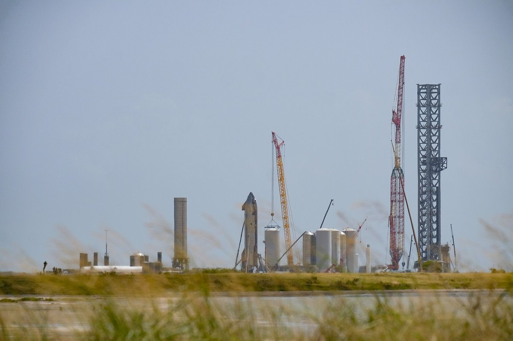
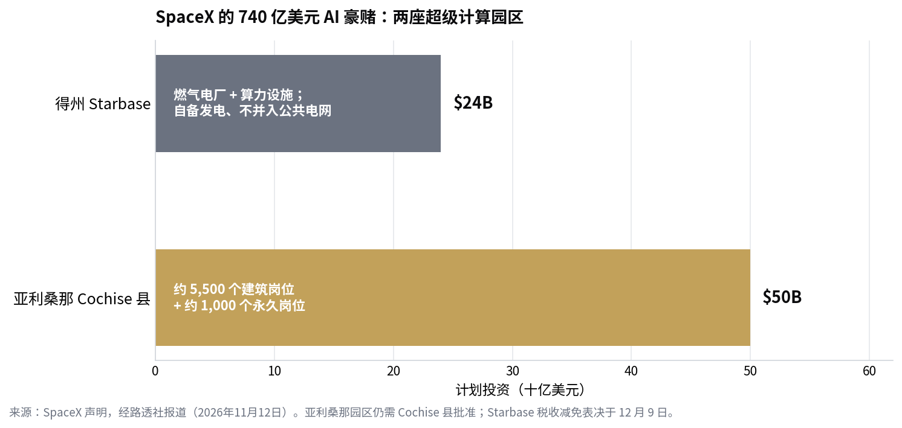

> [English version](/life/spacex-74b-ai-campuses/)

*得州 Boca Chica 的 Starbase 发射场。照片来自 Wikimedia Commons（CC BY-SA 2.0）。*

## 官宣

SpaceX 在 11 月 12 日周四宣布，计划在两座 AI 超级计算园区投入**超过 740 亿美元**：一座位于得州 Starbase，另一座位于亚利桑那州 Cochise 县（路透社）。其中 **Starbase 约 240 亿美元，亚利桑那约 500 亿美元**。

亚利桑那园区将创造约 **5,500 个建筑岗位和 1,000 个永久岗位**，但仍需 Cochise 县批准，而且反对声音已经组织起来：一份 **2,400 人签名的请愿书**要求官员拒绝许可，县里的公开听证会定在 12 月。Starbase 园区则**自备发电，不并入公共电网**；本周早些时候公司表示正在规划一座燃气电厂和超算设施，Starbase 市委员会将于 **12 月 9 日**审议该项目的税收减免申请。

*SpaceX 计划中的 AI 园区投资。来源：SpaceX 声明，经路透社报道（2026年11月12日）。*

## 一家火箭公司为什么要这么干

数字解释了这次转向。SpaceX 在 2026 年 6 月上市，其 AI 业务在第三季度的收入占比**已超过一半**——这门生意早已不止于火箭和星链。按收入算，它现在主要是一家 AI 公司，顺便发射火箭。

硬件计划与这个规模相匹配。研究机构 SemiAnalysis 在 11 月 11 日报告称，SpaceX 与 xAI 正在开发 **Kessel**——英伟达 Vera Rubin NVL72 机架式系统的定制版，面向地面与轨道数据中心：同样是 36 颗 Vera CPU、72 颗 Rubin GPU 和 9 个 NVLink 交换托盘，但把内部 NVLink 线缆换成了一块 **84 层印制电路板中背板**。SpaceX 将直接向英伟达采购芯片封装，其余部件自行采购，绕过英伟达的预组装板卡——以承担更多供应链风险换取更多控制权。SemiAnalysis 还称，SpaceX 已把 2027 年算力目标上调至约 **13 吉瓦，其中 3.6 吉瓦已在建设中**。SpaceX 与英伟达均未公开回应 Kessel 的消息，所以这款机架目前只能算传闻，而非已确认产品——但方向与公司正在做的其他事完全一致，包括本月早些时候我们写过的轨道数据中心计划（[SpaceX 的 StarMind](/life/spacex-starmind-orbital-datacenter-zh/)）。

## 真正的仗在地方层面打，争的是电

反对声音与 AI 本身无关，争的是电力、土地和谁买单。自备燃气电厂绕开了电网——也绕开了公用事业公司对项目的制约——但它仍然需要税收减免投票，也仍然要面对并不想住在电厂旁边的邻居。在亚利桑那，12 月的县听证会是这座 500 亿美元园区能否经受住地方政治考验的第一次实测。

政治环境本周变得更棘手。民主党赢得了得州州长选举，分析师 Dan Ives 本周表示，马斯克现在需要在得州伸出"橄榄枝"以保住数据中心扩张，同时他仍坚持认为 SpaceX 最终会收购特斯拉。740 亿美元的官宣在某种程度上就是对这种压力的回应：一笔大到让州政府无法轻易放弃的投资，在政治风向转变的同一周抛出。

## 判断

值得盯的数字不是 740 亿。那是未来数年的计划支出，取决于许可、电力和一次税收投票——亚利桑那那一半还没获批。真正重要的数字已经写在账本里：**SpaceX 超过一半的收入如今来自 AI**。一家这样赚钱的公司，最终会自己建基础设施——自己的电、自己的机架，如果 StarMind 能成，还有自己的轨道。

悬而未决的问题是，为火箭验证过的垂直整合打法是否同样适用于算力。火箭奖励什么都自己造；数据中心奖励的是谁能最便宜地拿到电和芯片。SpaceX 赌的是自己能两者兼得。12 月亚利桑那的听证会和 12 月 9 日 Starbase 的投票，比今天的新闻稿更能说明这场赌局的成色。

## 来源

- 路透社，"SpaceX to invest over $74 billion in supercompute facilities in Texas, Arizona"，2026年11月12日（740 亿美元总额；Starbase 240 亿；亚利桑那约 500 亿；5,500 个建筑岗位、1,000 个永久岗位；Starbase 自备发电；本周早些时候规划燃气电厂与超算设施）。
- 路透社经 WNCY，2026年11月12日（亚利桑那园区需 Cochise 县批准；2,400 人签名请愿；12 月公开听证会；Starbase 税收减免 12 月 9 日表决；AI 业务占第三季度收入一半以上；公司 6 月上市）。
- Tom's Hardware / SemiAnalysis，2026年11月11日，经 Data Center Dynamics 与 Stocktwits 转述（Kessel：定制版 Vera Rubin NVL72，36 颗 Vera CPU、72 颗 Rubin GPU、9 个 NVLink 交换托盘、84 层 M10 PCB 中背板；向英伟达买芯片、其余自行采购；2027 年算力目标约 13 吉瓦，3.6 吉瓦在建；SpaceX 与英伟达均未公开回应）。
- Benzinga 经 TradingView，2026年11月12日（Dan Ives：民主党胜选后马斯克需要在得州伸出"橄榄枝"；"我仍相信 SpaceX 会收购特斯拉"）。
