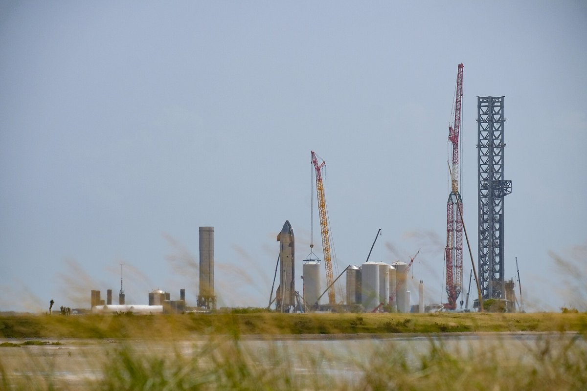
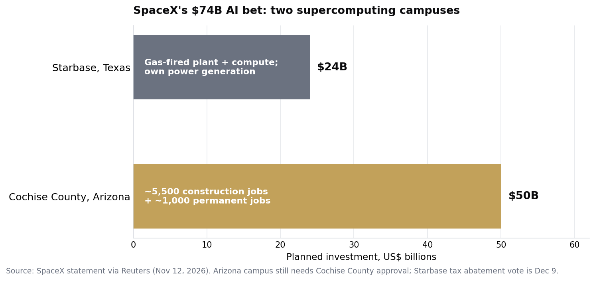

> [中文版 Chinese version](/life/spacex-74b-ai-campuses-zh/)

*The Starbase launch facility in Boca Chica, Texas. Photo via Wikimedia Commons (CC BY-SA 2.0).*

## The announcement

SpaceX said on Thursday, November 12, that it plans to invest **more than $74 billion in two supercomputing campuses**: one at its Starbase site in Texas and another in Cochise County, Arizona (Reuters). The split is **about $24 billion for Starbase and roughly $50 billion for Arizona**.

The Arizona campus would create about **5,500 construction jobs and 1,000 permanent jobs**, according to the company — but it still needs approval from Cochise County, and it already has organized opposition: a petition with **2,400 signatures** has asked officials to deny the permit, with a county public hearing set for December. At Starbase, the facility would **generate its own electricity rather than draw from the public grid**; earlier in the week the company said it was planning a gas-fired power plant and super-compute facility there, and the Starbase City Commission is due to consider a property-tax abatement for the project on **December 9**.

*SpaceX's planned AI campus spending. Source: SpaceX statement via Reuters (Nov 12, 2026).*

## A company town, literally

The Starbase half of this announcement is not landing on neutral ground. Starbase is not just a launch site with a name — it is an incorporated city, and SpaceX effectively runs it. Residents voted 212 to 6 on May 3, 2025 to incorporate the community around the Boca Chica launch complex as the City of Starbase, and the incorporation became formal on May 20, 2025. The population is about 500, most of them SpaceX employees and their families. The mayor is Bobby Peden, SpaceX's vice president of Texas test and launch operations, and the city commission controls zoning and building permits that used to sit with Cameron County. SpaceX had already moved its corporate headquarters from Hawthorne, California to Starbase in 2024.

That matters for the December 9 tax-abatement vote in a way that would be strange anywhere else. The body deciding whether to grant SpaceX a tax break is a city government whose electorate is overwhelmingly SpaceX people, led by a SpaceX executive. None of that is illegal — Starbase is a real municipality under Texas law, a Type C general-law city, not a company subsidiary — but it changes the meaning of "local approval." In Texas, the December 9 vote is close to a formality. The real permitting fight for SpaceX is the one in Arizona, where the company has no such home-field advantage.

## Why a rocket company is doing this

The numbers explain the pivot. SpaceX went public in June 2026, and its AI segment generated **more than half of its revenue in the third quarter** — the business has already moved beyond rockets and Starlink. The company is not dabbling in AI infrastructure; by revenue, it is now mostly an AI company that also launches rockets.

The IPO itself set the scale of the story. SpaceX listed on the Nasdaq on June 12, 2026, selling 555.6 million shares at $135 and raising $75 billion — the largest IPO in history, more than double Saudi Aramco's $29.4 billion record from 2019. Shares touched $225.64 within days, briefly valuing the company near $3 trillion. The three businesses inside that valuation could hardly be more different in character. Starlink, the connectivity segment, is the cash engine: in the second quarter, its first as a public company, it brought in about $4.3 billion of revenue and roughly $1.66 billion of operating income, with subscribers reaching 12 million by June 30 and the constellation past 11,000 satellites. The launch business earned about $1 billion and lost money. And the AI segment — Grok, the X platform, and AI infrastructure, built on the xAI acquisition that closed in February 2026 — produced about $2.6 billion in revenue and lost about $1.26 billion at the operating level. The $74 billion campus plan is, in that light, the AI segment's attempt to stop being the loss-maker and start being the moat: the part of the company that owns the compute instead of renting it.

The hardware plan matches that scale. Research firm SemiAnalysis reported on November 11 that SpaceX and xAI are developing **Kessel**, a custom version of Nvidia's Vera Rubin NVL72 rack-scale system for both terrestrial and orbital data centers: the same 36 Vera CPUs, 72 Rubin GPUs and nine NVLink switch trays, but with the internal NVLink cable cartridges replaced by an **84-layer printed-circuit-board midplane**. SpaceX would buy the chip packages from Nvidia and source the rest directly, bypassing Nvidia's pre-assembled boards — taking on more supply-chain risk in exchange for more control. SemiAnalysis also said SpaceX has raised its 2027 capacity target to about **13 gigawatts, with 3.6 gigawatts already under construction**. Neither SpaceX nor Nvidia has commented publicly on Kessel, so treat the rack as a report, not a confirmed product — but the direction is consistent with everything else the company is doing, including the orbital data-center plans we covered earlier this month ([SpaceX's StarMind](/life/spacex-starmind-orbital-datacenter/)).

## The template: Colossus

SpaceX has already built one gigawatt-scale AI campus, and it is the template for both new ones — including their problems. Colossus, the xAI supercomputer cluster in Memphis, Tennessee, went from an empty former Electrolux plant to roughly 100,000 Nvidia H100 GPUs live in 122 days in 2024. Its successor, Colossus 2, straddling Memphis and Southaven, Mississippi, brought a first cluster of about 110,000 GB200 processors online in 91 days, and SpaceX reported 1.7 gigawatts of nameplate compute capacity across its sites by September 30, 2026.

The speed came from a power playbook that is now a legal fight. The Tennessee Valley Authority approved only 150 megawatts of grid power for the Memphis site at first, so xAI trucked in mobile natural-gas turbines — dozens of them — to generate power behind the meter, exploiting the fact that trailer-mounted generators were exempt from Mississippi air permitting for a year. The NAACP, with the Southern Environmental Law Center and Earthjustice, sued over the turbines under the Clean Air Act. Mississippi has since approved a 41-turbine, 1.2-gigawatt gas plant for the Southaven site. The pattern is now legible: build the compute first, generate your own power while the grid catches up, and litigate the air permits later. Starbase's gas-fired plant and Arizona's $3.6 billion in grid upgrades are the same playbook in two different local forms — one where SpaceX owns the town, one where it has to persuade a county.

## The fight is local, and it is about power

The opposition is not about AI. It is about electricity, land, and who pays. A gas-fired plant that powers its own campus sidesteps the grid — and sidesteps the utility's leverage over the project — but it still needs a tax abatement vote and still faces neighbors who did not sign up to live next to a power plant. In Arizona, the county hearing in December is the first real test of whether the $50 billion campus survives contact with local politics.

The Arizona site, as filed, is bigger and more specific than the headline suggests. The permit application, filed October 30 with Cochise County by an entity called Tombstone Resources LLC — SpaceX's name does not appear on it — describes a 747-acre campus near the Willcox Playa, a dry lakebed where migratory sandhill cranes gather each winter, with up to nine computing buildings in four phases and an electrical demand of about **6 gigawatts at full build-out**. For scale, that is roughly two and a half times the power draw of every data center in Maricopa County combined, according to an analysis by The Arizona Republic, and about one and a half times the output of the Palo Verde nuclear plant. The site sits near the Apache Generating Station, a roughly 1-gigawatt coal-and-gas plant, and would be served through the Sulphur Springs Valley Electric Cooperative and the Arizona Electric Power Cooperative, with $3.6 billion in grid upgrades in the application.

Water is the other local flashpoint, and the company's answer is dry cooling: heat moves from the computers into closed liquid loops and out through fan-cooled radiators, with no evaporative cooling towers and no groundwater pumped for industrial use. An existing well would pump up to 10 acre-feet a year for drinking water, maintenance, and cleaning. That is a small number against a valley where groundwater has already been drawn down by large dairy farms — but residents at the November 4 community meeting, where nearly 300 people packed an elementary school auditorium, asked for enforceable limits rather than assurances, and for conditions on noise, light, and what happens if the builder sells. SpaceX's energy chief told the meeting the project would cut residents' electricity bills and property taxes by about 20%, though the property-tax claim does not appear in the permit application itself.

The politics got harder this week. Democrats won the Texas governor's race, and analyst Dan Ives argued this week that Musk now needs an "olive branch" in Texas to protect the data-center buildout — while maintaining that he still believes SpaceX eventually acquires Tesla. The $74 billion announcement reads, in part, as an answer to that pressure: a bet too big for the state to walk away from, announced the same week the politics turned. Arizona's attorney general, Kris Mayes, has called for a statewide pause on new data-center projects, and officials in Pinal County have already rejected a different one. The backlash is no longer hypothetical — it is a permitting record.

## The verdict

The number to watch is not $74 billion. That is planned spending over years, contingent on permits, power, and a tax vote — and the Arizona half is not approved yet. The number that matters is the one already in the books: **more than half of SpaceX's revenue now comes from AI**. A company that earns its money that way will eventually build the infrastructure itself — its own power, its own racks, and, if StarMind works out, its own orbit.

The open question is whether the vertical-integration playbook that worked for rockets works for compute. Rockets reward owning everything; data centers reward whoever gets power and chips cheapest. SpaceX is betting it can be both. The December hearings in Arizona and the December 9 vote in Starbase will say more about that bet than today's press release did — and the two votes will say different things. In Starbase, approval is nearly certain, which tells you about SpaceX's control of its own town. In Cochise County, approval is genuinely contested, which tells you about the limits of that control everywhere else. If the Arizona campus clears, the model scales anywhere. If it stalls, the $74 billion headline shrinks to the Texas half — and the company that builds its own power plants will have learned that the one thing it cannot build is permission.

## Sources

- Reuters, "SpaceX to invest over $74 billion in supercompute facilities in Texas, Arizona," November 12, 2026 ($74B total; $24B Starbase; ~$50B Arizona; 5,500 construction jobs, 1,000 permanent jobs; Starbase generates its own electricity; gas-fired power plant and super-compute facility planned earlier in the week).
- Reuters via WNCY, November 12, 2026 (Arizona campus needs Cochise County approval; 2,400-signature petition; December public hearing; Starbase tax abatement vote December 9; AI segment generated more than half of Q3 revenue; company went public in June).
- Tom's Hardware / SemiAnalysis, November 11, 2026, via Data Center Dynamics and Stocktwits (Kessel: custom Vera Rubin NVL72 variant, 36 Vera CPUs, 72 Rubin GPUs, nine NVLink switch trays, 84-layer M10 PCB midplane; buy chips from Nvidia, source the rest directly; 2027 capacity target ~13 GW, 3.6 GW under construction; no public comment from SpaceX or Nvidia).
- Benzinga via TradingView, November 12, 2026 (Dan Ives: Musk needs an "olive branch" in Texas after Democrat election wins; "I still believe SpaceX acquires Tesla").
- Wikipedia, "Starbase, Texas" (incorporation vote 212–6 on May 3, 2025; formal incorporation May 20, 2025; population about 500; Mayor Bobby Peden, SpaceX vice president of Texas test and launch operations; headquarters moved from Hawthorne to Starbase in 2024).
- The Arizona Republic via azcentral, November 6, 2026 (747-acre campus near Willcox Playa; 6 GW at full build-out; 2.5 times all Maricopa County data centers combined; dry-cooled; 10 acre-feet a year; $3.6 billion in grid upgrades; permit filed October 30 by Tombstone Resources LLC; ~300 people at November 4 community meeting; 20% bill and property-tax claims; December 9 hearing).
- Three Sonorans / Tucsonans, November 2026 (nine buildings in four phases; 6 GW about 1.5 times Palo Verde; 90 MW of gas backup generators; sandhill cranes at Willcox Playa; NAACP Clean Air Act suit over Colossus turbines; Arizona AG call for a statewide pause; Pinal County rejection).
- Inside Deep Tech / American Owned Superintelligence, October 2026 (Colossus 1: ~100,000 H100s in 122 days; Colossus 2: ~110,000 GB200s in 91 days; 1.7 GW nameplate compute at September 30, 2026; 41 turbines, 1.2 GW Southaven plant approved March 2026).
- Horizon Desk / AInvest, October–November 2026 (IPO June 12, 2026: 555.6 million shares at $135, $75 billion raised, largest IPO in history; shares touched $225.64, near $3 trillion; Q2 revenue about $7.8 billion; Starlink $4.3 billion revenue, ~$1.66 billion operating income, 12 million subscribers, 11,000+ satellites; AI segment $2.6 billion revenue, ~$1.26 billion operating loss).

<!-- rebuild trigger 2026-11-12 -->
