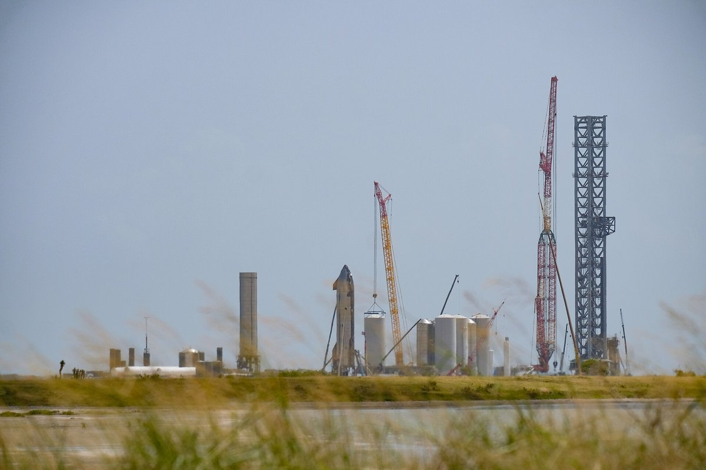
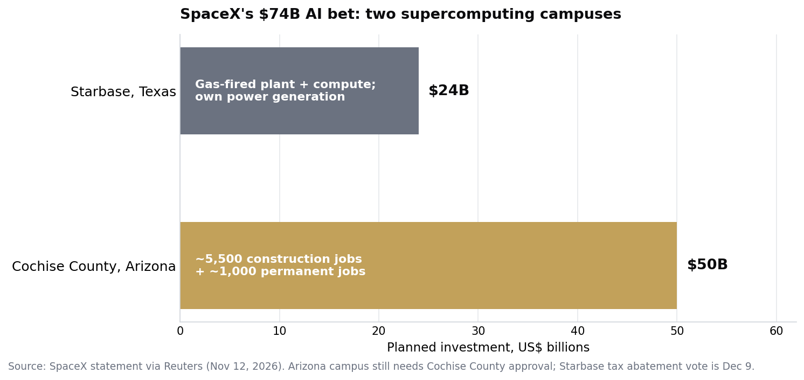

> [中文版 Chinese version](/life/spacex-74b-ai-campuses-zh/)

*The Starbase launch facility in Boca Chica, Texas. Photo via Wikimedia Commons (CC BY-SA 2.0).*

## The announcement

SpaceX said on Thursday, November 12, that it plans to invest **more than $74 billion in two supercomputing campuses**: one at its Starbase site in Texas and another in Cochise County, Arizona (Reuters). The split is **about $24 billion for Starbase and roughly $50 billion for Arizona**.

The Arizona campus would create about **5,500 construction jobs and 1,000 permanent jobs**, according to the company — but it still needs approval from Cochise County, and it already has organized opposition: a petition with **2,400 signatures** has asked officials to deny the permit, with a county public hearing set for December. At Starbase, the facility would **generate its own electricity rather than draw from the public grid**; earlier in the week the company said it was planning a gas-fired power plant and super-compute facility there, and the Starbase City Commission is due to consider a property-tax abatement for the project on **December 9**.

*SpaceX's planned AI campus spending. Source: SpaceX statement via Reuters (Nov 12, 2026).*

## Why a rocket company is doing this

The numbers explain the pivot. SpaceX went public in June 2026, and its AI segment generated **more than half of its revenue in the third quarter** — the business has already moved beyond rockets and Starlink. The company is not dabbling in AI infrastructure; by revenue, it is now mostly an AI company that also launches rockets.

The hardware plan matches that scale. Research firm SemiAnalysis reported on November 11 that SpaceX and xAI are developing **Kessel**, a custom version of Nvidia's Vera Rubin NVL72 rack-scale system for both terrestrial and orbital data centers: the same 36 Vera CPUs, 72 Rubin GPUs and nine NVLink switch trays, but with the internal NVLink cable cartridges replaced by an **84-layer printed-circuit-board midplane**. SpaceX would buy the chip packages from Nvidia and source the rest directly, bypassing Nvidia's pre-assembled boards — taking on more supply-chain risk in exchange for more control. SemiAnalysis also said SpaceX has raised its 2027 capacity target to about **13 gigawatts, with 3.6 gigawatts already under construction**. Neither SpaceX nor Nvidia has commented publicly on Kessel, so treat the rack as a report, not a confirmed product — but the direction is consistent with everything else the company is doing, including the orbital data-center plans we covered earlier this month ([SpaceX's StarMind](/life/spacex-starmind-orbital-datacenter/)).

## The fight is local, and it is about power

The opposition is not about AI. It is about electricity, land, and who pays. A gas-fired plant that powers its own campus sidesteps the grid — and sidesteps the utility's leverage over the project — but it still needs a tax abatement vote and still faces neighbors who did not sign up to live next to a power plant. In Arizona, the county hearing in December is the first real test of whether the $50 billion campus survives contact with local politics.

The politics got harder this week. Democrats won the Texas governor's race, and analyst Dan Ives argued this week that Musk now needs an "olive branch" in Texas to protect the data-center buildout — while maintaining that he still believes SpaceX eventually acquires Tesla. The $74 billion announcement reads, in part, as an answer to that pressure: a bet too big for the state to walk away from, announced the same week the politics turned.

## The verdict

The number to watch is not $74 billion. That is planned spending over years, contingent on permits, power, and a tax vote — and the Arizona half is not approved yet. The number that matters is the one already in the books: **more than half of SpaceX's revenue now comes from AI**. A company that earns its money that way will eventually build the infrastructure itself — its own power, its own racks, and, if StarMind works out, its own orbit.

The open question is whether the vertical-integration playbook that worked for rockets works for compute. Rockets reward owning everything; data centers reward whoever gets power and chips cheapest. SpaceX is betting it can be both. The December hearings in Arizona and the December 9 vote in Starbase will say more about that bet than today's press release did.

## Sources

- Reuters, "SpaceX to invest over $74 billion in supercompute facilities in Texas, Arizona," November 12, 2026 ($74B total; $24B Starbase; ~$50B Arizona; 5,500 construction jobs, 1,000 permanent jobs; Starbase generates its own electricity; gas-fired power plant and super-compute facility planned earlier in the week).
- Reuters via WNCY, November 12, 2026 (Arizona campus needs Cochise County approval; 2,400-signature petition; December public hearing; Starbase tax abatement vote December 9; AI segment generated more than half of Q3 revenue; company went public in June).
- Tom's Hardware / SemiAnalysis, November 11, 2026, via Data Center Dynamics and Stocktwits (Kessel: custom Vera Rubin NVL72 variant, 36 Vera CPUs, 72 Rubin GPUs, nine NVLink switch trays, 84-layer M10 PCB midplane; buy chips from Nvidia, source the rest directly; 2027 capacity target ~13 GW, 3.6 GW under construction; no public comment from SpaceX or Nvidia).
- Benzinga via TradingView, November 12, 2026 (Dan Ives: Musk needs an "olive branch" in Texas after Democrat election wins; "I still believe SpaceX acquires Tesla").

<!-- rebuild trigger 2026-11-12 -->
