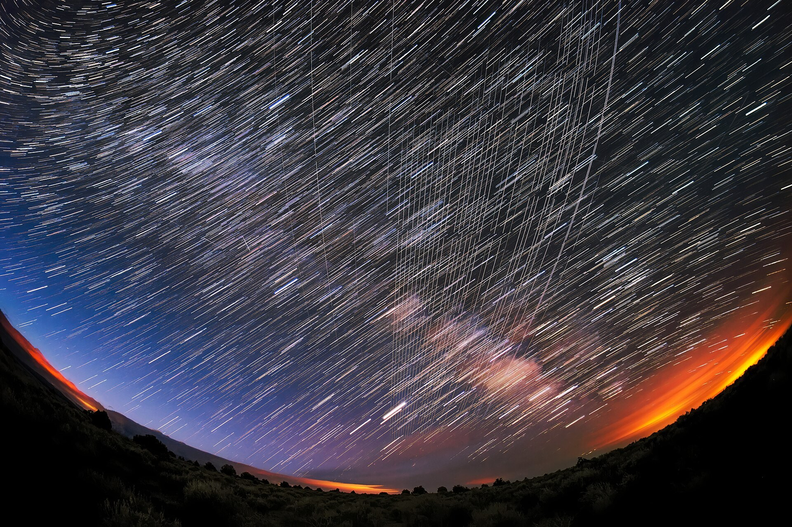
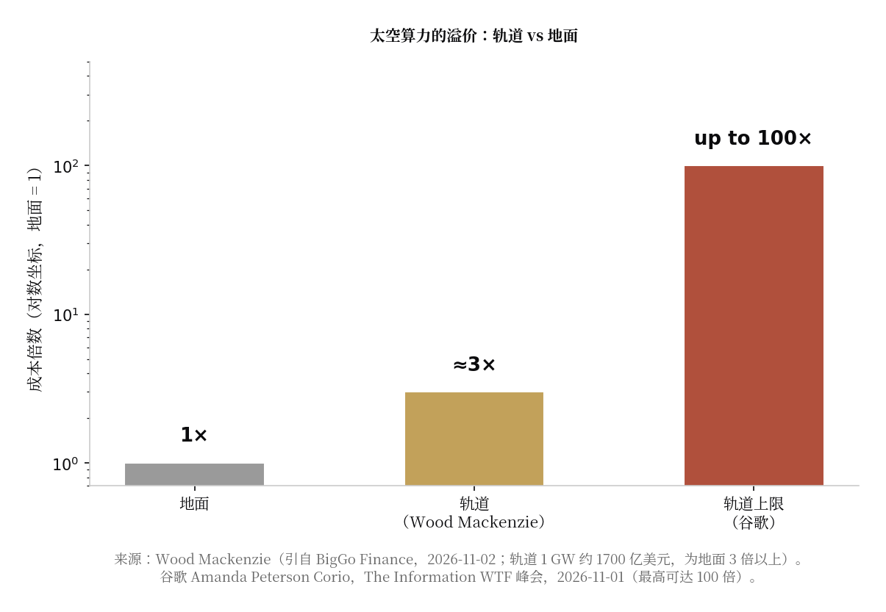

> [English version](/life/spacex-starmind-orbital-datacenter/)

*星链卫星划过夜空。StarMind 的逻辑，是把同一套星座思路从通信延伸到算力。图片：M. Lewinsky，CC BY 4.0，来自 Wikimedia Commons。*

## 马斯克宣布了什么

11 月 6 日，马斯克在纽约第 33 届 Baron 投资大会上表示，SpaceX 计划从 2027 年第三季度开始发射 StarMind 轨道计算系统，并在 2028 至 2029 年加速部署。这套系统由 SpaceX 与英伟达联合设计，采用 Vera Rubin NVL72 平台——正是 SpaceX 在 8 月首次财报电话会上宣布独家采用的架构，当时马斯克的理由是"我们认为 Vera Rubin 架构是最好的架构"。

发布还附带了第二个数字：SpaceX 即将推出的星链 V4 卫星每颗将搭载 10 条激光链路，单条速率超过 10 Tb/s，约为 V3 的 10 倍。这些链路是关键管道——轨道数据中心如果不能把结果高速传回地面，就毫无意义。

马斯克的说法不止于一个发射日期。10 月底他在 X 上发文称，30 到 36 个月内，太空将成为 AI 算力最具吸引力、也最具成本效益的部署环境，轨道算力规模有望在 2029 年前后开始超过地面新增规模。他的逻辑是：轨道上的阳光免费且持续，出了大气层散热问题迎刃而解，而星舰会让发射便宜到足以改变算式。

## 为什么轨道看起来有吸引力

在听反驳之前，值得先把这个想法最强的版本讲清楚。第一是电力：按谷歌自己的研究，放在合适轨道上的太阳能板，每年收集的能量可达地面同一块板的 8 倍，因为它几乎一直晒着太阳，没有黑夜、云层和冬天。谷歌 Suncatcher 项目的设计就是晨昏太阳同步轨道，约 650 公里高度，沿着昼夜分界线飞行，太阳能板几乎不进入阴影。第二是轨道上没有审批流程、没有邻居、没有水费——而在地面，为 1 GW 稳定电力排队接入电网要等上数年。第三是先例：星链已经证明 SpaceX 可以批量制造卫星、把它们作为一个整体系统运营，StarMind 不过是把同一套打法换了一个载荷。这些都不能让今天的经济账成立，但它解释了为什么严肃的人会反复回到这个想法：AI 最需要的两样东西——电力与许可——恰恰是地面上最稀缺、轨道上最充裕的。

## 100 倍的反驳

本周最直接的反驳不是来自竞争对手火箭公司，而是谷歌。谷歌全球数据中心能源负责人 Amanda Peterson Corio 在 The Information 的 WTF 峰会上表示，太空数据中心的成本可达地面的 100 倍，原因包括发射成本，以及轨道硬件永远无法由技术人员上门维修升级。她说："在奔向外太空之前，先把地面上所有可行的选项都探索一遍。"

这句话之所以有分量，是因为谷歌并非站在场外否定轨道算力——它自己就在测试。谷歌的 Suncatcher 项目原型卫星搭载 TPU，已于 10 月 1 日随 SpaceX 拼单发射入轨，并已在太空跑通第一个工作负载。谷歌自己的研究人员也发表过算式成立的条件：如果发射成本降到每公斤 200 美元左右，轨道算力的单位功率成本可以与地面大致相当——他们预计这个门槛可能在 2035 年前后达到，取决于星舰能否飞得足够频繁。

空头 Jim Chanos 替 Corio 的上限算了一笔账：按 100 倍成本，1 GW 轨道算力意味着约 5 万亿美元；按同样的租金回收，地面不到一年的回本周期，在轨道上会拉长到一个世纪。Wood Mackenzie 的估算没那么极端，但同样令人清醒：建设 1 GW 轨道数据中心约需 1700 亿美元，是地面建设成本的 3 倍以上。

*地面成本为基准。Wood Mackenzie 的轨道估算约为其 3 倍；谷歌能源负责人的上限是 100 倍。图表：本站根据下文来源制作。*

## 发射成本的阶梯

这场争论归根结底挂在一个数字上：把一公斤东西送入近地轨道要多少钱。航天飞机时代约为每公斤 54000 美元；猎鹰 9 号用回收的一级把这个数字降到约 2700 美元；猎鹰重型进一步降到约 1400–1500 美元，是迄今有人实际飞过的最便宜的入轨价格。星舰的目标是完全复用后低于每公斤 100–200 美元——这只是设计目标，不是已经实现的价格：星舰直到 2026 年 9 月 28 日的第 14 次飞行才首次进入轨道，上面级的常规回收与快速复飞还在前面。谷歌研究人员按 SpaceX 历史成本曲线外推后认为，每公斤 200 美元的门槛要到 2035 年前后才能达到，而且前提是星舰保持每年约 180 次的飞行频率——十年内约 1800 次发射、累计约 37 万吨入轨。作为对比，到 2026 年 10 月初，星舰总共只飞了 13 次。从 13 次到 1800 次，就是试验项目与工业物流之间的差距。

标题数字背后还有一个容易忽略的细节：你要为发电与散热硬件的发射买单，而不只是芯片。一座 40 MW 的轨道设施在装第一颗 GPU 之前，就要先把约 1500 至 3000 吨的散热器、太阳能板和电池送上去——按猎鹰重型已验证的价格算，发射费是 23–45 亿美元，已经超过在地面建同等数据中心的 12–16 亿美元；按星舰设想的每公斤 100 美元算，则是 1.5–3 亿美元。整场争论浓缩成一句话，就是你信哪一个数字。

## 散热问题，算一笔账

马斯克说轨道上"散热不是问题"，这句话把物理说反了。太空很冷，但它不会帮你降温：真空中没有空气和水带走热量，航天器唯一的散热方式是以红外线辐射热量，速率由斯特藩–玻尔兹曼定律决定，与绝对温度的四次方成正比。唯一飞过的参照物是国际空间站，而它的数据令人警醒：空间站的外部热控系统用约 422–475 平方米的氨循环散热器排出约 70 kW 热量——每千瓦约需 7 平方米散热器、近 100 公斤重量。而一台英伟达 GB200 NVL72 机柜的功耗就在 120–140 kW 量级：一台机柜产生的热量接近整个空间站的两倍。让散热器跑得更热会有很大帮助——同样一块板在 350 K 时的辐射量约为 300 K 时的两倍——无人卫星也可以把热量从芯片直接传导到展开的散热板上，Starcloud-1 就是这样在 700 瓦负载下无泵运行的。问题是，这套办法能不能从 700 瓦放大到每颗卫星 70 万瓦，而不让散热器本身变成卫星的主体。这一点还没有人验证过。

## 谁也投不掉的物理

除了成本，工程上的质疑也很具体。真空中没有空气和水来带走热量，每一瓦废热都必须以辐射方式散掉，而让一颗航天器辐射掉数百千瓦热量，是严肃的热设计难题。而且越新的芯片越脆弱：宾夕法尼亚大学电气与系统工程教授 Benjamin Lee 提醒，先进架构更容易受到比特翻转影响——辐射会让芯片二进制代码中的 0 和 1 互换。问题不只是错误能否被检测和纠正，而是纠正错误的代价会不会让轨道算力相对更低效。

近地轨道的辐射不是科幻片里的深空轰击，但高能粒子仍会造成单粒子翻转，而且晶体管越小、密度越高的新芯片越敏感——谷歌在把 Trillium TPU 送上天之前，先在粒子束里测试过它。更深的问题没有任何工程解法：坏了修不了。轨道上一块板子坏了，就坏到卫星寿命结束；Starcloud-1 的预期寿命只有 11 个月，之后再入大气层烧毁——做演示够了，做资本资产太残酷。行业的答案是把卫星当消耗品：发射便宜、坏了就换。但这个答案成立的前提，恰恰是发射真的便宜，于是争论又回到了星舰。

Sam Altman 曾称近期建设大规模轨道数据中心的想法"荒谬"，这是怀疑的一极。乐观的一极不只有马斯克：2025 年 11 月把英伟达 H100 送上轨道的创业公司 Starcloud 认为，轨道数据中心的寿命可以与地面相当。

## 还有谁在参赛

StarMind 不是桌上唯一的赌注。Starcloud-1 于 2025 年 11 月 2 日发射，是一颗 60 公斤的卫星，搭载了有史以来第一颗在轨运行的英伟达 H100——算力约为此前任何太空系统的 100 倍。几周之内，它在谷歌 Gemma 模型上跑了推理，又在轨道上完整训练了一个小语言模型 NanoGPT（莎士比亚全集），成为第一次在太空训练大语言模型。下一步是 Starcloud-2：一对 8 kW 卫星，搭载多颗 H100 与英伟达 Blackwell B200。2026 年 2 月，Starcloud 向 FCC 申请部署最多 88000 颗卫星的星座——那只是一份申请，不是批准。这家公司在 2026 年 3 月完成 1.7 亿美元 A 轮融资，估值 11 亿美元，距它参加 Y Combinator 演示日仅 17 个月就成为独角兽，速度创下纪录。谷歌的路子正好相反：它的 Suncatcher 分析以同行评议论文发表在《焦耳》期刊上，原型卫星由 Planet Labs 建造，搭载 4 颗 TPU、靠约 1 千瓦太阳能供电，并于 10 月 30 日从轨道传回第一个 AI 回答——Gemma 4 模型在飞越挪威斯瓦尔巴群岛上空时写了一首俳句。英伟达则在确保无论哪条路走通它都是赢家：2026 年 3 月的 GTC 上，它发布了太空计算产品线，包括 Space-1 Vera Rubin 模组，号称算力可达 H100 的 25 倍，并公布了六家首批合作伙伴。杰夫·贝佐斯也公开表示，轨道上的 GW 级数据中心有望在 10 到 20 年内在成本上低于地面；埃里克·施密特收购 Relativity Space 时，公开表示目的就是建设轨道数据中心。这个想法现在每一边都有亿万富翁站台——这不能证明它行得通，但能证明它会被资助到水落石出。还有一个监管插曲：SpaceX 自己为 StarMind 提交的 FCC 申请，遭到了亚马逊的反对请愿，程序仍在进行中。

## 地面也没有闲着

轨道算力的真正对手不是另一家火箭公司，而是地面数据中心本身也在变。国际能源署预计，全球数据中心用电量将从 2025 年的 485 TWh 翻倍至 2030 年约 950 TWh，而美国电网排队等待接入的发电与储能容量已超过 2060 GW，中位等待时间超过四年——这正是轨道派最有力的论据：地面不是没电，而是接不上电。但地面也在用自己的办法绕开电网：就在同一周，Anthropic 被曝出斥资 34 亿美元买下 1.7 GW 的燃气发电机，绕过电网自己发电；液冷、核电购电协议、选址向电力充裕地区转移，都是同一逻辑的不同版本。换句话说，轨道算力要打败的不是今天的地面数据中心，而是五年后、被逼到墙角后进化过的地面数据中心。星舰的成本曲线要跑赢的，也是同一条学习曲线。

## 三种结局

把所有变量摊开，这场争论其实只有三种结局。第一种，星舰按时兑现：发射成本在 2030 年代初跌破每公斤 200 美元，StarMind 从演示变成生意，谷歌的 Suncatcher 从论文变成星座，轨道算力先吃掉对延迟不敏感的训练负载，再慢慢蚕食推理。第二种，星舰只兑现一半：发射便宜到每公斤 500 到 1000 美元，轨道算力在利基市场成立——政府客户、主权 AI、不想把数据放在别人电网上的买家——但永远成不了主流，StarMind 变成 SpaceX 的高端产品线，而不是 AI 的新大陆。第三种，星舰卡住：复用率上不去、发射频率上不去，成本停在每公斤 1000 美元以上，StarMind 变成一颗昂贵的演示卫星，谷歌的论文留在期刊里，Starcloud 的星座停在申请文件里。今天的证据无法区分这三种结局，因为它们的区别不在物理，而在执行——而执行恰恰是 SpaceX 历史上最擅长、也最常被高估的东西。

## 延迟与带宽：轨道算力能跑什么负载

即使成本与散热都解决了，还有一个问题决定轨道算力能接什么活：延迟。光速是硬上限。一颗 650 公里高度的卫星与地面站之间，信号单程约需几毫秒，算上星间激光链路的中继与地面网关的跳转，一次往返通常在几十毫秒量级——与地面光纤跨洲传输相当。这意味着轨道算力不适合对延迟极度敏感的实时推理，比如自动驾驶的云端决策或高频交易；但它很适合训练：训练一个大模型需要数周连续计算，几十毫秒的延迟在其中几乎可以忽略，而训练恰恰是算力需求最大、最耗电的环节。马斯克的星链 V4 激光链路——每颗卫星 10 条、单条 10 Tb/s 以上——正是为这种分工准备的：把训练放在天上，把结果传回地面。

这个分工还决定了轨道算力的第一个真实客户可能不是谁都能想到的。训练负载可以容忍延迟、可以批量调度、可以为了便宜的电力而等待；而推理负载要贴着用户，贴着地面。换句话说，StarMind 即使成功，第一步也更像一座建在天上的训练工厂，而不是一朵飘在天上的云。谷歌的 Suncatcher 论文同样把重点放在训练与批量推理上，而不是实时交互。这个判断反过来也给出了一个检验标准：不要只看 StarMind 发射了多少颗卫星，要看它接的第一单生意是训练还是推理——前者说明经济账开始成立，后者说明它已经便宜到可以贴着用户了。

## 被遗忘的成本：造卫星本身

争论大多集中在发射价格上，但发射只是账单的一部分。卫星本身——平台、太阳能板、散热器、抗辐射部件、地面测试——也要花钱，而且轨道硬件的测试标准比地面服务器严苛得多：每一颗卫星在发射前都要经过热真空测试，模拟它在轨道上经历的极端温差与真空环境。Starcloud-1 的经验说明小规模可以很便宜：这家公司用 21 个月、300 万美元就造出了第一颗卫星。但那是一颗 60 公斤的演示卫星，上面只有一颗 GPU；把它放大到一颗携带数十颗 GPU、数百千瓦功耗的计算卫星，成本结构会完全不同。SpaceX 真正的优势可能不在火箭，而在工厂：星链已经让它拥有了批量造卫星的生产线与供应链，StarMind 可以复用同一套产能——而 Starcloud、谷歌这些后来者都要从零建这条线。这也是为什么"星舰降价"这个故事里，发射成本只是上半场；下半场是卫星制造成本能不能像星链一样，被批量生产压下来。

## 判断

这场争论里的两个数字，其实都是关于星舰的。如果发射成本真的向谷歌说的每公斤 200 美元门槛崩塌，100 倍的上限也会随之崩塌，免费阳光和免费散热就开始成为真正的优势。如果星舰既不便宜也不频繁，StarMind 就是一颗挂着 2027 年发射日期的昂贵演示卫星，配的却是 2035 年的成本曲线。

但无论成本曲线怎么走，有一件事已经是现实：供应商锁定。SpaceX 在 AI 算力上彻底押注英伟达一家，放弃了每个企业 IT 部门都视为常识的多供应商策略，而 Vera Rubin 也因此成为大气层外最宏大算力项目的平台。这场赌注真正的含义不是轨道很便宜，而是马斯克能按时把它变便宜，并且英伟达是唯一同行的芯片公司。

最公允的记分牌有三行，而不是一行。物理上，怀疑派占优：散热与辐射是真实的约束，在机柜规模上还没有经过验证的解法。经济上，裁决推迟给了星舰：这场争论里的每个成本模型，本质上都是披着不同外衣的发射成本模型。势头上，相信派占优：真实的硬件已经在轨，真实的模型已经跑起来了，参与的公司花的是真金白银，而不是只写白皮书。2027 年的发射日期，最好理解为这场实验的开始，而不是争论的结束。值得盯住的不是发布会上的日期，而是三个硬指标：星舰的年发射次数有没有爬上三位数、第一颗计算卫星的在轨寿命有没有超过一年、以及 StarMind 的第一单生意到底是训练还是推理。这三个数字出来之前，100 倍与 3 倍的争论都只是模型之争。

最后还有一个视角值得补充：轨道数据中心的争论，本质上是两种时间尺度的竞争。地面数据中心的约束——电网排队、土地审批、社区反对——是以年计的，而且越来越紧；星舰的成本曲线也是以年计的，而且方向相反。哪一边先到对方的领地，谁就赢了。如果星舰在 2030 年代初跌破每公斤 200 美元，而地面电网的排队还在四年以上，轨道算力就会从科幻变成采购选项；如果星舰卡住，而地面通过自建发电、液冷与选址转移绕开了电网，轨道算力就会停留在论文与演示里。2027 年的 StarMind 发射，第一次让这场竞争有了实物，而不是只有模型。谁先到达，谁就定义下一个十年的算力版图——而 2027 年是第一次有人真正出发。
*来源：Interesting Engineering，2026-11-07（Baron 大会发言、2027 年第三季度目标、星链 V4 激光链路）；Engadget（Starmind 背景、辐射与比特翻转问题）；The Information（经 Dealroom 与 Data Center Dynamics 转引），2026-11-01 至 11-04（Peterson Corio 的 100 倍说法、Suncatcher 首个工作负载）；TIKR，2026-11-02（Chanos 的每 GW 5 万亿美元推算）；BigGo Finance，2026-11-02（Wood Mackenzie 的 1700 亿美元估算）。扩写部分新增来源：谷歌研究 /《焦耳》期刊（Suncatcher 论文、81 颗卫星编队、650 公里、晨昏轨道、太阳能板 8 倍、每公斤 200 美元门槛、2035 年前后）；NPR / 谷歌，2026-10-30（Suncatcher 原型、4 颗 TPU、约 1 kW、Gemma 4 俳句）；NASA Ames / SpaceX 标价（经 NowSky 与 Orbital Radar 转引：航天飞机约 54000 美元/公斤、猎鹰 9 号约 2700 美元/公斤、猎鹰重型约 1400–1500 美元/公斤、星舰目标低于 100–200 美元/公斤）；Morning Tick，2026-10-02（1800 次星舰发射、每年约 180 次、约 37 万吨、截至 2026 年 10 月初星舰共飞 13 次）；DC Build X / BSEIF（国际空间站 70 kW、422–475 平方米散热器、每千瓦约 7 平方米与约 96 公斤、GB200 NVL72 机柜 120–140 kW、斯特藩–玻尔兹曼散热数据）；Starcloud / Sacra / SpaceNexus（Starcloud-1，2025-11-02，60 公斤，H100，NanoGPT 莎士比亚训练，11 个月寿命，Starcloud-2 8 kW，FCC 申请 88000 颗卫星，2026 年 2 月）；英伟达 GTC，2026 年 3 月（太空计算产品线、Space-1 Vera Rubin 模组）。*
