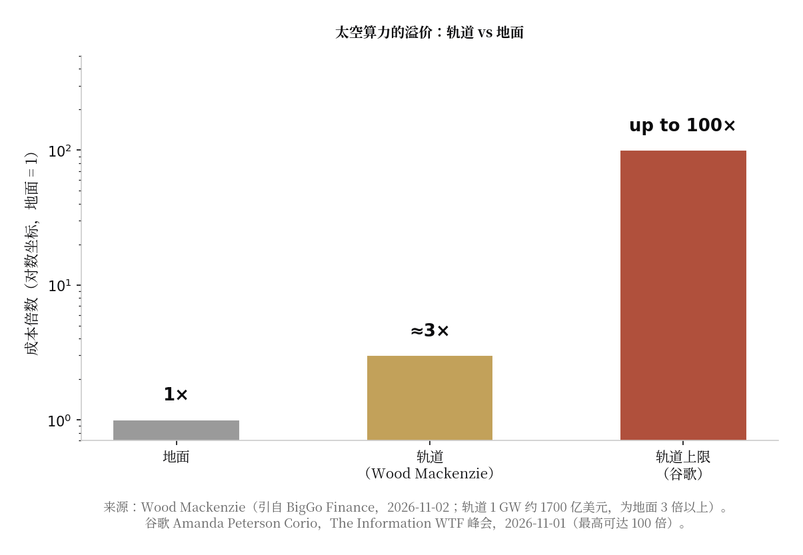

> [English version](/life/spacex-starmind-orbital-datacenter/)

*星链卫星划过夜空。StarMind 的逻辑，是把同一套星座思路从通信延伸到算力。图片：M. Lewinsky，CC BY 4.0，来自 Wikimedia Commons。*

## 马斯克宣布了什么

11 月 6 日，马斯克在纽约第 33 届 Baron 投资大会上表示，SpaceX 计划从 2027 年第三季度开始发射 StarMind 轨道计算系统，并在 2028 至 2029 年加速部署。这套系统由 SpaceX 与英伟达联合设计，采用 Vera Rubin NVL72 平台——正是 SpaceX 在 8 月首次财报电话会上宣布独家采用的架构，当时马斯克的理由是"我们认为 Vera Rubin 架构是最好的架构"。

发布还附带了第二个数字：SpaceX 即将推出的星链 V4 卫星每颗将搭载 10 条激光链路，单条速率超过 10 Tb/s，约为 V3 的 10 倍。这些链路是关键管道——轨道数据中心如果不能把结果高速传回地面，就毫无意义。

马斯克的说法不止于一个发射日期。10 月底他在 X 上发文称，30 到 36 个月内，太空将成为 AI 算力最具吸引力、也最具成本效益的部署环境，轨道算力规模有望在 2029 年前后开始超过地面新增规模。他的逻辑是：轨道上的阳光免费且持续，出了大气层散热问题迎刃而解，而星舰会让发射便宜到足以改变算式。

## 100 倍的反驳

本周最直接的反驳不是来自竞争对手火箭公司，而是谷歌。谷歌全球数据中心能源负责人 Amanda Peterson Corio 在 The Information 的 WTF 峰会上表示，太空数据中心的成本可达地面的 100 倍，原因包括发射成本，以及轨道硬件永远无法由技术人员上门维修升级。她说："在奔向外太空之前，先把地面上所有可行的选项都探索一遍。"

这句话之所以有分量，是因为谷歌并非站在场外否定轨道算力——它自己就在测试。谷歌的 Suncatcher 项目原型卫星搭载 TPU，已于 10 月 1 日随 SpaceX 拼单发射入轨，并已在太空跑通第一个工作负载。谷歌自己的研究人员也发表过算式成立的条件：如果发射成本降到每公斤 200 美元左右，轨道算力的单位功率成本可以与地面大致相当——他们预计这个门槛可能在 2035 年前后达到，取决于星舰能否飞得足够频繁。

空头 Jim Chanos 替 Corio 的上限算了一笔账：按 100 倍成本，1 GW 轨道算力意味着约 5 万亿美元；按同样的租金回收，地面不到一年的回本周期，在轨道上会拉长到一个世纪。Wood Mackenzie 的估算没那么极端，但同样令人清醒：建设 1 GW 轨道数据中心约需 1700 亿美元，是地面建设成本的 3 倍以上。

*地面成本为基准。Wood Mackenzie 的轨道估算约为其 3 倍；谷歌能源负责人的上限是 100 倍。图表：本站根据下文来源制作。*

## 谁也投不掉的物理

除了成本，工程上的质疑也很具体。真空中没有空气和水来带走热量，每一瓦废热都必须以辐射方式散掉，而让一颗航天器辐射掉数百千瓦热量，是严肃的热设计难题。而且越新的芯片越脆弱：宾夕法尼亚大学电气与系统工程教授 Benjamin Lee 提醒，先进架构更容易受到比特翻转影响——辐射会让芯片二进制代码中的 0 和 1 互换。问题不只是错误能否被检测和纠正，而是纠正错误的代价会不会让轨道算力相对更低效。

Sam Altman 曾称近期建设大规模轨道数据中心的想法"荒谬"，这是怀疑的一极。乐观的一极不只有马斯克：2025 年 11 月把英伟达 H100 送上轨道的创业公司 Starcloud 认为，轨道数据中心的寿命可以与地面相当。

## 判断

这场争论里的两个数字，其实都是关于星舰的。如果发射成本真的向谷歌说的每公斤 200 美元门槛崩塌，100 倍的上限也会随之崩塌，免费阳光和免费散热就开始成为真正的优势。如果星舰既不便宜也不频繁，StarMind 就是一颗挂着 2027 年发射日期的昂贵演示卫星，配的却是 2035 年的成本曲线。

但无论成本曲线怎么走，有一件事已经是现实：供应商锁定。SpaceX 在 AI 算力上彻底押注英伟达一家，放弃了每个企业 IT 部门都视为常识的多供应商策略，而 Vera Rubin 也因此成为大气层外最宏大算力项目的平台。这场赌注真正的含义不是轨道很便宜，而是马斯克能按时把它变便宜，并且英伟达是唯一同行的芯片公司。

*来源：Interesting Engineering，2026-11-07（Baron 大会发言、2027 年第三季度目标、星链 V4 激光链路）；Engadget（Starmind 背景、辐射与比特翻转问题）；The Information（经 Dealroom 与 Data Center Dynamics 转引），2026-11-01 至 11-04（Peterson Corio 的 100 倍说法、Suncatcher 首个工作负载）；TIKR，2026-11-02（Chanos 的每 GW 5 万亿美元推算）；BigGo Finance，2026-11-02（Wood Mackenzie 的 1700 亿美元估算）。*
