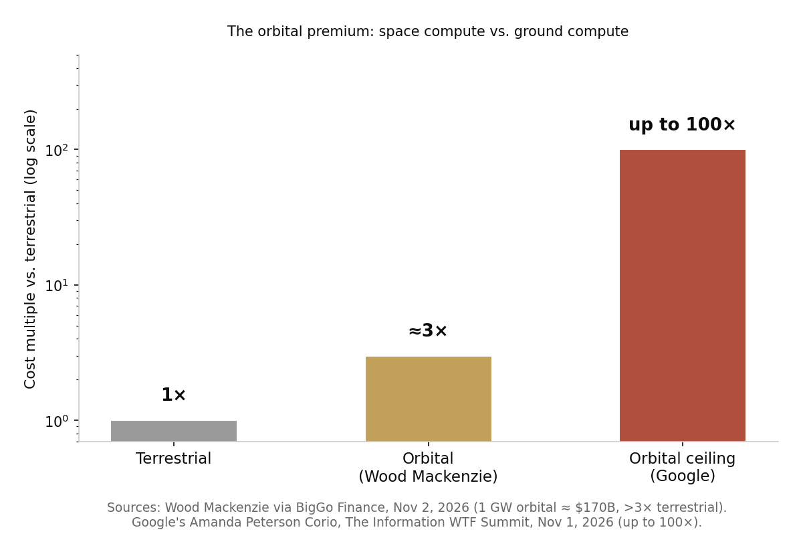

> [中文版 Chinese version](/life/spacex-starmind-orbital-datacenter-zh/)

*Starlink satellites crossing the night sky. StarMind would extend the same constellation logic from connectivity to compute. Photo: M. Lewinsky, CC BY 4.0, via Wikimedia Commons.*

## What Musk announced

Speaking at the 33rd Annual Baron Investment Conference in New York on November 6, Elon Musk said SpaceX plans to begin launching its StarMind orbital computing systems in the third quarter of 2027, with deployment accelerating through 2028 and 2029. The systems are co-designed with NVIDIA around the Vera Rubin NVL72 platform — the same rack-scale system SpaceX committed to exclusively in August, when Musk said on the company's first earnings call that SpaceX would standardize on NVIDIA "because we think the Vera Rubin architecture is the best architecture."

The announcement came with a second number. SpaceX's upcoming Starlink Version 4 satellites will each carry 10 laser links capable of more than 10 terabits per second per link — roughly 10 times the capacity of Version 3. Those links are the plumbing: an orbital data center is useless if it cannot move results back to Earth fast.

Musk's framing goes further than one launch date. In posts on X in late October, he argued that within 30 to 36 months, space will become the most compelling and cost-effective environment for AI computing, and that orbital capacity could begin scaling faster than terrestrial capacity around 2029. The pitch is that sunlight in orbit is free and constant, cooling is a solved problem once you are out of the atmosphere, and Starship makes launch cheap enough to matter.

## Why orbit looks attractive in the first place

Before the rebuttal, it is worth steelmanning the idea. The first attraction is power: a solar panel in the right orbit collects up to eight times more energy per year than the same panel on the ground, according to Google's own research, because it sees near-continuous sunlight instead of nights, clouds, and winter. Google's Project Suncatcher design flies in a dawn-dusk sun-synchronous orbit at about 650 km, riding the line between day and night so the panels almost never enter shadow. The second attraction is that orbit has no permitting process, no neighbours, and no water bill — while on the ground, interconnection queues for a gigawatt of firm power run for years. None of this makes the economics work today. It explains why serious people keep returning to the idea: the two things AI needs most — power and permission — are exactly the two things scarcest on the ground and most abundant in orbit.

## The 100x rebuttal

The most direct counter-argument this week did not come from a rival rocket company. It came from Google. Amanda Peterson Corio, Google's global head of data center energy, told The Information's WTF Summit that data centers in space could cost up to 100 times as much as those on Earth, citing launch costs and the difficulty of maintaining and upgrading hardware that no technician can ever touch. "Let's explore all the terrestrial options before we go extraterrestrial," she said.

The sting is that Google is not dismissing orbital compute from the sidelines — it is testing it. Its Project Suncatcher prototype, carrying Google TPUs, reached orbit on October 1 aboard a SpaceX rideshare and has since run its first workload in space. Google's own researchers have published the condition under which the math closes: if launch costs fall to around $200 per kilogram, orbital compute could cost roughly the same per unit of power as terrestrial — a threshold they expect around 2035, depending on Starship flying often enough.

Short seller Jim Chanos did the arithmetic on Corio's ceiling: at 100 times the cost, a gigawatt of orbital compute implies roughly $5 trillion, and a terrestrial payback of under a year stretches to as long as a century at the same rental rates. Wood Mackenzie's estimate is less extreme but still sobering: building a 1-gigawatt orbital data center would cost about $170 billion, more than three times a terrestrial build.

*Terrestrial cost is the baseline. Wood Mackenzie's orbital estimate is roughly 3 times that; Google's energy chief puts the ceiling at 100 times. Chart: this site, from the sources cited below.*

## The launch-cost ladder

The Space Shuttle cost roughly $54,000 per kilogram to orbit. Falcon 9, with a reused booster, brought that to roughly $2,700; Falcon Heavy gets to roughly $1,400–$1,500, the cheapest demonstrated ride anyone has flown. Starship's target is under $100–$200 per kilogram once fully reusable — a design goal, not an achieved price: Starship reached orbit for the first time on Flight 14 on September 28, 2026. Google's researchers extrapolated SpaceX's historical cost curve and concluded the $200-per-kilogram threshold arrives around the mid-2030s, and only with a sustained cadence on the order of 180 Starship flights a year — roughly 370,000 tonnes to orbit, or about 1,800 launches over a decade. For scale, Starship had flown 13 times in total by early October 2026. You also pay to launch the power and cooling hardware, not just the chips: a 40 MW facility must lift roughly 1,500 to 3,000 tonnes of radiators, solar arrays, and batteries first — $2.3–$4.5 billion at Falcon Heavy's demonstrated price, versus $150–$300 million at Starship's aspirational $100 per kilogram.

## The heat problem, worked out

Musk's claim that cooling is "solved" in orbit gets the physics exactly backwards. Space is cold, but it does not cool things: in a vacuum there is no air or water to carry heat away, so the only way heat leaves a spacecraft is by radiating it as infrared light, at a rate governed by the Stefan–Boltzmann law, which scales with the fourth power of absolute temperature. The only flown benchmark is the International Space Station, and it is humbling: the ISS's external thermal control system rejects about 70 kW through roughly 422–475 square metres of ammonia-loop radiators — about 7 square metres and nearly 100 kilograms of radiator for every kilowatt. A single NVIDIA GB200 NVL72 rack draws on the order of 120–140 kW: one rack produces nearly twice the heat the entire space station rejects. Running radiators hotter helps — a panel emits roughly twice as much at 350 K as at 300 K — and an uncrewed satellite can conduct heat straight from the die to panels, as Starcloud-1 does at 700 watts. Whether that scales to 700 kilowatts per satellite is unproven.

## The physics neither side can vote away

Beyond cost, the engineering objections are specific. In a vacuum there is no air or water to carry heat away; every watt of waste heat must leave as radiation, and radiating hundreds of kilowatts from a spacecraft is a serious thermal design problem. And the newest chips are the most vulnerable to it: Dr. Benjamin Lee, a professor of electrical and systems engineering at the University of Pennsylvania, has warned that advanced architectures are more susceptible to bit flips, where radiation swaps the ones and zeros in a chip's binary code. The question is not only whether errors can be detected and corrected, but whether correcting them makes orbital compute comparatively inefficient.

Radiation in low Earth orbit still causes single-event upsets, and the newest, densest chips are the most sensitive — Google tested its Trillium TPU in a particle beam before flying it. The deeper problem has no fix at all: you cannot repair anything. A failed board stays failed, and Starcloud-1 has an expected life of 11 months before it deorbits and burns up. The industry's answer is to treat satellites as disposable — launch cheap, replace often — but that only works if launch really is cheap, which brings the argument back to Starship.

Sam Altman has called the idea of massive orbital data centers in the near term "ridiculous." That is the skeptical pole. The optimistic pole is not just Musk: Starcloud, a startup that put NVIDIA H100 GPUs in orbit in November 2025, argues orbital data centers can have the same shelf life as terrestrial ones.

## Who else is in the race

StarMind is not the only bet on the table. Starcloud-1 launched on November 2, 2025, a 60 kg satellite carrying the first NVIDIA H100 ever operated in orbit — roughly 100 times more GPU compute than any prior space-based system. Within weeks it had run inference on Google's Gemma model and trained a small language model, NanoGPT on Shakespeare's complete works, entirely in orbit: the first LLM training in space. Its next step is Starcloud-2, a pair of 8 kW satellites carrying multiple H100s and NVIDIA's Blackwell B200. In February 2026 Starcloud filed with the FCC for a constellation of up to 88,000 satellites — an application, not an approval. Google's approach is the mirror image: its Suncatcher analysis appeared as a peer-reviewed paper in the journal Joule, and its prototype, built with Planet Labs, carries four TPUs, runs on about one kilowatt of solar power, and on October 30 returned its first AI response from orbit — its Gemma 4 model wrote a haiku as the satellite passed over Svalbard, Norway. NVIDIA, meanwhile, is making sure it wins whichever approach prevails: at GTC in March 2026 it announced a space computing line, including the Space-1 Vera Rubin Module, which it says delivers up to 25 times the AI compute of an H100.

## The judgment

Both numbers in this fight are really about Starship. If launch costs collapse toward Google's $200-per-kilogram threshold, the 100x ceiling collapses with them, and the free sunlight and free cooling start to look like a real advantage. If Starship does not get cheap and frequent, StarMind is a very expensive demo satellite with a 2027 launch date attached to a 2035 cost curve.

What is already real, whatever the cost curve does, is the vendor lock-in. SpaceX has gone exclusive with NVIDIA for AI compute — abandoning the multi-vendor strategy every enterprise IT department treats as common sense — and NVIDIA's Vera Rubin is now the platform for the most ambitious compute project outside the atmosphere. The bet is not really that orbit is cheap. The bet is that Musk can make it cheap, on a schedule, and that NVIDIA will be the only chip company along for the ride.

The fairest scorecard has three lines rather than one. On physics, the skeptics are winning: heat rejection and radiation are real constraints with no demonstrated solution at rack scale. On economics, the verdict is deferred to Starship: every cost model in this debate is a launch-cost model wearing a different hat. On momentum, the believers are winning: real hardware is in orbit, real models have run on it, and the companies involved are spending real money rather than writing white papers. A 2027 launch date for StarMind is best read as the start of that experiment, not the end of the argument.

*Sources: Interesting Engineering, November 7, 2026 (Baron conference remarks, Q3 2027 target, Starlink V4 laser links); Engadget (Starmind background, radiation and bit-flip concerns); The Information via Dealroom and Data Center Dynamics, November 1–4, 2026 (Peterson Corio's 100x remark, Suncatcher's first workload); TIKR, November 2, 2026 (Chanos's $5 trillion-per-gigawatt reading); BigGo Finance, November 2, 2026 (Wood Mackenzie's $170 billion estimate). Additional sources for the expanded sections: Google Research / Joule (Suncatcher paper, 81-satellite clusters at 650 km, dawn-dusk orbit, solar panel up to 8x, $200/kg threshold, mid-2030s); NPR / Google, October 30, 2026 (Suncatcher prototype, four TPUs, ~1 kW, Gemma 4 haiku over Svalbard); NASA Ames / SpaceX list prices via NowSky and Orbital Radar (Shuttle ~$54,000/kg, Falcon 9 ~$2,700/kg, Falcon Heavy ~$1,400–$1,500/kg, Starship target under $100–$200/kg); Morning Tick, October 2, 2026 (1,800 Starship launches, ~180 a year, ~370,000 tonnes, 13 Starship flights by early October 2026); DC Build X / BSEIF (ISS 70 kW, 422–475 m² radiators, ~7 m² and ~96 kg per kW, GB200 NVL72 rack 120–140 kW, Stefan–Boltzmann radiator figures); Starcloud / Sacra / SpaceNexus (Starcloud-1, November 2, 2025, 60 kg, H100, NanoGPT on Shakespeare, 11-month life, $170M Series A March 2026 at $1.1B, Starcloud-2 8 kW, FCC filing for 88,000 satellites, February 2026); NVIDIA GTC, March 2026 (space computing line, Space-1 Vera Rubin Module, six partners); Bloomberg, May 2026 (Google–SpaceX Starship talks for Suncatcher).*
