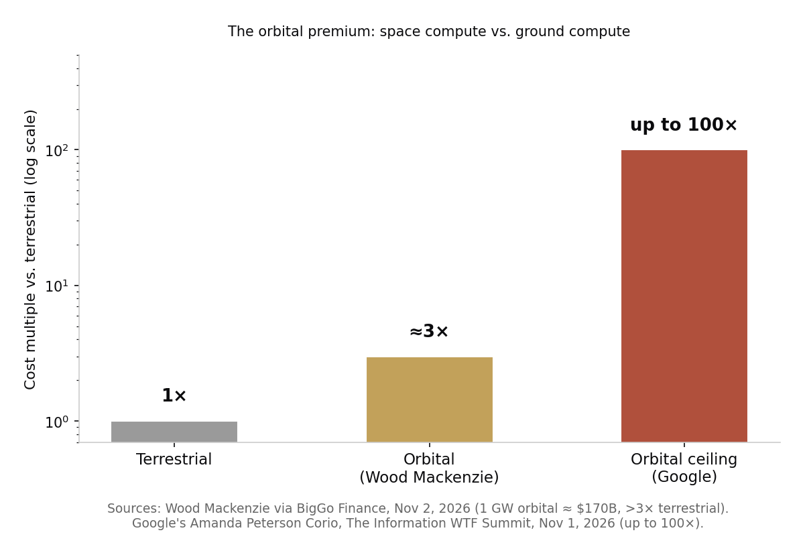

> [中文版 Chinese version](/life/spacex-starmind-orbital-datacenter-zh/)

*Starlink satellites crossing the night sky. StarMind would extend the same constellation logic from connectivity to compute. Photo: M. Lewinsky, CC BY 4.0, via Wikimedia Commons.*

## What Musk announced

Speaking at the 33rd Annual Baron Investment Conference in New York on November 6, Elon Musk said SpaceX plans to begin launching its StarMind orbital computing systems in the third quarter of 2027, with deployment accelerating through 2028 and 2029. The systems are co-designed with NVIDIA around the Vera Rubin NVL72 platform — the same rack-scale system SpaceX committed to exclusively in August, when Musk said on the company's first earnings call that SpaceX would standardize on NVIDIA "because we think the Vera Rubin architecture is the best architecture."

The announcement came with a second number. SpaceX's upcoming Starlink Version 4 satellites will each carry 10 laser links capable of more than 10 terabits per second per link — roughly 10 times the capacity of Version 3. Those links are the plumbing: an orbital data center is useless if it cannot move results back to Earth fast.

Musk's framing goes further than one launch date. In posts on X in late October, he argued that within 30 to 36 months, space will become the most compelling and cost-effective environment for AI computing, and that orbital capacity could begin scaling faster than terrestrial capacity around 2029. The pitch is that sunlight in orbit is free and constant, cooling is a solved problem once you are out of the atmosphere, and Starship makes launch cheap enough to matter.

## The 100x rebuttal

The most direct counter-argument this week did not come from a rival rocket company. It came from Google. Amanda Peterson Corio, Google's global head of data center energy, told The Information's WTF Summit that data centers in space could cost up to 100 times as much as those on Earth, citing launch costs and the difficulty of maintaining and upgrading hardware that no technician can ever touch. "Let's explore all the terrestrial options before we go extraterrestrial," she said.

The sting is that Google is not dismissing orbital compute from the sidelines — it is testing it. Its Project Suncatcher prototype, carrying Google TPUs, reached orbit on October 1 aboard a SpaceX rideshare and has since run its first workload in space. Google's own researchers have published the condition under which the math closes: if launch costs fall to around $200 per kilogram, orbital compute could cost roughly the same per unit of power as terrestrial — a threshold they expect around 2035, depending on Starship flying often enough.

Short seller Jim Chanos did the arithmetic on Corio's ceiling: at 100 times the cost, a gigawatt of orbital compute implies roughly $5 trillion, and a terrestrial payback of under a year stretches to as long as a century at the same rental rates. Wood Mackenzie's estimate is less extreme but still sobering: building a 1-gigawatt orbital data center would cost about $170 billion, more than three times a terrestrial build.

*Terrestrial cost is the baseline. Wood Mackenzie's orbital estimate is roughly 3 times that; Google's energy chief puts the ceiling at 100 times. Chart: this site, from the sources cited below.*

## The physics neither side can vote away

Beyond cost, the engineering objections are specific. In a vacuum there is no air or water to carry heat away; every watt of waste heat must leave as radiation, and radiating hundreds of kilowatts from a spacecraft is a serious thermal design problem. And the newest chips are the most vulnerable to it: Dr. Benjamin Lee, a professor of electrical and systems engineering at the University of Pennsylvania, has warned that advanced architectures are more susceptible to bit flips, where radiation swaps the ones and zeros in a chip's binary code. The question is not only whether errors can be detected and corrected, but whether correcting them makes orbital compute comparatively inefficient.

Sam Altman has called the idea of massive orbital data centers in the near term "ridiculous." That is the skeptical pole. The optimistic pole is not just Musk: Starcloud, a startup that put NVIDIA H100 GPUs in orbit in November 2025, argues orbital data centers can have the same shelf life as terrestrial ones.

## The judgment

Both numbers in this fight are really about Starship. If launch costs collapse toward Google's $200-per-kilogram threshold, the 100x ceiling collapses with them, and the free sunlight and free cooling start to look like a real advantage. If Starship does not get cheap and frequent, StarMind is a very expensive demo satellite with a 2027 launch date attached to a 2035 cost curve.

What is already real, whatever the cost curve does, is the vendor lock-in. SpaceX has gone exclusive with NVIDIA for AI compute — abandoning the multi-vendor strategy every enterprise IT department treats as common sense — and NVIDIA's Vera Rubin is now the platform for the most ambitious compute project outside the atmosphere. The bet is not really that orbit is cheap. The bet is that Musk can make it cheap, on a schedule, and that NVIDIA will be the only chip company along for the ride.

*Sources: Interesting Engineering, November 7, 2026 (Baron conference remarks, Q3 2027 target, Starlink V4 laser links); Engadget (Starmind background, radiation and bit-flip concerns); The Information via Dealroom and Data Center Dynamics, November 1–4, 2026 (Peterson Corio's 100x remark, Suncatcher's first workload); TIKR, November 2, 2026 (Chanos's $5 trillion-per-gigawatt reading); BigGo Finance, November 2, 2026 (Wood Mackenzie's $170 billion estimate).*
