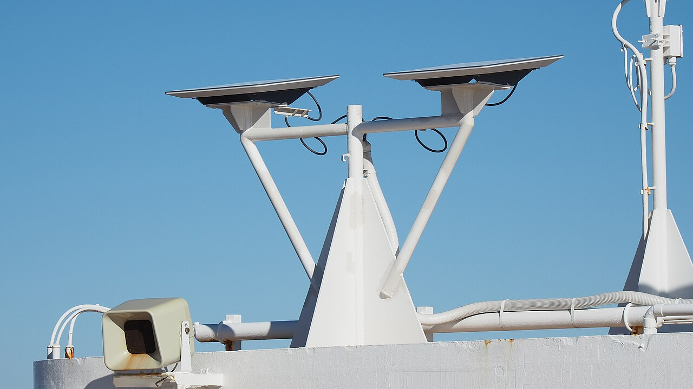
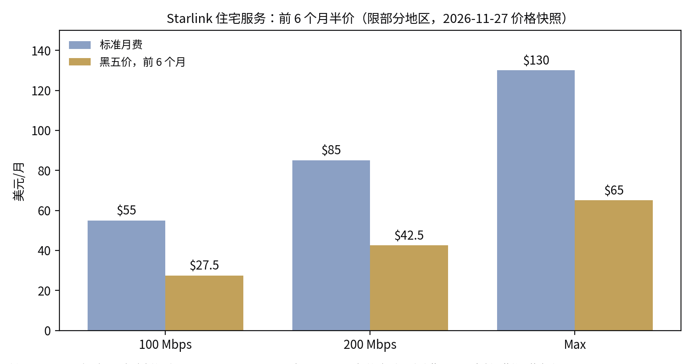

> [English version 英文版](/life/starlink-black-friday-half-price-residential/)

*图片：邮轮上的 Starlink 天线 UTA-222。摄影：Ka23 13，CC BY 4.0，来自 Wikimedia Commons。*

## 优惠原文：Starlink 自己是怎么说的

**2026 年 11 月 26 日（周四）**，Starlink 在 X 上和帮助中心文章里宣布黑五促销：**在 2026 年 11 月 30 日（周一，网络星期一）太平洋时间 23:59 前签约的新用户**，可享**住宅服务月费前六个月五折**。优惠适用于**部分地区**，美国境内**阿拉斯加除外**。根据多家媒体与价格追踪站对 Starlink 各国订购页的核查（SatellitePlan 11 月 27 日更新、TeslaNorth 11 月 26 日报道，以及 11 月 26 日复核订购页的追踪站），同样的“五折、六个月”结构已在**加拿大、英国、澳大利亚、法国、意大利、西班牙、巴西、墨西哥**等市场上线。覆盖档位为住宅版的 **100 Mbps、200 Mbps 与 Max**，含租赁选项；折扣**只针对服务费**：不含天线套件、不含运费、不含任何需求附加费，也不含 Roam 漫游计划。

具体价格取决于你的地址，所以 Starlink 的公告没有给出统一数字。在适用五折的样本地址上，Starlink 自家结账页在 11 月 26–27 日复核显示：**100 Mbps 档每月 27.50 美元，原价 55 美元**；**200 Mbps 档 42.50 美元，原价 85 美元**；**Max 档 65 美元，原价 130 美元**。加拿大的对应示例是入门档 CA$37.50、原价 CA$75；法国与西班牙是 €17.50、原价 €35。本文所有价格均为 **2026 年 11 月 27 日**查询的快照，**可能变动**——而且比平时更要紧的一点是：只有你自己地址的订购页显示出来的价格，才对你成立。Starlink 的帮助文档明确写道，折扣仅适用于服务费，第七个月起按你所选档位的标准价计费。

把第一年的账算清楚，因为“五折”这个词会自己膨胀。六个月半价加六个月全价，等于**第一年省 25%**：100 Mbps 档十二个月共 495 美元、原价 660 美元，省 **165 美元**；Max 档共 1,170 美元、原价 1,560 美元，省 **390 美元**。这是实打实的节省，值得拿；但也正是黑五标题最希望你四舍五入掉的那部分。再加上本次优惠里不打折的硬件，促销的真实形状就出来了：Starlink 折的是订阅，不是入场券——和便宜打印机同一套剃须刀加刀片结构，只是反过来跑：刀架保持原价，刀片半价到春天。

*作者自制图。数据：Starlink 订购页与黑五帮助文档，经 SatellitePlan、TeslaNorth 于 2026-11-26/27 复核。仅服务半价，硬件不打折；价格为 2026-11-27 快照，可能变动，且因地址而异。*

## 混乱来源：那档“降价不设到期”的 30% 促销去哪了？

11 月早些时候研究过 Starlink 的人，见过另一档促销，两者极易混淆——好几家价格追踪站 11 月 27 日都在忙着把它们分开。11 月初起，Starlink 站上挂着一档**“部分地区住宅服务长期省 30%”**的优惠；PCMag 的地址实测发现，旧金山、阿尔伯克基、密尔沃基、丹佛等地是 30%，波士顿、法戈、康科德、普罗维登斯等较少地区是 50%。那档优惠最扎眼的是它的问答原文，被追踪站逐字引用：降价后的月费“会留在你的计划上，不设到期月份”，尽管 Starlink 仍可提前 30 天通知后调整价格。该促销附带的 Roam 折扣在 11 月 23 日前已从美国结账页消失，而 **149 美元的 Mini 套件**优惠在最后一周仍在。

黑五公告把这档交易**重新发布并重组**了：在追踪站复核的适用地区，五折成为标题数字（有一家追踪站的丹佛测试地址在 11 月 27 日从 30% 变成了 50%），但时长变成了固定的**六个月**，之后恢复标准价。某个具体地址现在到底显示的是 30% 式的长期优惠、六个月五折，还是什么都没有——任何文章都答不了，包括本文。Starlink 按服务地址定价，优惠与地址绑定，你地址的订购页是唯一权威来源。还有两个未知数要点名：**100 美元推荐奖励**能否与黑五价叠加，**尚未确认**——黑五帮助文档没提推荐，推荐条款也没提促销；另外，Starlink 的通用促销定价条款历史上写过地区折扣持续固定期限后恢复全价，这又多了一个理由去读你自己结账页展示的条款，而不是任何二手摘要。

## Starlink 为什么要这么做

Starlink 历来表现得像一家不需要打折的公司：在热门地区产能受限、等候名单言犹在耳，涨价比促销眼熟得多。因此，一档横跨其主要市场的五折服务促销，是一个值得读的信号。善意的读法是季节性的、简单的：黑五是家庭宽带换约决策集中的时点，六个月半价窗口是一种获客成本，比打广告便宜，瞄准的是有线或光纤合约在假日季到期的家庭。结构性的读法更有意思：Starlink 的约束已经转移。随着在轨卫星容量远超公测年代，在一个不拥挤的小区里多服务一户郊区家庭的边际成本很低，而以 27.50 美元获客、再以 55 美元续约的用户终身价值很高——前提是他续约。六个月的期限正是照着这个赌局校准的：长到足以成为这户人家的默认连接、积累转换成本（天线装好了、Wi-Fi 配好了、旧服务退订了），短到补贴在它变成预期价格之前结束。

地址抽奖是这套策略的另一半，也是消费者最不会喜欢的部分。按服务地址定价，让 Starlink 能精准地在有闲置容量、且面临竞争的地方打折——有有线电视替代选项的郊区与小城市——同时在它几乎是唯一选择、或小区拥挤的地方守住全价。这是航空业玩熟了的收益管理，理性无可指摘；它同时意味着，相隔一小时车程的两户邻居，头顶上飞过的是同一批卫星，报价却可以差出一倍。这种做法只会更多、不会更少：11 月这一串动作——这里悄悄 30%、那里 50%、一个月内重组——看起来像一家公司在主动试验地理差别定价，逐个市场摸索价格弹性。

## 该不该上车：真正要紧的清单

对适用地区里正用着平庸有线或 DSL 的家庭，上面的账是实打实划算的：一年 100 Mbps 卫星服务的服务费 495 美元、硬件按标准价，是 Starlink 历来最便宜的*运行*成本——尽管不是最便宜的上车成本。但条件才是本体。**先查你自己的地址**：去 starlink.com 输入地址再相信本文任何数字，折扣要么出现在你的订购页上，要么对你不存在。**读清你结账页的时长**：黑五条款写的是六个月、之后标准价，不要假设早先“不设到期”的问答适用于黑五订单。**把硬件算诚实**：本优惠不折套件，你地址若有需求附加费也不折。**盯住截止时间**：签约在 11 月 30 日太平洋时间 23:59 关闭。**推荐奖励不要先算进去**，除非 Starlink 在你的结账页书面确认可叠加。

结论：这是一档真实的、罕见深度的折扣，打在一项几乎从不打折的服务的运行成本上，但裹着足够多的地址依赖与时长细则，以至于“五折”这个标题应该被读成“若你的邮编合格，第一年七五折”。对合适的家庭——郊区或乡村、地址合格、本来就对 Starlink 心动——这足以成为周一晚上之前下单的理由。对其他人，长久的新闻不是这场促销，而是 Starlink 开始表现得像一家普通宽带公司了：在黑五，按邮编，打价格战。卫星互联网定价的垄断时代正在落幕，方式和这类时代通常的落幕方式一样——不是因为又升起了一家对手星座，而是因为一场促销。

*来源：Starlink 于 2026-11-26 在 X 上的黑五公告及其《Black Friday Residential Service Promotion》帮助文档；SatellitePlan《Starlink's November sale takes 30-50% off Residential and Roam》（2026-11-27 更新）；TeslaNorth《Starlink Black Friday: 50% Off Residential for Six Months》（2026-11-26）；Drohnen.de 与 StarlinkCostUSA 2026-11-26/27 的订购页价格核查。所有价格为 2026-11-27 快照，可能变动，且因服务地址而异。*
