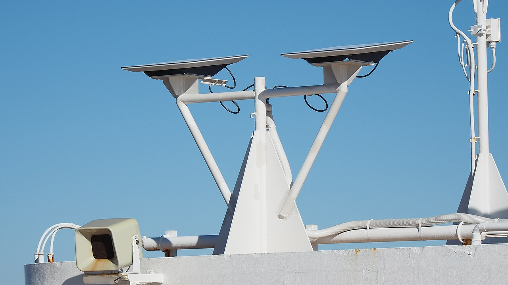
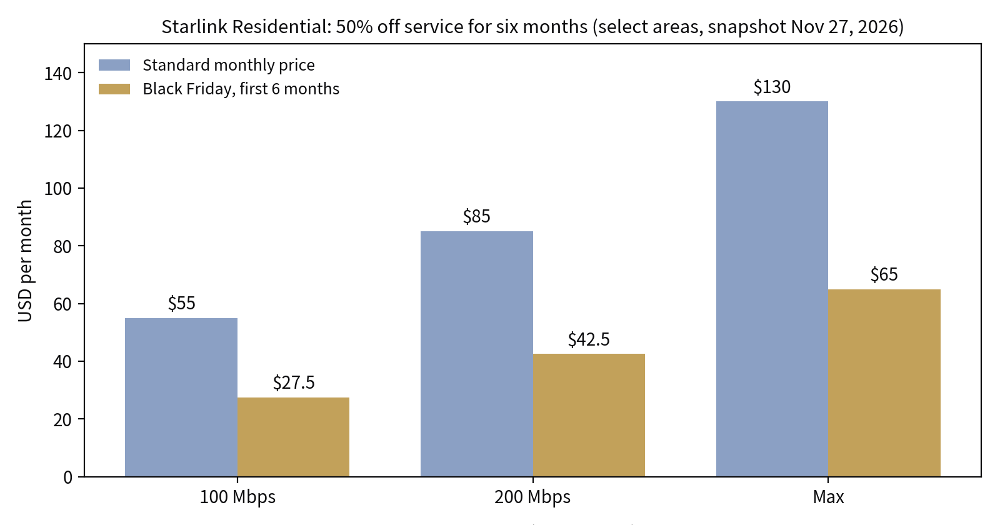

> [中文版 Chinese version](/life/starlink-black-friday-half-price-residential-zh/)

*Image: Starlink dish UTA-222 on a cruise ship. Photo: Ka23 13, CC BY 4.0, via Wikimedia Commons.*

## The offer, exactly as Starlink states it

On **Thursday, November 26, 2026**, Starlink announced a Black Friday promotion on X and in a help-centre article: **new customers who sign up by 11:59 p.m. Pacific Time on Monday, November 30, 2026** — Cyber Monday — get **50% off their monthly Residential service for the first six months**. The offer applies in **select areas**; in the United States, **Alaska is excluded**. Reporting based on Starlink's order pages in multiple countries (SatellitePlan's November 27 update, TeslaNorth's November 26 report, and price trackers that re-checked order pages on November 26) shows the same 50%-for-six-months structure live in **Canada, the UK, Australia, France, Italy, Spain, Brazil and Mexico**, among others. It covers the Residential tiers — **100 Mbps, 200 Mbps and Max**, including rental options — and it covers **service only**: not the dish kit, not shipping, not any demand surcharge, and not Roam plans.

The prices depend on your address, which is why Starlink's announcement lists no single figure. At sample addresses where the 50% tier applies, Starlink's own checkout showed, as re-verified on November 26–27: **100 Mbps at $27.50 a month instead of $55**; **200 Mbps at $42.50 instead of $85**; and **Max at $65 instead of $130**. In Canada the equivalent examples were CA$37.50 instead of CA$75 on the entry tier; in France and Spain, €17.50 instead of €35. All prices in this post are a snapshot checked on **November 27, 2026**, are **subject to change**, and — this matters more than usual — are only real if your own address's order page shows them. Starlink's help article is explicit that the discount applies to service only and that the standard price for your plan applies from month seven.

Do the first-year arithmetic, because "50% off" overstates itself. Six months at half price followed by six months at full price is a **25% saving over the first year**: on the 100 Mbps tier, $495 instead of $660 across twelve months, a saving of **$165**; on Max, $1,170 instead of $1,560, a saving of **$390**. Those are real savings, worth having, and they are also exactly the kind of numbers a Black Friday headline is designed to make you round up. Add the hardware, which is not discounted in this offer, and the promotion's true shape emerges: Starlink is discounting the subscription, not the entry ticket — the same razor-and-blades structure as a cheap printer, run in reverse, where the razor stays full price and the blades are half off until spring.

*Author's chart. Data: Starlink order pages and Black Friday help article, as re-verified by SatellitePlan and TeslaNorth, November 26–27, 2026. Service only; kit not discounted. Prices are a November 27, 2026 snapshot, subject to change, and vary by address.*

## The confusion: what happened to the 30% offer that "did not expire"?

Anyone who researched Starlink earlier in November met a different promotion, and the two are easy to conflate — several price trackers spent November 27 untangling them. From early November, Starlink's site carried a **"save 30% on recurring Residential service in select areas"** offer; PCMag's address checks found 30% in cities including San Francisco, Albuquerque, Milwaukee and Denver, and 50% in a smaller set including Boston, Fargo, Concord and Providence. The striking feature of that earlier offer was its FAQ, which trackers quoted verbatim: the reduced monthly price "stays on your plan and does not expire after a set number of months," though Starlink could still change prices later with 30 days' notice. A Roam discount attached to the same promotion disappeared from US checkout pages by November 23, while a **$149 Mini kit** offer remained live in the final week.

The Black Friday announcement **re-announced and restructured** the deal: 50% became the headline figure in the eligible areas trackers re-checked (one tracker's Denver test address moved from 30% to 50% on November 27), but the duration became a fixed **six months**, after which the standard price applies. Whether any given address still shows a 30%-style recurring offer, the six-month 50% offer, or nothing at all cannot be known from any article — including this one. Starlink prices by service address, the offers are address-specific, and the order page for your address is the only authoritative source. Two further unknowns deserve naming: whether the **$100 referral reward** stacks with the Black Friday price is **not confirmed** — Starlink's Black Friday help article does not mention referrals and the referral terms do not mention promotions — and Starlink's generic promotional-pricing terms have historically described area discounts lasting a fixed period before returning to full price, which is one more reason to read the terms shown at your own checkout rather than any summary.

## Why Starlink is doing this at all

Starlink historically behaves like a company that does not need to discount: capacity-constrained in desirable areas, waitlists in living memory, price *increases* more familiar than sales. A 50% service promotion across most of its major markets is therefore a signal worth reading. The charitable reading is seasonal and simple — Black Friday is when home-internet switching decisions get made, and a six-month half-price window is a customer-acquisition cost, cheaper than advertising, aimed at households whose alternative is a cable or fibre contract expiring in the holiday window. The structural reading is more interesting: Starlink's constraint has shifted. With far more satellite capacity in orbit than in the beta years, the marginal cost of serving an additional rural or exurban household in an uncongested cell is low, while the lifetime value of a subscriber acquired at $27.50 who renews at $55 is high — provided they renew. The six-month term is calibrated to exactly that bet: long enough to become the household's default connection and accumulate switching costs (the dish is mounted, the Wi-Fi is configured, the alternatives are cancelled), short enough that the subsidy ends before it becomes the expected price.

The address lottery is the other half of the strategy, and the part consumers will like least. Pricing by service address lets Starlink discount precisely where it has spare capacity and a competitive fight — suburbs and small cities with cable alternatives — while holding full price where it is the only real option or where cells are congested. That is rational yield management, of the kind airlines perfected; it is also why two neighbours an hour apart can be quoted prices differing by a factor of two for the same satellites passing over both of them. Expect more of it, not less: the November sequence — a quiet 30% here, 50% there, restructured within the month — looks like a company actively experimenting with geographic price discrimination and learning what each market will bear.

## Should you bite? The checklist that matters

For a household in an eligible area with mediocre cable or DSL, the maths above is genuinely favourable: a year of 100 Mbps satellite service for $495 of service charges, with hardware at the standard price, is the cheapest Starlink has ever been to *run*, even if not to start. The conditions are the substance, though. **Check your own address** on starlink.com before believing any figure in this post — the discount either appears on your order page or it does not exist for you. **Read the duration at your checkout**: the Black Friday terms say six months, then standard pricing; do not assume the earlier no-expiry FAQ applies to a Black Friday order. **Price the hardware honestly**: the kit is not discounted under this offer, and any demand surcharge at your address is not discounted either. **Mind the deadline**: sign-ups close at 11:59 p.m. PT on November 30. And **do not count the referral reward** until Starlink confirms stacking in writing at your checkout.

The verdict: this is a real, unusually deep discount on the running cost of a service that almost never discounts, wrapped in enough address-dependence and duration fine print that the headline "50% off" should be read as "25% off your first year, if your postcode qualifies." For the right household — rural or exurban, eligible address, already Starlink-curious — that is more than enough reason to move before Monday night. For everyone else, the lasting news is not the sale. It is that Starlink has started behaving like an ordinary broadband company: competing on price, by postcode, on Black Friday. The monopoly era of satellite internet pricing is ending the way those eras usually end — not with a rival constellation, but with a promotion.

*Sources: Starlink's Black Friday announcement on X and its Black Friday Residential Service Promotion help article, November 26, 2026; SatellitePlan, "Starlink's November sale takes 30-50% off Residential and Roam," updated November 27, 2026; TeslaNorth, "Starlink Black Friday: 50% Off Residential for Six Months," November 26, 2026; order-page price checks reported by Drohnen.de and StarlinkCostUSA, November 26–27, 2026. All prices are a snapshot as of November 27, 2026, subject to change, and vary by service address.*
