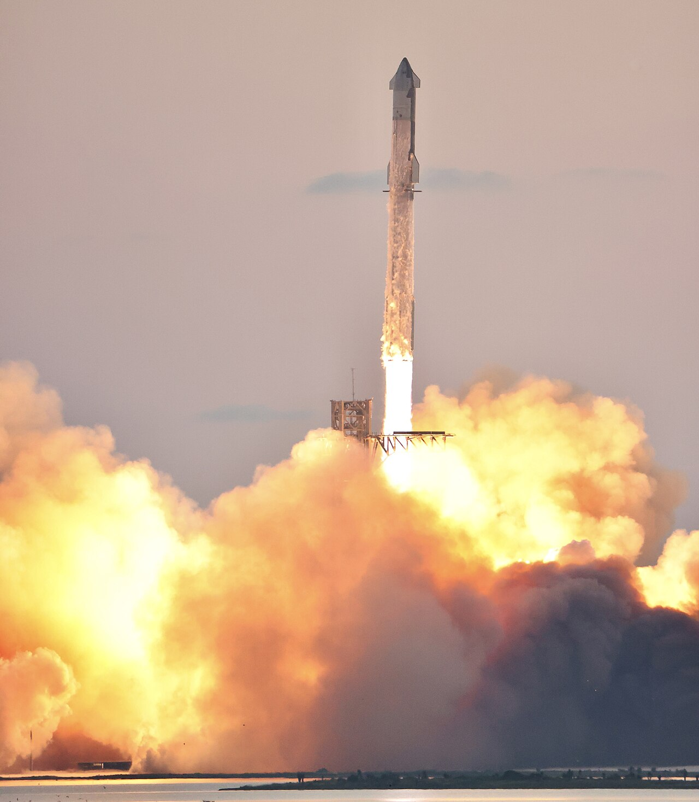
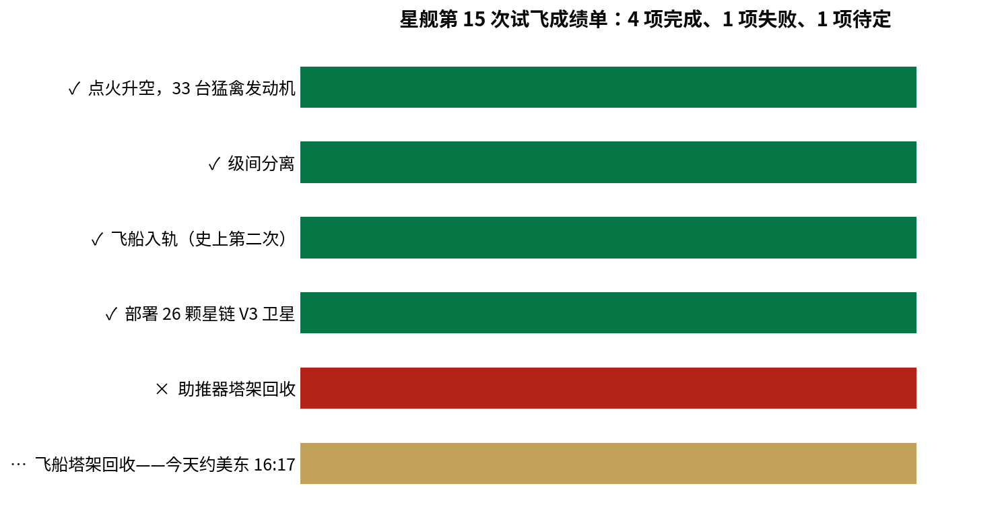

> [English version](/life/starship-flight-15-booster-catch/)

*星舰在一次早期试飞中升空（IFT-5，2024 年 10 月）。照片：Steve Jurvetson，来自 Wikimedia Commons（CC BY 2.0）。撰写时暂无第 15 次试飞的官方图片。*

## 发生了什么

SpaceX 的星舰于 11 月 13 日周五美东时间 17:47 从得州 Starbase 升空，407 英尺高的火箭进行第 15 次试飞。这次的计划是该项目迄今最大胆的一次：**两级都回收**——超重型助推器在升空几分钟后由发射塔接住，飞船在完整绕轨一圈后再由发射塔接住，一次任务验证完全可重复使用。

这个计划的一半已经没了。升空约两分半钟后，飞船分离并点火；超重型助推器翻转回来，开始向发射塔返航。大约 6 分钟时，飞行控制中心叫停了回收。助推器被改道飞往海上指定区域，坠入墨西哥湾，在触水前一刻化作一团火球。

SpaceX 随后表示，是助推器自己中止了回收：其制导、导航与控制系统在滑行阶段检测到故障，触发了海上备降程序。据 SpaceX 传播经理 Dan Huot 称，滑行后期之前回收还是"可以执行"的状态。如果成功，这将是升级后的 V3 助推器的首次回收——SpaceX 此前已用塔臂接住过 3 枚 V1 助推器，其中 2 枚还复飞过。

## 成功的那一半

任务的另一半比以往任何一次星舰飞行都顺利。飞船于美东时间约 18:13 进入轨道，高度约 275 公里——这是星舰**史上第二次**完整进入轨道。第一次是 9 月底的第 14 次试飞。

随后约 42 分钟里，它部署了携带的全部 **26 颗星链 V3 卫星**，这是该公司最先进的互联网卫星。SpaceX 于周五晚确认卫星已入轨。

*第 15 次试飞成绩单。来源：美联社；SpaceX（经 Florida Today 与 Space.com）；Spaceflight Now。*

## 从来没人试过的那部分

飞行还没结束。飞船正在执行约 22.5 小时的任务，绕地球约 14 圈，SpaceX 计划让它返回 Starbase，在**今天美东时间约 16:17（太平洋时间 13:17）**尝试塔架回收——这是人类首次尝试用发射塔接住一艘从轨道返回的飞船。

SpaceX 在轨道飞行中设置了三个检查点，一旦发现任何不安全因素，可将飞船改道至夏威夷附近或智利外海的预定溅落区；截至周六凌晨，它已通过前两个检查点。脱轨点火定于美东时间约 15:21。返回路径本身也是第一次：飞船将从太平洋上空再入，飞越墨西哥北部和得州南部陆地上空，再转向发射塔。SpaceX 表示，只有在再入制导所需的每个系统都健康的情况下才会尝试回收——能入轨不等于一定回收。

这个周末的太空活动还不止这一件。ULA 的 Vulcan 火箭定于今天美东时间 12:32–13:01 从卡纳维拉尔角发射，携带 40 颗亚马逊 Leo 宽带星座卫星；周五因燃料加注厂断电而推迟。

## 为什么非要接住火箭

塔架回收看起来像一场表演，但它要解决的是一个很实际的问题：着陆腿很重，而火箭上的死重是最贵的重量。超重型助推器根本没有着陆腿。它飞回发射它的那座塔——绰号 Mechazilla，高约 146 米——两只巨大的机械臂（人称"筷子"）在它悬停于塔旁时合拢。机械臂抓住助推器顶部格栅翼下方的结构挂钩，托住几百吨重的箭体，直到地面人员将其固定。而这座塔本身就是发射前堆叠火箭的起重机，所以被接住的助推器已经在它该在的位置：可以直接放回发射台。这就是 SpaceX 敢谈"不到一小时再次发射"的原因——用腿着陆再吊运回收，需要几天甚至几周。

这个想法 2020 年 12 月才公开，当时埃隆·马斯克写道 SpaceX 将尝试用发射塔的机械臂接住超重型助推器。将近四年后才第一次尝试。2024 年 10 月 13 日第 5 次试飞，一次就成功了：助推器 12 号在升空约 7 分钟后回到塔旁，靠发动机减速到几乎悬停，横向滑入张开的机械臂，熏黑但完好无损地挂在那里。此后 SpaceX 又接住过两次——第 7 次和第 8 次试飞——其中两枚被接住的助推器还复飞过。这套系统也在公众面前安全地失败过：第 6 次试飞回收被叫停，助推器按设计改道，在墨西哥湾软着陆。

这套安全逻辑就是全部要点，而且非常严格。第 5 次试飞前，SpaceX 表示一次回收需要满足数千项飞行器与发射台条件，而且只有飞行主管在助推器返航点火结束前发出手动"可以执行"的指令，助推器才会飞向发射塔。任何时候自动健康检查发现问题——或者指令根本没来——助推器就会避开发射塔、飞向海面。第 15 次试飞的助推器正是这么做的：其制导、导航与控制系统在滑行阶段检测到故障，飞行器自行中止、飞往海上备降区。尴尬是真实的，但设计按预期工作也是真实的。一套不会说"不"的回收系统不是回收系统，而是发射台旁边的一颗炸弹——而那座发射台是唯一能发射这枚火箭的地方。

## V3 到底改了什么

第 15 次试飞是升级后的 V3 飞行器的第三次飞行，也是 V3 首次尝试助推器回收——这就是这次损失比丢一枚 V1 助推器更让人难受的原因。V3（也称 Block 3）于 2026 年 5 月 22 日在第 12 次试飞中首飞，从 Starbase 新建的二号发射台升空，此前两次试飞之间隔了七个月。这是该项目历史上最大的一次重新设计：整箭高 407 英尺（124 米），携带约 5,250 吨液态甲烷与液氧，动力是猛禽 3 号发动机——助推器上装了 33 台，起飞总推力 8,240 吨力，约 1,810 万磅。SpaceX 公布的猛禽 3 号海平面推力为 250 吨力，高于猛禽 2 号的 230 吨力，而发动机本身反而更轻了，隔热罩改为内置、管路也简化了。最醒目的指标是运力：SpaceX 称 V3 在完全可重复使用构型下可向近地轨道运送 100 吨以上，约为上一代的三倍——这个说法还没有以这种方式飞出来过。

回收硬件也改了。V3 助推器的格栅翼从四片减为三片，每片大约 50%，重新布局后同一片翼既能帮助升力、又能参与回收，挂钩点也是新的。塔架一侧，SpaceX 的 V3 更新中提到"筷子"变短了，以便更快地跟踪返回的飞行器，主执行器也从液压改为机电式。所有这些在此前没有一次在真实回收中验证过：第 12 次和第 13 次试飞都是亚轨道测试，两次助推器都在墨西哥湾硬着陆，而非塔架回收。第 14 次试飞（9 月 28 日）是 V3 首次入轨——也是任何版本的星舰首次入轨。第 15 次试飞本该是新硬件证明自己能回家的那一次。

## 为什么 26 颗卫星才是真正的有效载荷

很容易把卫星部署当成回收尝试的配角。从商业上看，恰恰相反。第 15 次试飞携带的 26 颗星链 V3 卫星，是星舰作为一门生意存在的原因：它们对猎鹰 9 号来说太大、太重，只有星舰能飞。

每颗 V3 卫星重约 2,000 公斤——约为猎鹰 9 号今天发射的 V2 Mini 的三倍——SpaceX 公布的设计指标是，每颗下行容量约 1 Tbps（太比特每秒），约为 V2 Mini 的十倍；上行约 160 Gbps，约为 22 倍。相控阵天线可操控 2,048 路下行波束和 2,048 路上行波束，而 V2 Mini 只有 192 路和 144 路；六个激光终端以每路 400 Gbps 在卫星之间传数据；太阳能电池阵列的发电量约为 V2 Mini 的两倍，完全展开时翼展约 60 米，约等于一架波音 787 的翼展。SpaceX 称，一次满载 60 颗 V3 卫星的星舰发射可为网络增加约 60 Tbps 的容量——超过猎鹰 9 号一次星链任务的 20 倍。但所有这些数字都是 SpaceX 公布的设计目标，不是实测结果：至今还没有一颗 V3 卫星服务过客户。

这正是部署记录重要的原因。7 月的第 13 次试飞携带了首批 20 颗 V3 卫星，但那艘星舰按设计就是亚轨道飞行，卫星 20 分钟后就再入了。第 14 次试飞于 9 月 28 日把 26 颗留在了轨道上——星舰的第一次创收任务。第 15 次试飞如今又做了一次。它们加入的网络已经是 SpaceX 的印钞机：2026 年 5 月的 IPO 文件显示，以星链为核心的 Connectivity 业务 2025 年收入 114 亿美元——约占公司 187 亿美元总收入的 61%——截至 2026 年 3 月 31 日，在 164 个国家和地区拥有约 1,030 万用户，高于一年前的 500 万。但速度提升不是立刻到来的。SpaceX 总裁 Gwynne Shotwell 表示，需要几百颗 V3 卫星入轨，用户才能真正感受到更快的速度，可能要到 2027 年年中。按每次 26 颗算，那至少需要十几次成功的星舰发射——所以每一次部署，无论接不接得住，都是一个以年为单位的时间表上的一步，而不是一个下午的 spectacle（看点）。

## 为什么接飞船是另一类难事

接助推器很难。接飞船是另一类难事，因为两级不是从同一个地方回家的。助推器其实从没真正离开过家：分离后它爬升到约 96 公里高度，减速到约每小时 1,200 公里，几分钟内掉头，约 7 分钟后回到塔旁。飞船要一路飞进轨道，在那么低的轨道上，任何东西的速度都约为每小时 28,000 公里——每秒将近 8 公里。要回家，它必须靠扎进大气层把几乎全部速度都甩掉，再入时表面温度接近 1,650 摄氏度。飞船与高温之间唯一的屏障，是一层约 18,000 片六边形陶瓷瓦。

而在那之后，飞船还得留足燃料翻正、减速，并恰好停在两只机械臂之间的正确位置——一艘在太空待了 22 小时、飞越一片海洋和两个国家、几分钟前刚经历全程最热阶段的飞船。周五助推器的中止提醒人们这套系统如何处理失败：改道。飞船的返回也内置了同样的逻辑，三个检查点、夏威夷附近与智利外海的预定溅落区——但一艘改道的飞船就是一艘丢失的飞船，而不是回收的飞船。这就是今天下午的赌注：助推器已经证明了中止程序管用；飞船必须证明回收管用。

## 飞船在天上的 22.5 小时在干什么

22.5 小时的任务时长听起来像是故意拖长，实际上它是轨道力学算出来的数字。飞船在约 275 公里高度绕地球一圈大约需要 90 分钟，22.5 小时就是约 14 圈。这个时长不是为了多飞几圈好看，而是为了让飞船回到 Starbase 上空时，发射场正好转到它的轨道面下方——地球在飞船脚下自转，发射场必须等到合适的位置才能接它。换句话说，飞船大部分时间只是在等地球转到正确的位置。

等待期间它也不是闲着。部署 26 颗卫星只用了前 42 分钟，剩下的时间里，飞船要验证在轨系统：推进剂管理、姿态控制、通信，以及再入前最关键的隔热瓦状态。第 14 次试飞的飞船在完成部署后执行了脱轨点火、溅落在太平洋，整个流程走通了一遍；第 15 次的不同之处在于最后一步不是溅落，而是对准发射塔。三个检查点就是这段等待期的意义所在：每个检查点都是一次"继续还是改道"的决策，飞船必须在每一个点上证明自己的制导系统健康，否则就去夏威夷或智利外海溅落。截至周六凌晨，它已通过前两个。

返回路径本身也值得单独说一句。飞船将从太平洋上空再入，飞越墨西哥北部和得州南部陆地上空，再转向发射塔。星舰此前的再入都是飞越海洋、溅落在海上；这一次，飞船要在陆地上空飞行一段，再入的航迹第一次经过有人居住的地区上空。这是 SpaceX 向监管机构证明再入精度的方式——它必须证明飞船能精确地飞到它该去的地方，而不是大概的方向。FAA 的发射许可正是建立在这种精度的论证之上：如果飞船不能保证落在预定的走廊里，就没有人会批准它飞越陆地。

## 如果今天下午成功了，意味着什么

先说清楚成功是什么样子：飞船在约 16:17（美东时间）脱轨点火，穿过大气层，在发射塔旁减速到几乎悬停，机械臂合拢，接住一艘从轨道上回来的飞船。如果它发生了，SpaceX 将在 24 小时内用两次独立的尝试验证了完全可重复使用的两半——助推器那一半失败了，飞船那一半成功了。这听起来像是一半的成功，但它实际上是更难的那一半。助推器回收已经成功过三次，飞船回收一次都没有。

对星舰的商业时间表来说，成功会改变很多东西。完全可重复使用是星舰整个经济模型的前提：只有两级都能回收、快速复飞，发射成本才能降到让每月多次发射成为可能，也只有那样，部署几百颗 V3 卫星、进而实现 Shotwell 所说的"用户真正感受到更快速度"才有现实的时间表。更远处还有月球与火星：NASA 的阿尔忒弥斯登月计划依赖星舰作为载人登月器，而那需要不止一次成功的轨道飞行与回收，更需要证明星舰能在轨道上加注燃料、长期停留。一次成功的飞船回收不会证明所有这些，但它会把"星舰能回家"从一个待验证的假设变成一个已经做过一次的事实。

如果失败了——飞船改道溅落，或者在回收中损毁——第 15 次试飞的叙事会立刻定型：星舰能在轨道上工作，却还不能完整回家。而 SpaceX 的回应是可以预测的，因为它过去十四次试飞的回应都是同一个：查数据、改设计、再飞一次。这个项目从 2023 年 4 月第一次试飞升空四分钟后爆炸开始，就是这么走过来的。区别只在于，每一次迭代的代价都在变大：V3 更大、更贵，Starlink V3 的部署窗口更紧，而竞争对手——ULA 的 Vulcan、蓝色起源的 New Glenn——也在同一个周末争夺同一个发射市场。时间不再是免费的。

## 从 2023 年到现在：十四次试飞的速览

第 15 次试飞的背景，是一个只用了三年多就从爆炸走到轨道的项目。2023 年 4 月的第一次试飞，星舰升空四分钟后爆炸；此后每一次试飞都比上一次多走一步：第 4 次试飞（2024 年 6 月）助推器在墨西哥湾精准溅落——据 SpaceX 的 Bill Gerstenmaier 后来透露，落点精度约为半厘米——第 5 次试飞接住了助推器，第 7、8 次又接住两次。但飞船本身一直没能进入轨道，直到 2026 年 9 月 28 日的第 14 次试飞才第一次做到。

这个节奏解释了为什么 SpaceX 敢在第 15 次同时尝试两件事：项目的方法一直是把每一次飞行当作一次实验，而不是一次演示。失败不是意外，是计划的一部分——每一枚助推器、每一艘飞船都是消耗品，造出来就是为了在飞行中暴露问题。第 12 次试飞（2026 年 5 月 22 日）V3 首飞，助推器 19 号在返航点火时发动机未能正常重启，失控坠入墨西哥湾；第 13 次试飞（7 月 24 日）同样没能回收助推器，但第一次把真正的 V3 卫星送上了天（按设计再入）。两次失败、两次教训，然后是第 14 次的入轨成功。

放在这个背景下，第 15 次试飞的助推器故障就不那么像一次倒退，而更像这个项目的常态：新硬件的第一天总是最难的。V3 的助推器是新的、发动机是新的、回收的执行器是新的，第一次尝试回收就遇到制导故障，并不令人意外；令人意外的是飞船那一半——最新、最复杂的部分——到目前为止一切正常。这也是为什么今天下午的回收尝试如此重要：它要回答的问题不是"星舰能不能飞"，第 14 次已经回答了，而是"星舰能不能回家"，而这个问题此前没有任何一艘飞船回答过。

## 助推器故障之后：调查会查什么

助推器坠入墨西哥湾之后，SpaceX 的调查会从遥测数据开始：制导、导航与控制系统在滑行阶段到底检测到了什么故障，是传感器读数异常、软件判断出错，还是硬件本身的问题。Dan Huot 的说法已经框定了范围——故障发生在滑行阶段，而非点火或返航点火阶段——这意味着调查的重点是助推器在无动力滑行、靠格栅翼转向的那几分钟里发生了什么。

值得注意的还有一点：这是 V3 助推器的第一次回收尝试，而 V3 的格栅翼、挂钩点和执行器都是新设计的。调查必须回答一个区分性问题：故障是 V3 新硬件特有的，还是任何一代助推器都可能遇到的问题？如果是前者，修复可能涉及硬件改动，下一次回收尝试会推迟；如果是后者，一次软件更新或检查流程的调整就可能解决问题。SpaceX 过去的调查节奏很快——第 12 次试飞的发动机重启失败之后，FAA 的调查关闭、第 13 次试飞在两个月后就升空了——但每一次调查的结论都不同，不能假定这一次也会这么快。

还有一个不需要调查就能回答的问题：发射台没事。助推器主动避开发射塔、坠入海中，这正是中止程序存在的意义。发射台、机械臂和二号发射台都完好无损，飞船的回收尝试可以按计划进行。对 SpaceX 来说，这是坏消息里最好的部分：一次失败没有带走任何基础设施。

这个周末还有另一层含义：ULA 的 Vulcan 火箭也在今天发射，运载 40 颗亚马逊 Leo 卫星——那是星链的直接竞争对手。两家公司的火箭在同一天争夺天空，争夺的其实是同一批用户：那些住在光纤到不了的地方、愿意为卫星上网付费的人。星舰的成败与 Vulcan 的成败，最终会在同一个市场上见分晓。

而对普通读者来说，最值得记住的可能是一个简单的对照：三年前，星舰升空四分钟就炸了；今天，它把 26 颗卫星送进了轨道，飞船还在天上等着回家。爆炸没有消失——助推器今天就炸了——但爆炸的位置变了：从发射台上空，变成了墨西哥湾的海面上。这就是进步在这个项目里的样子——而这一次，答案就在今天下午揭晓。

## 判断：一个分裂的结果，而分裂本身就是故事

第 15 次试飞既是一次险些成功，也是一次突破，到底算哪一个，取决于今天下午。

助推器的失败有种特定的尴尬：塔架回收本是 SpaceX 已经开始做得像家常便饭的部分。在 V3 助推器首飞就因制导故障丢掉它，提醒人们这个项目里的"常规"仍然是个很薄的说法。但中止程序本身完全按设计工作——助推器主动避开发射塔、飞向海上，这正是整个回收概念所依赖的安全逻辑。

飞船的表现则是商业上真正重要的部分。第二次入轨、完整部署 26 颗星链 V3 卫星，是星舰真正要靠它谋生的任务。回收尝试是 spectacle（看点），轨道投送才是生意。如果今天下午飞船被接住，SpaceX 将在 24 小时内、通过两次独立尝试，验证了完全可重复使用的两半。如果接不住，第 15 次试飞将被记住为"证明了星舰能在轨道上工作、却还不能完整回家"的那一次——然后项目会像以往一样，继续迭代。

*本文反映截至 2026 年 11 月 14 日上午（太平洋时间）的状态。飞船回收尝试定于今天美东时间约 16:17 / 太平洋时间 13:17，结果将在后续更新中报道。*
