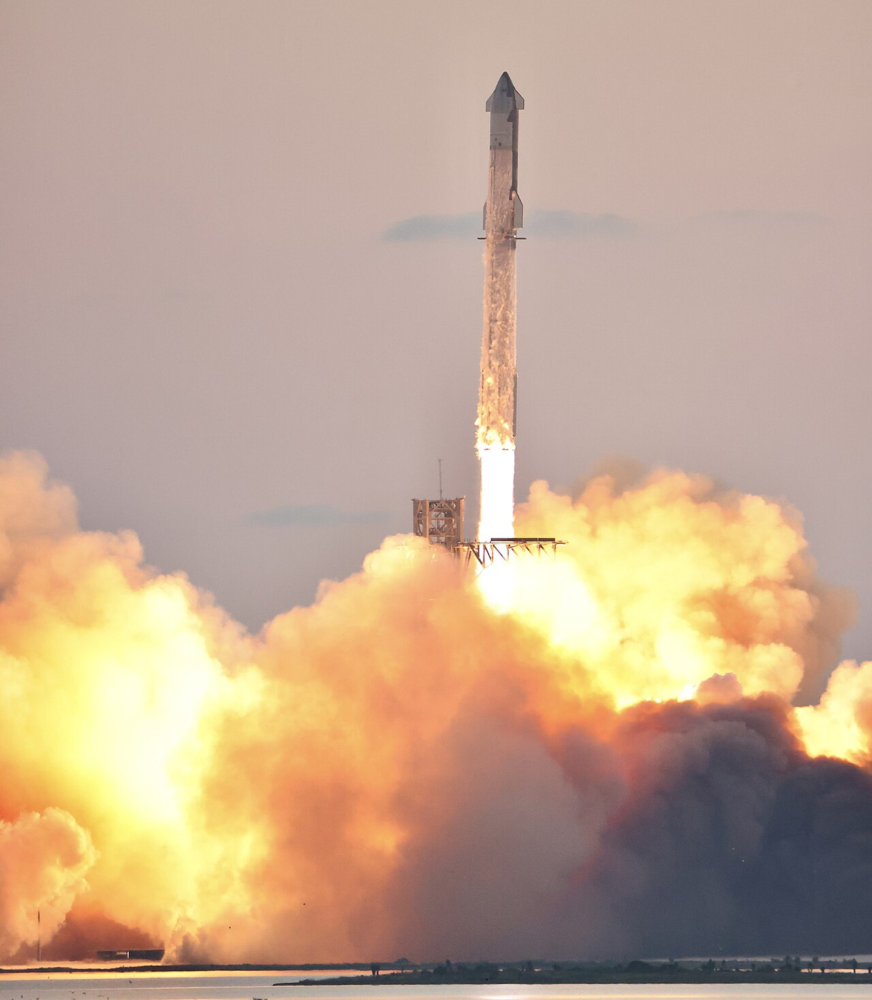
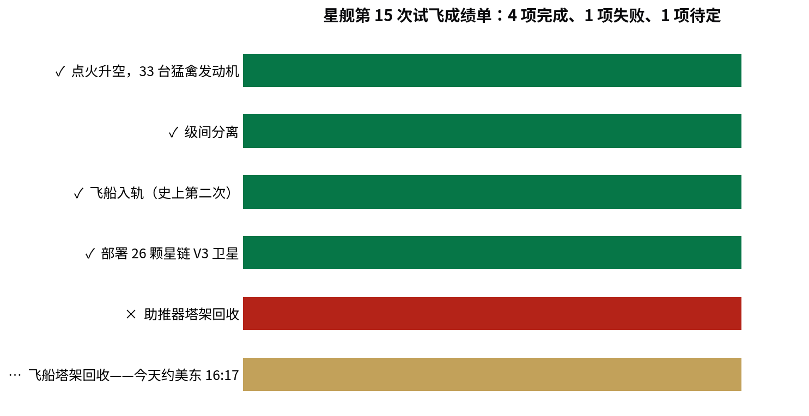

> [English version](/life/starship-flight-15-booster-catch/)

*星舰在一次早期试飞中升空（IFT-5，2024 年 10 月）。照片：Steve Jurvetson，来自 Wikimedia Commons（CC BY 2.0）。撰写时暂无第 15 次试飞的官方图片。*

## 发生了什么

SpaceX 的星舰于 11 月 13 日周五美东时间 17:47 从得州 Starbase 升空，407 英尺高的火箭进行第 15 次试飞。这次的计划是该项目迄今最大胆的一次：**两级都回收**——超重型助推器在升空几分钟后由发射塔接住，飞船在完整绕轨一圈后再由发射塔接住，一次任务验证完全可重复使用。

这个计划的一半已经没了。升空约两分半钟后，飞船分离并点火；超重型助推器翻转回来，开始向发射塔返航。大约 6 分钟时，飞行控制中心叫停了回收。助推器被改道飞往海上指定区域，坠入墨西哥湾，在触水前一刻化作一团火球。

SpaceX 随后表示，是助推器自己中止了回收：其制导、导航与控制系统在滑行阶段检测到故障，触发了海上备降程序。据 SpaceX 传播经理 Dan Huot 称，滑行后期之前回收还是"可以执行"的状态。如果成功，这将是升级后的 V3 助推器的首次回收——SpaceX 此前已用塔臂接住过 3 枚 V1 助推器，其中 2 枚还复飞过。

## 成功的那一半

任务的另一半比以往任何一次星舰飞行都顺利。飞船于美东时间约 18:13 进入轨道，高度约 275 公里——这是星舰**史上第二次**完整进入轨道。第一次是 9 月底的第 14 次试飞。

随后约 42 分钟里，它部署了携带的全部 **26 颗星链 V3 卫星**，这是该公司最先进的互联网卫星。SpaceX 于周五晚确认卫星已入轨。

*第 15 次试飞成绩单。来源：美联社；SpaceX（经 Florida Today 与 Space.com）；Spaceflight Now。*

## 从来没人试过的那部分

飞行还没结束。飞船正在执行约 22.5 小时的任务，绕地球约 14 圈，SpaceX 计划让它返回 Starbase，在**今天美东时间约 16:17（太平洋时间 13:17）**尝试塔架回收——这是人类首次尝试用发射塔接住一艘从轨道返回的飞船。

SpaceX 在轨道飞行中设置了三个检查点，一旦发现任何不安全因素，可将飞船改道至夏威夷附近或智利外海的预定溅落区；截至周六凌晨，它已通过前两个检查点。脱轨点火定于美东时间约 15:21。返回路径本身也是第一次：飞船将从太平洋上空再入，飞越墨西哥北部和得州南部陆地上空，再转向发射塔。SpaceX 表示，只有在再入制导所需的每个系统都健康的情况下才会尝试回收——能入轨不等于一定回收。

这个周末的太空活动还不止这一件。ULA 的 Vulcan 火箭定于今天美东时间 12:32–13:01 从卡纳维拉尔角发射，携带 40 颗亚马逊 Leo 宽带星座卫星；周五因燃料加注厂断电而推迟。

## 判断：一个分裂的结果，而分裂本身就是故事

第 15 次试飞既是一次险些成功，也是一次突破，到底算哪一个，取决于今天下午。

助推器的失败有种特定的尴尬：塔架回收本是 SpaceX 已经开始做得像家常便饭的部分。在 V3 助推器首飞就因制导故障丢掉它，提醒人们这个项目里的"常规"仍然是个很薄的说法。但中止程序本身完全按设计工作——助推器主动避开发射塔、飞向海上，这正是整个回收概念所依赖的安全逻辑。

飞船的表现则是商业上真正重要的部分。第二次入轨、完整部署 26 颗星链 V3 卫星，是星舰真正要靠它谋生的任务。回收尝试是 spectacle（看点），轨道投送才是生意。如果今天下午飞船被接住，SpaceX 将在 24 小时内、通过两次独立尝试，验证了完全可重复使用的两半。如果接不住，第 15 次试飞将被记住为"证明了星舰能在轨道上工作、却还不能完整回家"的那一次——然后项目会像以往一样，继续迭代。

*本文反映截至 2026 年 11 月 14 日上午（太平洋时间）的状态。飞船回收尝试定于今天美东时间约 16:17 / 太平洋时间 13:17，结果将在后续更新中报道。*
