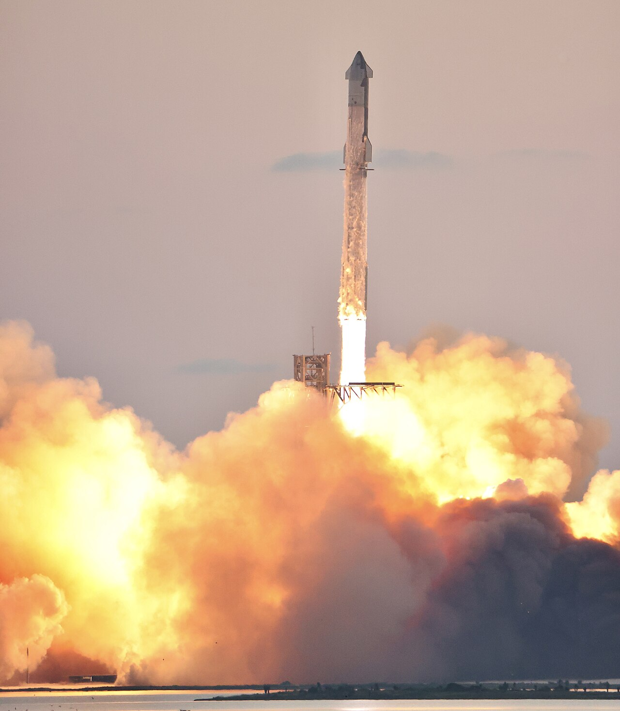
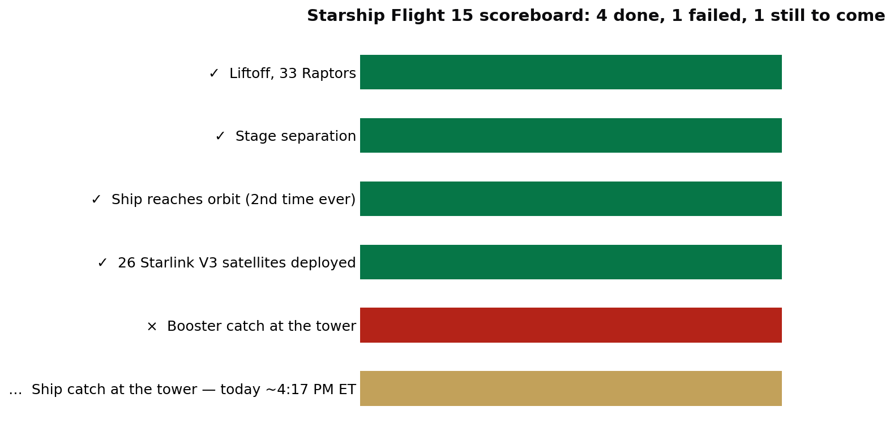

> [中文版 Chinese version](/life/starship-flight-15-booster-catch-zh/)

*Starship lifting off on an earlier test flight (IFT-5, October 2024). Photo: Steve Jurvetson, via Wikimedia Commons (CC BY 2.0). No official imagery of Flight 15 was available at the time of writing.*

## What happened

SpaceX launched the 407-foot Starship from Starbase, Texas, at 5:47 p.m. Eastern on Friday, November 13, on its 15th test flight. The plan was the most ambitious the program has ever attempted: catch **both** stages of the rocket back at the launch tower — the Super Heavy booster minutes after liftoff, and the Ship itself after a full orbit — proving full reusability in a single mission.

Half of that plan is already gone. About two and a half minutes after liftoff, the Ship separated and fired its engines; the Super Heavy booster flipped around and began its return burn toward the tower. Roughly six minutes in, flight controllers called off the catch. The booster was diverted to a designated area offshore, splashed down in the Gulf of Mexico, and exploded in a fireball just before reaching the water.

SpaceX later said the booster aborted the catch itself: its guidance, navigation, and control system detected a fault during the coast phase and triggered the offshore contingency landing, according to SpaceX communications manager Dan Huot. The company had been "go" for a catch until the later stages of the coast. Had it worked, it would have been the first catch of the upgraded Version 3 booster — SpaceX has caught three earlier V1 boosters with the tower arms and reflown two of them.

## What worked

The other half of the mission is going better than any Starship flight before it. The Ship reached orbit at about 6:13 p.m. Eastern, roughly 275 km up — only the **second time ever** a Starship has made it fully into orbit. The first was Flight 14, at the end of September.

Over the next 42 minutes it deployed all **26 Starlink V3 satellites** it was carrying, the company's most advanced internet satellites. SpaceX confirmed them in orbit on Friday evening.

*Flight 15 scoreboard. Sources: Associated Press; SpaceX via Florida Today and Space.com; Spaceflight Now.*

## The part that has never been tried

The flight is not over. The Ship is on a roughly 22-and-a-half-hour mission, circling the Earth about 14 times, and SpaceX plans to bring it back to Starbase for a catch attempt at **about 4:17 p.m. Eastern today (1:17 p.m. Pacific)** — the first time anyone has tried to catch a spacecraft returning from orbit with the tower arms.

SpaceX built three checkpoints into the orbital flight so it can divert the Ship to pre-cleared splashdown zones near Hawaii or off Chile if anything looks unsafe; as of early Saturday morning it had passed the first two. A deorbit burn is scheduled for about 3:21 p.m. Eastern. The return path itself is a first: the Ship will re-enter over the Pacific and cross parts of northern Mexico and southern Texas, over land, before turning toward the tower. SpaceX has said it will only attempt the catch if every system needed to guide the Ship through re-entry is healthy — reaching orbit does not guarantee the catch goes ahead.

It is also a crowded weekend in space. ULA's Vulcan rocket is scheduled to launch from Cape Canaveral today between 12:32 and 1:01 p.m. Eastern, carrying 40 satellites for Amazon's Leo broadband constellation, after a Friday postponement caused by a power interruption at the plant that pumps fuel into the rocket.

## Why catch a rocket at all

The tower catch looks like a stunt, but it exists to solve a mundane problem: landing legs are heavy, and dead weight on a rocket is the most expensive weight there is. Super Heavy has no legs at all. Instead it flies back to the tower it launched from — nicknamed Mechazilla, about 146 metres tall — and two giant arms, the "chopsticks," close around it as it hovers beside the tower. The arms grip the vehicle just below its grid fins, where structural hooks are built in, and hold several hundred tonnes of booster suspended until ground crews can secure it. Because the tower is already the crane that stacks the rocket before launch, a caught booster is already where it needs to be: it can be set straight back on the launch mount, which is why SpaceX talks about turning a booster around in under an hour rather than the days or weeks a legs-and-crane recovery would take.

The idea went public in December 2020, when Elon Musk wrote that SpaceX would try to catch Super Heavy with the tower arm. On Flight 5, October 13, 2024, it worked on the first try: Booster 12 came down beside the tower about seven minutes after liftoff, slowed almost to a stop on its engines, slid sideways into the open arms, and hung there, scorched but intact. SpaceX has caught a booster three times — Flights 5, 7, and 8 — and reflown two of the caught boosters. The system has also failed safely in public: on Flight 6, the catch was called off and the booster diverted to a soft splashdown in the Gulf, exactly as designed.

That safety logic is the whole point, and it is strict. Before Flight 5, SpaceX said a catch required thousands of separate vehicle and pad conditions to be met, and the booster would only head for the tower after a manual go command from the Flight Director, sent before the end of the boostback burn. If the automatic health checks found a problem at any point — or if the command never came — the booster steered away from the tower and into the Gulf. Flight 15's booster did precisely that: its guidance, navigation, and control system detected a fault during the coast phase, and the vehicle aborted itself to the offshore contingency zone. The embarrassment is real, but so is the design working as intended. A catch system that cannot say no is not a recovery system; it is a hazard next to the only pad that can launch the rocket.

## What V3 changed

Flight 15 is the third flight of the upgraded Version 3 vehicle, and the first V3 flight to attempt a booster catch — which is why the loss stings more than a lost V1 booster would. V3, also called Block 3, debuted on Flight 12 on May 22, 2026, from a brand-new second launch pad at Starbase, after a seven-month gap between flights. It is the biggest redesign in the program's history: the stacked vehicle stands 407 feet (124 metres) tall, carries about 5,250 tonnes of liquid methane and liquid oxygen, and is powered by Raptor 3 engines — 33 of them on the booster, producing a combined 8,240 tonnes-force of thrust at liftoff, roughly 18.1 million pounds. SpaceX lists each Raptor 3 at 250 tonnes-force at sea level, up from 230 for Raptor 2, while the engine itself got lighter, with its heat shielding internalised and its plumbing simplified. The headline claim is payload: SpaceX says V3 can carry more than 100 metric tons to low Earth orbit in a fully reusable configuration, roughly triple the previous version's figure — a claim that has not yet been flown that way.

The catch hardware changed too. V3 boosters carry three grid fins instead of four, each about 50 percent larger and repositioned so the same fins help lift the vehicle as well as steer it, with a new catch point. On the tower side, SpaceX's V3 update describes shorter chopsticks, built to track a returning vehicle faster, with the main actuators switching from hydraulic to electromechanical. None of that had been tested on a live catch before Friday: Flights 12 and 13 were suborbital tests, and on both the booster made a hard splashdown in the Gulf rather than a tower catch. Flight 14, on September 28, was the first V3 flight to reach orbit — and the first Starship of any version to do so. Flight 15 was supposed to be the flight where the new hardware proved it could come home.

## Why the 26 satellites are the real payload

It is easy to treat the satellite deployment as the undercard to the catch attempts. Commercially, it is the other way around. The 26 Starlink V3 satellites Flight 15 carried are the reason Starship exists as a business: they are too big and too heavy for Falcon 9, and only Starship can fly them.

Each V3 satellite weighs about 2,000 kilograms — roughly three times a V2 Mini, the model Falcon 9 launches today — and SpaceX's published design figures put each one at about 1 terabit per second of downlink capacity, roughly ten times a V2 Mini, and about 160 gigabits per second of uplink, roughly 22 times. The antennas can steer 2,048 downlink beams and 2,048 uplink beams, against 192 and 144 on the V2 Mini; six laser terminals move 400 gigabits per second each between satellites; and the solar arrays produce about twice the power of a V2 Mini's, stretching about 60 metres tip to tip when fully open, roughly the wingspan of a Boeing 787. SpaceX says a full Starship load of up to 60 V3 satellites would add about 60 terabits per second of network capacity per launch — more than 20 times a Falcon 9 Starlink mission. Every one of those figures is a design target published by SpaceX, not a measured result: no V3 satellite has served a customer yet.

That is what makes the deployment record matter. Flight 13, in July, carried the first 20 V3 satellites, but that Starship was suborbital by design and they re-entered twenty minutes later. Flight 14 left 26 in orbit on September 28 — the first revenue-generating Starship mission. Flight 15 has now done it twice. The network they are joining is already SpaceX's money machine: its May 2026 IPO filing showed the Connectivity segment, built around Starlink, generated $11.4 billion in 2025 revenue — about 61 percent of the company's $18.7 billion total — with roughly 10.3 million subscribers across 164 countries and territories as of March 31, 2026, up from 5.0 million a year earlier. But the speed gain is not instant: SpaceX president Gwynne Shotwell said a few hundred V3 satellites need to be in orbit before customers really feel faster speeds, possibly by mid-2027. At 26 per flight, that is at least a dozen successful Starship launches.

## Why catching the Ship is a different job

Catching the booster is hard. Catching the Ship is a different category of hard, because the two stages do not come home from the same place. The booster never really leaves home: after separation it coasts up to about 96 kilometres, slows to roughly 1,200 kilometres per hour, turns around within minutes, and is back at the tower in about seven. The Ship goes all the way to orbit, where anything that low moves at about 28,000 kilometres per hour — nearly eight kilometres every second. To come home it has to throw away almost all of that speed by ploughing into the air, and surfaces heat up to nearly 1,650 degrees Celsius on the way down. The only thing between the Ship and that heat is a skin of about 18,000 hexagonal ceramic tiles.

And after all that, the Ship still has to keep enough fuel to flip upright, slow down, and stop in exactly the right spot between two arms — a vehicle that has spent 22 hours in space, crossed an ocean and two countries on its way in, and endured the hottest part of its flight minutes earlier. The booster's abort on Friday is a reminder of how the system handles failure: it diverts. The Ship's return has the same logic built in, with three checkpoints and pre-cleared splashdown zones near Hawaii and off Chile — but a diverted Ship is a lost Ship, not a recovered one. That is the gamble of the afternoon: the booster proved the abort works; the Ship has to prove the catch does.

## The verdict: a split result, and the split is the story

Flight 15 is a near-miss and a breakthrough at the same time, and which one it becomes depends on this afternoon.

The booster failure is embarrassing in a specific way: the tower catch was the part of Starship recovery that SpaceX had started to make look routine. Losing it to a guidance fault on the first flight of the new V3 booster is a reminder that "routine" in this program is still a thin claim. But the abort itself worked exactly as designed — the booster diverted itself away from the tower rather than risking the launch site, which is the safety logic the whole catch concept depends on.

The Ship's performance is the part that matters commercially. Reaching orbit for the second time, and deploying a full load of 26 Starlink V3 satellites, is the mission Starship actually has to do for a living. The catch attempts are the spectacle; the orbital delivery is the business. If the Ship is caught this afternoon, SpaceX will have demonstrated both halves of full reusability within 24 hours, on separate attempts. If it is not, Flight 15 will be remembered as the flight that proved Starship can work in orbit and still cannot come home in one piece — and the program will iterate again, as it always does.

*This post reflects the status as of the morning of November 14, 2026 (PT). The Ship catch attempt is scheduled for about 4:17 p.m. ET / 1:17 p.m. PT today; the outcome will be covered in a follow-up.*
