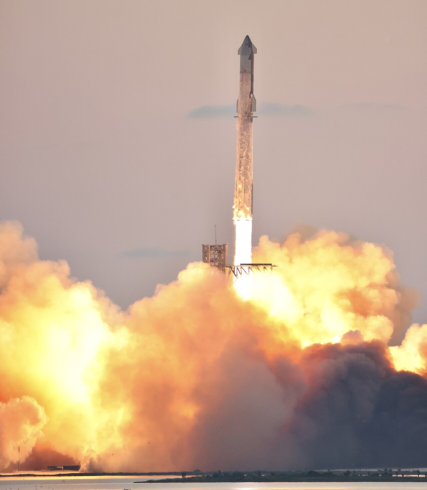
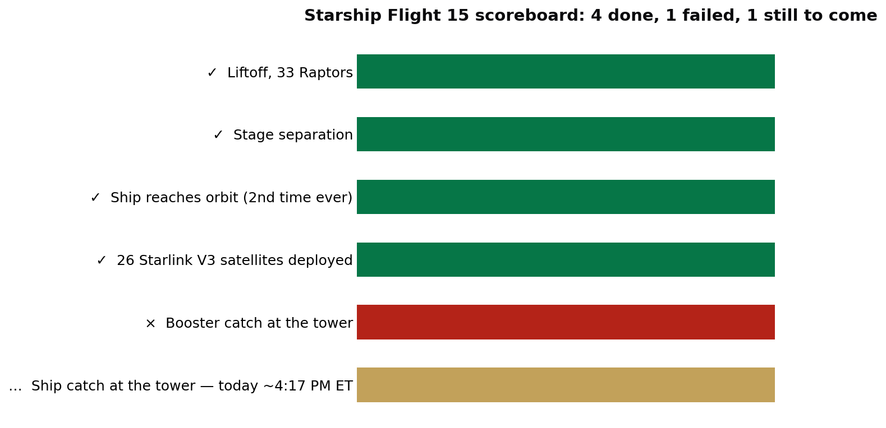

> [中文版 Chinese version](/life/starship-flight-15-booster-catch-zh/)

*Starship lifting off on an earlier test flight (IFT-5, October 2024). Photo: Steve Jurvetson, via Wikimedia Commons (CC BY 2.0). No official imagery of Flight 15 was available at the time of writing.*

## What happened

SpaceX launched the 407-foot Starship from Starbase, Texas, at 5:47 p.m. Eastern on Friday, November 13, on its 15th test flight. The plan was the most ambitious the program has ever attempted: catch **both** stages of the rocket back at the launch tower — the Super Heavy booster minutes after liftoff, and the Ship itself after a full orbit — proving full reusability in a single mission.

Half of that plan is already gone. About two and a half minutes after liftoff, the Ship separated and fired its engines; the Super Heavy booster flipped around and began its return burn toward the tower. Roughly six minutes in, flight controllers called off the catch. The booster was diverted to a designated area offshore, splashed down in the Gulf of Mexico, and exploded in a fireball just before reaching the water.

SpaceX later said the booster aborted the catch itself: its guidance, navigation, and control system detected a fault during the coast phase and triggered the offshore contingency landing, according to SpaceX communications manager Dan Huot. The company had been "go" for a catch until the later stages of the coast. Had it worked, it would have been the first catch of the upgraded Version 3 booster — SpaceX has caught three earlier V1 boosters with the tower arms and reflown two of them.

## What worked

The other half of the mission is going better than any Starship flight before it. The Ship reached orbit at about 6:13 p.m. Eastern, roughly 275 km up — only the **second time ever** a Starship has made it fully into orbit. The first was Flight 14, at the end of September.

Over the next 42 minutes it deployed all **26 Starlink V3 satellites** it was carrying, the company's most advanced internet satellites. SpaceX confirmed them in orbit on Friday evening.

*Flight 15 scoreboard. Sources: Associated Press; SpaceX via Florida Today and Space.com; Spaceflight Now.*

## The part that has never been tried

The flight is not over. The Ship is on a roughly 22-and-a-half-hour mission, circling the Earth about 14 times, and SpaceX plans to bring it back to Starbase for a catch attempt at **about 4:17 p.m. Eastern today (1:17 p.m. Pacific)** — the first time anyone has tried to catch a spacecraft returning from orbit with the tower arms.

SpaceX built three checkpoints into the orbital flight so it can divert the Ship to pre-cleared splashdown zones near Hawaii or off Chile if anything looks unsafe; as of early Saturday morning it had passed the first two. A deorbit burn is scheduled for about 3:21 p.m. Eastern. The return path itself is a first: the Ship will re-enter over the Pacific and cross parts of northern Mexico and southern Texas, over land, before turning toward the tower. SpaceX has said it will only attempt the catch if every system needed to guide the Ship through re-entry is healthy — reaching orbit does not guarantee the catch goes ahead.

It is also a crowded weekend in space. ULA's Vulcan rocket is scheduled to launch from Cape Canaveral today between 12:32 and 1:01 p.m. Eastern, carrying 40 satellites for Amazon's Leo broadband constellation, after a Friday postponement caused by a power interruption at the plant that pumps fuel into the rocket.

## The verdict: a split result, and the split is the story

Flight 15 is a near-miss and a breakthrough at the same time, and which one it becomes depends on this afternoon.

The booster failure is embarrassing in a specific way: the tower catch was the part of Starship recovery that SpaceX had started to make look routine. Losing it to a guidance fault on the first flight of the new V3 booster is a reminder that "routine" in this program is still a thin claim. But the abort itself worked exactly as designed — the booster diverted itself away from the tower rather than risking the launch site, which is the safety logic the whole catch concept depends on.

The Ship's performance is the part that matters commercially. Reaching orbit for the second time, and deploying a full load of 26 Starlink V3 satellites, is the mission Starship actually has to do for a living. The catch attempts are the spectacle; the orbital delivery is the business. If the Ship is caught this afternoon, SpaceX will have demonstrated both halves of full reusability within 24 hours, on separate attempts. If it is not, Flight 15 will be remembered as the flight that proved Starship can work in orbit and still cannot come home in one piece — and the program will iterate again, as it always does.

*This post reflects the status as of the morning of November 14, 2026 (PT). The Ship catch attempt is scheduled for about 4:17 p.m. ET / 1:17 p.m. PT today; the outcome will be covered in a follow-up.*
