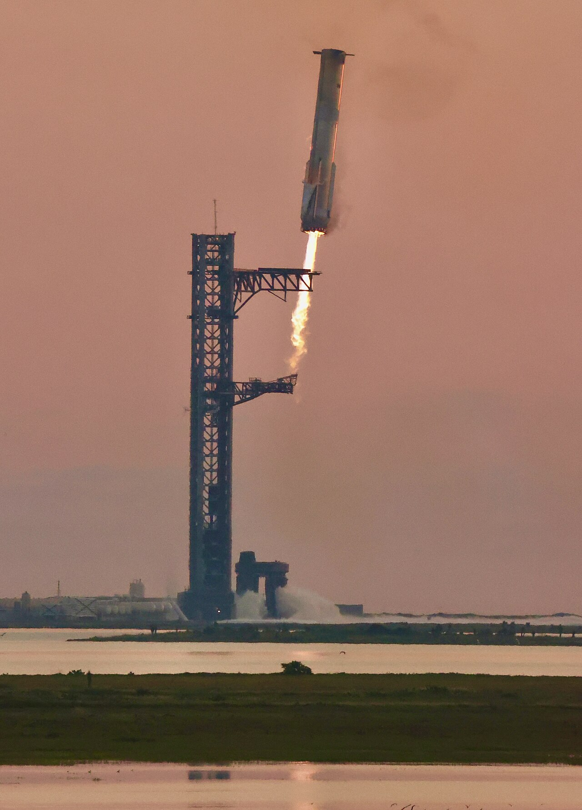
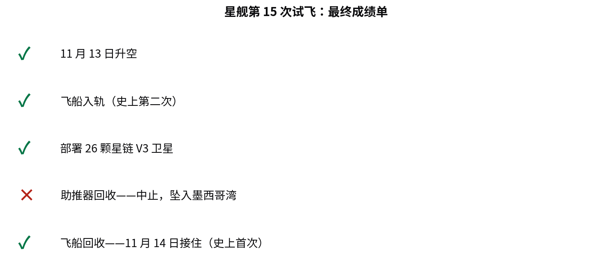

> [English version](/life/starship-flight-15-ship-caught/)

> **更新：** 本文是 [11 月 14 日第 15 次试飞报道](/life/starship-flight-15-booster-catch-zh/)的后续。当时飞船还在轨道上，回收尝试尚有数小时；现在回收已经完成。

*超重型助推器在一次早期试飞中返回发射塔（第 5 次试飞，2024 年 10 月）。照片：Steve Jurvetson，来自 Wikimedia Commons（CC BY 2.0）。目前尚无 Ship 42 回收的开放授权照片。*

## 发生了什么

SpaceX 的飞船 Ship 42 于 11 月 14 日周六回家了。在轨约 22.5 小时、绕地球约 14 圈之后，它点火离轨、再入大气层，飞越太平洋与墨西哥北部，回到周五傍晚离开的那座 Starbase 发射塔。3 台猛禽发动机点火完成翻转，随后减到 2 台、再到 1 台，塔臂——"筷子"机械臂——于美东时间约 **16:20（太平洋时间 13:20）**合拢，接住了飞船。SpaceX 发帖称："Mechazilla catches Starship!"

这是人类第一次用发射塔接住从轨道返回的航天器，也是星舰上面级第一次被回收。此前所有返回的星舰都在海洋里结束了飞行。

飞船先干完了本职工作。周五傍晚它进入轨道——星舰史上第二次完整入轨——并部署了携带的全部 **26 颗星链 V3 卫星**，这是该公司最先进的互联网卫星。

*第 15 次试飞最终成绩单。来源：SpaceX；美联社；USA Today；Space.com。*

## 没回来的那一半

助推器还是没了，原因尚未定论。超重型助推器 Booster 22 在分离后翻转回来、开始返航点火，但点火提前结束——据 Payload 报道，33 台发动机中只有 32 台重新点火——随后助推器的软件将它改道飞往墨西哥湾上空，自毁系统在它触水前一刻将其引爆。

SpaceX 给出了两种听起来不太一样的解释。传播经理 Dan Huot 在直播中表示，助推器检测到制导、导航与控制故障，自动中止了回收。CEO 埃隆·马斯克则在 X 上说助推器燃料不足。两种说法可能都成立——制导故障与燃料短缺可以是同一次异常点火的两种表现——但 SpaceX 表示，遥测数据仍需复核才能下定论。没有争议的一点是：中止逻辑按设计工作了——助推器主动远离发射塔与周边人员，而不是拿发射场冒险。

## 判断：难的那一半成了，看似成熟的那一半反而断了

第 15 次试飞现在的读法与周五晚上完全不同。SpaceX 已经开始做得驾轻就熟的部分——接助推器——在新版 V3 助推器的首飞中失败了；而从来没人做过的部分——接轨道返回的飞船——一次就成了。

这个反转比成绩单本身更重要。助推器回收在原理上已经是解决过的问题：SpaceX 此前已用早期助推器接住过 3 次，其中 2 枚还复飞过。而飞船回收是整个星舰架构悬而未决的问题，因为从轨道返回的飞行器以 8 倍音速冲回来，要扛住助推器永远遇不上的再入高温，最后还要精准落进一对钢臂之间。一次成功不等于常态化——SpaceX 尚未说明 Ship 42 是否会再次飞行——但它消除了上面级最大的技术疑问，而上面级恰恰是真正要经历太空飞行的那一半。

商业逻辑与周五没有变化：进入轨道、部署 26 颗星链 V3 卫星，是星舰谋生的本职工作，它做到了；回收是把这件事一次次低成本重复的路径。第 15 次试飞证明了交付业务可行、返回业务可能。下一飞要证明的是：两件事能在同一天发生。

*本文反映截至 2026 年 11 月 16 日上午（太平洋时间）的状态。来源：SpaceX 飞行总结；美联社；USA Today；Space.com；Spaceflight Now；Payload。*
