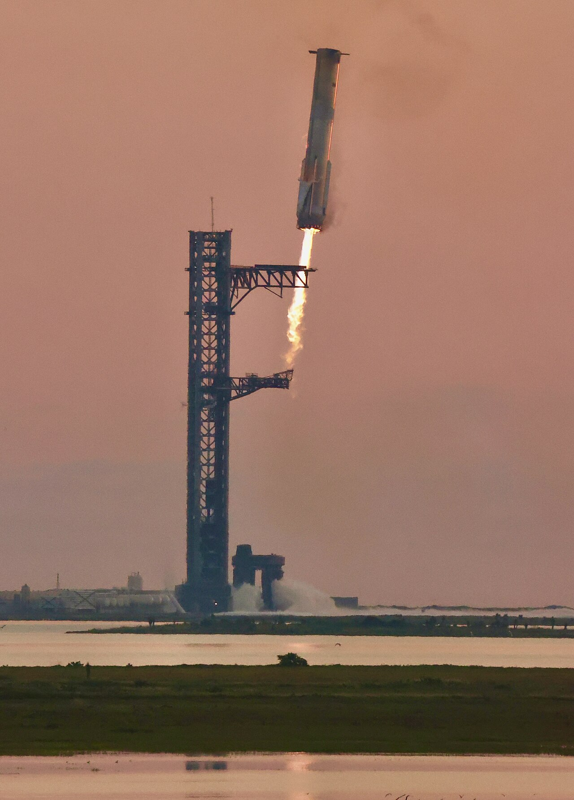

> [中文版 Chinese version](/life/starship-flight-15-ship-caught-zh/)

> **Update:** this post follows up our [November 14 report on Flight 15](/life/starship-flight-15-booster-catch/), which ended with the Ship still in orbit and the catch attempt hours away. The catch has now happened.

*A Super Heavy booster returning to the tower on an earlier flight (Flight 5, October 2024). Photo: Steve Jurvetson, via Wikimedia Commons (CC BY 2.0). No freely licensed photo of Ship 42's catch exists yet.*

## What happened

SpaceX's Ship 42 came home on Saturday, November 14. After roughly 22.5 hours in orbit and about 14 trips around the Earth, it fired a deorbit burn, re-entered the atmosphere, crossed over the Pacific and northern Mexico, and flew back to the same Starbase tower it had left on Friday evening. Three Raptor engines lit for the landing flip, throttled down to two and then one, and the tower's arms — Mechazilla's chopsticks — closed around the Ship at about **4:20 p.m. Eastern (1:20 p.m. Pacific)**. SpaceX posted: "Mechazilla catches Starship!"

It is the first time anyone has caught a spacecraft returning from orbit with a launch tower, and the first recovery of a Starship upper stage. Every Starship that came back before this one ended its flight in the ocean.

The Ship had done its day job first. It reached orbit on Friday evening — only the second time a Starship has made it fully into orbit — and deployed all **26 Starlink V3 satellites** it was carrying, the company's most advanced internet satellites.

*Flight 15 final scoreboard. Sources: SpaceX; Associated Press; USA Today; Space.com.*

## The half that did not come home

The booster is still gone, and the reason is still not settled. Super Heavy Booster 22 flipped around after separation and began its return burn, but the burn ended early — only 32 of its 33 engines relit, according to Payload's reporting — and the booster's software diverted it over the Gulf of Mexico, where its flight termination system destroyed it just before it would have hit the water.

SpaceX has given two different-sounding explanations. Communications manager Dan Huot said on the webcast that the booster detected a guidance, navigation, and control issue and aborted the catch automatically. CEO Elon Musk said on X that the booster was running low on fuel. Both could be true — a guidance fault and a fuel shortfall can be two symptoms of the same bad burn — but SpaceX says telemetry still needs review before a definite conclusion. What is not in dispute is that the abort logic worked: the booster steered itself away from the tower and the people around it rather than risking the launch site.

## The verdict: the hard half works, the routine half broke

Flight 15 now reads very differently than it did on Friday night. The part SpaceX had started to make look routine — catching the booster — failed on the first flight of the new Version 3 booster. The part nobody had ever done — catching an orbital spacecraft — worked on the first try.

That inversion matters more than the scoreboard. The booster catch is a solved problem in principle: SpaceX has done it three times with earlier boosters and reflown two of them. The Ship catch was the open question for the whole Starship architecture, because a vehicle coming back from orbit arrives at eight times the speed of sound, survives re-entry heating no booster ever faces, and still has to hit a pair of steel arms. Doing it once does not make it routine — SpaceX has not said whether Ship 42 will fly again — but it removes the biggest technical doubt about the upper stage, which is the half that actually has to survive spaceflight.

The commercial point is unchanged from Friday: reaching orbit and deploying 26 Starlink V3 satellites is the mission Starship has to do for a living, and it did that. The catch is the path to doing it cheaply, over and over, with the same vehicle. Flight 15 proved the delivery business works and the return business is possible. The next flight has to prove both can happen on the same day.

*This post reflects the status as of the morning of November 16, 2026 (PT). Sources: SpaceX flight summary; Associated Press; USA Today; Space.com; Spaceflight Now; Payload.*
