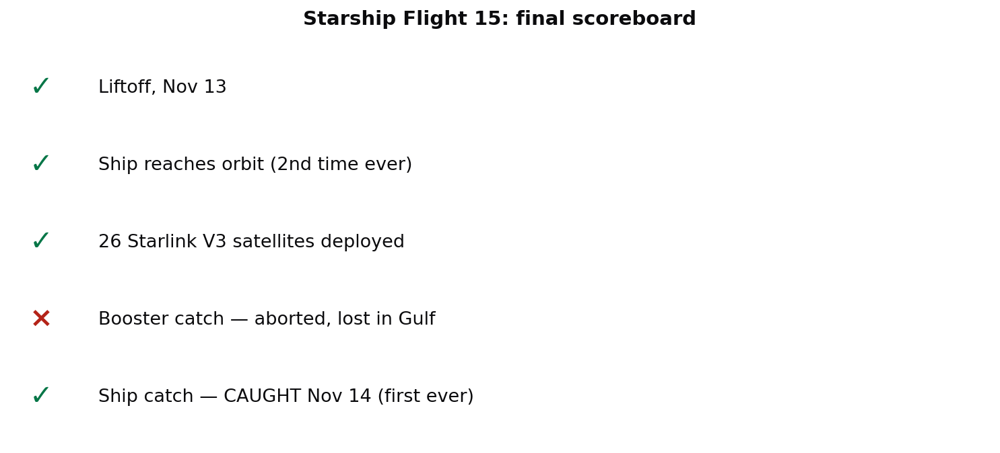

> [中文版 Chinese version](/life/starship-flight-15-ship-caught-zh/)

> **Update:** this post follows up our [November 14 report on Flight 15](/life/starship-flight-15-booster-catch/), which ended with the Ship still in orbit and the catch attempt hours away. The catch has now happened.

*A Super Heavy booster returning to the tower on an earlier flight (Flight 5, October 2024). Photo: Steve Jurvetson, via Wikimedia Commons (CC BY 2.0). No freely licensed photo of Ship 42's catch exists yet.*

## What happened

SpaceX's Ship 42 came home on Saturday, November 14. After roughly 22.5 hours in orbit and about 14 trips around the Earth, it fired a deorbit burn, re-entered the atmosphere, crossed over the Pacific and northern Mexico, and flew back to the same Starbase tower it had left on Friday evening. Three Raptor engines lit for the landing flip, throttled down to two and then one, and the tower's arms — Mechazilla's chopsticks — closed around the Ship at about **4:20 p.m. Eastern (1:20 p.m. Pacific)**. SpaceX posted: "Mechazilla catches Starship!"

It is the first time anyone has caught a spacecraft returning from orbit with a launch tower, and the first recovery of a Starship upper stage. Every Starship that came back before this one ended its flight in the ocean.

The Ship had done its day job first. It reached orbit on Friday evening — only the second time a Starship has made it fully into orbit — and deployed all **26 Starlink V3 satellites** it was carrying, the company's most advanced internet satellites.

*Flight 15 final scoreboard. Sources: SpaceX; Associated Press; USA Today; Space.com.*

## The catch, step by step

The return took most of a day, and the hard part was the last few minutes. Flight 15 lifted off from Pad 2 at Starbase at 5:47 p.m. Eastern on Friday, November 13, and Ship 42 reached orbit about 27 minutes later. It then spent roughly 22.5 hours circling the Earth — about 14 orbits — while the planet turned beneath it, until Starbase rotated back under its flight path. That wait is the point of the mission profile: the Ship cannot come home until the launch site is underneath it again, which is why the catch happened a day after liftoff rather than an hour after it. It also made Flight 15 the longest Starship flight to date, beating a three-hour orbital flight in September.

The deorbit burn itself was almost comically small for what it had to do: a single sea-level Raptor engine fired for roughly ten seconds, just enough to drop the Ship out of orbit. SpaceX commentator Dan Huot called it a good burn. From there the Ship fell back through the atmosphere at about 26,000 kilometers an hour — roughly 16,000 miles an hour, according to SpaceX's on-screen data — belly-first, using its body as a brake, the same "bellyflop" maneuver every returning Starship has used. The difference this time was what came after the fall: instead of splashing into the Indian Ocean, the Ship righted itself over the Gulf of Mexico, flew a banking final approach back to Starbase, and lit three Raptors for the landing flip. From the moment the engines lit, the catch itself took about 18 seconds, according to SpaceX's published timeline, which the company marks as approximate.

It was also a first for the tower that did it. Starbase has two launch towers, and this one — Pad 2 — had never caught anything before; its first catch was a spaceship. Pad 2's arms are shorter than the original tower's and electrically driven rather than hydraulic, so they can move faster and track the vehicle more precisely. That matters because the catch is not a grab: the arms do not squeeze the Ship. They close underneath the catch points near the top of the vehicle, and the Ship settles onto them, held from just under its shoulders. The Ship is 52 meters (171 feet) tall, and it has to arrive slow, vertical, and centered — a vehicle falling out of the sky has to place itself within a window the arms can close around, with no landing legs to absorb a mistake.

## Fifteen flights to this one

The catch did not come out of nowhere; it was the fifteenth full-scale Starship flight test since 2023, and the tower-catch program has its own short history. The first catch came on Flight 5, October 13, 2024, when Mechazilla caught Booster 12 on the first attempt — a result SpaceX itself had framed as uncertain, with thousands of vehicle and pad criteria that had to be met before the attempt was even allowed. The booster was caught twice more, on Flight 7 in January 2025 and Flight 8 in March 2025. Then the streak stopped: Flight 6's catch was called off by automated checks and the booster diverted to the Gulf, and no booster has been caught since Flight 8. Flight 15 was the first catch attempt for the larger third-generation (V3) booster, with three larger grid fins carrying the catch point, and the first attempt at the second pad.

That history is what makes the split result on Flight 15 so striking. The booster catch had been done three times and looked, from the outside, like a solved problem. The Ship catch had never been done by anyone, and the Ship is a fundamentally harder target: a booster comes back from a few dozen kilometers up, minutes after launch, at a fraction of orbital speed; a Ship comes back from orbit, at eight times the speed of sound, after surviving re-entry heating no booster ever faces, and still has to hit the same pair of steel arms. SpaceX had spent two years proving the easy half and had never attempted the hard half — until Saturday, when the hard half worked on the first try.

## The half that did not come home

The booster is still gone, and the reason is still not settled. Super Heavy Booster 22 flipped around after separation and began its return burn, but the burn ended early — only 32 of its 33 engines relit, according to Payload's reporting — and the booster's software diverted it over the Gulf of Mexico, where its flight termination system destroyed it just before it would have hit the water.

SpaceX has given two different-sounding explanations. Communications manager Dan Huot said on the webcast that the booster detected a guidance, navigation, and control issue and aborted the catch automatically. CEO Elon Musk said on X that the booster was running low on fuel. Both could be true — a guidance fault and a fuel shortfall can be two symptoms of the same bad burn — but SpaceX says telemetry still needs review before a definite conclusion. What is not in dispute is that the abort logic worked: the booster steered itself away from the tower and the people around it rather than risking the launch site.

The picture has filled in slightly since Friday. Reporting on SpaceX's account says the booster cut its boostback burn short because of a low fuel mass condition, and that guidance then flagged it as out of position for a safe tower catch. Musk added on X that the cause was engines underperforming, and that the fixes are the Raptor V3.2 engine and a flight-software change that shuts the engines down about one second earlier. Two caveats are worth keeping in mind. First, not every outlet agrees on the booster's end: Teslarati and other reports describe the flight termination system destroying it just before the water, while some outlets described a splashdown instead. Second, SpaceX has not published a written root-cause report, and it has not said whether the Federal Aviation Administration will require a mishap investigation for the booster loss. Until one of those appears, the fuel explanation is the company's working account, not a closed case.

## What SpaceX says happens next

The most concrete thing Musk has said since the catch is about the Ship, not the booster. On Sunday, he said Ship 42 could probably be reflown after a few weeks of refurbishment — a striking claim, because no caught Starship has ever flown a second time, and nobody outside SpaceX knows how much work this Ship needs before it could. Treat it as a goal rather than a schedule: "a few weeks" is Musk's estimate, and the Ship has just survived its first re-entry, so the inspection alone will tell SpaceX things no simulation can.

The longer-term plan was stated before Flight 15 flew. Musk said on October 10 that Flight 16 would aim to reuse both a booster and a Ship — the first flight in which both halves of the vehicle are recovered hardware rather than new builds. That is the flight that would turn Flight 15's split result into the thing Starship was designed to be: a fully and rapidly reusable orbital launch system, in which the same two pieces fly, come home, and fly again. Flight 15 proved each half can come home. It has not yet proved both can do it on the same day, and it has not proved either half can do it twice.

## The verdict: the hard half works, the routine half broke

Flight 15 now reads very differently than it did on Friday night. The part SpaceX had started to make look routine — catching the booster — failed on the first flight of the new Version 3 booster. The part nobody had ever done — catching an orbital spacecraft — worked on the first try.

That inversion matters more than the scoreboard. The booster catch is a solved problem in principle: SpaceX has done it three times with earlier boosters and reflown two of them. The Ship catch was the open question for the whole Starship architecture, because a vehicle coming back from orbit arrives at eight times the speed of sound, survives re-entry heating no booster ever faces, and still has to hit a pair of steel arms. Doing it once does not make it routine — SpaceX has not said whether Ship 42 will fly again — but it removes the biggest technical doubt about the upper stage, which is the half that actually has to survive spaceflight.

It is worth being precise about what one catch does and does not prove. It proves the tower can recover a Ship that has completed a full orbital mission — deploy its satellites, wait out 14 orbits, deorbit on a single engine, and land in the arms. It does not prove the Ship can be turned around quickly, or cheaply, or that the heat shield and engines survive re-entry in a condition worth reusing. The economics of Starship depend on all of that, and none of it has been demonstrated yet. A caught Ship that needs months of rebuilding is a trophy, not a business model; a caught Ship that flies again in weeks is the beginning of one. That is the test Musk's "few weeks" comment sets up, and it is the test Flight 16 will have to pass.

The commercial point is unchanged from Friday: reaching orbit and deploying 26 Starlink V3 satellites is the mission Starship has to do for a living, and it did that. The catch is the path to doing it cheaply, over and over, with the same vehicle. Flight 15 proved the delivery business works and the return business is possible. The next flight has to prove both can happen on the same day.

*This post reflects the status as of the morning of November 16, 2026 (PT). Sources: SpaceX flight summary; Associated Press; USA Today; Space.com; Spaceflight Now; Payload; Phys.org; Tech Times; The Space Road.*

