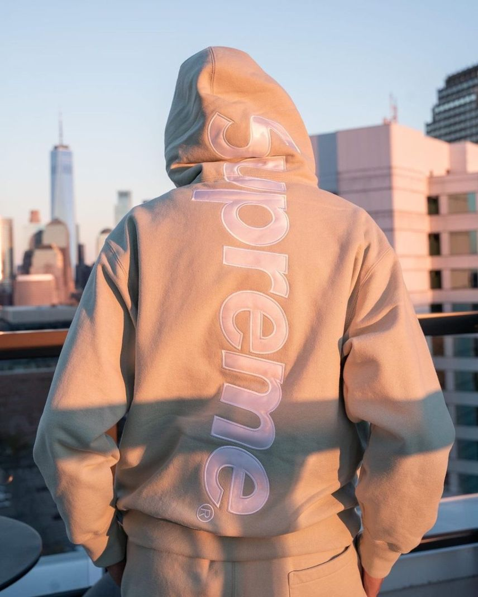
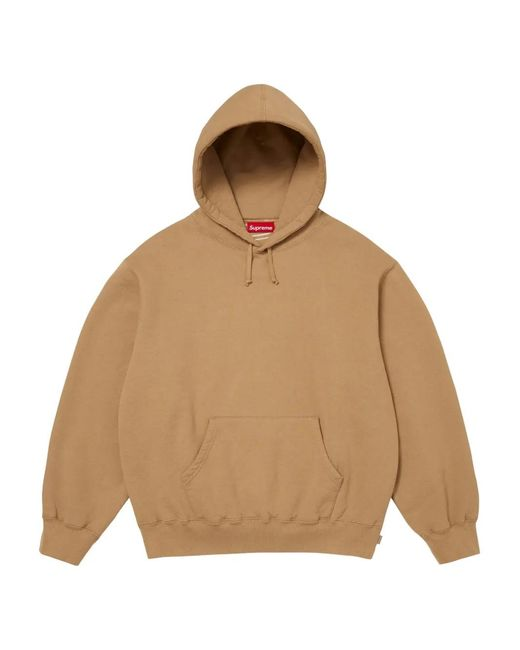
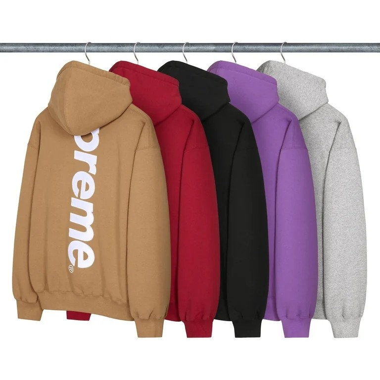
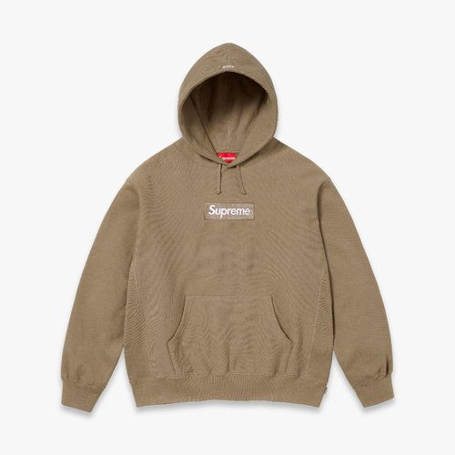
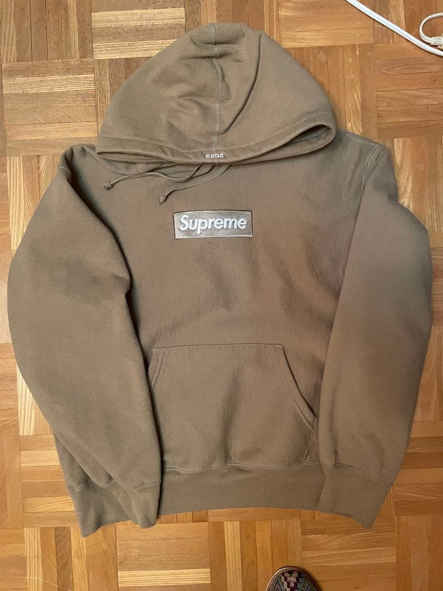

> [English version 英文版](/life/supreme-satin-applique-light-tan-box-logo-dark-sand/)

Supreme 的 hoodie 一般都很吵，这两件不吵——至少正面不吵。FW25 的 Satin Appliqué Hooded Sweatshirt Light Tan，正面看就是一件干干净净的浅棕色卫衣，直到穿的人转过身：一个缎面贴布的 "Supreme" 大字，从帽子一路竖着拉到下摆。FW23 的 Box Logo Hoodie Dark Sand 走的是反方向：街头服饰史上最出名的 logo，用同色系反光材质印在橄榄棕的衣身上，几乎隐形。两件用的是同一套厚重 fleece 配方，同一个大地色系，目前都挂在 Stadium Goods 上，结账码 SUPREME20 可以打八折。以下价格为 2026 年 11 月 21 日查询的 snapshot，价格随时可能变动。

## 基本信息

| | Satin Appliqué | Box Logo |
|---|---|---|
| **款名** | Satin Appliqué Hooded Sweatshirt | Box Logo Hooded Sweatshirt |
| **季度** | FW25 | FW23 |
| **配色** | Light Tan | Dark Sand |
| **货号** | SU26127 | SU100153 |
| **设计** | 正面全素；背面竖排缎面贴布大字 | 胸前同色系反光 box logo；帽子上白色 "2023" 刺绣 |
| **原始零售价** | — | $168 |
| **Stadium Goods 标价** | $247 | $237 |
| **SUPREME20 八折后** | **$197.60** | **$189.60** |

## Satin Appliqué Light Tan：背面就是全部

正面几乎没什么可说的——这正是设计本身。没有胸前小标，没有袖子印花，只有一件干净的 Light Tan 套头卫衣：抽绳帽、袋鼠兜，领口露出一点红色领标。所有的品牌预算都花在了背面：一个词，"Supreme"，缎面贴布，旋转九十度，从帽子读到下摆，连 ® 都齐全。

*上身背面图：Light Tan Satin Appliqué 搭配同款卫裤，黄昏的光正好是缎面最想要的光。图：SNKRDUNK 卖家图。*

上面这张上身图就是这个配色成立的原因。缎面玩的是光：哑光 fleece 吸光，贴布反光，夕阳一照，字母比衣身亮出一个色号。卖家直接配了同款 Light Tan 卫裤穿成一整套，这是最顺手的做法——大地色套装，背面一条竖排签名。拆开穿也行：下面配深色牛仔或黑色工装裤，让背面扛起整套造型；正面全素还有个好处，外面套夹克时没有 logo 跟拉链打架。

*正面：故意留白。想让别人知道，就得等他们看你离开。图：Farfetch via Lyst。*

*FW25 全部配色的背面：Light Tan 领头，后面依次是红、黑、紫、麻灰。图：SupremeCommunity。*

这个设计对 FW25 来说不算新——Satin Appliqué 从 FW22 起每季换色重出——但 Light Tan 是其中最耐看的一版。黑色偏哥特，红色太闹；这个棕色更像一件工装，只是背面挂了块广告牌。

## Box Logo Dark Sand：隐形版 bogo

FW23 的 box logo 一共出了八个颜色，Dark Sand 是最安静的那个：麻灰配了木纹迷彩 box，Dark Sand 配的是同色系的陶土色 box，带反光银面，衣身是低调的橄榄棕。全身另一处品牌标识只有帽子顶部一小排白色 "2023" 刺绣。厚重全棉 fleece，标准宽松 bogo 版型——SNKRDUNK 的实测数据里 XL 衣长 74 cm、身宽 71 cm，穿起来就是该有的宽大垂感。

*Dark Sand 正面：box 和衣身同属一个色系，帽子上的白色 "2023" 清晰可见。图：Solesense。*

*卖家平铺图：光线对上了 box 会泛银光；帽子上的 "2023" 是这一季的指纹。图：Mercari 卖家图。*

说句实话：这个配色在网上几乎找不到上身图。搜 bogo 穿搭，翻来覆去都是红、黑、灰——同色系配色买的人都是穿出门而不是拍照发帖的，一个设计成"融进背景"的 logo 也不会在信息流里拦人。上面这张平铺图才是关键证据：室内光下 box 只是一个安静的陶土色方块，只有直射光或闪光灯才能把它的反光面踢出来。这到底是它最大的魅力还是劝退点，取决于你买 bogo 是为了什么。

## 选哪件，现在多少钱

按 Stadium Goods 标价——Satin Appliqué $247、Box Logo $237——两件都高于原始零售价，寄卖 Supreme 的常态。用上 SUPREME20 之后分别是 **$197.60** 和 **$189.60**（2026 年 11 月 21 日查询，价格为 snapshot、随时可能变动；该码为 Stadium Goods 的公开促销码）。

喜欢那个"正面隐形、背面无敌"的反差感，选 Satin Appliqué，它是两件里更会玩梗的；想要一件能配你衣柜里所有东西、永远不用自我介绍的 Supreme，选 Dark Sand bogo。两件 hoodie，同一种色调，两种完全相反的 logo 观。
