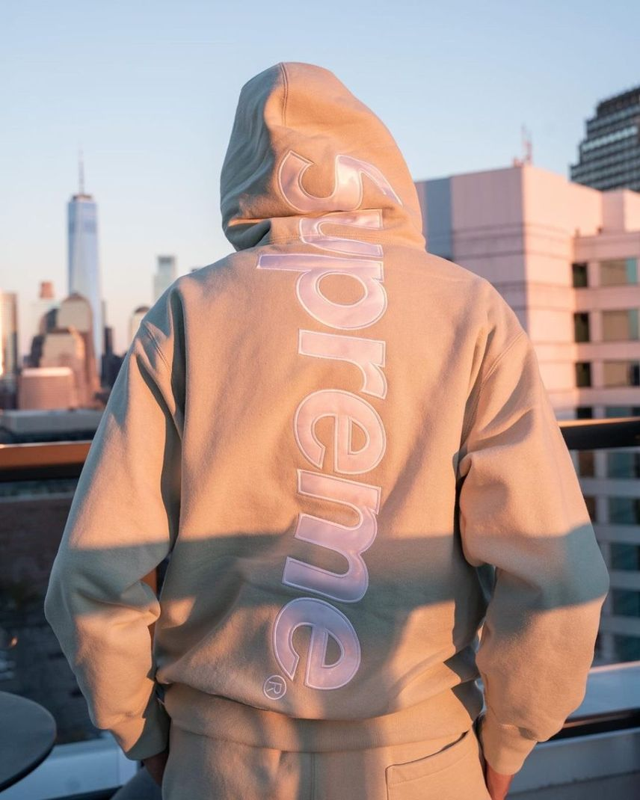
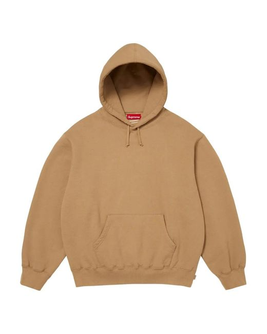
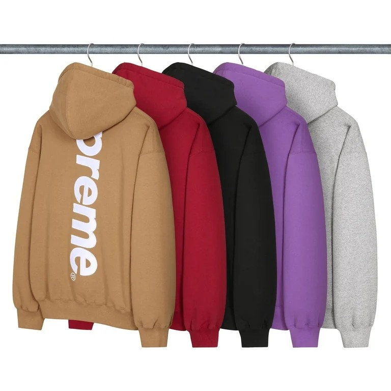
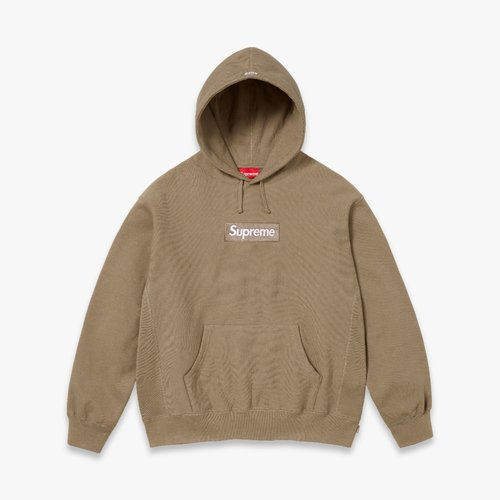
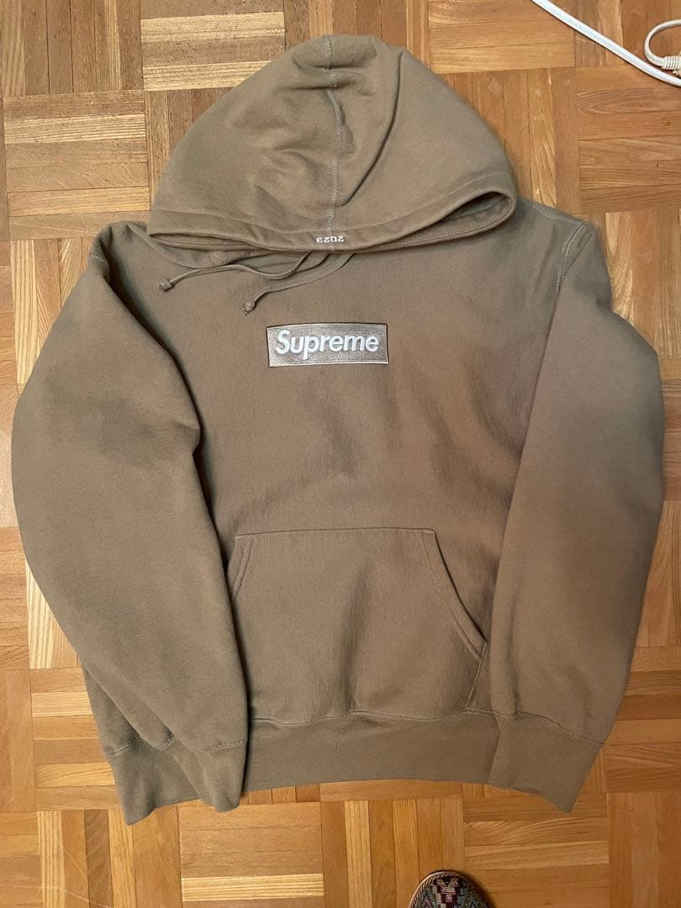

> [中文版 Chinese version](/life/supreme-satin-applique-light-tan-box-logo-dark-sand-zh/)

Supreme hoodies usually shout. These two don't — at least not from the front. The Satin Appliqué Hooded Sweatshirt from Fall/Winter 2025 in Light Tan is a completely plain tan hoodie until the wearer turns around, at which point a satin "Supreme" wordmark runs the full length of the back. The Box Logo Hoodie from Fall/Winter 2023 in Dark Sand goes the other way: the most famous logo in streetwear, rendered tonal and reflective on an olive-tan body so it almost disappears. Both are built on the same heavyweight fleece formula, both live in the same earth-tone register, and both are currently listed at Stadium Goods, where the code SUPREME20 takes 20% off. Prices below are a snapshot checked on November 21, 2026, and are subject to change.

## The facts

| | Satin Appliqué | Box Logo |
|---|---|---|
| **Model** | Satin Appliqué Hooded Sweatshirt | Box Logo Hooded Sweatshirt |
| **Season** | FW25 | FW23 |
| **Colorway** | Light Tan | Dark Sand |
| **SKU** | SU26127 | SU100153 |
| **Design** | Plain front; vertical satin appliqué wordmark down the back | Tonal reflective box logo on chest; white "2023" embroidered on the hood |
| **Original retail** | — | $168 |
| **Stadium Goods list** | $247 | $237 |
| **With SUPREME20 (−20%)** | **$197.60** | **$189.60** |

## Satin Appliqué, Light Tan: the back is the whole point

From the front, there is almost nothing to say — and that is the design. No chest hit, no sleeve print, just a clean Light Tan pullover with a drawstring hood, kangaroo pocket and the small red neck label peeking out. Every bit of branding budget went to the back: a single word, "Supreme," appliquéd in satin and rotated ninety degrees so it reads from the hood all the way down to the hem, registered mark and all.

*Worn, from behind: the Light Tan Satin Appliqué with the matching sweatpants, golden hour doing exactly what satin wants it to do. Photo: SNKRDUNK seller listing.*

The worn shot above is why this colorway works. Satin is a light game: matte fleece absorbs, the appliqué reflects, and in low sun the letters light up in a lighter tone than the body. The seller styled it as a full set with the matching Light Tan sweatpants, which is the obvious move — a tonal tan tracksuit with one giant vertical signature on the back. It also works broken up: dark denim or black cargos underneath let the back carry the whole outfit, and the plain front means it layers under a jacket without a logo fighting the zipper line.

*The front: deliberately blank. If you want people to know, they will have to watch you leave. Image: Farfetch via Lyst.*

*The FW25 colorway lineup from the back: Light Tan leads, followed by Red, Black, Purple and Heather Grey. Image: SupremeCommunity.*

The design is not new for FW25 — Supreme has rerun the Satin Appliqué since FW22 in rotating colors — but Light Tan is the most forgiving version of it. Black reads goth, red reads loud; the tan reads like workwear that happens to have a billboard on the back.

## Box Logo, Dark Sand: the stealth bogo

The FW23 box logo run came in eight colors, and Dark Sand was the quiet one: where Ash Grey got the woodland camo box, Dark Sand got a box in a matching taupe with a reflective silver finish, on a muted olive-tan body. The only other branding is a small white "2023" embroidered on top of the hood. Heavyweight 100% cotton fleece, the standard relaxed bogo cut — SNKRDUNK's measurements put an XL at a 74 cm length and 71 cm body width, so it wears boxy and long, exactly as a bogo should.

*Dark Sand front: the box sits in the same tonal family as the body, with the white "2023" hit visible on the hood. Image: Solesense.*

*An owner's flat lay: catch the light and the box goes silver; the "2023" on the hood is the season's fingerprint. Photo: Mercari seller listing.*

One honest observation: this colorway is nearly impossible to find in outfit photos. Search for worn box logo shots and you get the red, black and grey ones on repeat — the tonal colorways are bought by people who wear them rather than photograph them, and a logo designed to blend in does not stop traffic on a feed. The flat lay above is the real tell: indoors the box is a quiet taupe rectangle, and only a direct light or a camera flash kicks it reflective. That is either the whole appeal or a dealbreaker, depending on why you buy a bogo.

## Which one, and what they cost right now

At Stadium Goods list prices — $247 for the Satin Appliqué, $237 for the Box Logo — both sit above their original retail, as consigned Supreme does. The SUPREME20 code changes the math: **$197.60** and **$189.60** respectively, checked November 21, 2026 (prices are a snapshot and subject to change; the code is a public Stadium Goods promotion).

Pick the Satin Appliqué if you like the joke of it — invisible from the front, unmistakable from behind, and the better party trick of the two. Pick the Dark Sand bogo if you want the one Supreme hoodie that goes with everything you already own and never has to introduce itself. Two hoodies, same palette, opposite theories of what a logo is for.
