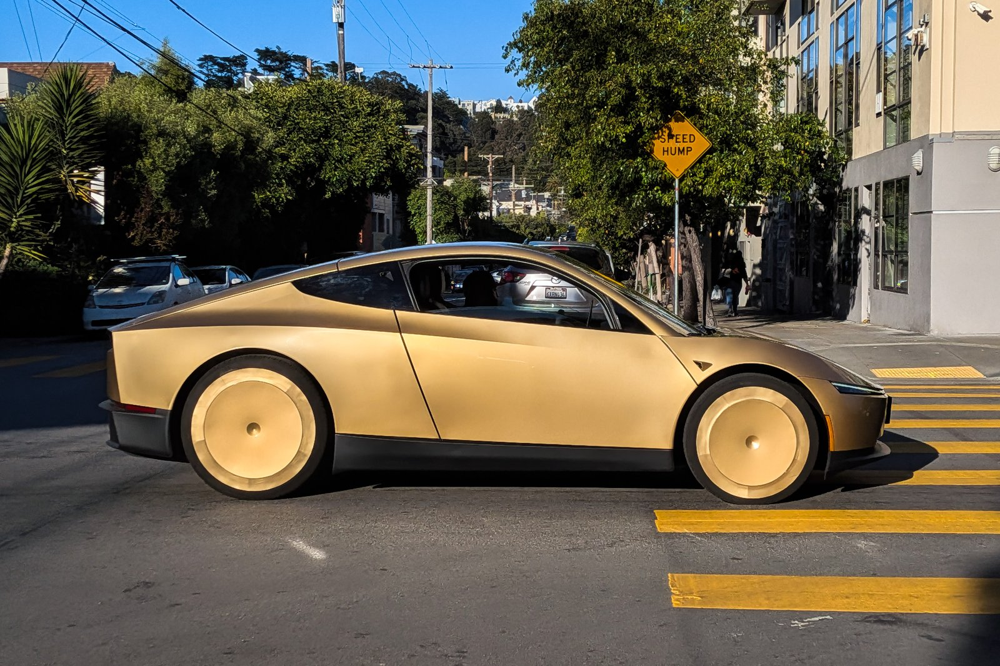
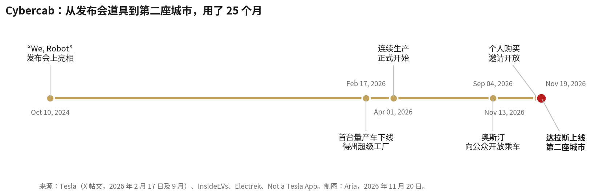
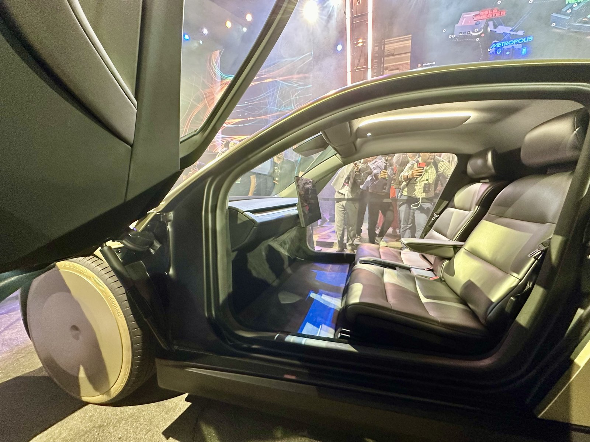
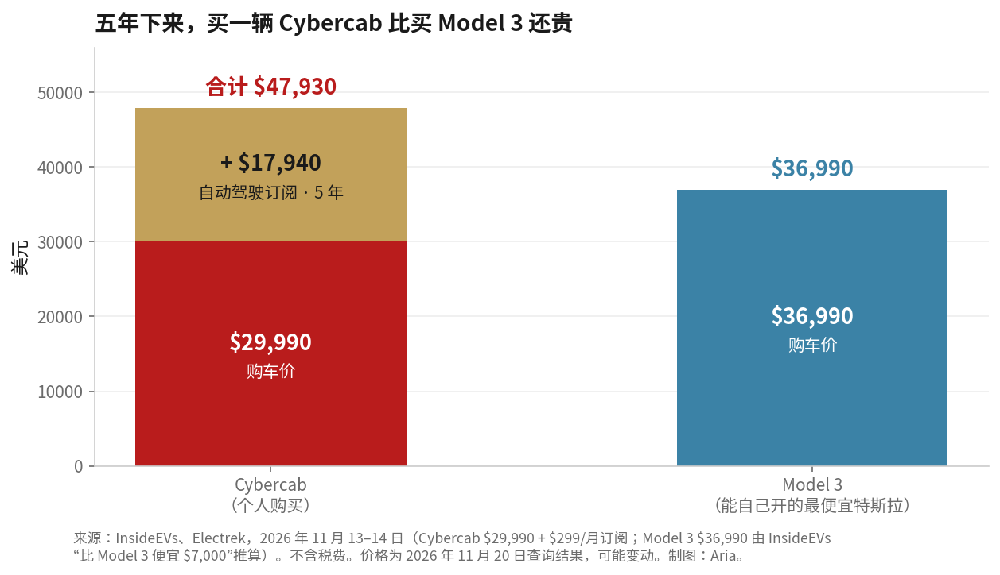
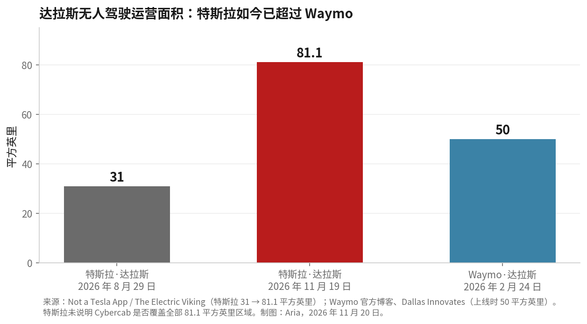

> [English version 英文版](/life/tesla-cybercab-dallas-v15/)

*2026 年 6 月，一辆量产版 Cybercab 行驶在旧金山街头。图片：9yz，Wikimedia Commons（CC BY）。*

## “Howdy Dallas”

2026 年 11 月 19 日星期四，特斯拉的 Robotaxi 账号只用了两句话：“Howdy Dallas. Cybercab has arrived in your city.”（你好，达拉斯。Cybercab 来到你们的城市了。）就凭这条帖子，达拉斯成为第二个可以向公众提供特斯拉专属无人驾驶出租车的城市——这是一款双座车，没有方向盘，没有踏板，车门是蝴蝶门。第一个城市是奥斯汀，Cybercab 的公开载客服务从 2026 年 9 月 4 日开始。乘客通过特斯拉 Robotaxi 应用叫车，同一个应用自 4 月起就在达拉斯提供无人驾驶的 Model Y 出租车服务。

上线当天，特斯拉还通过应用通知与邮件，向达拉斯服务区内外的用户发出邀请，请他们“成为第一批乘坐 Cybercab 的人”。这种打法与奥斯汀如出一辙：先用通知触达已有用户，再靠口碑扩散。值得注意的是，特斯拉没有为达拉斯单独开发布会、没有公布车队规模、没有公布票价——整个上线过程只有一条帖子加几条推送。这种克制本身就是一种信号：对特斯拉来说，达拉斯不是一场发布会，而是一次例行扩张。真正需要发布会的，是第一座城市；从第二座开始，扩张应该像软件更新一样平常。如果未来某一天，Cybercab 进入一座新城市连一条帖子都不值得发了，那才说明这张网络真正成熟了。

这条公告本身很小。让它成为奥斯汀上线以来最重要的 Cybercab 新闻的，是公告之外的一切：达拉斯的车不是同一批车。它们是 Cybercab 首席工程师埃里克·厄利（Eric Earley）所说的“Cybercab V1.5”，上线几小时内，乘客就已经在车上发现了新的硬件。而就在上线六天前，特斯拉做了一件以前从未做过的事——邀请私人客户购买一辆属于自己的 Cybercab，售价 29,990 美元，外加一笔没有它车就无法行驶的订阅费。

两周前本站写过背景：11 月 6 日，埃隆·马斯克表示，特斯拉将在明年年中前后逐步停产得州超级工厂的 Cybertruck，为扩大 Cybercab 生产腾出产能。达拉斯是这部分腾出来的产能第一次有了明确去向——也是对 Cybercab 究竟是产品、是服务、还是两者之间的某种东西的第一次真正检验。目前的答案，比公告看起来要复杂得多。

## 达拉斯到底发生了什么

时间线很重要，因为达拉斯不是冷启动。特斯拉自 2026 年 4 月起就在该市运营无人驾驶的 Model Y 出租车——Cybercab 到来之前，已经有了七个月的无人驾驶运营经验。8 月 29 日，特斯拉把达拉斯 Robotaxi 的运营范围从约 31 平方英里扩大到约 81 平方英里，向西延伸至欧文市，覆盖了更多的市中心区域，数据来自 Not a Tesla App 和 The Electric Viking 引用的独立追踪者。Cybercab 加入的是一个已经存在的网络，而不是从零新建一个。

特斯拉还在上线前一周忙着扩充车队。11 月 17 日，它向得州车管所（Texas DMV）又注册了 200 辆 Cybercab，使其在得州的 Cybercab 注册总数达到 773 辆——约占特斯拉在该州已注册无人驾驶车队总数的 51%，数据来自 The Electric Viking。Not a Tesla App 报道，特斯拉此前表示奥斯汀已有 300 多辆 Cybercab 在运行。特斯拉没有说明达拉斯有多少辆 Cybercab、是否覆盖全部 81 平方英里的区域，也没有公布 Cybercab 在当地的车费。

它在 10 月 21 日的三季度财报电话会上确实说过，达拉斯是下一站，更多城市将在 2026 年底前跟进。特斯拉 AI 软件副总裁阿肖克·埃卢斯瓦米（Ashok Elluswamy）在电话会上直言：“我们在奥斯汀上线，只是因为我们手头有一些车，我们想让 Cybercab 遍布奥斯汀的每个角落。我们并没有什么根本性的理由局限于奥斯汀。”达拉斯是这句话的第一个证据。

*Cybercab 时间线：2024 年 10 月发布，2026 年 2 月 17 日首台量产车下线，9 月 4 日起在奥斯汀公开载客，11 月 19 日抵达达拉斯。来源：Tesla、InsideEVs、Electrek、Not a Tesla App。制图：Aria。*

## 从舞台道具到量产车：这 25 个月发生了什么

要理解达拉斯为什么重要，得先回头看这辆车走过的路。Cybercab 最早亮相于 2024 年 10 月 10 日的“We, Robot”发布会，当时它还只是一个舞台道具：金色车身、蝴蝶门、没有方向盘。两年后的今天，它是得州超级工厂里一辆真正量产的车。2026 年 2 月 17 日，特斯拉宣布首台量产版 Cybercab 下线；4 月进入连续生产；7 月，工厂外停放的待发车辆一度被数到 245 辆。特斯拉在三季度报告中披露，得州工厂的 Cybercab 年产能已超过 12.5 万辆。

生产方式本身也是新闻。Cybercab 是第一款采用特斯拉所谓“开箱式”（Unboxed）工艺的车：车身模块在平行工位上各自装好线束与内饰，最后一步再合为整车。马斯克曾表示，满产时目标是每十秒下线一辆。传统车厂以分钟计的节拍，在这里被按下了快进键。支撑这种工艺的，是一个正在收窄的产品线：Model S 与 Model X 已于 2026 年 4 月停产；11 月 6 日，马斯克又宣布 Cybertruck 将在明年年中前后停产，把产能让给 Cybercab。本站当时写过，Cybertruck 在 2026 年前九个月的美国销量约为 11,586 辆（Cox Automotive 数据），只有马斯克最初设想的年销 25 万辆的零头。特斯拉正在把一家什么车都造的公司，变成一家围绕自动驾驶下注的公司。

但产能与需求是两回事。年产能 12.5 万辆，注册量 773 辆，奥斯汀在跑的 300 多辆——这三组数字放在一起，说明生产爬坡远快于服务落地。达拉斯的意义正在于此：它消耗产能。每多一座城市，工厂里那些等着上路的车就多一个去处。特斯拉高管在财报电话会上说，年底前还要开更多城市，这句话的另一面是，如果开不出来，产能就会变成库存。

## 为什么第二座城市比第一座更重要

每个无人驾驶出租车项目都能享受一次免费通行证：首发城市。奥斯汀是特斯拉的大本营——工厂在那里，工程师在那里，监管态度友好，公司可以把全部注意力集中在一个围栏区域内。在奥斯汀上线，证明的是这辆车能跑、软件能应付一座城市的街道。它证明不了同一套系统能不能被拿起来、放到另一座城市去。

达拉斯开始回答这个问题。它是另一座城市，有不同的交通模式、不同的道路结构、不同的市中心——而且关键在于，在那里，特斯拉不是路上唯一的无人驾驶汽车。Waymo 自 2026 年 2 月 24 日起就在达拉斯运营，并于 8 月 4 日向所有人开放。这是第一次，特斯拉的纯视觉、无激光雷达路线与 Waymo 的传感器密集路线，在同一座城市、同一条街道、同一个得州规则下争夺同一批乘客。这是任何新闻稿都无法导演的对比。

还有第二个原因：第二座城市改变了车队的性质。在奥斯汀，每辆 Cybercab 都是一辆恰好载客的测试车。在达拉斯，Cybercab 必须成为混合车队中的一种车型——Model Y 和 Cybercab 由同一个应用调度，运营面积比 8 月底扩大了两倍多。这就是无人驾驶出租车从演示变成运营问题的时刻：调度、充电、清洁、维护，以及没有人在车里时出了问题怎么办。而这正通向硬件的部分。

更重要的是，复制一座城市的成本结构完全不同。首发城市可以靠总部输血：工程师现场值守、备用车随时待命、出了问题连夜改代码。第二座城市必须靠流程：远程监控中心能不能同时盯住两个城市？一辆车在达拉斯抛锚，调度系统能不能像在奥斯汀一样快速响应？这些问题的答案，决定了第三座、第四座城市的边际成本是递减还是递增。达拉斯真正的考题不是“车能不能在达拉斯开”，而是“特斯拉能不能不在达拉斯还开得下去”。

还有第二个原因：第二座城市改变了车队的性质。在奥斯汀，每辆 Cybercab 都是一辆恰好载客的测试车。在达拉斯，Cybercab 必须成为混合车队中的一种车型——Model Y 和 Cybercab 由同一个应用调度，运营面积比 8 月底扩大了两倍多。这就是无人驾驶出租车从演示变成运营问题的时刻：调度、充电、清洁、维护，以及没有人在车里时出了问题怎么办。而这正通向硬件的部分。

## V1.5：星链天线与后备箱摄像头

达拉斯上线最有意思的不是城市，而是车。上线几小时内，乘客就发现了两处变化，均由 Not a Tesla App 报道：集成在车顶后部的星链天线，由 X 用户斯宾塞（@scotsrule08）发现；以及后备箱盖里的一个摄像头，由 @dallastesla 发现。

“V1.5”这个版本号本身也值得玩味。传统车企以年款来迭代，一年一改；特斯拉以软件版本号来命名硬件改动，暗示这辆车会像手机一样持续进化。厄利在 X 上公开使用“V1.5”这个说法，等于是告诉外界：奥斯汀的车是 1.0，达拉斯的车已经不一样了，而 2.0 还在路上。对消费者来说，这意味着现在买到的 Cybercab 很快就会变成“旧款”；对车队运营商来说，这意味着车辆残值与备件管理会变得更复杂。但对特斯拉来说，这是它最擅长的打法：快速迭代，用真实运营数据驱动硬件改版，而不是等到下一代车型再统一升级。

这两处改动都与驾驶无关。这正是关键所在。

特斯拉早在 2026 年 7 月就展示过集成星链 V5 天线的 Cybercab——消息于 7 月 20 日通过特斯拉与星链在 X 上的帖子发布——埃卢斯瓦米当时解释说，它提供的是导航、客服与车队管理所需的冗余连接，“对于车辆的安全运行仍然不是必需的”。驾驶系统运行在车载电脑上；即使完全断网，车照样能开。连接的作用是让车与它周围的系统保持联系：实时路线、调度、车辆被困时的远程支持、空中升级，以及车内乘客的流媒体。

那么，为什么要给一辆只在手机信号良好的大都市区运营的车装上卫星天线？因为一家无人驾驶出租车公司承受不起车辆失联。私家车断网三十秒，只是不方便。无人驾驶汽车断网三十秒，意味着运营方看不见它、无法重新规划路线、无法提供帮助——而车里坐着一位不会开车的付费乘客。星链天线等于承认，连接是一个车队运营问题，特斯拉宁愿为第二张网络付费，也不愿一个个被困的乘客去发现信号死角。它同时也是与马斯克另一家公司 SpaceX 的硬件绑定——在评判成本时，这一点值得记住。

后备箱摄像头更有说服力。Cybercab 没有后窗，而后备箱是放行李的地方——也就是行李被遗忘的地方。在有人驾驶的出租车里，司机负责检查后备箱。在无人驾驶汽车里，除非有摄像头，否则没人检查任何东西。后备箱摄像头是那种没人会装在概念车上、但每个车队运营方在经历了第一个月的遗失行李与损坏索赔之后都会装上的配置。这两处 V1.5 改动讲的是同一个故事：特斯拉正在公开学习运营一支无人驾驶车队到底需要什么——并且围绕那些不起眼的问题重新设计车辆，而不是围绕自动驾驶问题本身。这令人鼓舞：运营与工程之间的反馈循环很快。但它也提醒我们，这一切还处于多么早期的阶段——公开载客才两个月就需要硬件改版，说明这款产品仍在以车队规模进行调试。

星链硬件本身也值得多说两句。据报道，这次集成的是 SpaceX 新一代星链 V5 车载终端，重量约 2.4 磅，只有标准固定终端 6.5 磅的三分之一多一点，功耗也降低了约一半。它被设计进车顶结构，与 GPS 天线、5G 天线、车内麦克风和 FSD 电脑排布在一起。马斯克在二季度财报电话会上说过一句关键的话：“对于 Robotaxi 这种情况，你需要做到处都有覆盖。”他还表示，星链最终会集成到特斯拉所有车型上。换句话说，Cybercab 只是第一个吃螃蟹的——卫星连接正在从一辆车的配置，变成整个车队的标准件。

还有一个 V1.5 之外、但同样属于“车队化改造”的细节：Cybercab 的每个外部摄像头都配有清洗器。没有司机下车擦摄像头，雨水、灰尘与虫尸就只能靠机器自己解决。Not a Tesla App 在报道无人驾驶 Model Y 时提到这一点——如果那辆车要去掉方向盘，它也得先补上同样的清洗器。这些细节都不会出现在发布会的幻灯片上，但它们决定了一支无人驾驶车队能不能在雨天之后继续跑。

*Cybercab 车内：只有一块屏幕、两个座位，没有任何驾驶装置。照片摄于 2024 年 10 月“We, Robot”发布会上的原型车：Wikimedia Commons（CC BY-SA）。*

## 29,990 美元的问题：这是消费产品，还是伪装的车队销售？

达拉斯上线六天前，11 月 13 日星期五，特斯拉的 Robotaxi 账号宣布，“部分客户现已受邀购买 Cybercab 供个人使用”。InsideEVs 与 Electrek 根据特斯拉订单页面与邀请邮件的截图报道了条款：29,990 美元（税前）、1,000 美元不可退还订金、预计 2026 年 12 月在奥斯汀交付，以及每月 299 美元的强制性“自动驾驶订阅”（Autonomy Subscription）——订单页面上默认勾选，首月免费——没有它，车完全无法行驶。细则写道：“订阅与定期车辆保养是运行所必需的。”邀请邮件说得更直接：“仅在支持的服务区域内可用。运行需要订阅。”

限制还在一层层叠加。Digital Trends 报道，交付最初仅限得州的五个城市——奥斯汀、达拉斯、休斯顿、圣安东尼奥和沃斯堡——而且车辆只能在特斯拉现有的地理围栏 Robotaxi 服务区内行驶。每位买家限购一辆，且仅限个人使用：据 Investor's Business Daily 报道，车主不能把自己的 Cybercab 投入 Robotaxi 车队向付费乘客赚钱。没有公开的订购页面。特斯拉没有说明谁会收到邀请，也没有说明何时向公众开放销售。

算一笔账，“29,990 美元的车”就现了原形。五年强制订阅费是 17,940 美元，五年总成本达到 47,930 美元（税前）——比 Model 3 还贵。InsideEVs 指出，Cybercab 的售价比 Model 3 便宜 7,000 美元，据此推算 Model 3 的起售价为 36,990 美元。而 Model 3 可以在任何地方开、由车主自己驾驶、无需订阅、可以转卖给任何人。Cybercab 只能在得州少数几个地理围栏区域内使用，车主完全不能自己开，订阅一停，车就停摆。而根据 Carscoops 报道的特斯拉条款，公司只需提前一个月通知，就可以更改订阅价格。

*拥有 Cybercab 五年的成本为 47,930 美元——高于 36,990 美元的 Model 3，而 Cybercab 还出不了它的地理围栏。来源：InsideEVs、Electrek，2026 年 11 月 13–14 日。价格为 2026 年 11 月 20 日查询结果，可能变动。制图：Aria。*

对车队运营商来说，这笔账要换一种算法。摩根士丹利在 2026 年 4 月估计，特斯拉无人驾驶出租车的运营成本约为每英里 0.81 美元，而 Waymo 约为 1.43 美元。如果这个差距成立，一辆 29,990 美元的 Cybercab 只要每天跑够里程，就能在几年内赚回成本——前提是它真的能全天候接单，而这正是订阅费与地理围栏要解决的问题。特斯拉显然也这么想：《华尔街日报》本周报道，特斯拉计划投资约 30 亿欧元（约 33 亿美元）扩建德国工厂，用于生产 Cybercab，据报道目标是年产 100 万辆。这是一场以车队为单位的赌注，而不是以个人消费者为单位的赌注。

订阅费本身也是一场未完成的谈判。马斯克说 299 美元太高、应该降到约 115 美元，这句话等于公开承认定价还没定。买家今天付 299 美元，明天可能付 115 美元，也可能付更多——条款允许特斯拉提前一个月通知就调价。更现实的问题是残值：一辆只能在几个城市的围栏里跑、且必须持续订阅才能动的车，二手市场会怎么定价？没有人知道，因为这种车以前从未存在过。第一批买家买到的与其说是一辆车，不如说是一张参与实验的门票，外加一张价格可能变动的长期账单。

订阅制的车：所有权正在被改写

Cybercab 的个人销售之所以值得单独讨论，是因为它改写了“买车”这个词的含义。传统上，买车意味着获得一辆车的使用权与处置权：你可以开它去任何地方，可以卖掉它，可以停在车库里十年不动。而 Cybercab 的买家得到的是一辆离开特斯拉网络就无法移动的机器。订阅一停，车就停摆；服务区一变，车的使用范围就跟着变；公司提前一个月通知，就可以改订阅价。这更接近于手机合约机或软件订阅，而不是汽车所有权。

这种模式并非没有先例。软件行业早就完成了从买断到订阅的转型，打印机、游戏机甚至拖拉机都在向类似的方向走。但汽车是大多数家庭第二贵的资产，把它的核心功能——移动——绑在一个可以单方面调价的订阅上，是一个全新的社会契约。特斯拉的赌注是，用户最终会接受“车是服务入口”这个设定，就像他们接受了手机是应用入口一样。反对者的观点是，车与手机不同：它承载的是人身安全与出行自由，把这两样东西的开关交给一家公司的计费系统，风险完全不对称。

对第一批买家来说，最实际的风险有三个。第一，价格风险：299 美元的订阅费连马斯克都说太高，未来可能下调，也可能上调，没人能锁定。第二，范围风险：今天的服务区是五个得州城市，明天可能扩大，也可能因为监管或运营原因缩小——而你的车只能跟着走。第三，残值风险：二手买家接手的同样是一辆需要订阅、只能在围栏里跑的车，它的二手价没有任何历史数据可以参考。这三个风险叠加在一起，29,990 美元的标价就不再是一个价格，而是一张期权：你赌的是特斯拉的网络会越铺越大、订阅费会越降越低。这张期权可能很值钱，也可能一文不值。

马斯克自己似乎也知道这个价格不对。邀请发出几小时后，他在 X 上回复 YouTuber 马克斯·布朗利（Marques Brownlee）时写道，每月 299 美元的费用“太高了”，“应该与特斯拉其他车型的全自动驾驶与联网服务成本相当，也就是大约每月 115 美元”。他还说，Cybercab“将在获得监管批准后向全美开放”。但此后什么都没有变——费用仍是 299 美元，车仍只在得州。

那么，这次销售到底是什么？它不是一次消费产品的发布。消费产品是你能买下来、在你生活的地方使用、停掉附加服务后还能继续用的东西。而今天出售的 Cybercab，是一张参与特斯拉车队实验的门票：一辆只在特斯拉网络内、按特斯拉的条件、以特斯拉可以提前一个月更改的价格运行的车，行驶范围由特斯拉决定。 可能的买家不是通勤者，而是想拥有史上第一辆没有方向盘的车的发烧友，以及正在测算一辆 29,990 美元的自动驾驶汽车作为商业资产是否划算的小型车队运营商。对后者来说，这笔账确实有意思——根据 Tesorb 的生产时间线，摩根士丹利在 2026 年 4 月估计，特斯拉无人驾驶出租车的运营成本约为每英里 0.81 美元，而 Waymo 约为 1.43 美元——但那是车队买家的账，不是家庭的账。

还有一个悬而未决的问题：监管。Carscoops 指出，这次销售距美国国家公路交通安全管理局（NHTSA）要求特斯拉说明 Cybercab 在没有方向盘和踏板的情况下如何合法上路，大约只有两个月。特斯拉尚未公开解决这个问题。

## 达拉斯的棋盘：八城网络与德州策略

把镜头拉远一点，达拉斯只是特斯拉无人驾驶网络上的一个点。特斯拉的 Robotaxi 服务如今覆盖八座城市：得州的奥斯汀、达拉斯、休斯顿、沃斯堡、圣安东尼奥，以及佛罗里达的迈阿密、奥兰多、坦帕；旧金山湾区也在运营，但车内仍配有安全员。Model Y 出租车在其中八个城市实行 24 小时运营。Cybercab 目前只在其中两座城市载客——奥斯汀与达拉斯——但它加入的，是一张已经铺开的网。

为什么是德州？答案一半是监管，一半是地理。得州对无人驾驶的监管在全美属于最宽松的一档，州政府不设前置审批式的路障，企业可以在划定区域内直接开展无人驾驶运营。佛罗里达同理。相比之下，加州仍要求安全员，Cybercab 在旧金山只能以测试或展示的身份出现。这解释了为什么特斯拉的扩张路线图看起来像一条“阳光带”：先在规则友好的州把规模跑起来，再回头啃监管最严的市场。

网络效应在这里是真实存在的。每新增一座城市，特斯拉的软件就多一套路网数据，多一批真实乘客的反馈，多一个可以复用的运营模板。奥斯汀到拉达斯用了约十一周；如果第三座城市只用六周，那说明复制的成本正在下降——这才是财报电话会上“年底前更多城市”这句话真正要证明的东西。反过来，如果第三座城市迟迟不来，投资者就该问一问，瓶颈究竟是在软件、是在车辆供应，还是在监管。

## 达拉斯：与 Waymo 的正面对决

达拉斯的竞争格局现在异常清晰：两家公司，两种理念，一座城市。Waymo 于 2026 年 2 月 24 日在达拉斯上线，运营面积 50 平方英里，覆盖市中心、橡树草坪（Oak Lawn）、深埃勒姆（Deep Ellum）、南达拉斯与主教艺术区（Bishop Arts District），数据来自 Waymo 与《达拉斯晨报》。8 月 4 日向所有人开放，此前已从意向名单中迎接了近 15 万名乘客，Waymo 表示。Waymo 援引超过 1.27 亿英里的行驶数据称，与人类驾驶相比，严重或更严重伤害事故减少了十倍。

特斯拉在达拉斯的运营区约 81 平方英里，如今已大于 Waymo 上线时的面积——尽管 Waymo 自 2 月以来可能已经扩张，而特斯拉尚未确认 Cybercab 是否覆盖其全部区域。特斯拉无法匹敌的是 Waymo 的先发优势：在达拉斯九个月的公开运营、以英里数与事故率公布的安全记录，以及自 8 月起向所有人开放的服务。在达拉斯，特斯拉是挑战者。

*特斯拉的达拉斯运营区在 2026 年 8 月 29 日从约 31 平方英里扩大到约 81 平方英里，大于 Waymo 上线时的 50 平方英里。来源：Not a Tesla App、The Electric Viking、Waymo、Dallas Innovates。制图：Aria。*

Waymo 的领先不只是时间，更是规模。它在全美 10 个都市区开展商业运营，目标是 20 多座城市，并表示到 2026 年底全网每周将提供超过 100 万次乘车。在达拉斯，它还在测试通往达拉斯爱田机场（Love Field）航站楼的无人驾驶路线，并即将开始高速公路的无人驾驶测试——这是向公众开放高速路段前的最后一步。换句话说，Waymo 在达拉斯的路线图是向外扩张：从市中心到机场、再到高速。而特斯拉在达拉斯的路线图，目前还停留在“把 Cybercab 放进已有的围栏里”。两者处在不同的阶段：一个在拓宽边界，一个在填满边界。

两家公司的分歧，本质上是两种技术路线的赌注。特斯拉坚持纯视觉路线：摄像头加神经网络，不用激光雷达，赌的是通用人工智能可以学会在任何地方开车，成本随规模下降。Waymo 的路线是传感器融合：激光雷达、摄像头、雷达层层叠加，再配上高精地图，赌的是在限定区域内把安全做到极致，然后一座城市一座城市地复制。有意思的是，Waymo 在今年 2 月的公告里特意强调，自己的技术同样是“通用化”的，能应对每个城市独特的环境——从正午烈日到突发暴雨再到冰冻天气。这说明双方都在向对方的领地靠拢：特斯拉在补运营与安全，Waymo 在讲通用与规模。

成本是这场赌注的另一面。摩根士丹利估计特斯拉每英里运营成本约 0.81 美元，Waymo 约 1.43 美元。如果这个差距是真实的，特斯拉的路线在规模化之后会有巨大的价格优势——它可以把车费打到 Waymo 跟不起的水平。但“如果”是关键词：0.81 美元是分析师的模型，不是财报上的数字。特斯拉从未公布过 Robotaxi 业务的单位经济模型，Waymo 也没有。在双方都公布真实运营成本之前，所有的成本比较都只是理论推演。达拉斯的价值在于，它第一次让这两套理论在同一个市场里接受真实乘客的检验：谁的车来得更快、等得更短、坐得更稳、价格更便宜。乘客不会关心激光雷达，他们只关心体验。

顺带一提，达拉斯的无人驾驶竞争不只有两家。Avride 的无人驾驶汽车也在当地通过优步（Uber）应用提供服务——乘客叫车时可能被匹配到一辆 Avride 的车，只是匹配并不保证。也就是说，达拉斯已经是三家无人驾驶运营商同场竞技的城市。对于乘客来说，这是好事：竞争压低价格、倒逼服务。对于特斯拉来说，这意味着达拉斯的每一场比较都不只是在和 Waymo 比——整个城市正在变成无人驾驶行业的公开试验场。

更深层的区别在于商业模式。Waymo 卖的是行程。特斯拉试图在同一个平台上同时卖行程和卖车——而达拉斯上线暴露了其中的张力。卖给私人车主的 Cybercab 是一辆特斯拉不再掌控的车，在同样的区域、以同样的品牌、运行同样的软件。特斯拉目前的答案是，把私人销售限制为每人一辆并禁止商用——这让冲突保持在小范围，但也等于承认，这两门生意目前还无法合二为一。

## 六座车的自白

同一周还带来了一个关于 Cybercab 最大局限的悄然承认。11 月 19 日星期三，马斯克在《纽约时报》DealBook 峰会上表示，特斯拉计划推出没有方向盘和踏板的无人驾驶版 Model Y，“适合运送六到七人的团体”。InsideEVs 报道了其中的逻辑：Cybercab 旨在覆盖约 90% 只需要两个或更少座位的乘客里程；无人驾驶 Model Y 将覆盖另外 10%——家庭、团体、去机场的行李。马斯克没有给出时间表、价格或生产地点；Not a Tesla App 指出，最可能的候选车型是六座的 Model Y L。

Model Y L 本身也值得一提：它是加长轴距的六座版 Model Y，美国售价 61,990 美元，马斯克称其为特斯拉目前最受欢迎的车型。把它改成无人驾驶版本，技术上比从零造一辆 Cybercab 简单得多——现成的车身、现成的供应链、现成的维修网络，只需要拆掉方向盘与踏板、补上摄像头清洗器之类的车队化改造。但这也带来一个特斯拉尚未回答的问题：如果一辆能坐六七个人的无人驾驶 Model Y L 真的上市了，谁还会买只能坐两个人的 Cybercab？Cybercab 的存在价值，建立在“90% 的乘客里程只需要两个座位”这个判断上。一旦家庭用户发现他们可以花差不多的钱坐一辆更大的车，这个判断就要接受市场的检验。

这是明智的产品决策，也颇具揭示性。Cybercab 的双座布局是它最大的商业约束：不能服务家庭，不能服务团体，装不了多少行李。特斯拉的答案不是重新设计 Cybercab，而是再造一辆无人驾驶汽车——这等于承认，Cybercab 无论多么为特定用途而精心设计，都只是无人驾驶出租车问题的一个部分答案。

## 安全账本：特斯拉还没交出来的那一页

比较两家公司时，有一个不对称无法回避：Waymo 公布了安全数据，特斯拉没有。Waymo 援引超过 1.27 亿英里的行驶数据称，与人类驾驶相比，严重或更严重伤害事故减少了十倍，涉及行人的受伤事故减少了十二倍。数字可以争论口径，但至少有一本账可以翻。特斯拉方面，公开的只有运营规模：八座城市、24 小时运行、773 辆注册车辆。没有公布过 Cybercab 或 Robotaxi 车队的事故率、接管率或每百万英里干预次数。

这不是苛求。无人驾驶出租车的竞争，归根结底是信任的竞争，而信任需要数据。Waymo 用了近十年时间才攒出 1.27 亿英里这个数字；特斯拉的车队才跑了几个月，数据量本来就不在一个量级。但方向是明确的：特斯拉越早开始定期公布安全指标，质疑声就越小。反之，每一次事故都会在没有基准线的情况下被放大解读——而这正是所有无人驾驶公司最害怕的舆论环境。

监管层面同样不对称。得州的宽松让特斯拉跑得快，但也意味着出事后的追问会更尖锐。NHTSA 两个月前要求特斯拉说明 Cybercab 如何合法上路，这个问题至今没有公开答案。联邦层面至今没有统一的无人驾驶汽车认证框架，每家公司都在州法与联邦安全标准之间的灰色地带里摸索。达拉斯的顺利，证明的是这套模式在友好监管下能跑通；它没有回答，当监管收紧、或者第一起严重事故出现时，这套模式是否还站得住。

## 如果你在达拉斯：现在能坐上吗

对普通读者来说，最实际的问题是：这跟我有什么关系？如果你在达拉斯的运营区内，答案是现在就可以试试。通过特斯拉 Robotaxi 应用叫车，系统会匹配 Model Y 或 Cybercab；Cybercab 车头的灯带会亮起应用里显示的颜色，方便你认出自己的车。车费方面，特斯拉尚未公布 Cybercab 的单独定价——这是目前信息里最明显的空白之一，值得在叫车时留意实际扣费。

乘车体验本身也与传统出租车不同：车上没有司机可以交谈，行程通过中控屏幕或 Robotaxi 应用管理；Cybercab 车头的灯带会亮起应用里显示的颜色，方便你在路边认出自己的车。对第一次乘坐的人来说，最大的不适应可能不是没有司机，而是没有人可以问问题——车开错了路、想中途改目的地、行李落在了后备箱，所有这些场景都得靠应用与远程客服解决。这正是星链天线与后备箱摄像头存在的理由：它们不是为了开车，而是为了在没有司机的情况下，尽可能还原一个司机能提供的服务。

如果你不在得州或佛罗里达，Cybercab 暂时与你无关。个人购买只面向受邀客户、仅限得州五个城市交付、且只能在围栏内行驶，普通消费者现阶段既买不到也用不上。更值得关注的反而是另一条线：马斯克提到的六到七座无人驾驶 Model Y。一旦它有了时间表，家庭用户才真正进入这场游戏的射程。

## 数字背后：三组对比说明了什么

整篇新闻可以浓缩成三组数字。第一组是 773 对 125,000：特斯拉在得州注册了 773 辆 Cybercab，而得州工厂的年产能超过 12.5 万辆。注册量还不到产能的百分之一，说明这场仗的瓶颈不在生产，而在落地——监管、运营、需求，每一环都比造车慢。第二组是 81 对 50：特斯拉在达拉斯的运营面积约 81 平方英里，大于 Waymo 上线时的 50 平方英里。但面积不等于覆盖，Waymo 的 50 平方英里是经过九个月运营打磨的成熟区域，特斯拉的 81 平方英里有多少是真正高频使用的核心区，外界还不知道。第三组是 47,930 对 36,990：五年拥有一辆 Cybercab 的成本，高于一辆能开去任何地方的 Model 3。价格是最诚实的信号——它说明在今天，Cybercab 对个人买家仍然是一件奢侈品，而不是一个理性的交通选择。

这三组数字合起来，就是达拉斯这篇新闻的完整画像：一家生产能力已经就绪、扩张速度令人印象深刻、但商业模式尚未自洽的公司。它在正确的时间出现在了正确的城市，带着正确的硬件迭代，却还没想清楚要把车卖给谁、按什么价格卖、以及凭什么让买家相信这笔账。达拉斯回答了“能不能”的问题，接下来要回答的是“值不值”。而“值不值”的答案，最终要由乘客的钱包、买家的账本和监管者的红绿灯共同写出来——不是由任何一家公司的新闻稿写出来。从今天起，达拉斯的街头就是这场考试的考场。

## 结论

达拉斯是 Cybercab 从演示变成网络的时刻。第二座城市在每个重要方面都比第一座更难——新的城市、直接的竞争对手、混合车队、更大的区域——而特斯拉用大约十一周就完成了，还带来了一个表明它正在从真实运营中学习的硬件改版。V1.5 的改动很小、不起眼，但完全正确：一根卫星天线让车永不断网，一个摄像头让后备箱不再是个谜。这就是车队运营方的做法。

但同一周也暴露了特斯拉车队业务与消费者故事之间的差距。今天的 29,990 美元 Cybercab，还不是一辆给人开的车。它是一辆属于网络的车，被卖给了一个人，价格只有眯起眼睛才说得通——而订阅费连它自己的 CEO 都说太高。在地理围栏扩大、价格稳定下来、车能在车主真正生活的地方使用之前，对个人版 Cybercab 的诚实描述是：一件每月都要交钱的收藏品。

对三类读者，结论各不相同。对达拉斯的乘客来说，这是个好消息：多了一个选择，而且是与 Waymo 正面对打的选择，竞争只会让服务变得更好。对想买车的人来说，现在还不是时候——除非你住在得州的服务区内、愿意接受订阅制、并且把这 29,990 美元当作一张参与实验的门票，而不是一辆车。对关注特斯拉的人来说，达拉斯证明的是执行力：十一周复制一座城市、两个月迭代一次硬件，这种速度在传统车企是不可想象的。但执行力不等于终局，真正的考验在于第三座、第四座城市，以及订阅费与安全数据这两本迟早要公开的账。

接下来看三件事：第一，特斯拉是否会在 2026 年底前公布第三座 Cybercab 城市——扩张速度如今是最重要的指标。第二，每月 299 美元的订阅费是否会向马斯克建议的大约 115 美元靠拢，这将一夜之间改变拥有成本的算法。第三，无人驾驶 Model Y 是否会给出时间表，因为那辆车——而不是 Cybercab——才决定特斯拉的无人驾驶出租车网络能不能服务一家四口去机场。达拉斯回答了特斯拉能不能复制这一招。更难的问题——值不值、安不安全、卖给谁——还悬而未决，而答案不会来自发布会，只会来自接下来几个月里，达拉斯街头那几百辆没有方向盘的车每天跑出来的数据。我们拭目以待。

*所有价格均为 2026 年 11 月 20 日查询结果，可能变动。本文完全基于公开来源，不使用任何内部或非公开信息。*

## 来源

- Not a Tesla App, "Tesla Launches Cybercab Rides in Dallas With New V1.5 Design," November 19, 2026 — https://www.notateslaapp.com/news/5044/tesla-launches-cybercab-rides-in-dallas-with-new-v15-design
- Teslarati, "Tesla Cybercab without steering wheel and pedals expands public rides to Dallas," November 19, 2026 — https://www.teslarati.com/starlink-mini-2-arrives-one-feature-true-off-grid-connectivity/
- The Electric Viking, "Dallas Becomes Second US City to Receive Tesla's Driverless Cybercab," November 19, 2026 — https://theelectricviking.com/dallas-becomes-second-us-city-receive-teslas-driverless-cybercab/
- InsideEVs, "Tesla Opens Self-Driving Cybercab Orders To 'Select Customers' At $29,990," November 13, 2026 — https://insideevs.com/news/815473/tesla-cybercab-pricing-sales-announced/
- Electrek, "Tesla Cybercab orders open at $29,990 + $299/mo, only in Robotaxi zones," November 13, 2026 — https://electrek.co/2026/11/13/tesla-cybercab-personal-use-orders-299-subscription-geofence/
- Digital Trends, "Tesla is finally letting customers buy the Cybercab, but there's a long list of restrictions," November 2026 — https://www.digitaltrends.com/cars/tesla-is-finally-letting-customers-buy-the-cybercab-but-theres-a-long-list-of-restrictions/
- Carscoops, "Tesla Opens Cybercab Orders To Private Buyers, With Prices Starting At $29,990," November 2026 — https://www.carscoops.com/2320154/tesla-cybercab-on-sale-price/
- Investor's Business Daily, "Tesla Sells Cybercabs To The Public. It Might Be Because Of A Bet With A YouTuber," November 2026 — https://www.investors.com/news/tesla-cybercab-marquess-brownlee-elon-musk-robotaxi/
- Waymo, "Ready to Ride: Dallas, Houston, San Antonio, and Orlando," February 24, 2026 — https://waymo.com/blog/2026/02/dallas-houston-san-antonio-orlando/
- Waymo, "August 4, 2026 — From the road," August 4, 2026 — https://waymo.com/blog/shorts/dallas-open-to-all/
- Dallas Innovates, "Waymo Launches Driverless Robotaxi Service in Dallas," February 2026 — https://dallasinnovates.com/waymo-launches-driverless-robotaxi-service-in-dallas/
- InsideEVs, "A Tesla Model Y Without A Steering Wheel Is Coming: Musk," November 2026 — https://insideevs.com/news/815960/tesla-model-y-steering-wheel-remove/
- The Wall Street Journal, "Tesla Plans Model Y With No Steering Wheel, Musk Says," November 2026 — https://www.wsj.com/livecoverage/stock-market-today-dow-sp-500-nasdaq-11-18-2026/card/tesla-plans-model-y-with-no-steering-wheel-musk-says-nCFsqaUaRnUPhlaQ2iNy
- Not a Tesla App, "Tesla Plans Model Y L With No Steering Wheel or Pedals," November 2026 — https://www.notateslaapp.com/news/5046/tesla-plans-model-y-l-with-no-steering-wheel-or-pedals
- Not a Tesla App, "First Tesla Cybercab Rolls Off Production Line at Giga Texas," February 17, 2026 — https://www.notateslaapp.com/news/3616/first-tesla-cybercab-rolls-off-production-line-at-giga-texas
- Fox Business, "Tesla makes major Cybercab announcement as driverless vehicle goes on sale," November 2026 — https://foxbusiness.com/technology/tesla-makes-major-cybercab-announcement-driverless-vehicle-goes-sale
- TradingView / Stocktwits, "Tesla Expands Cybercab To Dallas In First Move Outside Austin," November 19, 2026 — https://www.tradingview.com/news/stocktwits:b1fa11894094b:0-tesla-expands-cybercab-to-dallas-in-first-move-outside-austin/
- Wikimedia Commons, "Tesla Cybercab – San Francisco – June 2026"（摄影：9yz，CC BY）与 "Inside the Tesla Cybercab"（CC BY-SA）。
