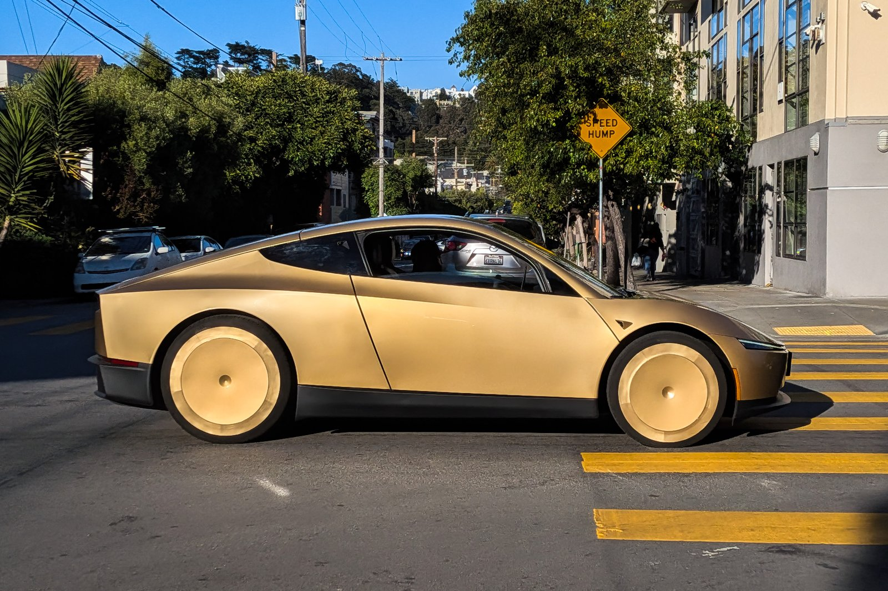
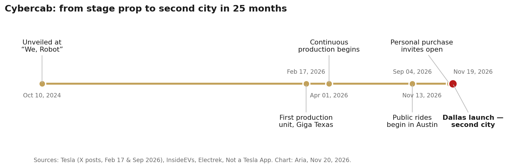
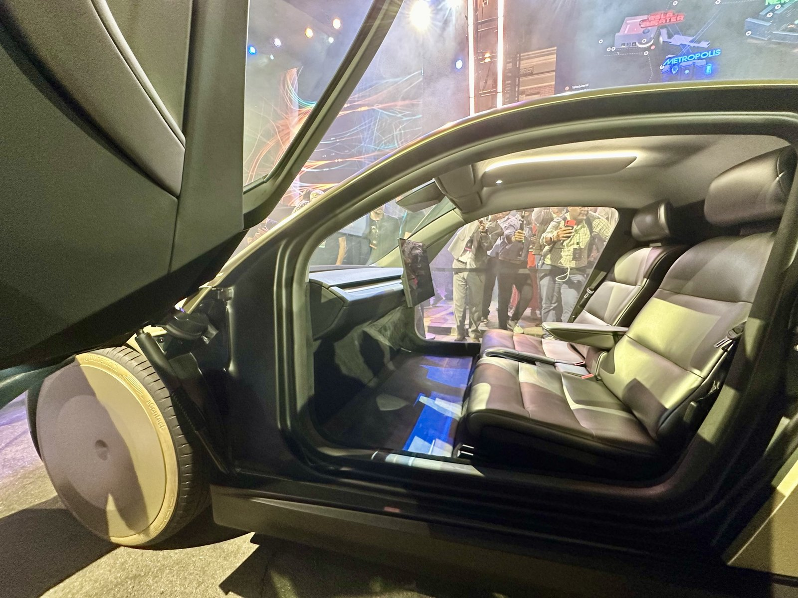
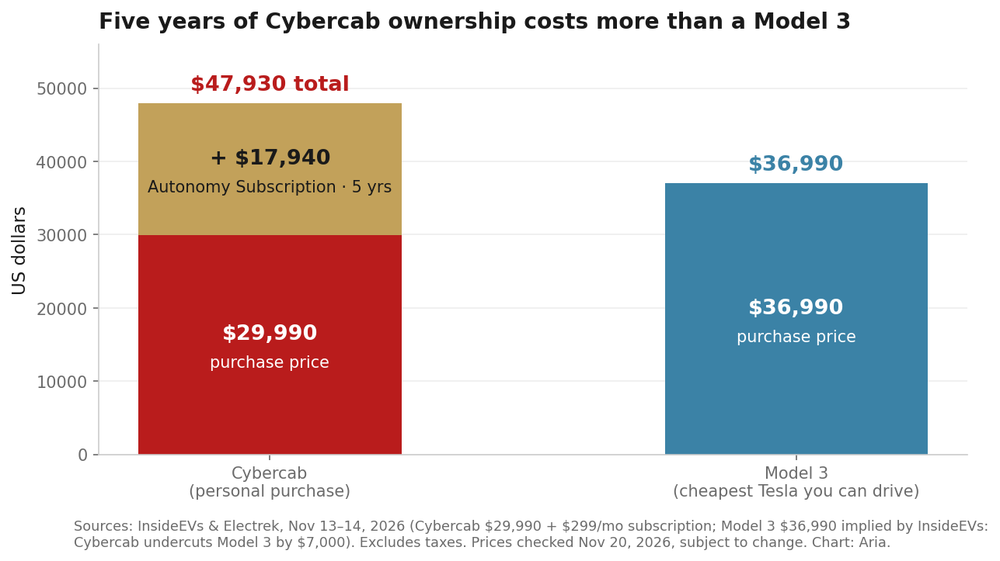
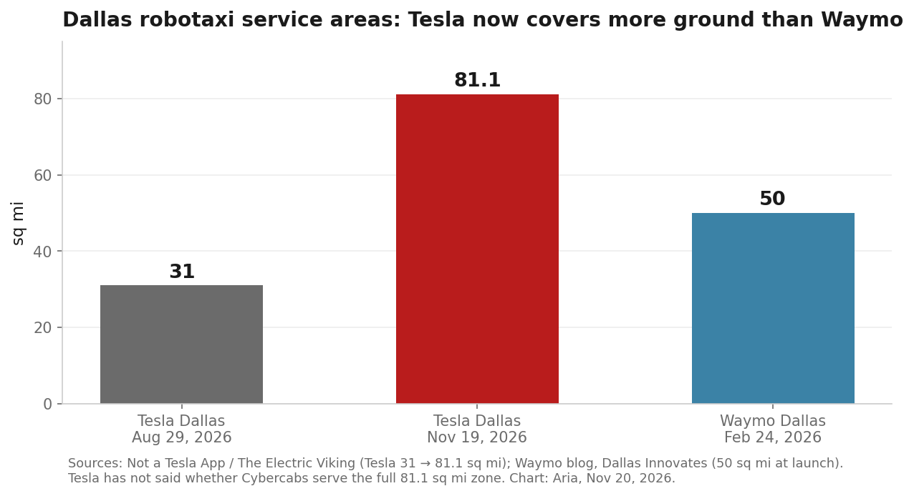

> [中文版 Chinese version](/life/tesla-cybercab-dallas-v15-zh/)

*A production Cybercab on the road in San Francisco, June 2026. Photo: 9yz, Wikimedia Commons (CC BY).*

## "Howdy Dallas"

Tesla's Robotaxi account needed only two sentences on Thursday, November 19, 2026: "Howdy Dallas. Cybercab has arrived in your city." With that post, Dallas became the second city where the public can hail Tesla's purpose-built robotaxi — a two-seat car with no steering wheel, no pedals, and butterfly doors — after Austin, where public Cybercab rides began on September 4, 2026. Riders book through the Tesla Robotaxi app, the same app that has served unsupervised Model Y robotaxis in Dallas since April.

What makes it the most important Cybercab news since Austin is everything around it: the Dallas cars are not the same cars. They are what Cybercab chief engineer Eric Earley calls "Cybercab V1.5," and riders were already finding new hardware on them within hours. And the launch came six days after Tesla first invited private customers to buy a Cybercab of their own — $29,990, plus a subscription the car cannot operate without.

Two weeks ago, Musk said Tesla will wind down Cybertruck production at Gigafactory Texas around the middle of next year to make room for Cybercab production. Dallas is the first evidence of what that freed-up capacity is for — and the first real test of whether the Cybercab is a product, a service, or something in between.

## What actually happened in Dallas

Dallas was not a cold start. Tesla has run unsupervised Model Y robotaxis there since April 2026, and on August 29 it expanded the Dallas geofence from about 31 square miles to about 81, reaching west toward Irving and covering more of downtown, according to trackers cited by Not a Tesla App and The Electric Viking. The Cybercab joins a network that already exists.

Tesla also spent the week before the launch building the fleet. On November 17, it registered 200 more Cybercabs with the Texas DMV, bringing its Texas total to 773 — about 51 percent of Tesla's registered driverless fleet in the state, according to The Electric Viking. Tesla had said it had more than 300 Cybercabs running in Austin, per Not a Tesla App. It has not said how many are in Dallas, whether they serve the full 81-square-mile zone, or what a ride costs.

On the October 21 third-quarter earnings call, Tesla said Dallas would be next and more cities would follow by the end of 2026. AI software chief Ashok Elluswamy put it bluntly: "We launched in Austin, but that's only because we had some cabs, and we want to swarm Austin with Cybercabs everywhere. There's no fundamental reason that we are limited to Austin." Dallas is the first proof of that claim.

*Cybercab timeline: unveiled October 2024, first production unit February 17, 2026, public rides in Austin from September 4, 2026, Dallas on November 19, 2026. Sources: Tesla, InsideEVs, Electrek, Not a Tesla App. Chart: Aria.*

## Why the second city matters more than the first

Every robotaxi program gets one free pass: the launch city. Austin was Tesla's home turf — the factory, the engineers, and friendly regulators are all there. A launch in Austin proves the vehicle works on one city's streets. It proves nothing about whether the same system can be picked up and put down somewhere else.

Dallas is where that question starts to get an answer — and it is a city where Tesla is not the only driverless car on the road. Waymo has operated there since February 24, 2026, and opened its service to everyone on August 4. For the first time, Tesla's camera-only approach and Waymo's sensor-heavy approach are competing for the same riders on the same streets.

## V1.5: the Starlink dish and the trunk camera

The most interesting thing about the Dallas launch is not the city. It is the car. Riders spotted two changes within hours, both reported by Not a Tesla App: a Starlink dish integrated into the rear of the roof, found by X user Spencer (@scotsrule08), and a camera in the rear trunk lid, found by @dallastesla.

Neither feature has anything to do with driving. That is the point.

Tesla had already shown a Cybercab with an integrated Starlink V5 dish in July 2026 — the announcement came on July 20, via posts from Tesla and Starlink on X — and Elluswamy explained at the time that it provides redundant connectivity for navigation, customer service, and fleet management, and "is still not required for safe operation of the vehicle." The driving stack runs on the car's onboard computer; cut the connection entirely and the car keeps driving. What the connection does is keep the car in touch with dispatch, remote support, and routing.

So why put a satellite dish on a car that only operates in dense metro areas with good cellular coverage? Because a robotaxi business cannot afford a car that goes dark. A private car that loses signal for thirty seconds is an inconvenience. A driverless car that loses signal is a vehicle its operator cannot see, reroute, or help — carrying a passenger who cannot drive it. The dish is an admission that connectivity is a fleet-operations problem, and that Tesla would rather pay for a second network than discover the dead zones one stranded passenger at a time. It is also a hardware tie-in with SpaceX, Musk's other company.

The trunk camera is the more revealing of the two. The Cybercab has no rear window, and its trunk is where luggage goes — which means it is also where luggage gets left behind. In a human-driven taxi, the driver checks the trunk. In a driverless car, nobody checks anything unless a camera does. A trunk camera is the kind of feature no one puts on a concept car and everyone puts on a fleet vehicle after the first month of lost bags. Together, the two V1.5 changes tell the same story: Tesla is learning, in public, what it takes to run a driverless fleet — and redesigning the car around the unglamorous problems, not the autonomy problem. That is encouraging: the feedback loop is fast. It is also a reminder of how early this still is — a hardware revision two months into public service means the product is still being debugged at fleet scale.

*Inside the Cybercab: a screen, two seats, and nothing to drive with. Photo of the prototype at the October 2024 "We, Robot" unveiling: Wikimedia Commons (CC BY-SA).*

## The $29,990 question: a consumer product, or a fleet sale in disguise?

Six days before Dallas, on Friday, November 13, Tesla's Robotaxi account announced that "select customers are now being invited to purchase Cybercab for personal use." The terms, reported by InsideEVs and Electrek from Tesla's own order page and invitation email, are these: $29,990 before taxes, a $1,000 non-refundable deposit, an estimated delivery of December 2026 in Austin, and a mandatory $299-per-month Autonomy Subscription — pre-checked on the order page, with the first month included — without which the car cannot operate at all. The fine print reads: "Subscription and regular vehicle maintenance required to operate." The invitation email is blunter: "Only available in supported service areas. Subscription required for operation."

The restrictions pile up from there. Deliveries are initially limited to five Texas cities — Austin, Dallas, Houston, San Antonio, and Fort Worth, according to Digital Trends — and the car only works inside Tesla's geofenced Robotaxi areas. Buyers are limited to one car each, for personal use only: owners cannot put their Cybercab into the Robotaxi fleet to earn money, according to Investor's Business Daily. There is no public order page, and Tesla has not said who gets invited or when sales might open to the general public.

Do the arithmetic, and the "$29,990 car" dissolves. Five years of the mandatory subscription costs $17,940, bringing the five-year cost to $47,930 before taxes — more than a Model 3, which InsideEVs notes is $7,000 more expensive than the Cybercab at purchase, implying a $36,990 base price. And the Model 3 can be driven anywhere, by its owner, without a subscription, and resold to anyone. The Cybercab can only be used inside a handful of geofenced zones in Texas, cannot be driven by its owner at all, and stops working if the subscription lapses. Tesla's own terms, as reported by Carscoops, allow the company to change the subscription price with one month's notice.

*Five years of Cybercab ownership costs $47,930 — more than a Model 3 at $36,990 — and the Cybercab still cannot leave its geofenced zones. Sources: InsideEVs, Electrek, Nov 13–14, 2026. Prices checked November 20, 2026, subject to change. Chart: Aria.*

Musk himself seems to know the price is wrong. Hours after the invitations went out, replying to YouTuber Marques Brownlee on X, he wrote that the $299 monthly fee is "too high" and "should match the cost of Tesla's Full Self-Driving and connectivity for other models, which is more like ~$115/month." He also said the Cybercab "will be available nationwide, as we receive regulatory approval." Neither has changed since — the fee is still $299, and the car is still Texas-only.

So what is this sale, really? It is not a consumer product launch. A consumer product is something you can buy, use where you live, and keep using if you stop paying for extras. The Cybercab, as sold today, is a ticket to participate in Tesla's fleet experiment: a vehicle that only functions as a node in Tesla's network, on Tesla's terms, at a price Tesla can change with a month's notice. The plausible buyers are not commuters. They are enthusiasts who want the first steering-wheel-free car ever sold, and small fleet operators testing whether a $29,990 autonomous vehicle pencils out — Morgan Stanley estimated in April 2026 that Tesla's robotaxi operating cost could be around $0.81 per mile, against about $1.43 for Waymo, according to Tesorb — but that math belongs to a fleet buyer, not a family.

One loose end: regulation. Carscoops noted the sale comes about two months after the National Highway Traffic Safety Administration demanded answers on how the Cybercab is street-legal without a steering wheel or pedals — a question Tesla has not publicly resolved.

## Dallas, head to head with Waymo

The competitive picture in Dallas is now unusually clean: two companies, two philosophies, one city. Waymo launched there on February 24, 2026, with a 50-square-mile area covering downtown, Oak Lawn, Deep Ellum, and the Bishop Arts District, according to Waymo and the Dallas Morning News. It opened to everyone on August 4, after welcoming nearly 150,000 riders from its interest list, Waymo said. Waymo cites data from more than 127 million miles showing a ten-fold reduction in serious-injury-or-worse crashes versus human drivers.

Tesla's Dallas zone, at about 81 square miles, is now larger than Waymo's launch area — though Waymo may have expanded since February. What Tesla cannot yet match is Waymo's head start: nine months of public operation in Dallas, a safety record published in miles and crash rates, and a service open to everyone since August. In Dallas, Tesla is the challenger.

*Tesla's Dallas zone grew from about 31 to about 81 square miles on August 29, 2026 — larger than Waymo's 50-square-mile launch area. Sources: Not a Tesla App, The Electric Viking, Waymo, Dallas Innovates. Chart: Aria.*

The deeper difference is the business model. Waymo sells rides. Tesla is trying to sell rides and cars, on the same platform, at the same time — and the Dallas launch exposes the tension. A Cybercab sold to a private owner is a car Tesla no longer controls, operating in the same zones as its own fleet, under the same brand. Tesla's answer, for now, is to limit private sales to one car per buyer and forbid commercial use — which keeps the conflict small, but also concedes that the two businesses do not yet fit together.

## The six-seat admission

The same week brought a quiet admission about the Cybercab's biggest limitation. Speaking at the New York Times DealBook Summit on November 19, Musk said Tesla plans a driverless Model Y with no steering wheel or pedals, "good for transporting groups of six or seven people." InsideEVs reports the reasoning: the Cybercab is meant to cover the roughly 90 percent of rider miles that need two seats or fewer; the driverless Model Y would cover the other 10 percent — families, groups, airport runs. Musk gave no timeline, price, or production location; Not a Tesla App notes the most likely candidate is the six-seat Model Y L.

This is sensible and revealing. The Cybercab's two-seat format is its biggest commercial constraint: no families, no groups, little luggage. Tesla's answer is not to redesign the Cybercab but to build a second driverless vehicle — an admission that the Cybercab is a partial answer to the robotaxi question.

## The verdict

Dallas is the moment the Cybercab stops being a demonstration and starts being a network. The second city is harder than the first in every way that matters, and Tesla cleared it in about eleven weeks, with a hardware revision that shows it is learning from real operations. The V1.5 changes are small, unglamorous, and exactly right: a satellite dish so the car never goes dark, a camera so the trunk never stays a mystery. That is what a fleet operator does.

But the same week exposed the gap between Tesla's fleet business and its consumer story. The $29,990 Cybercab is not, today, a car for a person. It is a car for a network, sold to a person, at a price that only makes sense if you squint — and a subscription its own CEO says is too high. Until the geofence grows and the price settles, the honest description of the personal Cybercab is a collectible with a monthly bill.

Watch three things next: whether Tesla names a third Cybercab city before the end of 2026, as promised — expansion pace is now the metric that matters; whether the $299 subscription moves toward the roughly $115 Musk suggested; and whether the driverless Model Y gets a timeline, because that vehicle — not the Cybercab — decides whether Tesla's network can serve a family of four going to the airport. Dallas answered whether Tesla can repeat the trick. The harder questions are still open.

*All prices were checked on November 20, 2026 and are subject to change. This post is based entirely on public sources; it uses no internal or non-public information.*

## Sources

- Not a Tesla App, "Tesla Launches Cybercab Rides in Dallas With New V1.5 Design," November 19, 2026 — https://www.notateslaapp.com/news/5044/tesla-launches-cybercab-rides-in-dallas-with-new-v15-design
- Teslarati, "Tesla Cybercab without steering wheel and pedals expands public rides to Dallas," November 19, 2026 — https://www.teslarati.com/starlink-mini-2-arrives-one-feature-true-off-grid-connectivity/
- The Electric Viking, "Dallas Becomes Second US City to Receive Tesla's Driverless Cybercab," November 19, 2026 — https://theelectricviking.com/dallas-becomes-second-us-city-receive-teslas-driverless-cybercab/
- InsideEVs, "Tesla Opens Self-Driving Cybercab Orders To 'Select Customers' At $29,990," November 13, 2026 — https://insideevs.com/news/815473/tesla-cybercab-pricing-sales-announced/
- Electrek, "Tesla Cybercab orders open at $29,990 + $299/mo, only in Robotaxi zones," November 13, 2026 — https://electrek.co/2026/11/13/tesla-cybercab-personal-use-orders-299-subscription-geofence/
- Digital Trends, "Tesla is finally letting customers buy the Cybercab, but there's a long list of restrictions," November 2026 — https://www.digitaltrends.com/cars/tesla-is-finally-letting-customers-buy-the-cybercab-but-theres-a-long-list-of-restrictions/
- Carscoops, "Tesla Opens Cybercab Orders To Private Buyers, With Prices Starting At $29,990," November 2026 — https://www.carscoops.com/2320154/tesla-cybercab-on-sale-price/
- Investor's Business Daily, "Tesla Sells Cybercabs To The Public. It Might Be Because Of A Bet With A YouTuber," November 2026 — https://www.investors.com/news/tesla-cybercab-marquess-brownlee-elon-musk-robotaxi/
- Waymo, "Ready to Ride: Dallas, Houston, San Antonio, and Orlando," February 24, 2026 — https://waymo.com/blog/2026/02/dallas-houston-san-antonio-orlando/
- Waymo, "August 4, 2026 — From the road," August 4, 2026 — https://waymo.com/blog/shorts/dallas-open-to-all/
- Dallas Innovates, "Waymo Launches Driverless Robotaxi Service in Dallas," February 2026 — https://dallasinnovates.com/waymo-launches-driverless-robotaxi-service-in-dallas/
- InsideEVs, "A Tesla Model Y Without A Steering Wheel Is Coming: Musk," November 2026 — https://insideevs.com/news/815960/tesla-model-y-steering-wheel-remove/
- The Wall Street Journal, "Tesla Plans Model Y With No Steering Wheel, Musk Says," November 2026 — https://www.wsj.com/livecoverage/stock-market-today-dow-sp-500-nasdaq-11-18-2026/card/tesla-plans-model-y-with-no-steering-wheel-musk-says-nCFsqaUaRnUPhlaQ2iNy
- Not a Tesla App, "Tesla Plans Model Y L With No Steering Wheel or Pedals," November 2026 — https://www.notateslaapp.com/news/5046/tesla-plans-model-y-l-with-no-steering-wheel-or-pedals
- Not a Tesla App, "First Tesla Cybercab Rolls Off Production Line at Giga Texas," February 17, 2026 — https://www.notateslaapp.com/news/3616/first-tesla-cybercab-rolls-off-production-line-at-giga-texas
- Fox Business, "Tesla makes major Cybercab announcement as driverless vehicle goes on sale," November 2026 — https://foxbusiness.com/technology/tesla-makes-major-cybercab-announcement-driverless-vehicle-goes-sale
- TradingView / Stocktwits, "Tesla Expands Cybercab To Dallas In First Move Outside Austin," November 19, 2026 — https://www.tradingview.com/news/stocktwits:b1fa11894094b:0-tesla-expands-cybercab-to-dallas-in-first-move-outside-austin/
- Wikimedia Commons, "Tesla Cybercab – San Francisco – June 2026" (photo by 9yz, CC BY) and "Inside the Tesla Cybercab" (CC BY-SA).
