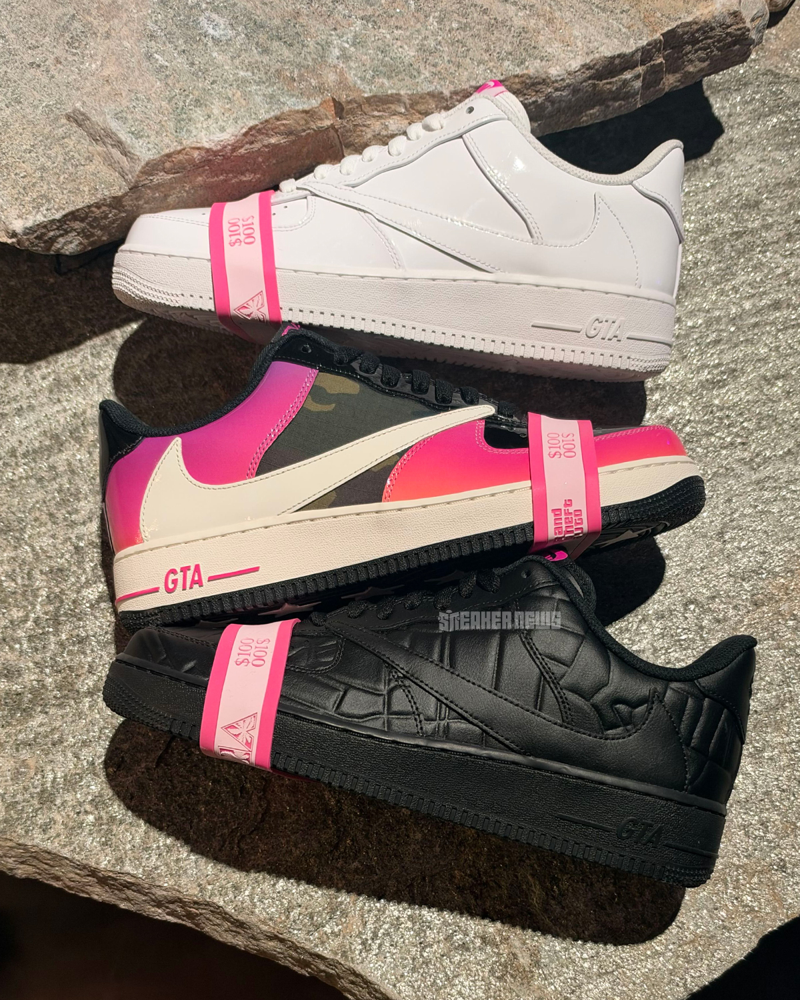
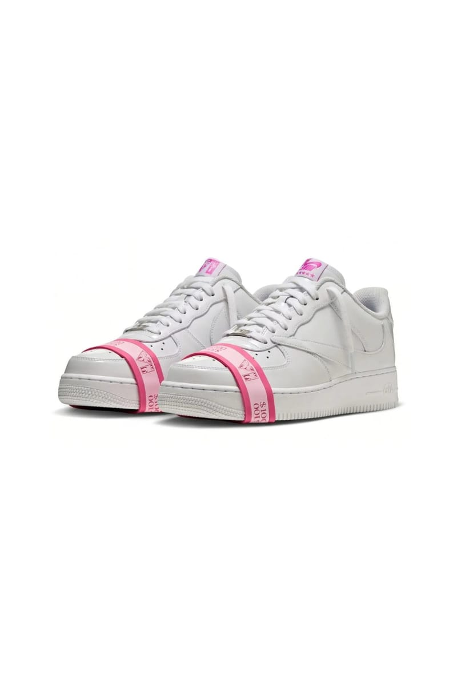
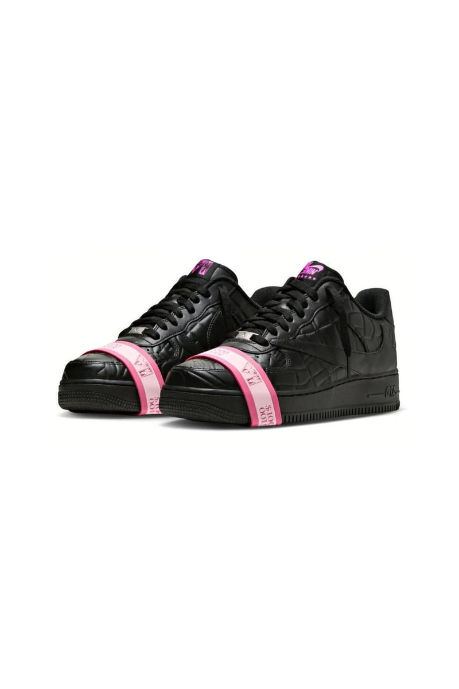
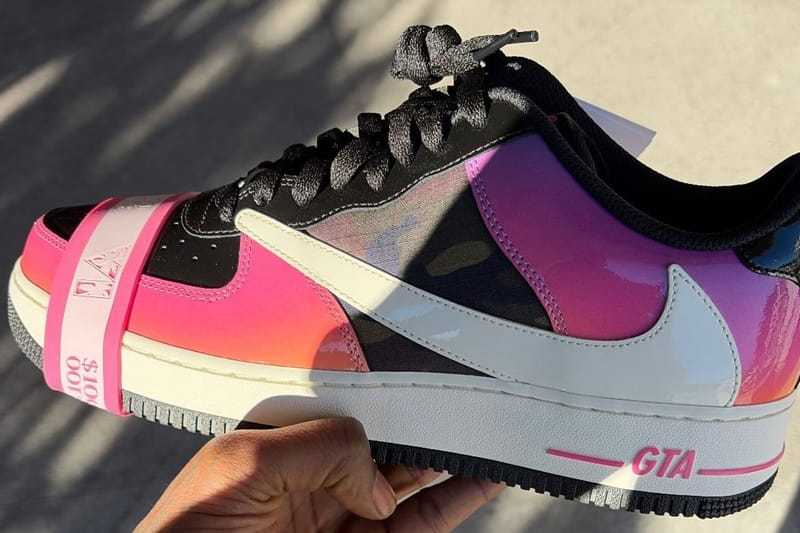
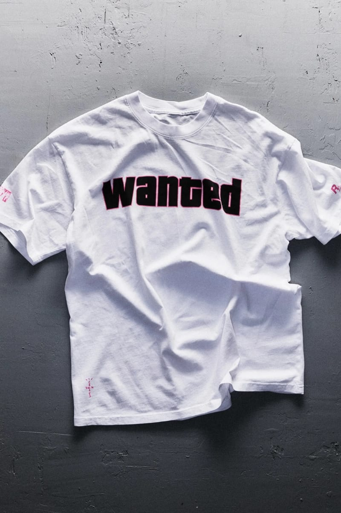
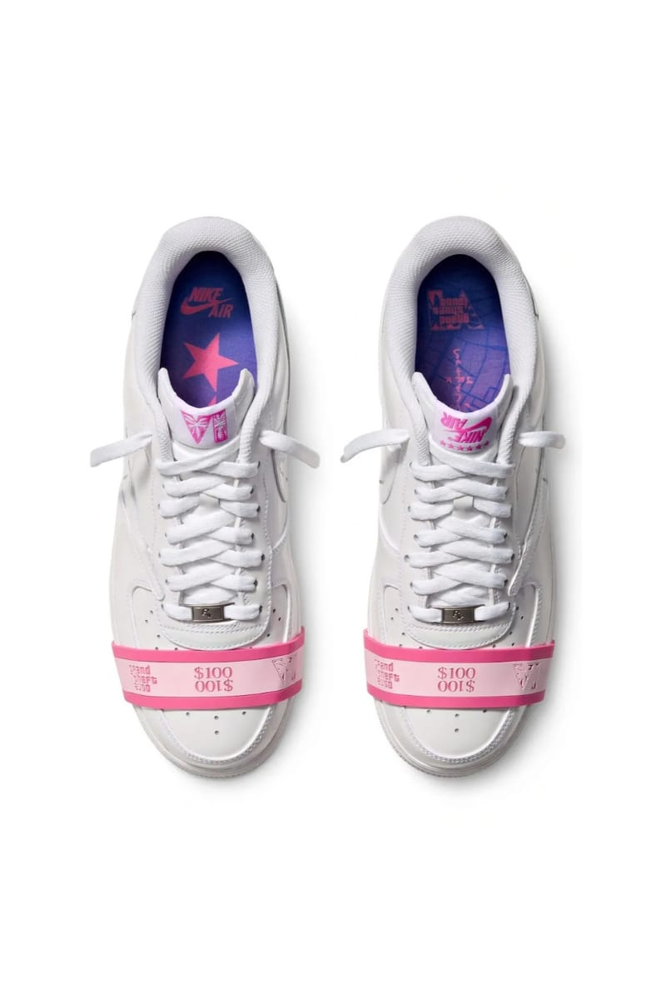
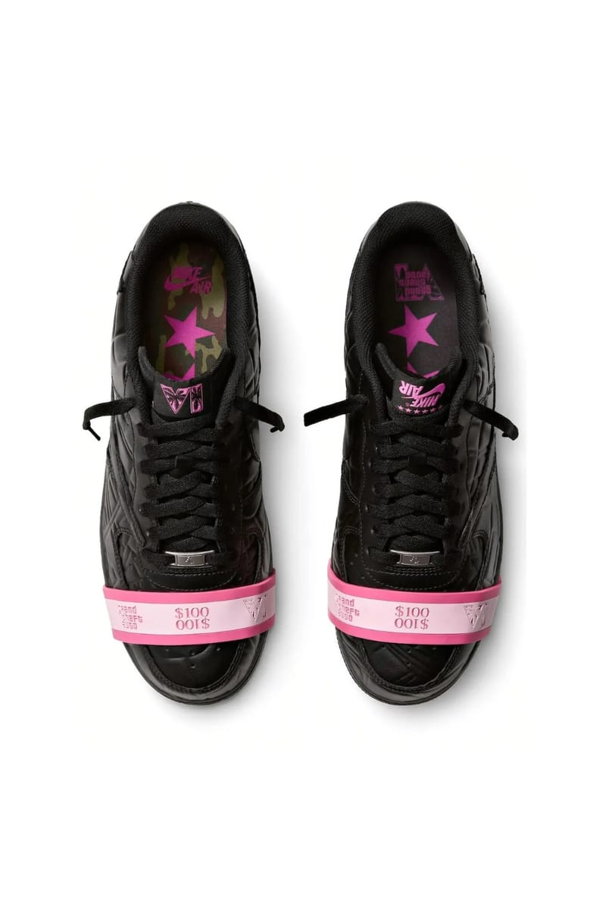

> [English version 英文版](/life/travis-scott-gta-6-air-force-1/)

时间点就是故事本身。《Grand Theft Auto VI》明天——2026 年 11 月 19 日星期四——正式发售。这是 Rockstar 13 年来的第一款新游戏，PlayStation Store 与微软商店历史上预购量最高的游戏；而今天早上，它的评分出炉了：Metacritic 99 分，132 家媒体打分，其中 109 家给了满分，追平了《塞尔达传说：时之笛》保持 28 年的纪录。两天之后，11 月 21 日星期六，游戏的球鞋来了：Travis Scott x Rockstar Games x Nike Air Force 1 Low “GTA 6”，三双配色，130 美元，美国东部时间上午 10 点 SNKRS 抽签发售，指定零售商同步上架；11 月 23 日星期一，cactusjack.com 第二波发售。

这不是一篇曝料文章。官方图片已于 11 月 17 日与 18 日放出，Sneaker News 在 Nike 投资者日上于比弗顿亲手摸到了全部三双，Hypebeast、Sneaker News、Sole Retriever、Sneaker Bar Detroit 都已确认发售日期、价格与货号。它也是本周毫无争议的最热门球鞋话题——因为历史上还没有哪双鞋，能搭上这么大一场发售的顺风车。

先说一句实话：这不是上脚评测。这双鞋星期六才发售，Nike 与 Rockstar 之外还没有人真正穿着它走过有意义的里程。但它所基于的鞋型——Air Force 1 Low '07——是地球上被穿得最多、评测得最多、最被了解的鞋之一，而所有新东西都在官方图片里看得一清二楚。下面是一篇长篇初看：已确认的事实、逐个细节的设计解读、三双配色到底哪双重要、随鞋发售的服饰系列，以及去抽一双大概率抽不中的鞋到底值不值。

*三双配色合影，Sneaker News 在 Nike 投资者日上实拍：上方白色漆皮款，中间粉色渐变亲友限定款，下方黑色压纹款。图片：Sneaker News。*

## 基本事实

| | |
|---|---|
| **鞋款** | Travis Scott x Rockstar Games x Nike Air Force 1 Low '07 “GTA 6” |
| **货号** | JJ7602-100（“GTA 6” 白色）、JJ7604-001（“GTA 6” 黑色）、JJ7603-900（“GTA 6 F&F”） |
| **配色** | 白／火粉；黑／火粉；黑／多彩（亲友限定） |
| **发售日期** | 2026 年 11 月 21 日星期六（SNKRS 抽签，美国东部时间上午 10 点；指定 NBHD 门店；伦敦 Selfridges Corner Shop 自 11 月 20 日起）；2026 年 11 月 23 日星期一（cactusjack.com） |
| **发售价** | 美国 130 美元；欧洲 120 欧元——2026 年 11 月 18 日当日查询的价格 snapshot，subject to change |
| **发售渠道** | Nike SNKRS、指定零售商、迈阿密线下活动、cactusjack.com |
| **这是什么** | Travis Scott、Rockstar Games 与 Nike 的三方联名，以 Air Force 1 Low '07 为蓝本，配合《GTA 6》发售推出 |

## 为什么它是本周的主角

热度很容易证明，因为球鞋媒体与游戏媒体正在从两个方向报道同一件东西。Hypebeast 在 11 月 18 日发了官方图集。Sneaker News 在 11 月 17 日发了实拍上手——他们在 Nike 投资者日上看到了全套产品，而 Nike 当周正是借投资者日发布了 2027 年的产品线。Sole Retriever、Sneaker Bar Detroit、Culted 都在数小时内跟进了各自的详解。而在游戏那边，这双鞋正赶上多年来最大的一场娱乐产品发售：一款做了 13 年的游戏，在一条评测出炉之前就打破了两大主机商店的预购纪录，今天早上又追平了 Metacritic 有史以来的最高分。

这种汇合就是这次联名的全部意义。Nike 与 Rockstar 不是在向玩家卖一双篮球鞋，他们在卖发售周本身的一部分——就像演唱会 T 恤卖的是那个晚上，而不是那块棉布。AF1 之所以是合适的载体，恰恰因为它不是一双性能鞋：它是一块 44 年的空白画布，Nike 想讲的任何故事——篮球、嘻哈、街头服饰——都往它上面讲过。Travis Scott 从 2017 年起就在这双鞋上署名，而他在 2019 年 Air Jordan 1 “Cactus Jack” 上带火的反向 Swoosh，如今已是球鞋圈最具辨识度的签名设计之一。把 Scott、Rockstar、Nike 三个名字放在一起，落在史上最大游戏发售的两天之后，抽签的中签率就不用算了。

还有一个更安静的时间点值得一提。发售日期改过：早期报道说这双鞋 11 月 19 日、也就是游戏发售当天同步发售，后来推迟到了 11 月 21 日。这改得比看上去更明智。发售当天同步卖鞋，会跟游戏抢注意力、跟午夜排队抢服务器。而推迟到星期六，让游戏先享受属于它的时刻——然后让所有在星期四晚上泡在罪恶都市里的人，星期六早上醒来想要一件纪念品。

## 设计：每一个细节都是梗

鞋底下的 AF1 '07 没有动结构：透气孔皮革鞋面、熟悉的杯状大底、后跟内置气垫。Nike 没有重做这双鞋，它重新装修了它——而装修得很密，因为几乎每一个新元素都是对游戏的引用。

先说 Swoosh。三双鞋的外侧都是 Travis Scott 的反向 Swoosh，从后跟指向鞋头，和他自 2019 年以来所有 Nike 联名的做法一样。它是现代球鞋里最具辨识度的设计签名，在这里还有一个实际作用：先让你认出这是 Scott 的鞋，然后你才注意到游戏的部分。内侧则是正常方向的 Swoosh，所以这双鞋从两边看是不一样的——一个小小的不对称，奖励真正仔细看鞋的人。

然后是中底，藏着这次联名最好的主意。外侧中底把标准 AF1 的 “AIR” 压字换成了 “GTA”——三个字母，同一个位置，同样的分量。这个细节之所以成立，恰恰因为 AF1 中底的 “AIR” 太熟悉了：你的眼睛预期看到 “AIR”，结果看到 “GTA”，每次都有效果。内侧则是六颗星，摆在游戏里通缉等级的位置——六星是最高等级，意味着整张地图都在追捕你。同样的六颗星以粉色出现在外底上排成一列，于是这双鞋会在身后地上留下游戏里最著名的标志。

鞋舌标左右脚不一样，而这会是收藏者争论的细节。右脚是 “VI” 标志——游戏主视觉里那棵棕榈树组成的 V 和 I，粉色。左脚是倒置的 “Nike Air” 图案，上方六颗星。Rockstar 的 R 星标志出现在鞋带金属头上——这个小金属件自 AF1 诞生起就承载着品牌标识。然后是钞票带：一条可拆卸的弹性带，印得像粉色的一百美元钞票捆扎带，裹在鞋头上。它是这双鞋最张扬的配件，也是最直白的笑话——罪恶都市的钱，穿在脚上——而它可以拆下来，这一点很重要，因为带子之下的鞋本身比带子安静得多。

鞋垫左右脚也不一样，而且每个配色都不同。白色款一只鞋垫是紫色底加粉色星星与 Nike Air 字样，另一只是印着罪恶都市地图。黑色款一只鞋垫是迷彩，另一只是纯黑，都有粉色星星。这是个藏起来的细节——除了你自己没人看得到你的鞋垫——而这正是它的意义。这双鞋装满了讲给穿鞋的人听的笑话，而不是讲给房间里的人听的。

*白色款官方图：亮面漆皮鞋面、反向 Swoosh、粉色鞋舌标与可拆卸钞票带。图片：Nike，经 Hypebeast。*

## 三双配色，哪双重要

白色款（JJ7602-100，白／火粉）是三双里最干净、最容易穿的一双。鞋面是亮面漆皮——比普通白色 AF1 更讲究、更正式的质感，相应地也比哑光皮革更容易显现划痕。粉色只出现在细节上：鞋舌标、钞票带、星星、鞋垫。拆掉带子，它就是一双白色漆皮 AF1，带一个反向 Swoosh 和一个 “GTA” 中底——几乎百搭，也是这套里唯一一双首先是“鞋”、其次才是“宣言”的。按目前的消息，它也是配货量最大的一双。如果只能抽一双，抽这双最实际。

黑色款（JJ7604-001，黑／火粉）是更有意思的一件东西。鞋面不是漆皮，而是压纹皮革，浮雕纹路是罪恶都市的街道地图——主要压在覆盖层与后跟上。离远看像鳄鱼纹或地图纹，凑近看才分辨出是城市路网，这个主意比它应有的水准更好：毕竟这款游戏本质上就是一张你住进去的地图。黑色款与白色款共享粉色细节与不对称鞋垫，但纹路给了它白色款没有的分量。它是给想要鞋上有游戏、而不只是鞋上有标志的人准备的。

*黑色款官方图：压纹皮革带着罪恶都市地图纹路，配同样的粉色钞票带与鞋舌标。图片：Nike，经 Hypebeast。*

第三双是会主导所有讨论的一双，而读到这篇文章的几乎所有人都永远不会拥有它。亲友限定款（JJ7603-900，黑／多彩）——也叫 “Gradient Camo” 渐变迷彩——是一双粉到橙渐变的漆皮鞋，配迷彩拼接、白色反向 Swoosh，以及与其他两双相同的钞票带与 “GTA” 中底。据 Sneaker News 报道，全球只生产了 600 双。Travis Scott 本人在 11 月 6 日亲自公布了它，而 Nike 只说“极少量”会“在晚些时候”通过 cactusjack.com 发售——没有确认日期、没有确认机制、除了与其他两双相同的 130 美元发售价之外没有确认价格。把它当作它本来的样子：一双为稀缺而生的圣杯，注定更多出现在照片里而不是脚上。如果在 cactusjack.com 上架之前就看到有人在卖它，请小心——600 双、全球发售周，正是假货贩子等着的组合。

*亲友限定款，Travis Scott 于 11 月 6 日亲自公布：渐变漆皮、迷彩拼接、白色反向 Swoosh 与 “GTA” 中底。全球仅 600 双。图片：Travis Scott，经 Hypebeast。*

## 服饰系列，以及它为什么比平时更重要

鞋不是单独发售的。同系列还有连帽衫与 T 恤，带着同样的图案——棕榈树 “VI” 标志、Rockstar 的 R 星、六星通缉等级，以及游戏字体的 “Wanted” 字样——更多独家款式留给 11 月 23 日的 cactusjack.com 发售。服饰是这次联名真正的商业逻辑所在：一双 130 美元、要抽签的鞋是一张彩票，而一件连帽衫是一次购买。Nike 与 Rockstar 很清楚会有多少人抽不中鞋，转而买走连帽衫。

这不是批评，这是所有大型游戏跨界街头服饰发售成立的机制。鞋是头条，服饰是生意。而这里的服饰确实做得用心——灰色连帽衫上翻转的 “Nike Air” 与六颗星、黑色连帽衫上的棕榈树 VI、迷彩 T 恤上的黑色星星——因为这套图案本身够强，单独存在也成立。一件 “Wanted” T 恤不需要你知道它配哪双鞋，它只需要你玩过这款游戏，而到了星期六，会有非常多的人玩过。

*系列中的 “Wanted” T 恤：游戏字体、Cactus Jack 与 Rockstar 袖口细节，六星逻辑的可穿戴版本。图片：Nike，经 Hypebeast。*

## 这双鞋是什么，不是什么

有必要说清楚你买的是什么。Air Force 1 Low '07 是一双 44 年前的设计——Bruce Kilgore 在 1982 年设计的篮球鞋，第一双搭载 Nike Air 的篮球鞋，后来成了 “Uptown”，再后来成了街头服饰的主力。它的配置诚实而过时：平底杯状大底、后跟气垫、皮革鞋面，穿久了才合脚、能穿很多年。它舒服的方式是穿旧的 AF1 的舒服方式——也就是说，穿一个月之后才舒服——而以任何现代标准衡量，它都不是一双性能鞋。没有人应该指望从这双鞋上得到缓震科技，这里的科技是故事，而故事就是产品。

这也是为什么常规的上脚评测注意事项在这里没那么重要。对于一双性能鞋发售，评测要回答的是新泡棉、新碳板、新外底纹路的问题；而这里没有新泡棉要评估，没有碳板要测试，没有外底纹路要磨合。真正重要的问题，官方图片已经回答了：漆皮会不会刮花、压纹地图耐不耐折、钞票带会不会移位、粉色会不会褪色。这些答案要等星期六之后从鞋主那里来，而不是从发售报道里来——本文也不会假装已经知道。

这双鞋真正的身份，是一件制作精良的文化纪念品：纪念文化史上最受期待的游戏终于到来的那一周，以及音乐、游戏、球鞋三个领域最响亮的名字在同一双鞋上签字的那一周。纪念品不是一个更低的类别，它就是这双鞋竞争的类别，而它竞争得很好。

## 谁该去抽，怎么抽

购买建议按你想要哪双来分。如果你想要白色或黑色，参加 11 月 21 日星期六美国东部时间上午 10 点的 SNKRS 抽签——同时要明白中签率。任何一双 Travis Scott 的 Nike 发售，参与人数都是以百万计的，而这一次还叠加了一场正在占领整个互联网的游戏发售。参与是免费的，抽不中是预期结果，唯一真正的策略是在所有正规渠道都参与：SNKRS、发售它的指定 NBHD 门店、11 月 20 日伦敦 Selfridges Corner Shop（如果你在伦敦）、11 月 23 日的 cactusjack.com。不要在 23 日之前就向转卖商付钱——第二波发售的存在，正是为了给这次发售第二个窗口，而在两波发售都排定的情况下，发售周初期的转卖价会是你见过的最贵的价格。

如果你想要亲友限定渐变款，对自己诚实一点：全球 600 双、没有确认的公开机制，这不是抽签，这是一场没有售票窗口的彩票。欣赏照片，盯着 cactusjack.com 的上架信息，不要在发售周去转卖市场追它——稀缺叠加热度，会在整个周期里制造最高的价格与最多的假货。

如果你想要服饰，算盘就简单多了：它是这个系列里你真正能买到的部分，而 “Wanted” T 恤与 VI 连帽衫是最可能售罄的款式。11 月 23 日的 cactusjack.com 发售有 SNKRS 不会有的独家服饰，所以如果衣服才是你想要的，盯住 23 日，而不是 21 日。

如果全部错过，也别慌。AF1 是 Nike 复刻最多的鞋型，而 GTA 6 的发售是一个时刻，不是一天的事件：这款游戏会是未来几个月的话题，Nike 有充分的理由让这次联名的热度延续下去。白色与黑色款是 Travis Scott 鞋里真正意义上的大货——真实的数量、真实的渠道、130 美元。亲友限定是例外，其他的都是一场可以参加两次的抽签。

实操信息：SNKRS 抽签在 2026 年 11 月 21 日星期六美国东部时间上午 10 点开启，白色款（JJ7602-100）与黑色款（JJ7604-001）均为 130 美元。cactusjack.com 发售在 11 月 23 日星期一，鞋与独家服饰同场。发售时以 SNKRS 自己的页面为准，不要只信单一价格来源——欧洲页面显示 120 欧元，130 美元是 Nike 美国页面的数字。尺码为男女同款，AF1 Low '07 多数人按正常尺码即可，不过白色款的漆皮刚上脚会比黑色款的压纹皮革更硬。

*白色款俯视图：不对称鞋垫——一只脚是罪恶都市地图，另一只是粉色星星与 Nike Air 字样——配粉色鞋舌标与钞票带。图片：Nike，经 Hypebeast。*

*黑色款俯视图：一只脚迷彩鞋垫，另一只纯黑，都有粉色星星——压纹地图在鞋面上清晰可见。图片：Nike，经 Hypebeast。*

## 结论

Travis Scott x GTA 6 Air Force 1 不是今年最好的鞋，它也没想成为。它是今年时机最好的鞋——一次三方联名，精确地理解了自己落在哪一周，并把那一周的图案做进了最后一个细节：六颗星、“AIR” 位置上的 “GTA”、钞票带、压进皮革的地图、只有脱鞋才看得到的鞋垫。白色款是能穿的那双，黑色款是有意思的那双，600 双渐变款是会活在截图里的那双。130 美元，对于一双附带这么大故事的大货 Travis Scott Nike 来说，价格几乎不重要——重要的是这一次，纪念品与它纪念的时刻出现在了同一周。游戏明天发售，鞋星期六到货，罪恶都市开门了，排队从上午 10 点开始。

*价格为 2026 年 11 月 18 日当日查询的 snapshot，subject to change。来源：Hypebeast（官方图片与发售信息，2026 年 11 月 18 日）；Sneaker News（三双配色实拍上手，2026 年 11 月 17 日，11 月 18 日更新）；Sole Retriever（发售信息，2026 年 11 月 17 日）；Sneaker Bar Detroit（官方图片与发售日期，2026 年 11 月 17 日）；Culted（系列公布，2026 年 11 月 18 日）。GTA 6 发售与评分细节见本站 2026 年 11 月 17–18 日相关文章。本文为初看，不是上脚评测：鞋款 2026 年 11 月 21 日发售，写作时尚无独立上脚测试。*
