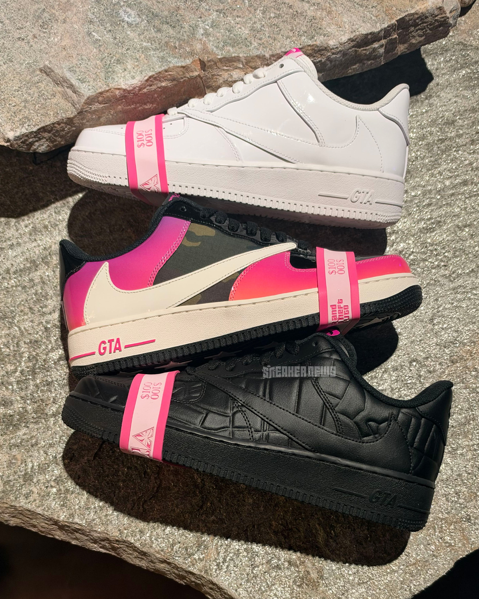
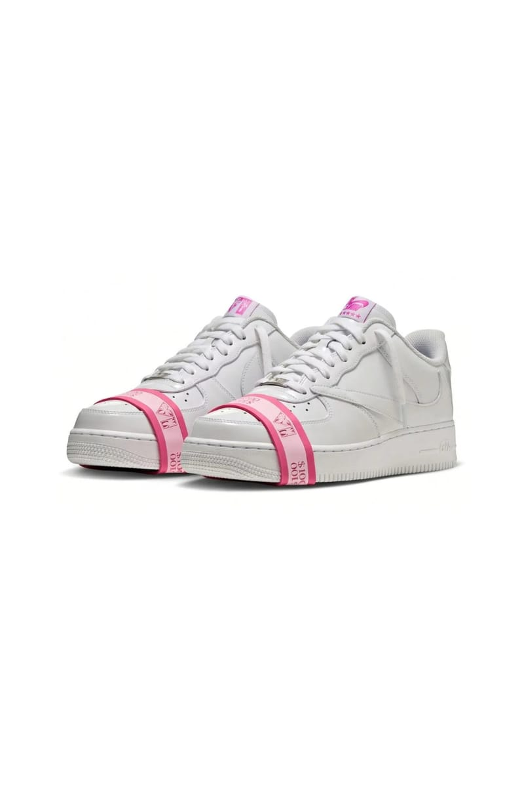
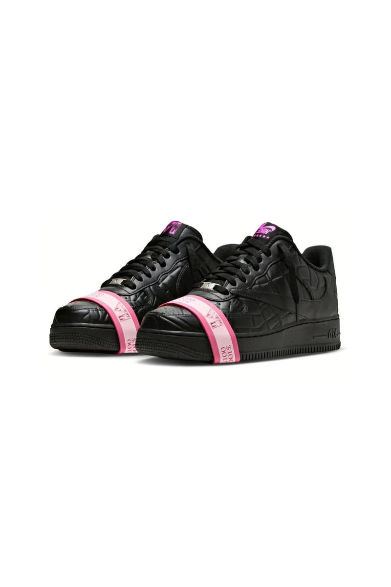
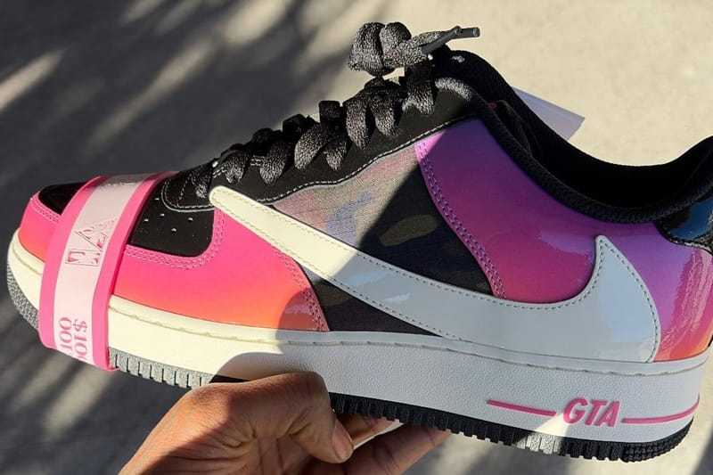
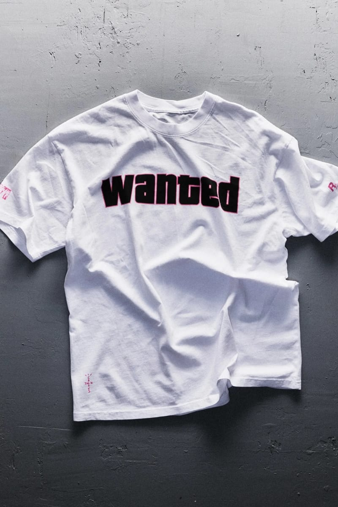
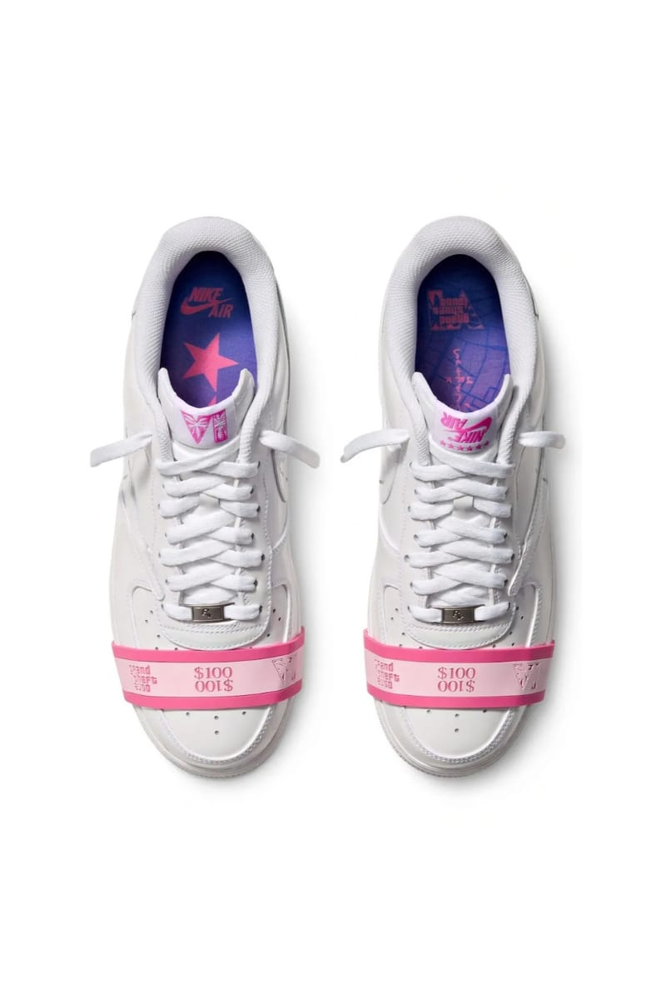
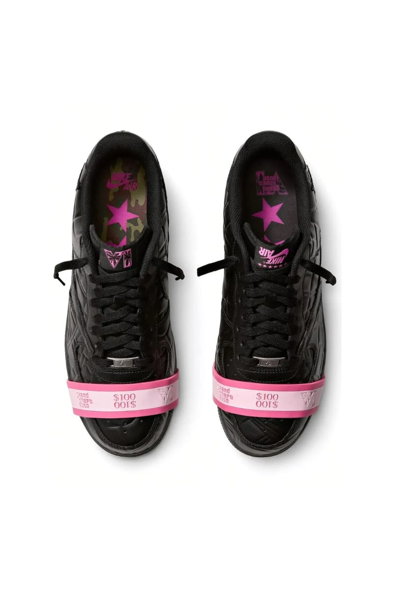

> [中文版 Chinese version](/life/travis-scott-gta-6-air-force-1-zh/)

The timing is the story. *Grand Theft Auto VI* launches tomorrow, Thursday, November 19, 2026 — Rockstar's first new game in 13 years, the most pre-ordered game in the history of the PlayStation Store and the Microsoft Store, and as of this morning, a 99 on Metacritic from 132 critics, 109 of them perfect scores, tying a record that *The Legend of Zelda: Ocarina of Time* has held for 28 years. Two days later, on Saturday, November 21, the game's sneaker arrives: the Travis Scott x Rockstar Games x Nike Air Force 1 Low "GTA 6," three colorways at $130, through a SNKRS raffle at 10 a.m. ET and select retailers, followed by a second drop on cactusjack.com on Monday, November 23.

This is not a leak story. The official images went out on November 17 and 18, Sneaker News handled all three pairs in person at Nike's Investor Day in Beaverton, and the release dates, prices, and style codes are now confirmed across Hypebeast, Sneaker News, Sole Retriever, and Sneaker Bar Detroit. It is also, by a wide margin, the hottest sneaker story of the week — because it is the only sneaker in history that gets to ride shotgun on a launch this big.

One honest note up front: this is not a wear test. The shoe does not release until Saturday, and nobody outside Nike and Rockstar has put meaningful miles on it. But the shoe it is built on — the Air Force 1 Low '07 — is one of the most worn, reviewed, and understood shoes on earth, and everything new here is visible in the official photography. What follows is a long first look: the confirmed facts, the design decoded detail by detail, the three colorways and which one actually matters, the apparel that comes with it, and the honest case for and against entering a raffle you will probably lose.

*All three colorways together, photographed in hand by Sneaker News at Nike's Investor Day: the white patent pair on top, the pink-gradient Friends & Family pair in the middle, and the black embossed pair below. Image: Sneaker News.*

## The facts

| | |
|---|---|
| **Model** | Travis Scott x Rockstar Games x Nike Air Force 1 Low '07 "GTA 6" |
| **Style codes** | JJ7602-100 ("GTA 6" White), JJ7604-001 ("GTA 6" Black), JJ7603-900 ("GTA 6 F&F") |
| **Colorways** | White / Fire Pink; Black / Fire Pink; Black / Multi-Color (Friends & Family) |
| **Release date** | Saturday, November 21, 2026 (SNKRS raffle, 10 a.m. ET; select NBHD doors; Selfridges London Corner Shop from November 20); Monday, November 23, 2026 (cactusjack.com) |
| **Retail price** | $130 in the US; €120 in Europe — price snapshot as of November 18, 2026, subject to change |
| **Where** | Nike SNKRS, select retailers, Miami in-person activations, cactusjack.com |
| **What it is** | A three-way collaboration between Travis Scott, Rockstar Games, and Nike, built on the Air Force 1 Low '07, timed to the launch of *Grand Theft Auto VI* |

## Why this is the story of the week

The heat is easy to prove, because the sneaker press and the games press are covering the same object from opposite directions. Hypebeast ran the official-images reveal on November 18. Sneaker News published its in-hand look on November 17, after being shown the full collection at Nike's Investor Day — a product showcase where Nike had already used the week to unveil its broader 2027 lineup. Sole Retriever, Sneaker Bar Detroit, and Culted all ran their own breakdowns within hours. And on the games side, the shoe is landing inside the single biggest entertainment launch in years: a game that took 13 years to make, that broke pre-order records on both console stores before a single review existed, and that this morning matched the highest Metacritic score ever awarded.

That convergence is the whole point of the collaboration. Nike and Rockstar are not selling a basketball shoe to gamers. They are selling a piece of the launch week itself — the same way a concert tee sells the night, not the cotton. The AF1 is the right vehicle for it precisely because it is not a performance shoe: it is a blank, 44-year-old canvas that has carried every kind of story Nike has ever wanted to tell, from basketball to hip-hop to streetwear. Travis Scott has been putting his name on it since 2017, and the reverse Swoosh he made famous on his 2019 Air Jordan 1 "Cactus Jack" has since become one of the most recognizable signatures in sneakers. Put the three names together — Scott, Rockstar, Nike — two days after the biggest game launch ever, and the raffle odds take care of themselves.

There is also a quieter piece of timing worth naming. The release date moved: early reporting had the shoe dropping November 19, launch day itself, and the date was pushed to November 21, two days after the game. That is a better decision than it looks. A launch-day shoe drop would have competed with the game for attention and with the midnight queues for server space. A Saturday drop, two days later, lets the game have its moment first — and lets everyone who spent Thursday night in Vice City wake up on Saturday wanting the souvenir.

## The design: every detail is a reference

The AF1 '07 underneath is unchanged in construction: perforated leather upper, the familiar cupsole, the encapsulated Air unit in the heel. Nike did not rebuild the shoe. It redecorated it — and the redecoration is dense, because almost every new element is a reference to the game.

Start with the Swoosh. On the lateral side of all three pairs, Travis Scott's reverse Swoosh runs backward, heel to toe, exactly as it has on his Nike collaborations since 2019. It is the single most recognizable design signature in modern sneakers, and it does something useful here beyond branding: it marks the shoe as Scott's before you notice anything about the game. The medial side carries the standard Swoosh direction, so the shoe reads differently from each side — a small asymmetry that rewards actually looking at the pair.

Then the midsole, where the collaboration's best idea lives. The lateral midsole replaces the standard "AIR" deboss with "GTA" — three letters, same placement, same weight. It is the kind of detail that only works because the AF1's midsole text is so familiar: your eye expects "AIR" and finds "GTA" instead, and the joke lands every time. On the medial side, six stars sit where the game puts its Wanted Level — six being the maximum, the point where the whole map is hunting you. The same six stars appear on the outsole in a row, in pink, so the shoe leaves the game's most famous icon on the ground behind you.

The tongue tags are mismatched, left and right, and they are the detail collectors will argue about. The right shoe carries the "VI" logo — the palm-tree V and I from the game's key art — in pink. The left shoe carries an upside-down "Nike Air" motif with six stars above it. Rockstar's R-star logo sits on the lace dubrae, the small metal aglets that have carried branding on AF1s since the beginning. And then there is the money band: a removable elastic strap, printed like a $100 bill wrapper in pink, that wraps around the toe box. It is the shoe's loudest accessory and its most literal joke — Vice City money, worn on your feet — and it is removable, which matters, because the shoe underneath it is much quieter than the band suggests.

The insoles are mismatched too, and they are different on each colorway. On the white pair, one insole is purple with a pink star and Nike Air branding; the other carries a printed map of Vice City. On the black pair, one insole is camouflage and the other is solid black, both with the pink star. It is a hidden detail — nobody sees your insoles but you — and that is the point. The shoe is full of jokes told to the wearer, not the room.

*The white pair in Nike's official imagery: glossy patent leather, the reverse Swoosh, pink tongue tags, and the removable money band. Image: Nike, via Hypebeast.*

## The three colorways, and which one matters

The white pair (JJ7602-100, White / Fire Pink) is the cleanest of the three, and the easiest to actually wear. The upper is glossy patent leather — a finish that makes the shoe read as dressier and more deliberate than a standard white AF1, and that will show scuffs more honestly than matte leather does. The pink is confined to the details: the tongue tags, the money band, the stars, the insoles. Without the band, it is a white patent AF1 with a backward Swoosh and a "GTA" midsole — wearable with almost anything, and the one pair in the pack that works as a shoe rather than a statement. It is also, by most accounts, the pair with the widest allocation. If you can only try for one, this is the practical pick.

The black pair (JJ7604-001, Black / Fire Pink) is the more interesting object. Instead of patent leather, the upper is embossed leather with a raised map texture — the street grid of Vice City pressed into the black leather, most visible on the overlays and the heel. It reads as a crocodile or map texture at arm's length and resolves into a city map up close, which is a better idea than it has any right to be: the game is, after all, a map you live in. The black pair shares the white pair's pink details and mismatched insoles, but the texture gives it a weight the white pair does not have. It is the pair for the person who wants the game on the shoe, not just the logo.

*The black pair in Nike's official imagery: embossed leather carrying the Vice City map texture, with the same pink money band and tongue tags. Image: Nike, via Hypebeast.*

The third pair is the one that will dominate the conversation, and almost nobody reading this will ever own it. The Friends & Family pair (JJ7603-900, Black / Multi-Color) — also called the "Gradient Camo" — is a pink-to-orange gradient patent leather shoe with camouflage panels, a white reverse Swoosh, and the same money band and "GTA" midsole as the other two. Only 600 pairs were produced, according to Sneaker News. Travis Scott revealed it himself on November 6, and Nike has said only that a "very select number" will be available through cactusjack.com "at a later date" — no confirmed date, no confirmed mechanism, no confirmed price beyond the same $130 MSRP the other two carry. Treat the F&F as what it is: a grail by design, made to be photographed more than worn, and priced by scarcity rather than by retail. If you see one for sale before cactusjack.com lists it, be careful — 600 pairs and a global launch week is exactly the combination counterfeiters wait for.

*The Friends & Family pair, revealed by Travis Scott on November 6: gradient patent leather, camo panels, a white reverse Swoosh, and the "GTA" midsole. Only 600 pairs were made. Image: Travis Scott, via Hypebeast.*

## The apparel, and why it matters more than usual

The shoes do not launch alone. The collection includes hoodies and T-shirts carrying the same iconography — the palm-tree "VI" logo, the Rockstar R-star, the six-star Wanted Level, and a "Wanted" wordmark in the game's typeface — with additional exclusive pieces reserved for the cactusjack.com drop on November 23. The apparel is where the collaboration's real commercial logic lives: a $130 shoe with a raffle is a lottery ticket, but a hoodie is a purchase, and Nike and Rockstar know exactly how many people will lose the shoe raffle and buy the hoodie instead.

That is not a criticism. It is the mechanism that has made every major gaming-meets-streetwear launch work, from the earliest console collaborations to the present day. The shoe is the headline; the apparel is the business. And the apparel here is genuinely well considered — the grey hoodie with the flipped "Nike Air" and six stars, the black hoodie with the palm-tree VI, the camo tee with the black stars — because the iconography is strong enough to survive on its own. A "Wanted" tee does not need you to know what shoe it matches. It needs you to have played the game, and by Saturday, a very large number of people will have.

*The "Wanted" tee from the apparel range: the game's typeface, Cactus Jack and Rockstar sleeve details, and the six-star logic in wearable form. Image: Nike, via Hypebeast.*

## What the shoe is, and what it is not

It is worth being plain about what you are buying. The Air Force 1 Low '07 is a 44-year-old design — Bruce Kilgore's 1982 basketball shoe, the first to carry Nike Air, the shoe that became the "Uptown" and then became a streetwear staple. Its tooling is honest and dated in equal measure: a flat cupsole, a heel Air unit, a leather upper that breaks in slowly and lasts for years. It is comfortable in the way a broken-in AF1 is comfortable, which is to say it is comfortable after you have worn it for a month, and it is not a performance shoe by any modern measure. Nobody should buy this pair expecting cushioning technology. The technology here is the story, and the story is the product.

That is also why the usual wear-test caveats matter less than they do for a performance release. There is no new foam to evaluate, no plate to test, no traction pattern to break in. The questions that matter are the ones the official photography already answers: does the patent leather scuff, does the embossed map hold up to creasing, does the money band stay put or slide around, does the pink fade. Those answers will come from owners in the weeks after Saturday, not from launch coverage — and this article will not pretend otherwise.

What the shoe is, instead, is a well-made souvenir of a specific week in culture: the week the most anticipated game in history finally arrived, and the week three of the biggest names in music, games, and sneakers all signed the same shoe. Souvenirs are not a lesser category. They are the category this shoe is competing in, and it is competing well.

## Who should try for a pair — and how

The buying case splits cleanly by which pair you want. If you want the white or the black, enter the SNKRS raffle on Saturday, November 21, at 10 a.m. ET — and understand the odds. Any Travis Scott Nike release draws entries in the millions, and this one has the added fuel of a game launch that is dominating every feed on the internet. Entering is free, losing is the expected outcome, and the only real strategy is to enter everywhere the shoe is legitimately offered: SNKRS, the select NBHD doors carrying it, the Selfridges Corner Shop drop on November 20 if you are in London, and the cactusjack.com launch on November 23. Do not pay a reseller before the 23rd — the second drop exists precisely to give the launch a second window, and early resale prices on a shoe with two drops scheduled are the worst prices you will ever see for it.

If you want the Friends & Family gradient pair, be honest with yourself: 600 pairs, worldwide, with no confirmed public mechanism, is not a raffle. It is a lottery with no ticket window. Admire the photos, watch the cactusjack.com listing, and do not chase it on resale in launch week, when the combination of scarcity and hype produces the highest prices and the most fakes of the entire cycle.

If you want the apparel, the calculus is simpler: it is the part of the collection you can actually buy, and the "Wanted" tee and the VI hoodie are the pieces most likely to sell through. The November 23 cactusjack.com drop carries exclusive apparel that will not be on SNKRS, so if the clothing is what you want, that is the date to watch — not the 21st.

And if you miss everything, do not panic. The AF1 is Nike's most reissued silhouette, and the GTA 6 launch is a moment, not a one-day event: the game will be the conversation for months, and Nike has every incentive to keep the collaboration's energy alive. The white and black pairs are general releases in the only sense that matters for a Travis Scott shoe — they exist in real numbers, through real channels, at $130. The F&F is the exception. Everything else is a raffle you can enter twice.

Practically: the SNKRS raffle opens Saturday, November 21, 2026, at 10 a.m. ET, for both the white (JJ7602-100) and black (JJ7604-001) colorways at $130. The cactusjack.com drop follows Monday, November 23, with the shoes and exclusive apparel. Check the SNKRS listing at drop time rather than trusting a single price source — European listings show €120, and the $130 figure is the one Nike's US listing carries. Sizing is unisex, and the AF1 Low '07 fits true to size for most wearers, though the patent leather on the white pair will feel stiffer out of the box than the embossed leather on the black.

*Top-down on the white pair: the mismatched insoles — the Vice City map on one foot, the pink star and Nike Air branding on the other — with the pink tongue tags and the money band in place. Image: Nike, via Hypebeast.*

*Top-down on the black pair: the camouflage insole on one foot, solid black on the other, both with the pink star — and the embossed map texture visible across the upper. Image: Nike, via Hypebeast.*

## The verdict

The Travis Scott x GTA 6 Air Force 1 is not the best shoe of the year. It is not trying to be. It is the best-timed shoe of the year — a three-way collaboration that understood exactly which week it was landing in, and built a shoe out of that week's iconography down to the last detail: the six stars, the "GTA" where "AIR" used to be, the money band, the map pressed into the leather, the insoles you only see when you take the shoe off. The white pair is the wearable one, the black pair is the interesting one, and the 600-pair gradient is the one that will live in screenshots. At $130, for a general-release Travis Scott Nike with a story this big attached, the price is almost beside the point — the point is that for once, the souvenir and the moment it commemorates arrived in the same week. The game launches tomorrow. The shoe lands Saturday. Vice City is open, and the queue starts at 10 a.m.

*Price is a snapshot as of November 18, 2026, subject to change. Sources: Hypebeast (official images and release information, November 18, 2026); Sneaker News (in-hand look at all three colorways, November 17, 2026, updated November 18); Sole Retriever (release details, November 17, 2026); Sneaker Bar Detroit (official photos and release dates, November 17, 2026); Culted (collection unveiling, November 18, 2026). GTA 6 launch and review details as reported on this site on November 17–18, 2026. This is a first look, not a wear test: the shoe releases November 21, 2026, and no independent wear testing was available at the time of writing.*
