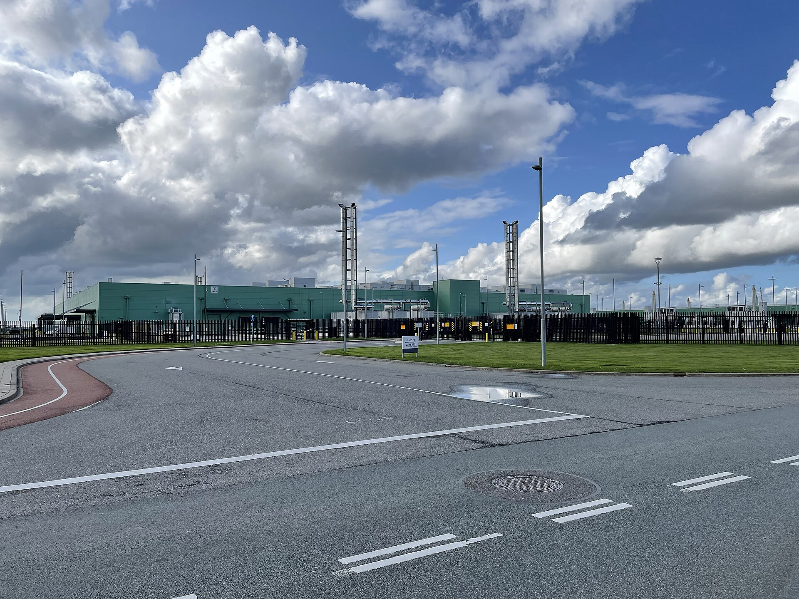
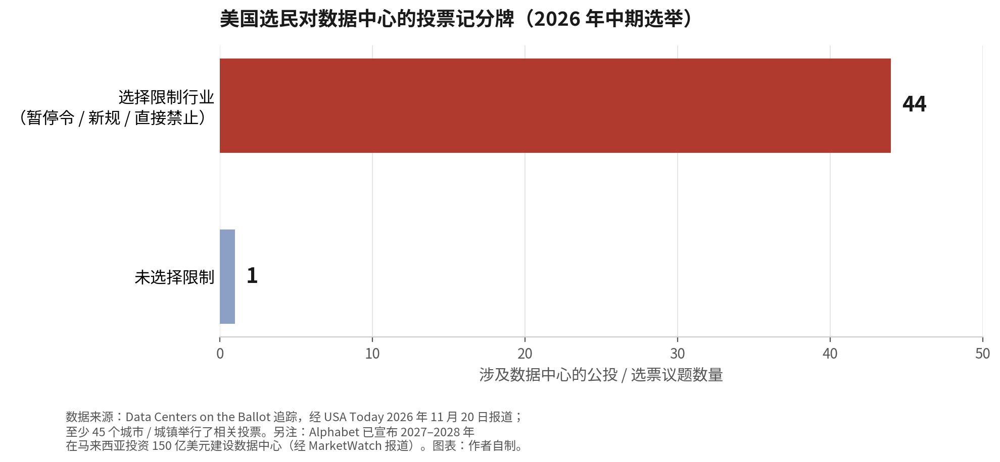

> [English version 英文版](/life/trump-overseas-datacenter-tax-threat/)

*位于荷兰米登梅尔的微软数据中心，摄于 2023 年。图片：Hay Kranen，经 Wikimedia Commons 发布，CC BY 4.0 许可。*

## 他到底说了什么

2026 年 11 月 20 日星期五，在结束亚洲与中国之行后举行的白宫记者会上，美国总统特朗普宣布了一项政策——用他自己的说法，他的幕僚在他开口之前都还没听说过这件事。他说："我们不会允许我们的公司在我们国家之外建设数据中心。"对于执意要在海外建设的公司，他补充说，将面临"巨额税收"（tremendous tax）和"巨额惩罚"（tremendous penalties）。他甚至具体点名了这些产能应该去的地方："如果他们不去得克萨斯，或者不去加利福尼亚，那他们就去西弗吉尼亚。"而对于这次发布的仓促程度，他也毫不掩饰："我甚至还没跟我自己的人说过这件事。"

理解这条新闻，必须抓住最后一句话。这不是一项成型政策的发布仪式，而是一次意图宣示：在镜头前、在记者会上、在任何内部流程产出执行工具之前，先把话说出去。路透社、《今日美国》、CNBC 和 SiliconANGLE 都在 11 月 20 日报道了这番讲话，而所有报道都指出了同一个事实：这次宣布的正中心，缺了一样东西。

## 还不存在的那一部分

截至 11 月 20 日至 21 日的报道，这项税并不存在。没有公布的税率，没有法案，没有被报道引用的法案草案文本，没有行政部门的规则，没有行政令文本，也没有生效日期。甚至连究竟会动用哪一条法律杠杆都不清楚——报道显示他提出的方向是税收，但记者会上的一句建议，不等于一个可以执行的机制。

这个区分不是咬文嚼字，它就是这条新闻本身。一句"巨额税收"，在实践中可以是完全不同的几种东西：它可以是对海外数据中心投资征收的专项税，可以是对从海外设施回流的服务征收的费用，可以是写进税法的一条抵扣取消条款，也可以是试图借用原本为货物贸易设计的贸易权限——而云计算产能并不是货物。每一条路径的法律风险不同、需要国会参与的程度不同，对一家正在决定本季度在哪里动工、两年后才投产的公司来说，影响更是天差地别。在文本出现之前，这一切都无法定价；而无法定价本身就是一种成本，因为数据中心选址是这些公司做出的周期最长、资本最密集的承诺之一。

所以，对 11 月 20 日最诚实的概括是：美国总统威胁要用一项尚不存在的工具、以无人知晓的税率、从无人宣布的日期起，惩罚本国科技行业全球布局中的核心部分。谁告诉你比这更多的细节，谁就是在猜测。

## 他的理由：明说就是中国

特朗普没有把这件事包装成抽象的产业政策。他把它说成一场竞争。他的论证是：如果美国公司在海外建设数据中心，"中国会把它们全拿走。"在他的叙事框架里，美国在人工智能上"领先中国"，而这种领先必须靠争夺数据中心来捍卫——让人工智能的物理层留在美国土地上、美国司法管辖之下，而不是散落在可能被对手夺取、复制或切断的国家里。

平心而论，这套修辞底下有一条成立的战略逻辑，值得公正地说出来。数据中心不是呼叫中心。它们是人工智能时代的工厂：模型在这里训练，推理在这里交付，稀缺的投入品——先进芯片、电力、冷却、土地——在这里被转化成产品。一个国家托管了算力，就掌握了杠杆。先进芯片出口管制正是建立在同一个前提上：能力跟着硬件走，所以要管住硬件。把这套逻辑从芯片延伸到装芯片的建筑，并不是跳跃，而是同一个论证在技术栈上往上走了一层。

但特朗普还补了一句针对国内的话，让图景变得微妙起来。他说，社区应该"让他们付钱"——从建成的数据中心身上榨取价值——但不应该把它们关掉。换句话说：在国内，你可以向这个行业收钱、可以狠狠地谈条件，但不要阻断建设。这句话与其说是对北京说的，不如说是对全美各地的市议会和县委员会说的。而这恰恰引出了这个故事真正的冲突核心。

## 另一个没人能忽视的选举结果

在特朗普记者会的十一天前——中期选举中——美国选民刚刚被问了一个实质相同的问题：你们想不想要数据中心建在自己家附近？答案是一场溃败。根据 Data Centers on the Ballot 的追踪、经《今日美国》报道，至少 45 个城市和城镇把数据中心议题付诸投票；在至少 44 场投票中，选民选择了限制这个行业：暂停新建、出台新规，或者干脆直接禁止。

把这两个事实并排读。联邦政府通过总统之口宣布：数据中心必须建在美国——去得克萨斯，去加利福尼亚，实在不行去西弗吉尼亚。而至少 45 个美国社区的选民刚刚就这个问题投了票，其中 44 个说：慢一点，小一点，管严一点，或者别建在我这儿。总统自己的说法——"让他们付钱，但别关掉"——试图在这两者之间找平衡。但暂停令和禁令不是谈判筹码；在通过它们的那些地方，它们就是法律。一场把全球人工智能建设强行集中到美国境内的联邦推动，正面撞上了一场地方性的反弹，而反弹的原因恰恰是选址最难的那几样东西：电价、电网容量、土地和水。

*投票记分牌。数据来源：Data Centers on the Ballot 追踪，经《今日美国》2026 年 11 月 20 日报道；Alphabet 150 亿美元马来西亚投资经 MarketWatch 报道。图表：作者自制。*

值得注意的是，华盛顿的另一只手，正在和选民推的方向相反。11 月 19 日——记者会的前一天——参议院批准了放宽数据中心审批的立法，作为更广泛的许可制度改革的一部分；该法案接下来将送交众议院。也就是说，在同一周之内：联邦政府推动让国内数据中心批得更快，总统威胁要惩罚在海外建数据中心的行为，而选民以压倒性比例投票要在地方上限制数据中心。这三件事同时为真，而这个行业被要求同时围绕这三件事做规划。

## 谁会被这场威胁波及

这场威胁瞄准的不是假想中的投资计划，而是真实的、具名的、已经宣布的项目。

Alphabet 已宣布 2027 至 2028 年在马来西亚投资 150 亿美元建设数据中心。这不是一张效果图，也不是一份谅解备忘录，而是 Google 母公司的一项头条级承诺，其时间窗口恰好落在华盛顿可能出台的任何税收措施生效的区间之内。AI 云厂商 CoreWeave 正在欧洲和加拿大扩张，并计划在澳大利亚、印度、印度尼西亚、日本、韩国、新加坡和阿联酋建设设施——这几乎就是一张"新主张认为美国算力不该去的地方"的地图。甲骨文也在向海外扩张：其未来两年规划的 7 吉瓦产能中，4 吉瓦与美国的超大规模园区绑定，其余部分分布在较小的站点和国际站点。而两大托管机房运营商 Equinix 和 Digital Realty，在海外运营设施是其商业模式的基本组成部分——对它们来说，"海外"不是扩张前沿，而是产品本身。

甲骨文的数字尤其值得多看一眼，因为它无意中画出了这条新红线会切在哪里。未来两年 7 吉瓦的规划里，4 吉瓦绑定美国的超大规模园区，剩下的约 3 吉瓦散落在较小的站点与国际站点。换句话说，即便是这家以美国政府与企业生意为根基的公司，也有超过四成的规划产能不在那 4 吉瓦的"安全区"里。如果未来的文本按产能征税或设限，切口不会落在某个边角料项目上，而会落在这些公司增长计划的主干上。同样，Alphabet 的 150 亿美元马来西亚投资横跨 2027 与 2028 两年，CoreWeave 的名单则横跨四大洲——这些都不是可以连夜改址的项目。数据中心从选址、拿地、并网到建成投产以年为单位计算，2027 年要投产的设施，其关键决策大多已经做出、合同已经签署、设备已经排产。一项 2026 年底才开始讨论的税，即便以最快速度落地，撞上的也是一支已经离港的船队。这正是为什么"是否给在建与已宣布项目留出过渡期"，会成为未来任何文本中第一个被争夺的条款。

Google、甲骨文和 CoreWeave 没有立即回应 MarketWatch 的置评请求。这种沉默是可以理解的。眼下根本没有什么具体的东西可以回应：没有可以游说反对的文本，没有可以建模的税率，没有可以申请的豁免。这些公司手里只有一份总统声明，声明说它们现有的国际路线图如今在政治上暴露于风险之中。对一个董事会来说，哪怕其他什么都不变，这也足以改变一次规划会议的温度——至少目前如此。

## 企业为什么要在海外建数据中心

很容易把海外数据中心理解成成本套利——更便宜的土地、更便宜的电、更宽松的规则——这其中有一部分是真的。但完整的解释有三个部分，只有一个与成本有关。

第一是物理与投入品。一座超大规模园区需要巨量且可靠的电力，还需要土地和水来冷却。在美国的许多地区，这些投入品如今正是瓶颈所在：电网拥堵，并网排队漫长，而且——正如 44 比 1 的投票结果所示——地方同意越来越难拿到。企业出海，一部分原因就是海外有电、也有许可。

第二是延迟。推理服务必须离用户足够近。一个在雅加达、法兰克福或圣保罗回答查询的模型，不可能从西弗吉尼亚提供服务而没有用户能感觉到的光速惩罚。海外产能中有相当一部分不是可有可无的选择，而是由地理和光速决定的。

第三是法律。越来越多国家的数字主权与数据本地化规则要求特定数据必须在本国境内存储和处理。一家拒绝在这些市场本地建设的美国云厂商，并不能用得克萨斯的机房替代服务；它会被排除在市场之外，而市场会落到本地厂商或非美国竞争者手里——用总统自己的对华框架来说，这恰恰是他声称要避免的结果。一项不加区分的海外建设惩罚，分不清一座设施究竟是为绕开美国电力约束而建，还是因为外国政府在法律上要求本地存在。在文本出现之前，没人知道它会不会试图做这种区分。

## 不要和芯片规则混为一谈

有一点澄清很重要，因为这两条新闻注定会在标题里被混在一起。美国商务部近期已限制向若干东南亚国家出口先进人工智能芯片，并出台了针对海外人工智能设施的新规则，目的是堵住中国通过第三国获取美国技术的通道。那些是真实的、正在生效的、已公布的规则，附带实实在在的合规义务。它们也是一项目标不同的政策：管的是美国"技术"可以流向哪里，防止它落入对手手中。

而 11 月 20 日的税收威胁是另一回事：一项尚未落地的提议，瞄准的是美国"企业的选址决策"，目的是把投资拉回国内。芯片规则今天就写在纸面上；这项税到目前为止只存在于一段引语之中。把威胁当作既成法规来报道，是夸大了它；因为它还不是法规就断言它毫无意义，则是低估了它——这正是最后一节要说的判断。

## 为什么点名西弗吉尼亚

特朗普那句"不去得克萨斯、不去加利福尼亚，就去西弗吉尼亚"，值得单独拆开看，因为它泄露了这项威胁的真实地理观。得克萨斯和加利福尼亚被点名并不奇怪：前者是美国能源与大型工业用地的心脏地带，后者是科技公司总部与工程师的聚集地，是"本该建在本土"的默认选项。但西弗吉尼亚完全不同——它不是现有的云计算重镇，而是一个以煤炭和能源工业闻名的州，土地便宜、人口流失、急需大型工业投资。把西弗吉尼亚放进这句话里，等于宣告这项政策的目标不只是"把算力留在美国"，而是"把算力导向政治上需要它的地方去"。

这里面有一层没有说出口的交换。数据中心能给一个地方带去的东西其实很有限：建设期的工作岗位很多，但建成之后长期雇佣的人数，相对它的占地和耗电而言少得不成比例——这正是许多社区算过账之后反悔的原因之一。而它消耗的东西却非常实在：电力、土地和水。西弗吉尼亚这类能源州恰恰是美国少数"投入品富余、而投资饥渴"的地方，电价承受力、土地供给和地方政府的欢迎程度，都与那些刚刚投出暂停令的社区形成镜像。总统的算盘并不难读：把建设引向欢迎它的州，既能兑现"算力回家"，又能绕开反弹最激烈的地方政治。

但这个算盘有一个物理上的漏洞：数据中心不是可以任意摆放的棋子。前面说过，推理要靠近用户，主权法规要求本地存在，电网也不是每个州都接得住吉瓦级的负荷。西弗吉尼亚可以承接的那部分产能，是训练型、批处理型、对延迟不敏感的那部分；而面向东南亚用户的推理、受欧洲与亚洲多国本地化法规约束的产能，无论华盛顿开出什么条件，都不可能搬到阿巴拉契亚山里。一项不理解这种分工的政策，最后惩罚的不会是"不爱国"的选址，而会是物理与法律本身。

## 地方反弹与企业出海，其实是同一个故事

把 44 比 1 的投票结果和企业的海外扩张名单放在一起看，会发现它们不是两个故事，而是同一个故事的两面。企业为什么去马来西亚、去新加坡、去欧洲？因为那里有电、有地、有水，而且有人欢迎。而美国社区为什么投票限制？因为在他们居住的地方，电、地、水正在被同一种设施以惊人的速度消耗，电费与资源压力是居民每月都能摸到的东西。一边是"请来这里建"，另一边是"别在我家旁边建"，中间隔着的不是意识形态，而是投入品的供需表。

这也是为什么"让他们付钱，但别关掉"这句话注定执行起来非常别扭。对社区来说，"付钱"如果指的是更高的税费、更贵的电价分摊、更严格的水耗标准，那么一部分反对确实可以被价格机制化解；但投票投出的暂停令和禁令说明，在至少 44 个地方，居民的答案已经不是价格问题，而是存在问题——不是"给多少钱才同意"，而是"这件事本身不要发生"。联邦政府可以用许可改革去缩短审批，可以用税收威胁去改变企业的国别选择，但它很难用一纸文件改变一个社区对自家电网和水源的感受。这场冲突的最终形态，很可能不是某一方获胜，而是建设被迫流向一个更窄的集合：能源富余、人口稀疏、地方欢迎、且电网接得住的州——而那正是西弗吉尼亚被点名的原因，也是这个集合在美国本土其实并不大的原因。

## 把这一周连起来看

单看任何一条，这一周的新闻都像是孤立的噪音；连起来看，它们构成了一幅完整的张力图。11 月 19 日，参议院通过放宽数据中心审批的立法，联邦立法机关在给建设松绑；11 月 20 日，总统在记者会上威胁惩罚海外建设，联邦行政首脑在给企业的国别选择上锁；而在此之前十一天，45 个地方的选民刚刚用选票给建设踩了刹车。三股力量分别来自国会、总统和地方选民，方向两两不一致，却同时作用于同一批项目经理的电子表格上。

还要注意一个容易被忽略的背景：就在近期，美国商务部已经收紧了对若干东南亚国家的先进人工智能芯片出口，并针对海外人工智能设施出台新规，目的是防止中国经由第三国绕道获取美国技术。也就是说，华盛顿的工具箱里其实已经有了一套针对"海外人工智能设施"的、真实生效的规则——只是那套规则管的是技术流向，防的是对手；而 11 月 20 日的新威胁管的是企业选址，拉的是投资。两套逻辑共享同一个焦虑，却指向不同的杠杆。当出口管制已经就位之后还要再加一道选址税，说明在华盛顿的评估里，仅靠"不让技术出去"已经不够，他们想要的是连产能的地理归属本身。理解了这一层，才能理解为什么这次威胁即便没有文本，也不能按普通的竞选语言打折处理：它是一个已经有前半段落地的政策序列的后半段宣言。

## 三种剧本

在文本出现之前，负责任的讨论方式是把可能性拆成剧本，而不是假装知道结局。

第一种剧本：威胁止步于威胁。没有任何法案、规则或行政文件跟进，企业在最初的紧张之后按原计划推进，Alphabet 的马来西亚投资照常落地。这种剧本下，11 月 20 日最终会被记为一次谈判姿态——说给选民听，也说给正在观望的企业听。它的成本不是零：规划会议里的政治风险溢价已经加上去了，只是不至于改变结果。

第二种剧本：出现一个窄版的文本。比如只针对"可自由选址"的海外产能征税或设限，同时豁免主权法规强制要求本地存在的设施，并给在建项目留出过渡期。这种版本对企业的杀伤力最小，甚至可能被行业公开接受——因为它惩罚的恰好是企业内部本来就争议最大的那类项目，而把真正刚性的部分留了出来。如果白宫想要一个能落地的成果，这是最可能的形状。

第三种剧本：出现一个不加区分的宽版。无论海外设施的原因是延迟、主权法规还是电力约束，一律按同一把尺子惩罚。这种版本将迫使企业在"放弃整个海外市场"和"承受惩罚"之间二选一，而结果很可能是美国厂商把部分市场让给本地与非美竞争者——用总统自己的对华框架衡量，这是最坏的结果：在一场以"不能让中国拿走"为名的政策里，亲手把市场份额送出去。正因为如此，宽版即便被提出，也最可能在游说与诉讼中被磨窄。判断一部未来文本的好坏，只需要看一条标准：它是否区分了"可以搬回家的产能"和"搬不回家的产能"。

## 对普通用户意味着什么

这件事离普通读者并不远。云服务的价格与区域布局，最终会传导到每一个使用美国云厂商产品的企业与个人：如果海外产能的成本被人为抬高，一部分成本会以区域定价的形式被转嫁；如果某些市场的本地设施被迫推迟，那些市场的用户会先感受到延迟与可用区的紧张。反过来，如果威胁真的把一部分产能拉回美国本土，美国用户得到的将是更多的本地容量与更短的路径——前提是这些项目能通过地方审批这一关，而 44 比 1 的投票结果提醒我们，这一关并不好过。对投资者而言，短期内更值得跟踪的不是税率——它还不存在——而是企业资本开支表述的变化：哪家公司在下一次财报电话会上第一次把"美国优先"写进资本计划，哪家公司的海外项目公告开始变得含糊，那些才是威胁开始变成现实的早期信号。

## 判断

以下是本站愿意签字的评估。第一，作为法律，这件事目前什么都不是——没有税率，没有法案，没有规则，没有日期，而且按总统本人的说法，连他自己的幕僚都是第一次听说。任何一家公司如果本周就因此取消马来西亚或新加坡的项目，它回应的是一个句子，而不是一部法规。

第二，作为规划变量，它已经真实存在。数据中心项目以数年为周期融资，依赖的是对政治风险的假设，而 11 月 20 日重新定价了每一家美国超大规模厂商路线图上每一个海外项目的政治风险。可以预见，在任何税收法案出现之前很久——如果它最终会出现的话——我们就会先看到悄悄的延期、重新分期的公告，以及资本计划里"美国优先"的表述框架。威胁之所以能移动董事会，正是因为猜错的成本是不对称的：一座推迟的海外园区可以挽回，一座被追溯性惩罚命中的园区不能。

第三，这项政策如果有一天真的拿到文本，将正面撞上中期选举刚刚暴露的矛盾。你不可能一边命令全球人工智能基础设施回家，一边面对 44 比 45 个投票社区要求把它挡在门外——除非华盛顿以此前从未尝试过的规模去压倒地方同意，或者真正解决掉当初把企业推出国门的那几个约束：电力、土地和水。参议院 11 月 19 日的许可法案，算是朝第二条路点了一下头；而投票结果，量出了这条路还有多长。

接下来按顺序看四件事：是否会出现带有实际文本的法案或行政文件；它是否会区分"主权法规强制的本地建设"与"可自由选址的建设"；Alphabet 那 150 亿美元的马来西亚计划，会被重新宣布、重新分期，还是被公开辩护；以及众议院是否会接手许可法案。在第一件事发生之前，这项"巨额税收"最准确的理解，就是它可被验证的那个身份：一次音量最大的意图宣示——出自一位其意图宣示总有变成文件的习惯的人之口，只是最终变成文件的时间，从来不在任何人公布的日程表上。
