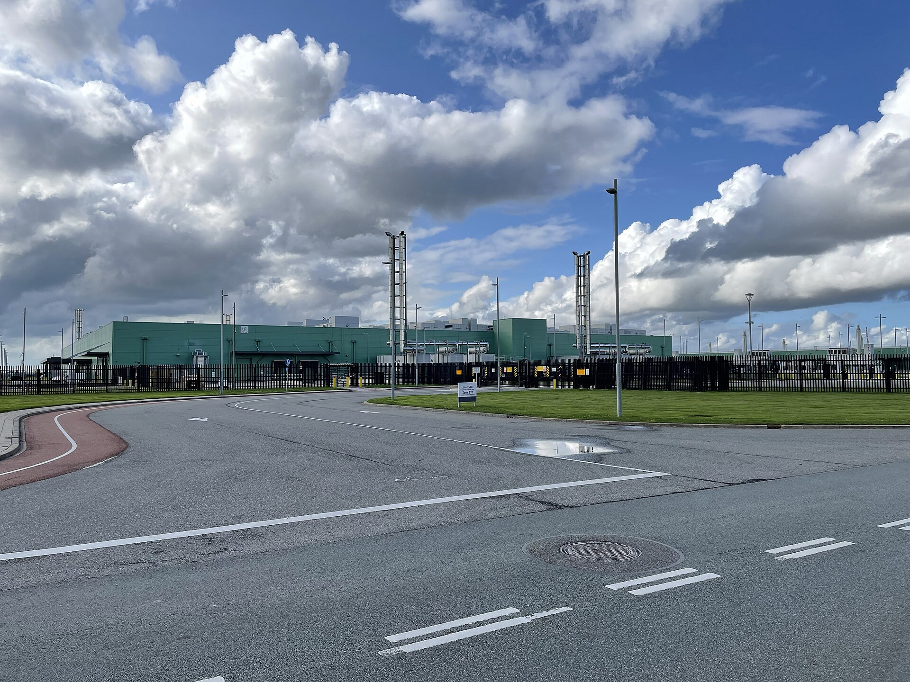
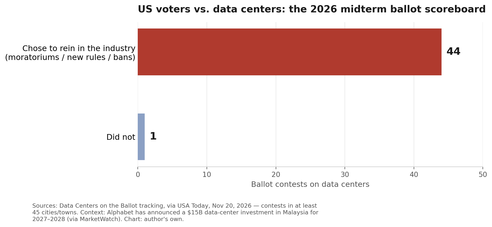

> [中文版 Chinese version](/life/trump-overseas-datacenter-tax-threat-zh/)

*A Microsoft data center in Middenmeer, the Netherlands, photographed in 2023. Photo: Hay Kranen, via Wikimedia Commons, CC BY 4.0.*

## What was actually said

On Friday, November 20, 2026, at a White House news conference held after his trip to Asia and China, President Donald Trump announced a policy that, by his own account, his staff had not heard before he said it out loud. "We're not going to allow our companies to build data centers outside of our country," he said. Companies that build overseas anyway, he added, would face a "tremendous tax" and "tremendous penalties." He was specific about where the capacity should go instead: "If they won't go in Texas or if they won't go in California, they're going to go in West Virginia." And he was candid about the rollout: "I haven't even said that to my people."

Everything else about this story has to be read through that last sentence. This was not the unveiling of a finished policy. It was a declaration of intent, delivered at a podium, in front of cameras, before — apparently — any internal process had produced the instrument that would carry it out. Reuters, USA Today, CNBC and SiliconANGLE all covered the remarks on November 20, and all of them noted the same absence at the center of the announcement.

## The part that does not exist yet

As of the November 20–21 coverage, there is no tax. There is no published rate. There is no statute, no draft bill text cited in the reporting, no agency rule, no executive order text, and no effective date. It is not even clear, from anything the administration has put on paper, what legal lever would be used — reporting on the remarks describes a tax as the suggested instrument, but a suggestion at a news conference is not a mechanism.

That distinction is not pedantry; it is the story. A "tremendous tax" could mean many very different things in practice. It could be structured as a levy on foreign data-center investment. It could be an excise on services re-imported from overseas facilities. It could be folded into the tax code as a disallowance, or attempted through trade authorities that were designed for goods, not for cloud capacity. Each of those routes has different legal exposure, different congressional requirements, and wildly different effects on a company deciding this quarter where to break ground on a facility that will not open for two years. Until a text exists, none of that can be priced — and the inability to price it is itself a cost, because data-center siting decisions are among the longest-lead, most capital-intensive commitments these companies make.

So the honest summary of November 20 is: the President of the United States threatened to penalize a core part of his own country's technology industry's global footprint, using an instrument that does not yet exist, at a rate nobody has named, starting on a date nobody has set. Anyone who tells you more than that is guessing.

## The rationale: China, stated plainly

Trump did not present this as an industrial-policy abstraction. He presented it as a contest. If American companies build data centers overseas, he argued, "China will take all of them." The United States, in his framing, is "leading China" in artificial intelligence, and that lead has to be defended by fighting for data centers — keeping the physical layer of AI on American soil, under American jurisdiction, rather than scattered across countries where a rival might capture, copy or cut off the capacity.

There is a coherent strategic logic underneath the rhetoric, and it is worth stating fairly. Data centers are not like call centers. They are the factories of the AI era: the place where models are trained, where inference is served, where the scarce inputs — advanced chips, power, cooling, land — are converted into the product. A country that hosts the compute hosts the leverage. Export controls on advanced chips already rest on exactly this premise: capability follows hardware, so hardware is what you control. Extending that logic from chips to the buildings that house them is not a leap; it is the same argument one level up the stack.

Trump also added a domestic instruction that complicates the picture in an interesting way. Communities, he said, should "make them pay" — extract value from the data centers that do get built — but not shut them off. In other words: tax the industry at home if you like, bargain hard, but do not block the buildout. That sentence is aimed less at Beijing than at city councils and county commissions across the United States. Which brings us to the collision at the heart of this story.

## The other result nobody in Washington can ignore

Eleven days before Trump's news conference — in the midterm elections — American voters were asked, in effect, whether they wanted data centers near them. The answer was a rout. According to Data Centers on the Ballot tracking, reported by USA Today, data centers were on the ballot in at least 45 cities and towns. In at least 44 of those contests, voters chose to rein in the industry: moratoriums on new construction, new regulations, or outright bans.

Read those two facts side by side. The federal government, speaking through the President, has declared that data centers must be built in the United States — in Texas, in California, or failing those, in West Virginia. The voters of at least 45 American communities have just held votes on the question, and 44 of them said: slower, smaller, more regulated, or not here at all. The President's own formulation — make them pay, but don't shut them off — is an attempt to split that difference. But moratoriums and bans are not bargaining positions; in the places that passed them, they are law. A federal push to concentrate the world's AI buildout inside US borders runs directly into a local revolt against exactly that buildout, driven by exactly the inputs that make siting hard: electricity prices, grid capacity, land, and water.

*The ballot scoreboard. Sources: Data Centers on the Ballot tracking, via USA Today, Nov 20, 2026; Alphabet's $15B Malaysia announcement via MarketWatch. Chart: author's own.*

Washington's other hand, notably, is pushing in the opposite direction from the voters. On November 19 — one day before the news conference — the Senate approved legislation to ease data-center permitting approval, as part of a broader permitting overhaul. That bill now heads to the House. So within a single week, the federal government moved to make it faster to approve data centers at home, while the President threatened to punish building them abroad, while the electorate voted overwhelmingly to restrict them locally. All three of those things are true at once, and the industry is expected to plan around all three.

## Who is exposed

The threat is aimed at real, named, already-announced investment programs — not hypothetical ones.

Alphabet has announced a $15 billion data-center investment in Malaysia spanning 2027–2028. That is not a rendering or a memorandum; it is a headline commitment by the parent company of Google, scheduled to land squarely in the window when any tax devised in Washington might take effect. CoreWeave, the AI cloud specialist, is expanding across Europe and Canada and planning facilities in Australia, India, Indonesia, Japan, South Korea, Singapore and the United Arab Emirates — essentially a map of everywhere the new doctrine says American compute should not go. Oracle is expanding abroad too: of the 7 gigawatts it has planned over the next two years, 4 GW are tied to US hyperscaler campuses, with the rest in smaller and international sites. And the two big colocation landlords, Equinix and Digital Realty, operate facilities overseas as a basic feature of their business model — for them, "overseas" is not an expansion frontier, it is the product.

Google, Oracle and CoreWeave did not immediately respond to MarketWatch's requests for comment. That silence is understandable. There is nothing concrete to respond to: no text to lobby against, no rate to model, no exemption to apply for. What the companies have, instead, is a presidential statement that their existing international roadmaps are now politically exposed. For a board, that is enough to change the temperature of a planning meeting even if it changes nothing else — yet.

## Why companies build abroad in the first place

It is tempting to treat overseas data centers as cost arbitrage — cheaper land, cheaper power, looser rules — and some of that is real. But the fuller explanation has three parts, and only one of them is about cost.

The first is physics and inputs. A hyperscale campus needs enormous, reliable power, plus land and water for cooling. In many US regions those inputs are now the binding constraint: grids are congested, interconnection queues are long, and — as the 44-of-45 ballot results show — local consent is increasingly withheld. Companies go abroad partly because abroad is where the power and the permission are.

The second is latency. Inference has to be served near the user. A model answering queries in Jakarta, Frankfurt or São Paulo cannot do it from West Virginia without a speed-of-light penalty that users can feel. Some share of overseas capacity is not discretionary; it is dictated by geography and the speed of light.

The third is law. Data-sovereignty and localization rules in a growing list of countries require certain data to be stored and processed in-country. A US cloud provider that refuses to build locally in those markets does not get to serve them from Texas instead; it gets excluded, and the market goes to a local or non-US competitor — which, under the President's own China framing, is the outcome he says he wants to avoid. A blanket penalty on overseas builds does not distinguish between a facility built to dodge US power constraints and one built because a foreign government legally requires local presence. Until a text exists, nobody knows whether it would try to.

## Do not confuse this with the chip rules

One clarification matters, because the two stories will be conflated in headlines. The Commerce Department has recently restricted exports of advanced AI chips to several Southeast Asian countries and introduced new rules on overseas AI facilities, aimed at curbing Chinese access to US technology through third countries. Those are real, live, published rules with compliance obligations attached. They are also a different policy with a different target: they police where American *technology* can flow, to keep it out of a rival's hands.

The November 20 tax threat is something else: an unimplemented proposal aimed at American *companies' siting decisions*, to pull investment home. The chip rules exist on paper today; the tax exists, so far, only as a quotation. Treating the threat as if it were already regulation would overstate it. Treating it as meaningless because it is not yet regulation would understate it — which is the final point.

## The judgment

Here is the assessment this site is willing to sign. First: as law, this is nothing yet — no rate, no statute, no rule, no date, and an announcement the President himself says his own people had not heard. Any company that cancels a Malaysia or Singapore project this week in response would be reacting to a sentence, not a statute.

Second: as a planning input, it is already real. Data-center projects are financed years ahead on assumptions about political risk, and November 20 repriced the political risk of every overseas project on every US hyperscaler's roadmap. Expect quiet delays, re-phased announcements, and "US-first" framing in capital plans long before any tax bill exists — if one ever does. Threats move boardrooms precisely because the cost of guessing wrong is asymmetric: a delayed overseas campus is recoverable; a campus caught by a retroactive penalty is not.

Third: the policy, if it ever gets a text, will run into the contradiction the midterms just exposed. You cannot order the world's AI infrastructure home while 44 of 45 communities that voted on it are voting to keep it out — not without either overriding local consent at a scale Washington has not attempted, or finally solving the power, land and water constraints that pushed companies abroad in the first place. The Senate's November 19 permitting bill is a nod at the second path. The ballot results are a measure of how far it has to go.

Watch, in order: whether a bill or executive instrument with actual text appears; whether it distinguishes sovereignty-mandated local builds from discretionary ones; whether Alphabet's $15 billion Malaysia program is re-announced, re-phased or defended in public; and whether the House takes up the permitting bill. Until the first of those happens, the "tremendous tax" is best understood for what it verifiably is: the loudest possible statement of intent, from the one person whose statements of intent have a habit of becoming paperwork — eventually, and on nobody's published schedule.
