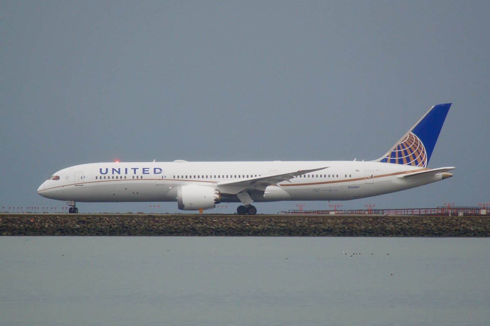
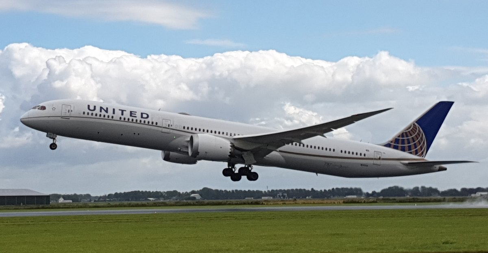

> [English version](/life/united-bans-ai-agents/)

*一架美联航波音 787-9 梦想客机（N26967）。照片来自 Wikimedia Commons（CC BY-SA 2.0）。*

## 美联航到底改了什么

美联航在 11 月 11 日周三表示，**禁止未经授权的第三方 AI 助手替旅客预订航班**——并且更新了运输合同（就是登机前没人会读的那份法律文件）来把这条规矩钉死。新规禁止使用 AI 助手"创建、修改或处理机票"或购买任何产品与服务，并赋予美联航**取消此类预订**的权利。

范围划得刻意地宽。禁令既适用于美联航自己的网站与 App，也适用于销售美联航座位的旅行社与聚合平台；覆盖订票、改票、管理行程，以及动用 MileagePlus 常旅客账户。而且**即使是旅客本人要求的也不行**——经过旅客监督、批准、授权的助手订票同样被禁。美联航表示，目前它不与任何第三方 AI 助手合作，只会"继续评估这些工具如何与其服务互动"。

美联航是**第一家公开限制自动化订票工具的大型美国航司**，当前报道中点名的工具是 Meta 的 Muse 与 OpenAI 的 Dots。11 月 11 日之前已由助手完成的预订仍会兑现，不过美联航建议旅客核查这些预订"是否已正确出票"。

## 五十年了，争的一直是谁卖票

美联航的禁令是新的，它底下的仗比互联网还老。半个世纪以来，航司一直在争夺自己与乘客之间的渠道，因为每一个中间商都要抽成、都要分走一部分客户关系。

第一代中间商是全球分销系统（GDS）。SABRE 由 IBM 在 20 世纪 60 年代为美航打造，它的后代 Amadeus、Sabre 与 Travelport 成了旅行社卖机票的水管，按航段向航司收费——短途每张票约 6 至 12 美元，长途更高。1978 年放开管制之后，航司发现同一根水管也束缚了自己：GDS 能传航班号、日期和舱位等级，却传不了如今驱动航司收入的打包优惠、选座与品牌票价家族。国际航协（IATA）的答案是新分销能力（NDC），2012 年出台的标准，让航司可以直接向销售方发送内容丰富、动态定价的报价——而此后十四年，航司一直在用各种办法把交易量推向 NDC 与自家官网、推离 GDS，对传统渠道的预订加收附加费就是棍子。汉莎就是例子：通过 GDS 按旧标准卖一张票收 18 至 23 欧元，走 NDC 渠道只收 8 欧元。

AI 助手是这条线上最新的中间商，而在美联航看来，它是迄今为止最糟糕的一种。GDS 至少还按美联航的条件卖美联航的产品；比价网站至少还把客户送回美联航完成购买。AI 助手是自己完成购买的——拿着客户的凭证与常旅客账户，而美联航全程见不到客户。禁令就是航司试图阻止最新一个中间商变成最强大的那一个——那个拥有付款瞬间的中介。

这段历史也解释了为什么美联航的措辞如此绝对。它不是在回应一个新产品，而是在延续一场打了五十年的仗：从旅行社柜台到 GDS，从 GDS 到官网直销，从官网到 NDC，每一次技术变迁都伴随着一次渠道控制权的重新谈判。AI 助手只是最新的一轮，而美联航这次选择了先发制人——在助手成为默认订票方式之前就把它挡在门外。

## 美联航给出的理由——以及它先说的那条

官方理由是安全与联邦法规。与个人 AI 助手共享账户凭证"可能泄露敏感信息，由这些工具采取的行动可能导致意外购买、账户变更或 MileagePlus 里程被使用"。还有一个相当具体的监管点：联邦法规要求旅客在值机时亲自确认行李中没有违禁品，而由 AI 完成值机，就会产生"到底是谁做出了这份确认"的问题。

这两点都是真实的。但美联航自己公告的第一段根本不是在谈风险——谈的是对订票渠道的控制。航空分析师、Atmosphere Research Group 的 Henry Harteveldt 对 CBS News 直言不讳：美联航不想再多一个"比谷歌搜索、比价聚合网站和在线旅行社更强大"的中介。他还补了更直接的一句："航班搜索是要花航空公司钱的，美联航无疑想避免 AI 机器人航班搜索激增带来的开支。"

*一架美联航波音 787-10 在阿姆斯特丹史基浦机场。照片来自 Wikimedia Commons（CC BY-SA 4.0）。*

## 哪些还行得通

禁令在一个方面比听起来要窄：**搜索仍然允许**。AI 工具可以向你展示美联航的航班时刻与票价，只是不能替你完成购买。旅客仍可通过 Kayak、Hopper、Google Flights 等聚合平台订票。美联航封堵的是最后一步——那个拿着你的卡、你的 MileagePlus 账号和你的一句"订吧"去出票的助手。

这个区分就是整个故事。搜索层是谷歌已经赢下的地盘；购买层是美联航仍然拥有客户、数据与利润的地盘。替你订票的 AI 助手是一个新的中介，正好坐在购买层上——而且与 Google Flights 不同，它来的时候还带着你的登录凭证和常旅客账户。

对旅客来说，这意味着体验上的微妙倒退：你仍然可以让助手帮你比价、挑航班、甚至填好一切信息，但最后那一下点击必须由你自己来完成。对大多数人来说这只是多一次点击；对真正想实现"全程托管"的用户来说，这等于宣布 AI 订票这件事在美联航这里还不存在。禁令的实际效果，取决于有多少人真的在乎那最后一次点击——而感恩节会给出答案。

## 旅客的权利边界：运输合同到底能管多宽

美联航这次动用的武器是运输合同——一份旅客在购票时就"同意"了、但几乎没人读过的格式合同。从法律上说，运输合同是一种附合合同：条款由航司单方拟定，旅客没有谈判余地，只能接受或不买票。美联航可以在里面写"禁止 AI 助手订票"，也可以写"有权取消此类预订"，而旅客的救济渠道非常有限：要么接受，要么向交通部（DOT）投诉，要么打官司——而打官司的成本对一张机票来说根本不划算。

但旅客并非全无护身符，而护身符恰恰来自联邦法规。美国交通部 2024 年的自动退款规则（14 CFR Part 260，2024 年 10 月 28 日起执行）规定：航班被取消或发生"重大变更"——国内航班出发提前或到达延误 3 小时以上、国际航班 6 小时以上，或更换机场、增加经停、降舱——而旅客不接受替代方案时，航司必须自动全额退款到原支付方式，信用卡 7 个工作日内、其他支付方式 20 个自然日内，旅客无需主动申请。这意味着，即便美联航取消了一张由助手订出的机票，旅客的钱仍然受到保护：取消预订不等于没收票款，退款规则站在旅客这边。

这里的张力值得说透。美联航的禁令针对的是"谁来操作预订"这个程序问题，而 DOT 的退款规则保护的是"旅客的钱"这个实体问题。两者并不冲突，但它们划出了一条线：航司可以决定由谁来替你点"购买"，却不能因此剥夺你作为消费者的退款权利。对旅客最现实的建议是：如果你的预订被取消，先确认退款是否已自动发起——按规则它应当自动到账，不需要你填表申诉；如果没到账，再向 DOT 投诉。禁令改变的是订票的方式，不是退款的权利。

## AI 订票的另一面：旅客为什么想要它

讨论到这里，值得回过头问一句：旅客到底为什么想要一个会订票的 AI 助手？答案不是懒，而是航空出行本身已经复杂到超出了人工处理的合理范围。

首先是改签。航班延误或取消时，几百名旅客同时涌向柜台、电话客服与 App，而 AI 助手可以在几秒钟内扫描所有替代方案——包括其他航司的航班、临近机场的起飞、以及里程与现金的组合——并在座位消失之前完成改签。人工操作做不到这个速度，而在 disruption 的窗口期，速度就是座位本身。其次是价格监控。机票价格每天波动，助手可以持续盯着某条航线的票价，在降价的瞬间提醒或直接出手；人类不可能 24 小时盯着一张票。再次是里程优化。MileagePlus 的兑换规则复杂到连常旅客都算不清最优解，助手可以同时比较现金价、里程价、混合支付与升舱选项，找出真正划算的那一个。最后还有无障碍需求：对视障或行动不便的旅客来说，一个能用语音全程代办订票的助手不是便利，而是独立出行的前提。

这些需求不会因为一纸禁令而消失。美联航的禁令只是把它们推回到了旅客自己手里——或者推向了那些愿意与航司谈判、拿到"授权"的助手。真正的问题不是旅客要不要 AI 订票，而是 AI 订票的形态：是由旅客自己控制的通用助手，还是由航司授权、按航司条件运行的专用渠道？前者把选择权交给用户，后者把选择权交给航司。美联航 11 月 11 日的公告，选的是后者。

## "未经授权"在实践中意味着什么

真正起作用的词是"未经授权"，而它引出一个公告没有回答的实际问题：美联航怎么知道一笔预订是助手下的？从航司的角度看，助手订票就像一个打字特别快的客户。识别只能靠航司 already 用来对付机器人与爬虫的那些信号——自动化操作模式、无头浏览器指纹、数据中心 IP 段、不熟悉设备的登录——再加上运输合同这根大棒：如果美联航认定某笔预订由助手完成，它可以取消它，风险由旅客承担。哪怕识别并不完美，这种威慑本身就够用了：没有人想成为感恩节机票被取消的那个故事主角。

还有一个值得玩味的讽刺。宣布禁令的同一天，美联航宣布 SpaceX 的星链 Wi-Fi 已覆盖过半每日航班——截至 11 月 12 日已有 694 架飞机装机，2026 年底前接近 64%，2027 年底前覆盖全机队。美联航乐意把一家马斯克公司的硬件装上飞机、卖它的联网服务；它不愿意的，是让一家马斯克公司的软件——或任何别家的助手——替它完成一笔订票。这条线与 AI 本身无关，只与谁控制交易有关。

更进一步说，"未经授权"这个词本身就预留了收费的口子。美联航没有说"永远不许"，它说的是"未经我许可不许"。这与它对待 GDS 与 NDC 的历史如出一辙：先划线、再谈判、最后对愿意付费或接受条款的渠道放行。如果未来某个助手愿意按美联航的条件接入、付费使用官方接口，它很可能拿到"授权"。禁令的真正目的不是消灭 AI 订票，而是确保 AI 订票以美联航开价的方式发生。

## 时间点：感恩节

日历很重要。美联航在一年最繁忙的出行时段开始前八天宣布禁令，而数字说明了它为什么宁愿现在打这一仗也不愿等到一月。美联航预计 11 月 19 日至 12 月 1 日之间运送超过 660 万旅客——每天超过 50 万人次、4,800 多个每日航班——其中 11 月 20 日周五是节前最繁忙的一天，超过 54 万人次；11 月 29 日周日达到峰值，约 60 万人次。行业组织 Airlines for America 预计全美航司在感恩节期间运送近 2,900 万旅客，而 Hopper 的数据显示，国内往返机票均价已达 402 美元，同比上涨 31%——是十年来最贵的感恩节出行季之一。

这就是禁令第一次实测的背景。数百万旅客会让助手帮忙找航班、根据天气改签、赶在过期前烧掉里程——而在美联航这里，助手第一次必须在最后一步停下来。如果旅客注意到了并抱怨，美联航会在客流量最大的几周里听到这些抱怨；如果没人注意，航司就学会了购买层原来可以悄悄守住，而这条禁令就会成为模板。

对旅客的实际建议也很具体：如果你在感恩节前让助手帮你订过美联航的票，先去核对预订是否已正确出票；如果行程有变，改签这一步也别指望助手代劳；里程兑换尤其要自己动手，因为 MileagePlus 账户正是新规明确点名的范围。禁令不影响你查价与比价，但它确实把"订票"这件事重新推回到了旅客自己手里。

## 达美与美航：三种可能的剧本

现在的问题是达美和美航会不会跟进，而答案有三种剧本，每一种对旅客的意义都不同。

第一种是全面跟进。达美与美航各自更新运输合同，写进相同的禁令，AI 订票在美国三大航司全线受阻。这是最可能的结果——航司在这个议题上的利益高度一致，没有哪家愿意成为那个让助手随便订票的"漏洞"。一旦三家齐步，AI 订票就不再是一项开放能力，而变成一条谈判得来的分销渠道：助手开发商必须逐家与航司签约、接受条款、甚至付费接入，而航司则掌握了定价权与准入权。旅客的体验会分裂成两档：获批渠道的助手可以一键订票，未获批的只能查价。

第二种是分化。某一家航司选择不跟进，反而把"支持 AI 助手订票"当作差异化卖点——就像当年有的航司率先支持 Apple Pay、有的率先取消改签费一样。在这种剧本里，禁令反而成了美联航的竞争劣势：商务旅客与高频用户会发现，在达美那里助手能全程代办，在美联航这里却要自己动手。这个剧本的可能性低于第一种，因为航司之间很少在分销渠道上公开唱反调——但它并非不可能，尤其是在某家航司认为 AI 订票能帮它抢走对手的高价值客户时。

第三种是监管介入。交通部或国会认为，禁止旅客授权的助手订票损害了消费者选择权，进而出台规则限制航司的做法。这个剧本最慢、也最不确定，但它有一个先例可循：DOT 在 2024 年的退款规则里已经展示过，它愿意在航司与旅客的利益冲突中站在旅客一边。如果 AI 订票的支持者能把这件事框定为"消费者选择权"而非"技术问题"，监管介入的概率会上升。

无论哪种剧本，有一点已经确定：2026 年 11 月 11 日将成为 AI 订票史上的一个分水岭。在此之前，助手订票是一项默认可用的能力；在那之后，它是一项需要谈判的权利。而谈判桌的一边坐着三家控制着美国国内市场绝大多数运力的航司，另一边是几家助手开发商与数以百万计的旅客。牌面并不对等。

## 判断

这件事双方都有实打实的论据，这正是它值得吵的原因。美联航说得没错：把登录信息和里程交给第三方助手确实是真实的安全敞口，而值机确认规则也是真实的监管难题，不是借口。同时，这家航司也明明白白地在保护一条收入渠道：助手完成的每一张预订，都是美联航没有掌控的预订；而机器人发出的每一次搜索，都是美联航要付费服务的查询。

真正起作用的词是**"未经授权"**。美联航并没有永远禁止 AI 订票；它禁止的是未经它许可的 AI 订票。这就给行业惯常的结局留了门：同意美联航条款、付费接入或走获批渠道的助手可以进来，而开放的助手网络进不来。现在的问题是达美和美航会不会跟进——如果跟进，AI 订票就不再是一项开放能力，而变成一条谈判得来的分销渠道，笔握在航司手里。盯紧假日季：美联航在一年中最繁忙的旅行周前几周宣布了这项政策，第一次考验将是旅客是否会发现，自己的助手已经没法替自己把票订完了。

如果达美与美航跟进，格局会迅速定型：三大航司各自与少数几家助手达成商业协议，AI 订票变成按航司、按渠道逐一谈判的授权生意，开放网络的助手只能做搜索与比价，订票权回到航司官网与获批渠道手里。如果它们不跟进，美联航的禁令反而可能变成竞争劣势——旅客会发现，在达美那里助手能一键订票，在美联航这里却不行。两种结局的分水岭，就在未来几周的公告栏里。对旅客而言，最务实的姿态是两手准备：一方面继续用助手做搜索、比价与行程规划——这部分不受影响；另一方面把订票、改签与里程兑换的操作留在自己手里，并且在每次出行前亲自核对预订状态。禁令改变的是流程，不是权利；而流程，是可以适应的。更长远地看，这场争论的终点可能不是"禁与不禁"，而是一套新的分销协议——就像当年 GDS 与 NDC 之争最终落到费率与接口标准上一样，AI 订票之争最终也会落到"助手以什么条件接入航司系统"这个具体问题上。

## 来源

- CBS News，Megan Cerullo，2026年11月11日（美联航禁止 AI 助手订票；安全风险；联邦法规；Harteveldt 关于中介与航班搜索成本的评论；"与个人第三方 AI 助手共享账户凭证可能泄露敏感信息"）。
- 美联航，"United Restricts Access for Third-Party AI Agents"，2026年11月11日，经 CBS News 与 TravelPulse 转述（限制适用于美联航自有平台及旅行社与聚合平台；11 月 11 日之前的预订予以兑现）。
- TravelPulse，2026年11月11日（订票、出票与分销政策更新；MileagePlus 账户；值机与联邦法规）。
- Travel Weekly，经 The American Quorum，2026年11月12日（AI 助手在 11 月 11 日之前完成的预订将予以兑现）。
- One Mile at a Time / PPC Land，经 Medium，2026年11月12日（运输合同现禁止 AI 助手创建、修改或处理机票；美联航可取消此类预订）。
- Benzinga 经 TradingView，2026年11月12日（点名 Meta 的 Muse 与 OpenAI 的 Dots；票价仍可通过 Kayak、Hopper 与 Google Flights 查询）。
- Adivaha / Xeni / Altexsoft，2026年（GDS 每航段费用约 6–12 美元；SABRE 由 IBM 在 20 世纪 60 年代为美航打造；Amadeus 成立于 1987 年；NDC 由 IATA 于 2012 年推出，787 号决议；汉莎对 GDS 旧标准票收 18–23 欧元、NDC 渠道收 8 欧元）。
- 美联航经 PR Newswire / ABC News，2026年11月10–12日（感恩节预测：11 月 19 日至 12 月 1 日超 660 万旅客；每天超 50 万人次、4,800 多个每日航班；11 月 20 日超 54 万；11 月 29 日约 60 万；Airlines for America 预计近 2,900 万旅客；Hopper 国内往返均价 402 美元，同比上涨 31%）。
- 美联航经 PR Newswire，2026年11月12日（星链覆盖过半每日航班；694 架飞机已装机；2026 年底前接近 64%；2027 年底前覆盖全机队）。
- 美国交通部，14 CFR Part 260 自动退款规则，2024 年 4 月最终规则、2024 年 10 月 28 日起执行（航班取消或重大变更且旅客不接受替代方案时，航司须自动全额退款至原支付方式；信用卡 7 个工作日、其他支付方式 20 个自然日；重大变更包括国内 3 小时以上、国际 6 小时以上的时间变动、更换机场、增加经停与降舱）。

[END EXTERNAL CONTENT: source=file file=~/workspace/stage/united-bans-ai-agents/article-zh.md tool_name=read]
