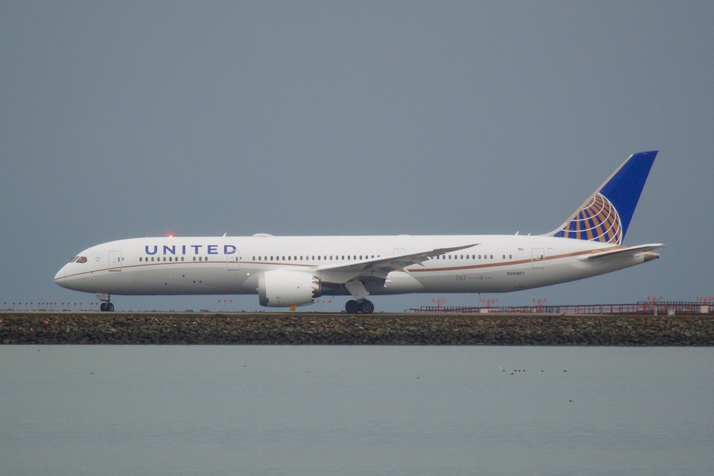
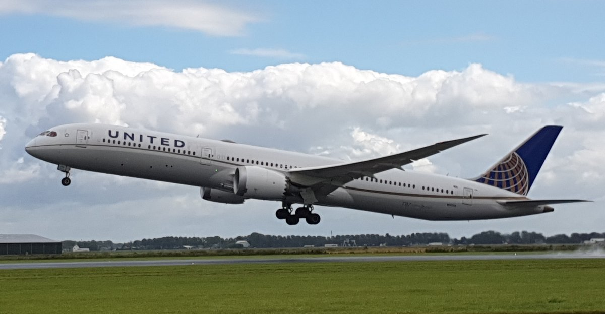

> [English version](/life/united-bans-ai-agents/)

*一架美联航波音 787-9 梦想客机（N26967）。照片来自 Wikimedia Commons（CC BY-SA 2.0）。*

## 美联航到底改了什么

美联航在 11 月 11 日周三表示，**禁止未经授权的第三方 AI 助手替旅客预订航班**——并且更新了运输合同（就是登机前没人会读的那份法律文件）来把这条规矩钉死。新规禁止使用 AI 助手"创建、修改或处理机票"或购买任何产品与服务，并赋予美联航**取消此类预订**的权利。

范围划得刻意地宽。禁令既适用于美联航自己的网站与 App，也适用于销售美联航座位的旅行社与聚合平台；覆盖订票、改票、管理行程，以及动用 MileagePlus 常旅客账户。而且**即使是旅客本人要求的也不行**——经过旅客监督、批准、授权的助手订票同样被禁。美联航表示，目前它不与任何第三方 AI 助手合作，只会"继续评估这些工具如何与其服务互动"。

美联航是**第一家公开限制自动化订票工具的大型美国航司**，当前报道中点名的工具是 Meta 的 Muse 与 OpenAI 的 Dots。11 月 11 日之前已由助手完成的预订仍会兑现，不过美联航建议旅客核查这些预订"是否已正确出票"。

## 美联航给出的理由——以及它先说的那条

官方理由是安全与联邦法规。与个人 AI 助手共享账户凭证"可能泄露敏感信息，由这些工具采取的行动可能导致意外购买、账户变更或 MileagePlus 里程被使用"。还有一个相当具体的监管点：联邦法规要求旅客在值机时亲自确认行李中没有违禁品，而由 AI 完成值机，就会产生"到底是谁做出了这份确认"的问题。

这两点都是真实的。但美联航自己公告的第一段根本不是在谈风险——谈的是对订票渠道的控制。航空分析师、Atmosphere Research Group 的 Henry Harteveldt 对 CBS News 直言不讳：美联航不想再多一个"比谷歌搜索、比价聚合网站和在线旅行社更强大"的中介。他还补了更直接的一句："航班搜索是要花航空公司钱的，美联航无疑想避免 AI 机器人航班搜索激增带来的开支。"

*一架美联航波音 787-10 在阿姆斯特丹史基浦机场。照片来自 Wikimedia Commons（CC BY-SA 4.0）。*

## 哪些还行得通

禁令在一个方面比听起来要窄：**搜索仍然允许**。AI 工具可以向你展示美联航的航班时刻与票价，只是不能替你完成购买。旅客仍可通过 Kayak、Hopper、Google Flights 等聚合平台订票。美联航封堵的是最后一步——那个拿着你的卡、你的 MileagePlus 账号和你的一句"订吧"去出票的助手。

这个区分就是整个故事。搜索层是谷歌已经赢下的地盘；购买层是美联航仍然拥有客户、数据与利润的地盘。替你订票的 AI 助手是一个新的中介，正好坐在购买层上——而且与 Google Flights 不同，它来的时候还带着你的登录凭证和常旅客账户。

## 判断

这件事双方都有实打实的论据，这正是它值得吵的原因。美联航说得没错：把登录信息和里程交给第三方助手确实是真实的安全敞口，而值机确认规则也是真实的监管难题，不是借口。同时，这家航司也明明白白地在保护一条收入渠道：助手完成的每一张预订，都是美联航没有掌控的预订；而机器人发出的每一次搜索，都是美联航要付费服务的查询。

真正起作用的词是**"未经授权"**。美联航并没有永远禁止 AI 订票；它禁止的是未经它许可的 AI 订票。这就给行业惯常的结局留了门：同意美联航条款、付费接入或走获批渠道的助手可以进来，而开放的助手网络进不来。现在的问题是达美和美航会不会跟进——如果跟进，AI 订票就不再是一项开放能力，而变成一条谈判得来的分销渠道，笔握在航司手里。盯紧假日季：美联航在一年中最繁忙的旅行周前几周宣布了这项政策，第一次考验将是旅客是否会发现，自己的助手已经没法替自己把票订完了。

## 来源

- CBS News，Megan Cerullo，2026年11月11日（美联航禁止 AI 助手订票；安全风险；联邦法规；Harteveldt 关于中介与航班搜索成本的评论；"与个人第三方 AI 助手共享账户凭证可能泄露敏感信息"）。
- 美联航，"United Restricts Access for Third-Party AI Agents"，2026年11月11日，经 CBS News 与 TravelPulse 转述（限制适用于美联航自有平台及旅行社与聚合平台；11 月 11 日之前的预订予以兑现）。
- TravelPulse，2026年11月11日（订票、出票与分销政策更新；MileagePlus 账户；值机与联邦法规）。
- Travel Weekly，经 The American Quorum，2026年11月12日（AI 助手在 11 月 11 日之前完成的预订将予以兑现）。
- One Mile at a Time / PPC Land，经 Medium，2026年11月12日（运输合同现禁止 AI 助手创建、修改或处理机票；美联航可取消此类预订）。
- Benzinga 经 TradingView，2026年11月12日（点名 Meta 的 Muse 与 OpenAI 的 Dots；票价仍可通过 Kayak、Hopper 与 Google Flights 查询）。
