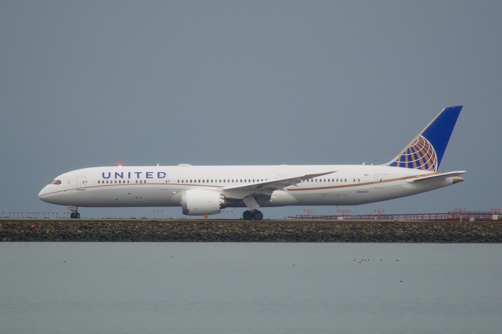
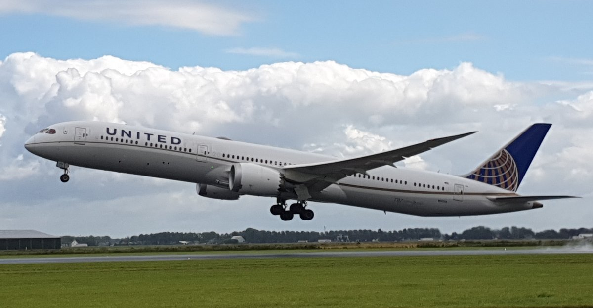

> [中文版 Chinese version](/life/united-bans-ai-agents-zh/)

*A United Airlines Boeing 787-9 Dreamliner (N26967). Photo via Wikimedia Commons (CC BY-SA 2.0).*

## What United actually changed

United Airlines said on Wednesday, November 11, that it is **banning unauthorized third-party AI agents from booking flights on behalf of travelers** — and it updated its contract of carriage, the legal document nobody reads before flying, to make it stick. The new rules prohibit using AI agents "to make, modify or service a Ticket" or to buy any product or service, and give United the right to **cancel reservations made that way**.

The scope is deliberately wide. The ban applies directly on United's own website and app, and indirectly through travel agencies and aggregators that sell United seats. It covers booking, changing, and managing trips, plus touching MileagePlus accounts. And it applies **even when the traveler asked for it** — supervised, approved, customer-permissioned agent bookings are barred all the same. United says it does not currently work with any third-party AI agents at all, and will only "continue to evaluate how these tools interact with our services."

United is the **first major U.S. airline** to publicly restrict automated booking tools, which in current coverage are named as Meta's Muse and OpenAI's Dots. Bookings that agents already completed before November 11 will still be honored, though United recommends checking that they "were booked and ticketed correctly."

## The reasons United gives — and the one it leads with

United's official reasons are security and federal rules. Sharing account credentials with a personal AI assistant "can expose sensitive information, and actions taken by these tools may result in unintended purchases, account changes, or use of MileagePlus miles." There is also a genuinely specific regulatory point: federal rules require travelers to personally confirm at check-in that their luggage contains no prohibited items, and an AI completing check-in raises the question of who actually made that acknowledgment.

Both points are real. But the first paragraph of United's own announcement is not about risk at all — it is about control of the booking channel. Aviation analyst Henry Harteveldt of Atmosphere Research Group said it plainly to CBS News: United does not want "yet another, and potentially even more powerful, intermediary than they already face in terms of Google search, price-comparison metasearch sites and online travel agencies." He added a second, blunter motive: "Flight searches cost airlines money, and undoubtedly United wants to avoid the expense associated with the surge of AI bot flight searches."

*A United Airlines Boeing 787-10 at Amsterdam Schiphol. Photo via Wikimedia Commons (CC BY-SA 4.0).*

## What still works

The ban is narrower than it sounds in one respect: **searching is still allowed**. AI tools can show you United's schedules and fares; they just cannot finish the purchase. Travelers can still book through flight aggregators such as Kayak, Hopper, and Google Flights. What United has blocked is the last step — the agent that takes your card, your MileagePlus number, and your "book it" and turns them into a ticket.

That distinction is the whole story. The search layer is where Google already won; the purchase layer is where United still owns the customer, the data, and the margin. An AI agent that books for you is a new intermediary sitting exactly on that layer — and unlike Google Flights, it arrives carrying your credentials and your loyalty account.

## The verdict

Both sides of this one have a real argument, which is what makes it a good fight. United is right that handing your login and your miles to a third-party agent is a genuine security exposure, and the check-in acknowledgment rule is a real regulatory wrinkle, not a pretext. And the airline is also, transparently, protecting a revenue channel: every booking an agent completes is a booking United did not control, and every bot search is a query United pays to serve.

The word doing all the work is **"unauthorized."** United has not banned AI booking forever; it has banned AI booking without its permission. That leaves the door open for the outcome the industry usually reaches: agents that agree to United's terms, pay for access, or route through approved channels get in, and the open web of agents does not. The question now is whether Delta and American follow — if they do, agentic travel stops being an open capability and becomes a negotiated distribution channel, with the airlines holding the pen. Watch the holiday season: United announced this weeks before the busiest travel weeks of the year, and the first test will be whether travelers even notice their assistant can no longer finish the job.

## Sources

- CBS News, Megan Cerullo, November 11, 2026 (United bans AI agents from booking flights; security risks; federal rules; Harteveldt quotes on intermediary and flight-search costs; "sharing account credentials with personal, third-party, AI assistants can expose sensitive information").
- United Airlines, "United Restricts Access for Third-Party AI Agents," November 11, 2026, via CBS News and TravelPulse (restriction applies directly on United's platforms and indirectly via travel agencies and aggregators; bookings made before November 11 honored).
- TravelPulse, November 11, 2026 (booking, ticketing, and distribution policy update; MileagePlus accounts; check-in and federal rules).
- Travel Weekly, via The American Quorum, November 12, 2026 (bookings made by AI agents before November 11 will be honored).
- One Mile at a Time / PPC Land, via Medium, November 12, 2026 (contract of carriage now prohibits AI agents from making, modifying or servicing tickets; United may cancel such reservations).
- Benzinga via TradingView, November 12, 2026 (Meta's Muse and OpenAI's Dots named as the tools in question; fares remain available through Kayak, Hopper and Google Flights).
