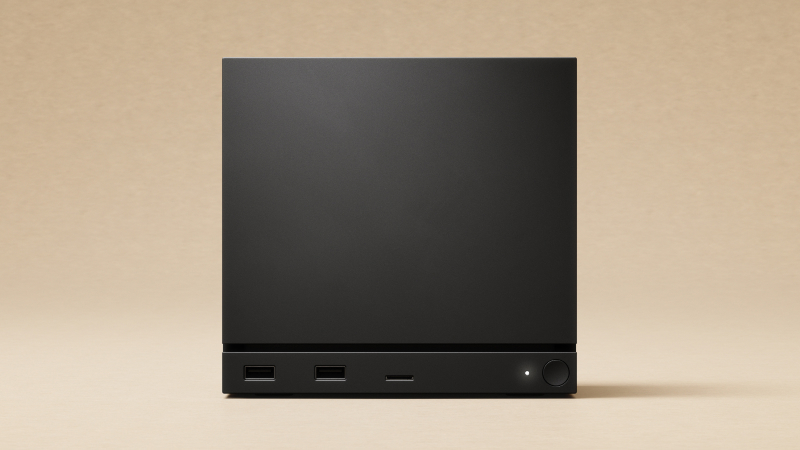
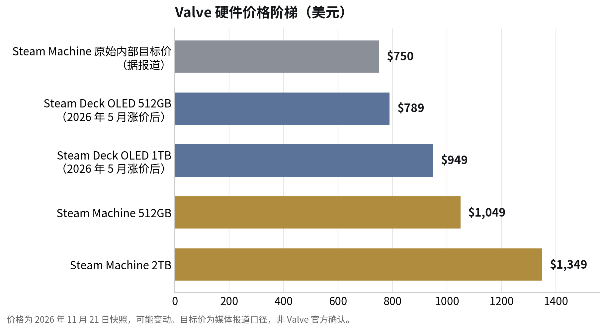
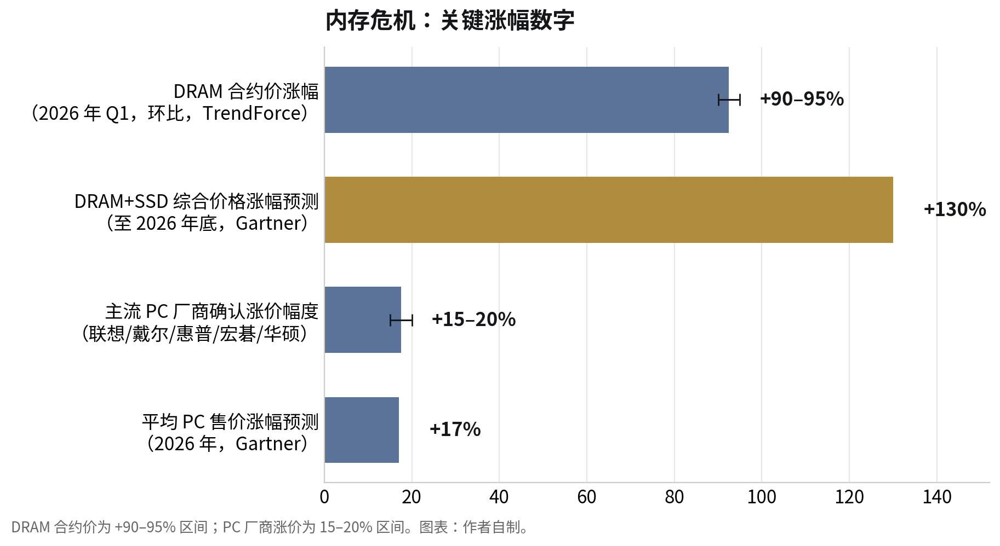

> [English version 英文版](/life/valve-steam-machine-price-warning/)

*Steam Machine。图片来源：Valve（官方产品渲染图，Steam 商店）。*

硬件公司发供应动态是家常便饭，绝大多数都是套话。但 Valve 在 2026 年 11 月 19 日的这篇 Steam 硬件更新不是。在一篇看似例行的预订进度通报里，藏着一句任何大厂都不愿意对自家旗舰产品写下的话：公司目前不知道 Steam Machine 还能再造多少台，也不知道造出来之后卖什么价。这不是一份库存通知。这是一份由制造商本人发出的、针对自家产品的涨价预警——而且是在产品上市仅仅五个月之后。要理解 Valve 为什么会走到这一步——这家公司坐拥 Steam、靠软件赚钱赚到手软——需要顺着一条链条往回追：从客厅里的一台黑色小方盒，一路追到正在吞噬全球内存产能的 AI 数据中心。

## Valve 到底说了什么

先把新闻本身说清楚。11 月 19 日的更新可以干净利落地拆成好消息和坏消息，按型号分开看。

好消息是 512GB 版。Valve 已经履约了该型号的全部现有预订，候补名单清零。512GB 版 Steam Machine 现在就是普通在售状态：加入购物车、直接购买，售完即止。关键在最后半句：现有库存卖完之后，Valve 会把商品页直接改为缺货，而不是再开一轮新的候补名单。也就是说，下一批货没有队可以排，因为 Valve 根本不承诺下一批会在什么时间出现。

坏消息是 2TB 版，而且要坏得多。Valve 已经向所有剩余的 2TB 预订用户发完了购买邀请。还在候补名单上的人保留排队位置——但名单即日起关闭，不再接受新登记，因为名单上的人数已经超过了 Valve 当前的产量；Valve 同时明说，名单上的任何人都不保证能买到一台。如果你在名单上、又现在就想要一台机器，Valve 给出的选项是改买 512GB 版（售完即止）——代价是放弃你的 2TB 排队位置。更多供应信息要等到 1 月份公布。

然后是全文最重要的一段，值得完整引用：

> "我们还在继续生产更多的 Steam Machine，但内存和存储成本正以前所未有的速度上涨；因此我们尚不知道我们能造出多少台，也不知道能以什么价格出售。尤其是 2TB 型号，将特别受限。"

请注意这段话的措辞。Valve 不是在宣布涨价，而是在宣布：它现在给自己的下一批产品定不了价。目前的价格——512GB 版 1049 美元、2TB 版 1349 美元，加 Steam 手柄的同捆版分别为 1128 美元和 1428 美元——只适用于已经造出来、或者成本已经锁定的那批货。之后的每一台，价格都是开放问题，而 Valve 提前把这一点告诉了你。本文所有价格均为 2026 年 11 月 21 日的快照，价格可能变动——而这一次，这句套话本身就是新闻。

这次更新里还有一个容易被略过、但信号意义很强的动作：Valve 放弃了候补名单这个工具本身。要知道，预订加候补的排队体系是 Valve 在 Steam Deck 时期打磨出来的看家机制——用可退的订金锁定真实需求、按顺序分批发货，既防黄牛，又能给供应链一个可预测的需求曲线。这套机制运转的前提，是公司对自己未来的产量有一个大致可信的估计：我知道下个月能造多少台，所以我敢让你排队，并大致告诉你排到什么时候。现在 Valve 宁可让 512GB 卖完就挂缺货牌、把 2TB 的名单直接封死，也不肯再收新的排队者——这等于公开承认，它对未来产量的估计已经不可信到连队都不敢让人排的程度。对一家以运营纪律著称的公司来说，这是比涨价更严厉的自白：涨价说明成本出了问题，取消排队说明能见度出了问题。黄牛和二级市场接下来大概率会替 Valve 完成它拒绝做的事——用市场价格给稀缺定价，而那部分溢价，一分钱也不会回到 Valve 或玩家手里。

还有一个细节值得留意：Valve 主动建议 2TB 候补者"改买 512GB"。这句话表面上是给出路，实质上是公司在替市场做配给——把需求从最缺货的型号往库存相对充足的型号上引。一家公司开始公开引导用户"降配购买"，说明它对自己恢复高端型号供应的时间表，心里同样没底。

## 价格是怎么失控的

这一切不是从 11 月开始的。Steam Machine 于 2025 年 11 月 12 日发布，当时的报道称 Valve 的原始内部目标价约为 750 美元——需要强调，这个数字是媒体报道口径，Valve 从未官方确认过。2026 年 6 月正式发售时，定价是 1049 美元和 1349 美元，也就是说基础款比报道中的目标价高了约四成。Valve 在发售时表示，原来的价格目标因为内存和存储成本已经"不再可行"，并提到有一段时间，某些零部件是花多少钱都买不到的。供应商说"这个件，再多钱也不卖给你"，和供应商说"这个件要涨价"，是两个完全不同的世界——而 Valve 已经在前一个世界里待了大半年。

其实早在发售前几个月，Valve 自家产品线里就出现过预警信号。2026 年 5 月，Steam Deck OLED 以更高的价格回归在售：512GB 版 789 美元、1TB 版 949 美元，Valve 给出的理由正是内存与存储成本。Deck 的涨价是煤矿里的金丝雀：DRAM 和 NAND 闪存这两样东西，位于 Valve 每一台设备的物料清单正中央。一台 Steam Machine 装着 16GB DDR5 内存，外加一块 512GB 或 2TB 的 NVMe 固态硬盘。2TB 版"特别受限"的原因简单到近乎残酷：它需要四倍于基础款的、当下消费电子领域最稀缺的那种商品。

把这条价格阶梯画出来，过去一年发生的事情就一目了然：报道中的约 750 美元目标价、涨价后的 Steam Deck OLED、1049 美元起步的 Steam Machine——Valve 的每一台硬件，都在被同一股力量往上推。

*Valve 硬件价格阶梯。约 750 美元为媒体报道的内部目标价，Valve 未官方确认。价格为 2026 年 11 月 21 日快照，可能变动。图表：作者自制。*

## 这台机器本身

有必要停下来看一眼这笔钱买到的是什么，因为 Steam Machine 的问题不在于产品不好，而在于它是一个设计已经定型的产品，却撞上了一个每季度重新定价的供应链。它的硬件是 AMD 半定制方案：CPU 为 Zen 4 架构、6 核 12 线程、最高 4.8GHz、功耗墙 30W；GPU 为 RDNA3 架构、28 个计算单元、最高 2.45GHz、110W，配 8GB GDDR6 显存——大致相当于 Radeon RX 7600M 的水平；再加上 16GB DDR5 系统内存和 512GB 或 2TB 的 NVMe 硬盘。全部塞进一个约 156×152×162 毫米、重 2.6 公斤的立方体里，运行 SteamOS。这是一台可信的客厅 PC，无论是能力还是开放程度，都更接近一台小型游戏台式机，而不是传统意义上的游戏主机。

矛盾恰恰在这里：Valve 卖它的时候，用的是主机的承诺——一台盒子、一个价格、买回家就完事。主机厂商敢做这种承诺，是因为它们掌握着天量级的零部件订单，可以把价格钉住好几年。而一台主机外形的 PC，如果产量只有主机厂商的一个零头，物料清单又被 AI 弄成最稀缺的两种零件主导，它就没办法以同样的方式兑现这个承诺。11 月 19 日这篇更新，就是这道裂缝正式公开的时刻。

理解 Valve 今天的处境，还需要一点它自己的硬件史。Valve 做硬件向来是"小步快跑、量始终不大"：2015 年的第一代 Steam Machines 计划拉着一票 PC 厂商做贴牌主机，最终无声无息地退场；之后的 Steam 手柄、Steam Link、VR 头显 Index，再到真正打开局面的 Steam Deck——这条线教会 Valve 的是做一台好设备，却从来没有给过它主机厂商级别的采购规模。Steam Deck 是它迄今为止最成功的硬件，但即便是 Deck 的出货量级，放在索尼和任天堂面前仍然是零头。这段历史的含义在于：Valve 不是在 2026 年突然变小的，它从来就没有大过。内存市场风平浪静时，小买家的日子照样过——现货市场总有货，无非贵一点；可一旦市场进入配给状态，"从来没大过"就从无关紧要的背景，变成了决定生死的变量。11 月的更新，本质上是这段硬件史在极端市场里的一次总清算。

还有一个常被忽略的点：Steam Machine 的零部件几乎没有"降配腾挪"的空间。内存是焊死在规格表上的 16GB DDR5，砍到 12GB 等于重新定义产品；硬盘从 2TB 砍回 1TB 等于承认高端型号失败。主机厂商遇到成本压力时，还能在新型号上调整配置组合；Valve 的两款型号在发布时就把配置写死了，如今每一个选项都通向涨价、缺货或者缩配，没有一条路是体面的。

在讲机制之前，先说清楚 Valve 为什么非做这台机器不可，因为这决定了它不能简单地"停产止损"。Steam 的根基在 PC，但 PC 游戏的主导权并不完全在 Valve 手里：操作系统是微软的 Windows，客厅则长期被索尼、微软和任天堂的主机占据。Steam Machine 加 SteamOS 的组合，是 Valve 经营多年的对冲——一台不受 Windows 政策摆布、把 Steam 商店直接搬进客厅的终端。Steam Deck 已经在掌机形态上证明了这条路走得通，Steam Machine 则是它在客厅的对应物。也正因为这台机器承载的是生态卡位而非硬件利润，Valve 才会在成本如此难看的情况下坚持继续生产、继续发货，而不是像普通 PC 厂商那样直接砍掉产品线。但卡位逻辑也有它的边界：如果缺货和涨价持续到口碑耗尽，生态入口就会变成生态笑话。这条边界在哪里，取决于内存市场，也取决于 Valve 在 1 月之后还能拿出多少台机器。

## 机制：内存都去哪了

内存危机不是一个比喻。它的作用机制值得摊开讲清楚，因为只有讲清楚机制，才能明白这为什么不是 Valve 靠谈判就能解决的问题。

第一，需求端。AI 数据中心被估算吞掉了 2026 年全球内存芯片产量的约 70%——这个数字是 IDC 的估算，经 TechTimes 报道，应当按"估算"而不是"普查"来读。正在建设 AI 算力的超大云厂商，购买 DRAM 和高带宽内存（HBM）的规模，足以让整个消费硬件行业的采购量相形见绌，而且它们签的是长期、高价的合同——这种合同天然会得到供应商的全力对待。

第二，供给端不可互换。HBM 是 AI 加速卡必需的堆叠式内存，它每生产 1GB 所消耗的晶圆产能，大约是普通设备用的 LPDDR 的 3 到 4 倍。也就是说，晶圆厂每向 HBM 倾斜一片晶圆，就从市场上抽走了数倍于其重量的普通内存。而市场几乎没有别的选择：三星、SK 海力士和美光三家合计占全球 DRAM 产量的 95% 以上。三家供应商，面对同样的激励结构，都在把产能往出价最高的客户那边调。

第三，价格。TrendForce 报告称，仅 2026 年第一季度，DRAM 合约价就环比上涨了 90% 到 95%——一个季度接近翻倍。Gartner 预测，到 2026 年底，DRAM 与 SSD 的综合价格将上涨约 130%，个人电脑的平均售价将上涨约 17%。这不是 Valve 一家的遭遇：联想、戴尔、惠普、宏碁和华硕都已确认 15% 到 20% 的 PC 涨价。当全球所有主要 PC 厂商在同一年里集体双位数涨价，原因就不可能是某一家公司的采购失误，而是整个市场围绕着单一的、占主导地位的买家群体在重新定价。

*内存危机：关键涨幅数字。数据来源：TrendForce（2026 年 Q1 DRAM 合约价）、Gartner 预测（至 2026 年底 DRAM+SSD 综合价格、2026 年平均 PC 售价）、各厂商确认的涨价幅度（经公开报道）。图表：作者自制。*

把这三层叠起来看，结论并不复杂：内存市场的定价权，已经从"谁买得多谁便宜"变成了"谁离 AI 最近谁优先"。消费电子在这条食物链上的位置，过去靠规模说话，现在靠的是你和数据中心抢不抢同一种晶圆——而不幸的是，Steam Machine 的内存和硬盘，恰好和 AI 服务器用的是同一批产能池里的东西。

## 不只是内存条：NAND 和显存也在同一张桌子上

还有一个容易被标题简化掉的细节：这场危机从来不只是"DDR5 内存条涨价"。Steam Machine 的物料清单上有三处同时暴露在风暴里。第一处是 16GB DDR5 系统内存，直接吃 DRAM 合约价。第二处是 NVMe 固态硬盘用的 NAND 闪存——AI 数据中心不只抢计算和内存，也在以前所未有的规模囤积企业级存储，NAND 产能同样被数据中心订单吸走，这正是 2TB 型号比 512GB 型号处境恶劣得多的原因：它的 NAND 用量是四倍，而 NAND 的涨价曲线并不比 DRAM 温和。第三处是 GPU 上的 8GB GDDR6 显存——显存本质上也是 DRAM 的一个分支品类，产能池与主流 DRAM 相通。三处暴露、同一个源头，这意味着 Valve 连"换一种内存方案绕过去"的余地都很小：任何替代方案都还在同一张产能桌子上。此外，合约价的传导还有时滞：TrendForce 的合约价是季度谈判的结果，现货市场的恐慌会先行，合约价随后跟上并锁定数月。这解释了为什么危机从年初爆发，Valve 却到 6 月发售时才被迫放弃原始定价、又到 11 月连下一批的价格都定不出来——它签的每一份供应合同，都是在比上一份更贵的市场里重新谈的。

## 为什么偏偏是 Valve 最先被挤到

如果大家面对的是同一个市场，为什么是 Valve 在关名单、对自家未来价格免责？Ars Technica 对这次更新的分析指出了结构性原因：量。索尼、微软和任天堂的零部件订单大到足以让它们成为供应商的优先客户；供应紧张时，产能按订单大小分配，因为丢掉大客户的代价最高。Valve 的硬件出货量与之相比只是个零头。在短缺中，分配跟着规模走，而 Valve 是房间里最小的那个买家——所以它最先感受到短缺，感受得最深，也最没有杠杆去修复它。

第二重不对称在于缓冲垫。三大主机厂商并非绝缘：它们在 2025 年都涨过主机价格，2026 年还有更多涨价。但它们有 Valve 没有的减震器：平台方可以把硬件上的亏损摊到数千万装机量带来的游戏销售、订阅和商店抽成里，慢慢消化。Valve 当然也有 Steam 的商店经济，但它的硬件线年轻、体量小，而且定价贴着成本卖——Steam Machine 的卖点从一开始就是"一台定价公道的 PC"，不是"亏本卖刀架、靠刀片赚钱"。物料成本一旦跳涨，既没有预留的平台利润去吸收，也没有上亿台量级的订单簿可以拿去跟三星谈判。

把三大主机厂商的应对摆在一起看，差别更清楚。同样的内存市场，索尼、微软、任天堂在 2025 年的选择是涨价——把成本直接转嫁给消费者，机器照卖；2026 年还有更多涨价在路上。它们敢这么做，是因为装机量和内容生态锁住了用户：你的游戏库在 PlayStation 上，涨价你也只能接受。而 Valve 的 Steam Machine 恰恰没有这种锁定红利——它卖的是一台开放的 PC，用户随时可以转身去买一台涨价 15% 到 20% 的品牌整机，或者干脆自己攒机。换句话说，主机厂商的疼法是"涨价之后卖得贵一点"，Valve 的疼法是"涨价就没人买，不涨价就造不出来"。前者在利润表上解决，后者在生死线上解决。这也是为什么三大厂商至今只需要发涨价通知，而 Valve 需要发一篇解释自己为什么定不了价的更新。

那么，AI 短缺的成本到底由谁吸收？不是超大云厂商：它们把内存账单转嫁进 AI 算力的价格里，而算力需求远远跑在供给前面，账单总有人付。成本最终落在杠杆最小的买家身上——先是低出货量的硬件厂商，然后是消费者，形式是更高的价格、更薄的配置，以及干脆缺货的产品。Steam Machine 关闭的候补名单，就是这场转移在地面上的样子：某个地方的一次 AI 训练任务，在同一批晶圆上出价高过了你客厅里的 PC，于是客厅里的 PC 就只能等着。

一个自然的质问是：Valve 为什么不提前囤货、或者签长期锁价合同？答案还是回到规模。长期锁价合同从来不是免费保险：供应商愿意锁价的前提，是买家承诺足够大的量、足够长的周期，并且在市场上涨时不撕毁、下跌时不跑路——这种信用只有大买家出得起。对 Valve 这样量级的客户，供应商给的通常是随行就市的季度报价；它想锁，供应商未必肯卖这个保险。至于囤货，那等于用今天的现金去赌明天的价格和需求，对一家硬件只是副业、且历史上以精打细算著称的公司来说，囤上一年用量的内存和硬盘既不现实，也不符合它的一贯打法。更深一层看，Valve 的商业模式从来不依赖硬件利润：Steam 的抽成才是它的根基，硬件的使命是把 Steam 带进客厅、扩大生态，而不是靠卖盒子赚钱。这个定位在平时是优势——它可以贴着成本定价、用内容生态补贴硬件野心；但在配给市场里，这个定位反而成了软肋：当零部件变成需要用订单规模去"抢"的战略资源时，一家把硬件当生态入口而非利润中心的公司，既没有抢的筹码，也没有抢的组织惯性。它擅长的那套打法——做好产品、定个公道价格、让商店生态慢慢回本——每一步都预设了一个供应充足的世界。

这件事还有一个更长的时间维度。内存厂扩产晶圆产能以年为单位计数，而 HBM 的产能倾斜是写进长期合同里的。换句话说，就算 AI 需求明天见顶，留给消费电子的内存产能也要等合同周期和产线调整慢慢释放。对 Valve 这样的买家来说，2027 年的供应形势不会自动变好——这也是为什么它在更新里只敢承诺"1 月份给更多消息"，而不敢给出任何恢复供应的日期。把话说到这个份上，本身就是一种信息。

## 判断：如果你想买一台，该怎么看

先说公道话：Valve 这次坏消息的"发法"值得肯定。把 2TB 候补名单关掉而不是任由它无限膨胀、把"不保证有货"明说出来、承认下一批定不了价——这比行业惯例中的沉默延期和偷偷涨价要诚实得多。但对问题诚实，不等于问题被解决。读者应当按字面理解 11 月这篇更新：这是一家制造商在预警，它的产品可能会以更高的价格、更少的数量、在未知的日期回归，而下一个检查点是 1 月份的更新。

由此得出的实操结论并不复杂。如果你在考虑 Steam Machine，而且 512GB 能满足你的需求，那么眼下的局面罕见地清晰：它有现货，价格是确定的 1049 美元（带手柄同捆 1128 美元）；Valve 已经明说，这批库存卖完之后不会再开候补名单——只有缺货页面，和一个价格未知的未来批次。这时候下单不叫恐慌性购买，叫购买唯一一批 Valve 真正承诺过价格的货。如果你手里攥着 2TB 的候补位置，也请清楚它的含金量：一个 Valve 亲口说人数已超过其产量的队列、零保证，外加一个被 Valve 单独点名为"最受限"的型号。Valve 给出的交换——放弃位置、现在就买小容量版本——确实不诱人，但它是由现实定价的：存储就是那个稀缺投入品，而 2TB 的存储，恰恰是市场现在供不出来的东西。

还有一个变量会改变很多人的计算：512GB 并不是这台机器存储的终点。据报道，Steam Machine 支持 NVMe 2230 与 2280 两种规格的固态硬盘，机器正面也留有 microSD 卡槽——这意味着买 512GB 版的用户，日后完全可以自己加装或更换一块大容量硬盘，把"容量问题"延后到 NAND 价格回落时再解决。这条信息（硬盘规格为媒体报道口径）让 Valve 的"改买 512GB"建议从一句敷衍变得真正成立：两个型号的 CPU、GPU、内存完全一致，差的只是那块当下最贵、最缺的 NAND。对绝大多数人来说，理性的选择不是守着一张不保证兑现的 2TB 排队券，而是拿下有现货、价格确定的 512GB，把存储升级留给未来——前提是你接受自己动手，或者接受先用外置与卡槽方案过渡。反过来，如果你的游戏库庞大、又坚决不想折腾，那么 2TB 候补位置的真实价值就只剩期权价值：保留位置不需要成本，但请按 Valve 的原话理解它——不保证有货，也没有时间表。

把建议按人群拆开，会更清楚。第一类，已经下单或正打算买 512GB 的人：你的决策窗口就是现在这批库存的生命周期，Valve 已经把规则写明白了——卖完变缺货、不开新名单、下一批价格未知。在一个连制造商都拒绝为下一批价格背书的市场里，"等降价"这个选项的期望值是负的。第二类，2TB 候补者：保留位置本身没有成本，可以留着，但请把它当作一张大概率不兑现的彩票，而不是一个购买计划；同时认真考虑 Valve 的交换提议，尤其是你本来就打算自己扩容的话。第三类，Steam Deck 用户和观望者：Deck OLED 在 5 月已经涨过一轮价，而它的物料暴露与 Steam Machine 高度重合，如果内存市场按 Gartner 的预测走到年底，Valve 的整个硬件线都没有便宜的理由。观望的成本在 2026 年之前几乎为零，在这一轮周期里则每个月都在变贵。这不是催促消费，而是把 Valve 自己更新里的逻辑推到终点：当卖方公开说"我不知道下一批卖多少钱"时，买方唯一确定的信息，就是当前这个价格是最后一个确定的价格。

## 1 月份要看什么

Valve 承诺 1 月份给出更多供应消息。届时有三件事值得逐字核对。第一，下一批 512GB 的价格是否守住 1049 美元——守住，说明 Valve 找到了阶段性的供应安排；上调，则确认成本传导已经击穿了它的全部缓冲。第二，2TB 是否给出任何形式的恢复时间表，哪怕是模糊的季度口径；如果 1 月更新对 2TB 继续只有"特别受限"四个字，那基本可以判定这个型号在 2027 年内都只是名义存在。第三，Valve 是否会引入新的配置——比如一个 1TB 的中间型号。推出中间型号将是一个意味深长的信号：它等于承认 2TB 的 NAND 成本在可预见的未来回不来，转而用产品线重组来绕开最稀缺的那一档。反过来，如果 Valve 宁可缺货也不动配置，说明它判断这场危机是周期性的，熬过去就能回到原来的产品计划。这三种走向对应着对内存危机完全不同的判断，而 Valve 的选择本身，就是最值得读的行业信号。

更大的结论关乎 Steam Machine 这台产品变成了什么。它发售时的主张是：PC 游戏可以拥有主机的简单和诚实的价格。五个月后，它成了另一个故事里最清晰的消费级证据：AI 建设如今为所有人设定内存的价格，而其他所有人——2025 年和 2026 年相继涨价的主机厂商、涨价 15% 到 20% 的 PC 厂商、以及体量最小的 Valve——要么支付出清价格，要么停止出货。Valve 还没有停止出货，它停止的是承诺。接下来盯住 1 月：Valve 给下一批机器标出的价格，会比任何分析师的预测都更能说明内存市场的真实状态——因为那将是一家有充分动机把硬件卖便宜的公司，被迫报出的价格。

把镜头再拉远一点，Steam Machine 的遭遇对 PC 游戏玩家整体也不是个好兆头。过去十年，PC 硬件的价格曲线总体是向下的：同样的钱，每年能买到更强的性能。这条曲线的底层假设是零部件市场长期供过于求、价格竞争充分。2026 年发生的事情，是这个假设第一次被系统性击穿：当内存和存储的定价权被 AI 需求接管，游戏硬件不再是这个市场的定价者，甚至不再是重要客户。品牌整机涨价 15% 到 20%、平均 PC 售价涨约 17%（Gartner 预测）、主机全线涨价、Valve 定不了价——这些新闻拼在一起，画出的是一幅完整的图景：2026 年的游戏玩家，正在为他们从未使用过的 AI 服务支付一部分账单，而且是以硬件价格的形式、在结账时一次性付清。这笔"AI 税"不会出现在任何一张发票上，但它真实存在，而且按目前的产能格局，它至少会收完 2026 年，很可能延续到 2027 年。对玩家的实际建议也因此变得简单粗暴：如果你的购机计划在一两年之内，刚需零部件的价格大概率只会更贵；等待降价，在这一轮周期里第一次成了胜率最低的选项。

最后留一个更冷的观察。这场危机的分配方式，本质上是一次按"离 AI 的距离"排序的征税：离得越近，越能把成本转嫁出去；离得越远，越只能自己吞下。玩家为客厅里的一台游戏机多付的钱、等不到的货，最终都流向了同一批晶圆的另一端。这不是 Valve 的失败，也不是任何一家硬件公司的失败，而是整个消费电子行业在 2026 年共同的处境——Valve 只是第一个把这句话印在自家商店页面上的公司。

*本文价格为 2026 年 11 月 21 日查询的快照，价格可能变动。约 750 美元的原始目标价为媒体报道口径，Valve 未官方确认。AI 数据中心消耗 2026 年约 70% 内存芯片产量的说法为 IDC 估算，经 TechTimes 报道。Gartner 相关数字为预测值。*
