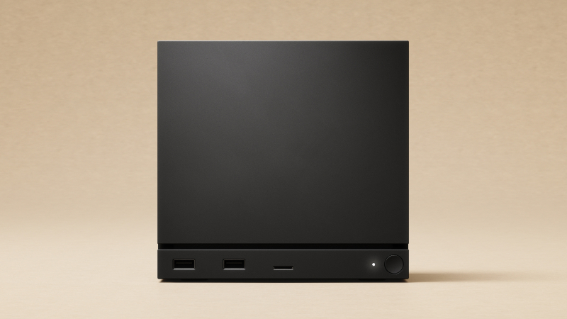
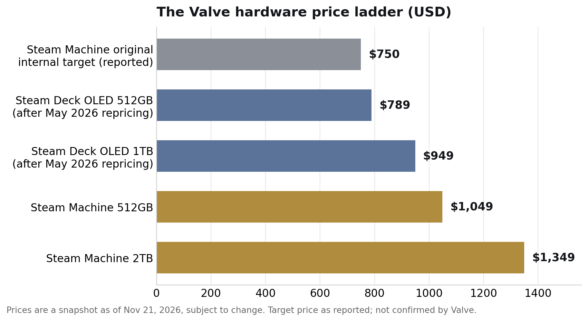
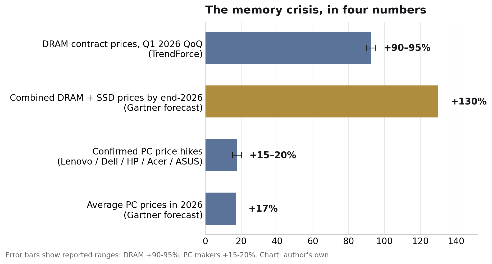

> [中文版 Chinese version](/life/valve-steam-machine-price-warning-zh/)

*The Steam Machine. Image: Valve (official product render, Steam store).*

Hardware companies issue supply updates all the time, and almost all of them are boilerplate. Valve's Steam Hardware post of November 19, 2026 is not. Buried in a routine reservation update is a sentence that no major hardware maker wants to write about its own flagship product: the company does not currently know how many more Steam Machines it can build, and it does not know what they will cost when it does. That is not a stock notice. It is a price warning, issued by the manufacturer, about its own product, five months after launch. Understanding why Valve — of all companies, the one that runs Steam and prints money from software — ended up here requires following a chain that runs from a small black cube in a living room all the way to the AI data centers consuming the world's memory supply.

## What Valve actually said

Start with the news itself, because the November 19 post splits cleanly into good news and bad news, model by model.

The good news is the 512GB model. Valve has fulfilled every current reservation for it, with no waitlist remaining. The 512GB Steam Machine is now simply on sale: add to cart and buy it directly, while supplies last. The catch is in the tail of that sentence. When the current inventory runs out, Valve will flip the product to out-of-stock rather than open a new waitlist. There is no queue to join for the next batch, because Valve is not promising there will be a next batch on any particular schedule.

The bad news is the 2TB model, and it is considerably worse. Valve has finished sending purchase invites to all remaining 2TB reservation holders. Everyone still on the 2TB waitlist keeps their place in line — but the waitlist is now closed to new sign-ups, because the number of people on it already exceeds Valve's current production, and Valve states plainly that no one on the waitlist is guaranteed a unit. If you are on that list and want a machine now, Valve's offer is to buy the 512GB instead, while supplies last — which means giving up your 2TB position to do it. More information on additional supply is promised in January.

Then comes the paragraph that matters most, and it deserves to be quoted in full:

> "We are continuing to build more Steam Machine units, but memory and storage costs continue to increase at unprecedented levels; as a result we don't yet know the number we are able to make, and at what price we'll be able to offer them. The 2TB model in particular will be especially constrained."

Read that carefully. Valve is not announcing a price increase. It is announcing that it cannot yet price its own next production run. The current prices — $1,049 for the 512GB model and $1,349 for the 2TB, with Steam Controller bundles at $1,128 and $1,428 — apply to units already built or already costed. Everything after that is an open question, and Valve is telling you so in advance. Prices in this article are a snapshot as of November 21, 2026, and are subject to change — in this case, that boilerplate is the actual news.

## How the price got away from Valve

None of this started in November. The Steam Machine was announced on November 12, 2025, and reporting at the time put Valve's original internal price target at roughly $750 — that figure is a reported target, not a number Valve ever officially confirmed. The machine launched in June 2026 at $1,049 and $1,349, which is to say roughly 40% above the reported target for the base model. Valve said at launch that its original price goal was "no longer viable" because of RAM and storage costs, and described periods in which some components could not be sourced at any price at all. A supplier telling a customer "we cannot sell you this part at any price" is a different world from a supplier asking for more money, and Valve has now lived in that world for the better part of a year.

The warning signs were visible inside Valve's own catalog months before launch. In May 2026, the Steam Deck OLED returned to sale at higher prices — $789 for the 512GB model and $949 for the 1TB — with Valve citing memory and storage costs. The Deck repricing was the canary: the same two components, DRAM and NAND flash, sit at the center of every device Valve makes. A Steam Machine carries 16GB of DDR5 memory and either a 512GB or a 2TB NVMe drive. The 2TB model is "especially constrained" for the simplest possible reason: it needs four times as much of the scarcest commodity in consumer electronics right now.

*Valve's hardware price ladder. The reported ~$750 internal target (not officially confirmed by Valve) against launch and repriced hardware. Prices are a snapshot as of November 21, 2026, subject to change. Chart: author's own.*

## The machine, briefly

It is worth pausing on what the money buys, because the Steam Machine's problem is not that it is a bad product — it is that it is a fixed product in a market where its two most volatile inputs reprice quarterly. The hardware is a semi-custom AMD design: a Zen 4 CPU with 6 cores and 12 threads, up to 4.8GHz at a 30W envelope, paired with an RDNA3 GPU of 28 compute units at up to 2.45GHz and 110W, with 8GB of GDDR6 — roughly comparable to a Radeon RX 7600M — plus 16GB of DDR5 system memory and the 512GB or 2TB NVMe drive. All of it fits in a cube about 156 × 152 × 162mm weighing 2.6kg, running SteamOS. That is a credible living-room PC, closer to a small gaming desktop than to a traditional console in both capability and openness.

The tension is that Valve sold it with a console's promise: one box, one price, buy it and be done. Consoles can make that promise because their makers control enormous component orders and can hold a price for years. A PC in a console's shape, built in console-unfriendly volumes, with a bill of materials dominated by the two components AI has made scarce, cannot hold that promise the same way. The November 19 post is the moment that gap became official.

## The mechanism: where the memory went

The memory crisis is not a metaphor, and its mechanics are worth spelling out, because they explain why this is not a problem Valve can negotiate its way out of.

First, demand. AI data centers are estimated to have consumed about 70% of the memory chips produced in 2026 — that figure is an IDC estimate, reported via TechTimes, and should be read as an estimate rather than a census. Hyperscalers building AI capacity are buying DRAM and high-bandwidth memory (HBM) at a scale that dwarfs the entire consumer hardware industry, and they sign the kind of long-term, high-value contracts that get a supplier's full attention.

Second, supply is not fungible. HBM — the stacked memory that AI accelerators need — consumes roughly three to four times as much wafer capacity per gigabyte as the LPDDR memory used in ordinary devices. Every wafer a manufacturer commits to HBM removes several times its weight in conventional memory from the market. And the market has almost no one else to turn to: Samsung, SK Hynix, and Micron together account for more than 95% of DRAM production. Three suppliers, all facing the same incentive, all allocating capacity toward the customer paying the most per wafer.

Third, the prices. TrendForce reported DRAM contract prices rising 90–95% quarter over quarter in Q1 2026 alone — a near-doubling in a single quarter. Gartner projects combined DRAM and SSD prices up about 130% by the end of 2026, with average PC prices rising roughly 17%. This is not confined to Valve: Lenovo, Dell, HP, Acer, and ASUS have all confirmed PC price increases in the 15–20% range. When every major PC maker on Earth raises prices by double digits in the same year, the cause is not any one company's procurement failure. It is the market repricing around a single dominant buyer class.

*The memory crisis, in four numbers. Sources: TrendForce (DRAM contract prices, Q1 2026); Gartner forecasts (combined DRAM + SSD prices by end-2026; average PC prices); company confirmations as reported (PC maker price increases). Chart: author's own.*

## Why Valve gets hit first and hardest

If everyone faces the same market, why is Valve the one closing waitlists and disclaiming its own future prices? Ars Technica's analysis of the November update identifies the structural reason: volume. Sony, Microsoft, and Nintendo order components in quantities that make them priority customers; when supply is allocated, the biggest buyers are served first, because losing them costs a supplier the most. Valve's hardware volumes are a rounding error by comparison. In a shortage, allocation follows size, and Valve is the smallest buyer in the room — so it feels the shortage first, most severely, and with the least leverage to fix it.

There is a second asymmetry. The console makers are not insulated — all three raised console prices in 2025, with further increases in 2026 — but they have shock absorbers Valve lacks. A platform holder can spread a hardware loss across years of game sales, subscriptions, and store fees on an installed base of tens of millions. Valve has Steam's store economics too, but its hardware line is young, small, and sold close to the metal: the Steam Machine's pitch was always a fairly priced PC, not a subsidized razor sold to move blades. When the bill of materials jumps, there is no cushion of platform profit earmarked to absorb it, and no hundred-million-unit order book to wave at Samsung.

So who absorbs the cost of the AI shortage? Not the hyperscalers: they pass their memory bills into the price of AI capacity, and demand for that capacity is so far ahead of supply that the bills get paid. The cost lands, instead, on the buyers with the least leverage — low-volume hardware makers first, and consumers second, in the form of higher prices, thinner configurations, and products that simply go out of stock. The Steam Machine's closed waitlist is what that transfer looks like at ground level: an AI training run somewhere outbids your living-room PC for the same wafers, and the living-room PC waits.

## Judgment: what this means if you want one

Valve deserves credit for the form of the bad news. Closing the 2TB waitlist instead of letting it grow, saying "not guaranteed" out loud, and admitting the next batch is unpriced is more honest than the industry norm of silent delays and stealth price changes. But honesty about a problem is not the same as a solution to it, and readers should take the November post at face value: it is a manufacturer warning that its own product may return at a higher price, in smaller numbers, on an unknown date, with January's update the next checkpoint.

The practical conclusions follow from that. If you want a Steam Machine and the 512GB model meets your needs, the current situation is unusually clear: it is in stock, at a known price of $1,049 ($1,128 with the controller), and Valve has explicitly said that when this inventory ends there will be no waitlist to fall back on — just an out-of-stock page and a future batch at an unknown price. Buying now is not panic-buying; it is buying the only batch whose price Valve has actually committed to. If you are holding a 2TB waitlist position, understand what you hold: a place in a queue that Valve says exceeds its production, with no guarantee, against a model Valve singles out as the most constrained. The 512GB trade Valve offers — give up the position, buy the smaller machine now — is unappealing, but it is priced by reality: storage is the scarce input, and 2TB of it is exactly what the market cannot currently supply.

The larger verdict is about what the Steam Machine has become. It launched as an argument that PC gaming could have console simplicity at an honest price. Five months later it has become the clearest consumer-facing evidence of a different story: the AI buildout now sets the price of memory for everyone, and everyone else — console makers with their 2025 and 2026 price hikes, PC makers at +15–20%, and smallest of all, Valve — pays the clearing price or stops shipping. Valve has not stopped shipping yet. It has stopped promising. Watch January: the number Valve attaches to its next batch will tell you more about the real state of the memory market than any analyst forecast, because it will be the price a company with every incentive to keep its hardware cheap was forced to charge.

*Prices checked November 21, 2026, subject to change. The ~$750 original price target is a reported figure, not confirmed by Valve. The estimate that AI data centers consumed about 70% of 2026 memory chip production is attributed to IDC via TechTimes. Gartner figures are forecasts.*
