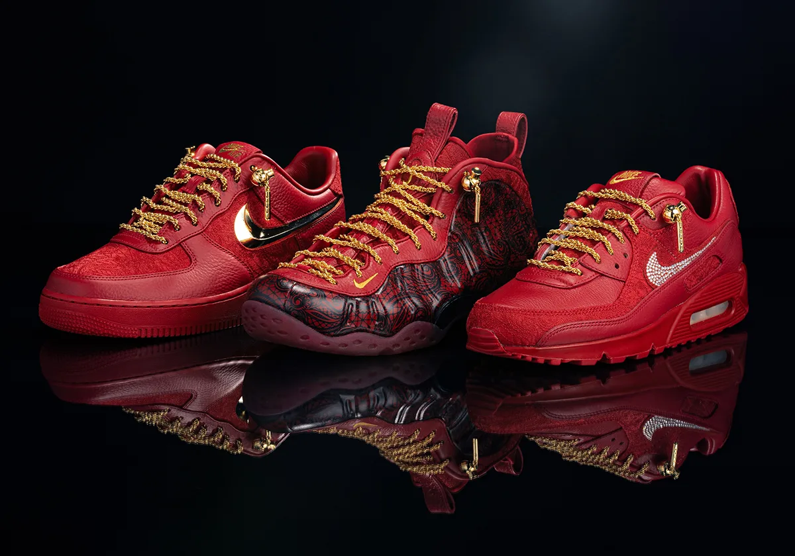
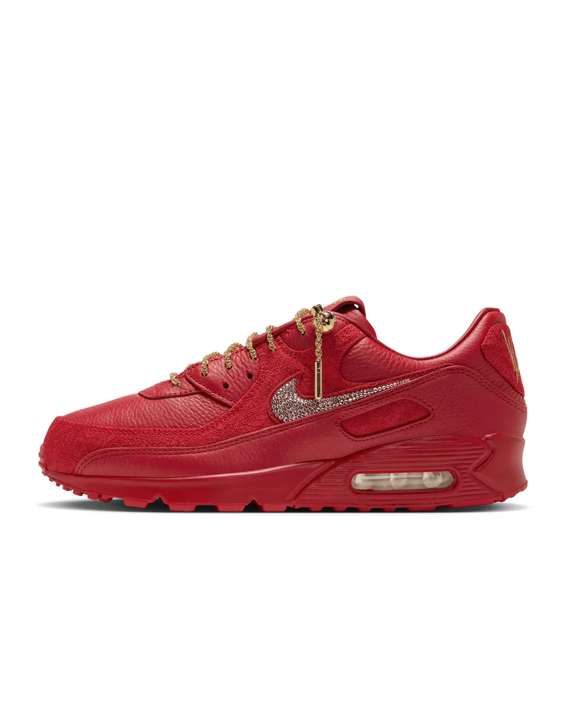
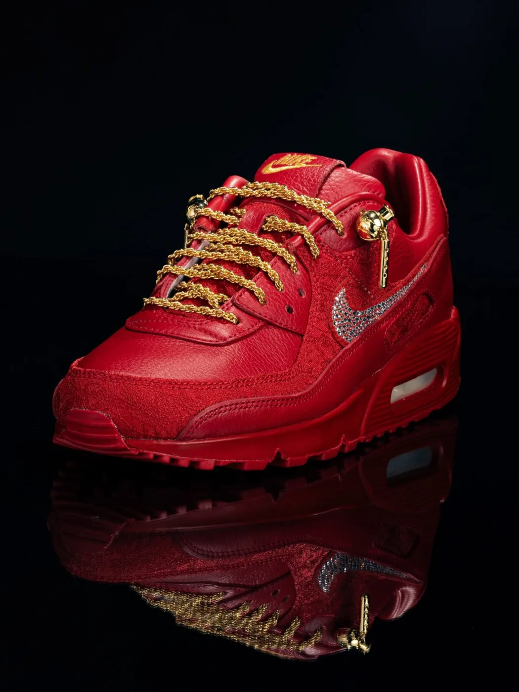
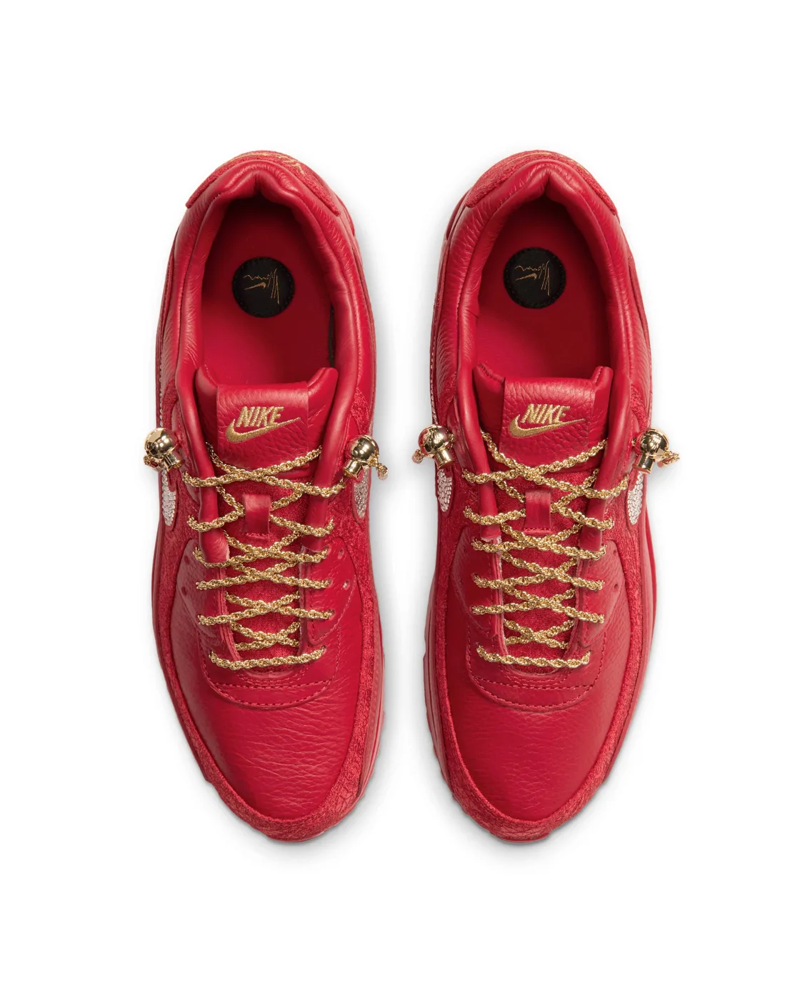
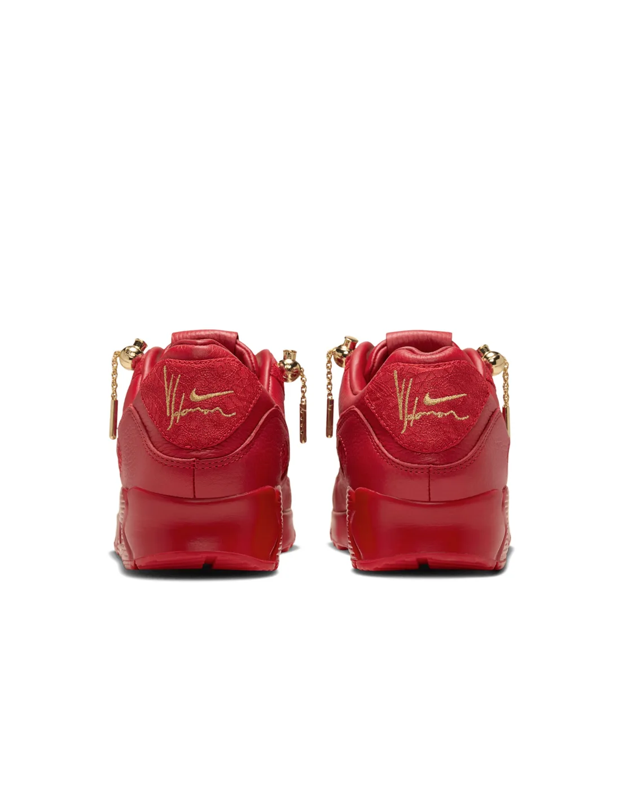
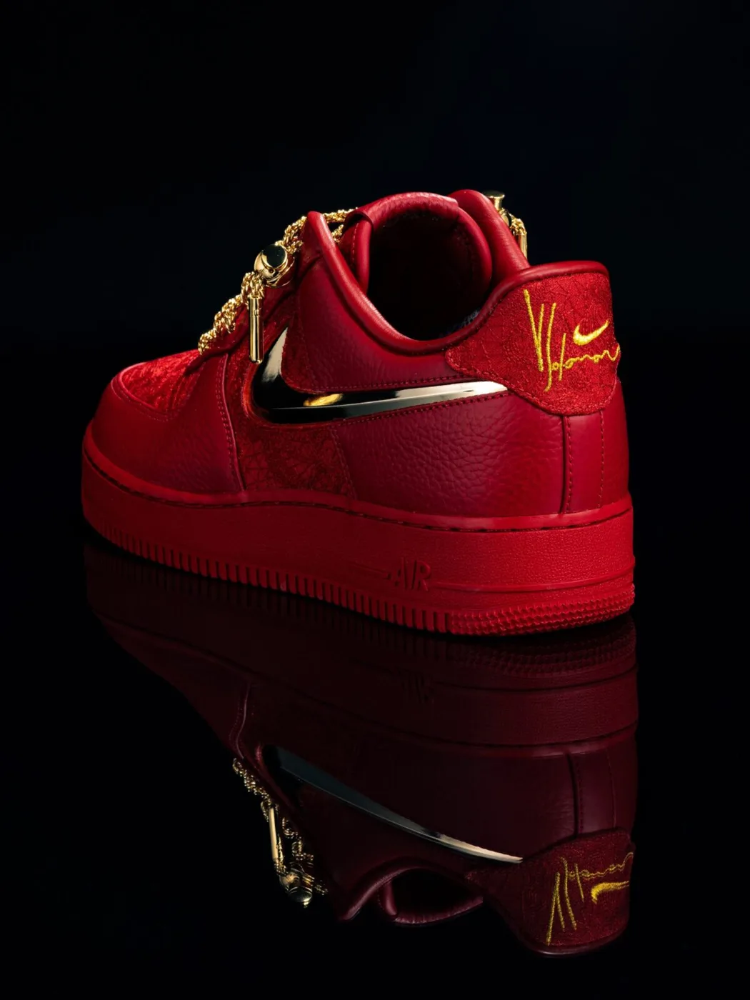
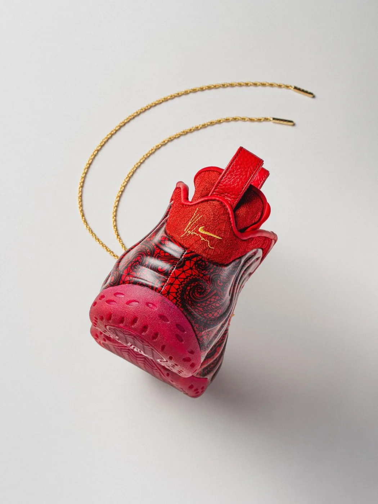

> [English version 英文版](/life/victor-solomon-nike-red-trophies/)

大多数球鞋联名借的是名气：把一个大名字放在 Swoosh 旁边，为这层关联收一笔溢价，然后祈祷没人追问联名方到底贡献了什么。Victor Solomon x Nike 的 "Trophies" 项目面对的是相反的问题：这位合作者的本职工作太具体、太可查证了，以至于鞋子必须配得上它。Solomon 是洛杉矶艺术家，是 Nike 和 NBA 在需要重新设计篮球自己的奖杯时找到的人——联盟重新设计的奖杯作品出自他手，其中包括颁给全明星赛 MVP 的科比·布莱恩特奖杯。当他把金链鞋带和镶满水晶的 Swoosh 放到一双鞋上时，他不是在拿奢侈符号扮装。他是把自己用在球员高举过头顶的那些物件上的同一套材质语言，原样搬到了鞋面上。

今天，这套语言迎来了它迄今最响亮的配色。"Red Trophies" 系列——一双 Air Force 1 '07、一双 Air Max 90 和一双 Air Foamposite One，全部被 Gym Red 淹没，配金属金色硬件——于今天，2026 年 11 月 25 日星期二上午，经 Nike SNKRS 发售，此前一天（11 月 24 日）已先经 Solomon 自己的渠道提前发售。这是贯穿全年的一整个系列的第四章：二月，洛杉矶 NBA 全明星周末的白金套装；七月，WNBA 全明星的黑金套装；十月，在 Kith 提前上架的蓝金三重奏；而现在是红色——Sneaker News 用的词是 "Christmasy"（圣诞味的）——精准卡在黑五周的假日档期。

热度是当下的、有据可查的，不是事后追认。Sneaker News 于 11 月 24 日发布了带官方图的完整拆解——正是 Solomon 抽签于当天美东中午 12 点截止的日子。Sole Retriever 刊登了该套装的发售报道与各单品页面。Nice Kicks 于 11 月 24 日放出了三双鞋的影棚实拍。House of Heat 与 Sneaker Bar Detroit 都把该系列列入了发售日历，Highsnobiety 把 Foamposite 选入本周最佳球鞋盘点，Men's Journal 则把 Air Max 90 放进黑五周五大发售，与 Kith x Star Wars ASICS GEL-Lyte III "Darth Vader"、Pharrell adidas Jellyfish 补货以及周四的 Air Jordan 4 "Bred" 并列。这就是这个套装本周所处的梯队——而且与 Jordan 4 不同，它没有 1989 年的原版可以吃老本。它卖的一切，都是今年设计出来的。

## 基本信息

| | |
|---|---|
| **系列** | Victor Solomon x Nike "Red Trophies"（亦作 "Gym Red Trophies"） |
| **Air Force 1 '07** | IR2076-600 — Gym Red/Black-Metallic Gold — $250 |
| **Air Max 90** | IR2074-600 — Gym Red/Black-Metallic Gold — $250 |
| **Air Foamposite One** | IR2077-600 — Gym Red/Metallic Gold-Black — $350 |
| **发售** | 2026 年 11 月 24 日经 Victor Solomon 渠道（抽签于 11 月 24 日美东 12:00 截止）；2026 年 11 月 25 日经 Nike SNKRS |
| **全系共同细节** | 金色绳链鞋带配篮球造型鞋带锁、附赠红色备用鞋带配金色带头、左右脚各一只独立防尘袋、鞋跟 Victor Solomon 签名标识 |
| **系列回顾** | 白/金（2026 年 2 月，NBA 全明星，洛杉矶）· 黑/金（2026 年 7 月，WNBA 全明星）· 蓝/金（2026 年 10 月，Kith 提前上架）· 红/金（2026 年 11 月） |
| **价格** | Nike/SNKRS 标价，2026 年 11 月 24–25 日查询的 snapshot，subject to change |

*三重奏：三个鞋型，一种颜色，一套材质论证。中间的 Foamposite 是唯一被允许使用第二种颜色的——黑色，藏在佩斯利纹里。图片：Nike，经 Sneaker News。*

## 这位艺术家：这不是比喻

有必要停下来讲清楚 Victor Solomon 是谁，因为如果他只是又一个拿着 mood board 的创意人，这个系列的整个前提就会垮掉。Solomon 靠 Literally Balling 系列在画廊界成名：用这项运动从不使用的材料重做篮球装备——手工研磨的彩绘玻璃篮板配镀金篮筐，篮网用水晶串成，陶瓷篮球摔碎后用日本金缮工艺修复，让修补的痕迹本身以金色示人。这批作品的主线是一个单一的论点：被一项运动当作消耗品的物件，配得上一种文化留给它最尊崇之物的材料。正如他本人在访谈中指出的，彩绘玻璃曾经是只有教堂和国王才用得起展示的材料。

NBA 显然认同这个论点。联盟在 2022 年 2 月宣布，为其 75 周年赛季重新设计的、于克利夫兰首次颁发的全明星奖杯，是与 Solomon 合作完成的。领衔之作是颁给全明星赛 MVP 的科比·布莱恩特奖杯——一件八边形的作品，其尺寸处处对应科比的数字，包括 18 颗星对应他的 18 次全明星入选。此后 Solomon 又重新设计了联盟多座个人奖项与冠军奖杯，这就是为什么 Sneaker News 介绍他时——准确且并不算夸张地——称他是"重新设计过多座个人奖项和冠军奖杯的那位老兄"。

把这个事实放到鞋子旁边，设计选择就不再读作装饰。一只镶满石头的 Swoosh、一条字面意义上的金绳链鞋带、一枚用金线绣在鞋跟的签名——放在别的联名上，这些是奢侈信号、借来的光环；放在 Solomon 的作品上，它们是引文：同一套他用在真奖杯上的珠宝匠词汇，缩小后变得可穿戴。Nike 为 Air Force 1 写的官方文案把这个主张说得很直白——"粗粝的荔枝纹与光面皮革画布，配让点缀成为主角的织物"，硬件让你"有赢家的感觉"。营销文案归营销文案，但这一次，其背后的资历是真实的，而且大约三十秒就能查证。

## 一个配方，三双完全不同的鞋

Trophies 系列的纪律在于：配方从不改变，改变的只有画布。每个套装都用同样的三个鞋型、同样的金链鞋带配篮球造型带锁、同样的鞋跟签名处理、同样的包装仪式——左右脚各一只独立防尘袋，加一副金色带头的红色备用鞋带。变化的只有底色，而底色揭示的是：同一套配方落在三双结构上几乎毫无共同点的鞋上时，表现如何不同——一双 1982 年的皮面篮球鞋、一双 1990 年的可视气垫跑鞋，和一双 1997 年的模压 Foamposite 篮球鞋，后者至今看起来仍像来自未来。

二月的白色读作婚礼装——干净、仪式感强，每双鞋对应洛杉矶的一处地标：据 Sole Retriever 对原系列的记述，Air Force 1 献给日落大道，Air Max 90 献给市中心钻石区，Foamposite 献给海滩，且那第一轮全明星发售是限量的。七月的黑色读作晚装。红色则是第一个读作"运动"的配色。Gym Red 首先是球队色，其次才是时尚色；把三双鞋从鞋底、中底、鞋面到鞋舌全部淹没在红色里，金色就从点缀变成了制服细节，就像冠军旗帜上的金边那样工作。Sneaker News 说它"有圣诞味"，确实不可避免；但更准确的读法是：红色是第一个远远看去可能被误认为球队配发、而非画廊出售的 Trophies 配色。这种"配发 vs 展出"的张力，是这一章最有趣的地方。

### Air Max 90（IR2074-600，$250）：珠宝匠的那双

Air Max 90 拿走了 Solomon 论点最字面化的版本。它的 Swoosh 由透明石头逐颗排布而成，排法像珠宝匠填密钉镶，而不是工厂印一个 logo；第二排石头沿挡泥板上缘向鞋跟延伸。在侧面图中，效果是彻底的：一双单色红皮鞋——鞋头与鞋带孔区是重荔枝纹皮，其余是光面皮，Swoosh 之后是一块带金属光泽的褶皱织物——被恰好两个异物打断：水晶 Swoosh 和金链。

这条链值得单独一句，因为在这双鞋上，鞋带不是鞋带。它们是金色绳链，配桶形带头和金色球形带锁，外侧还垂着一根小小的刻字金条。这是全系列最不实用的细节，也是最切题的：Solomon 用水晶做篮网，他的鞋当然要用珠宝当鞋带。

然后是鞋跟贴片，那个值得放大看的细节。Solomon 的金色草书签名绣满整个鞋跟徽章，一枚小小的金色 Swoosh 被织进了签名的笔画中间——logo 成了手写体的一笔，而不是坐在签名旁边的一个标记。Nike 的文案让你去看鞋跟贴片上的"Victor 官方签收"，却没提签收把 Swoosh 吞了进去。这要么是全套装最大胆的 branding 动作，要么是最 Solomon 的一个：毕竟在他的奖杯上，匠人的手艺才是重点，联盟的标记是画框。

背景让它更锋利。红色在 Air Max 90 上历来是点缀——著名的 Infrared 是嵌在灰白之间的一块色。这双鞋拿走了这个鞋型最出名的那一种颜色，把它淹没整双鞋，只留下石头和金色作为仅剩的对比。这是该型号通常工作方式的反面，也正是珠宝能被读出来的原因。

*侧面：红色一直是这双鞋的点缀色。在这里它是整双鞋，珠宝是仅剩的对比。图片：Nike，经 Because Sneakers。*

*影棚图：这条链在功能意义上不是鞋带——它是"用水晶做篮网"那个想法，搬到了鞋喉上。图片：Nike / Victor Solomon，经 Nice Kicks。*

*俯视：这套系带系统首先是珠宝，其次才是闭合结构。每双都附赠红色备用鞋带配金色带头，给真正想穿它走路的人。图片：Nike，经 Because Sneakers。*

*签收：签名吞掉了 Swoosh。在奖杯上，匠人的标记也是这样工作的。图片：Nike，经 Because Sneakers。*

### Air Force 1 '07（IR2076-600，$250）：克制的那双

如果 Air Max 90 是珠宝匠的鞋，Air Force 1 就是外交官的。它拿走了同样的红色洪流——从鞋头到鞋底单元的荔枝纹皮革、同色系佩斯利纹织物拼接——然后把全部金色预算花在一个动作上：一枚放大的、立体的金属金 Swoosh，抛光到读作一块铭牌而不是一层印刷。金绳链鞋带、鞋舌标识和鞋跟缝制的签名为它做配，但没有任何东西与它竞争。

这种克制，正是多位早期评论者把这双挑作三双中"该买的那双"的原因。AF1 是三者中结构戏剧性最弱的鞋型——没有做雕塑工作的可视气垫窗，没有模压外壳——所以 Trophies 的处理无处可藏，而在这个配色上它也不需要藏。红色荔枝纹皮、一块金铭牌 Swoosh、绳链鞋带，这大约是 Air Force 1 在滑向戏服之前能被推到的极限，而这双恰好停在了可穿的那一侧。以 $250——远高于普通 Air Force 1 Low 通常货架价的两倍——你付的是材料与硬件的钱，不是科技的钱，而鞋跟照片让这笔交易一目了然：荔枝纹皮、压纹佩斯利拼接、镜面金 Swoosh，和一枚像 hallmark 一样缝上的签名。

*AF1 把全部金色预算花在一块铭牌 Swoosh 上——加上鞋跟那枚 hallmark 式的签名。这是三双中最可穿的一双，是设计如此。图片：Nike / Victor Solomon，经 Nice Kicks。*

### Air Foamposite One（IR2077-600，$350）：奖杯本杯

Foamposite 是这个套装 $350 的头条，也是它概念上的重心，原因很简单：在三个鞋型中，它是唯一一个生来就是浇铸而非缝制的。Foamposite 的外壳是模压的、光亮的、无缝的——是 Nike 目录里最接近"被浇注出来的物件"的东西。把 Solomon 的语言放上去，比喻就不再是比喻。这双鞋真的长得像一座奖杯。

它也是唯一被允许使用第二种颜色的一双。AF1 与 AM90 是单色红，Foamposite 则在光亮的 Gym Red 外壳上铺满大幅黑色佩斯利满印——几何网格填满佩斯利纹样之间的空白——配更鲜亮的红色皮革鞋带区与鞋领、红色提拉环、鞋头外侧的金色小 Swoosh、金链鞋带、裸露的碳纤维足弓板，以及零售目录所载该型号惯常构造中的半透明红色外底。佩斯利是这个系列反复出现的织物母题——在它之前的白、黑两双 Foam 上都出现过——但在红色上它做了新的工作：黑色图案在外壳上读作近乎雕刻，深色的线条刻进抛光的表面，而这，再一次，正是真奖杯被装饰的方式。

鞋跟图收束了整个论证。把鞋转过来，你会看到佩斯利外壳收束进一块红色仿麂皮质感的鞋跟面板，上面是 Solomon 的金色签名，下方是半透明红外底，而备用金链在画面外划出一道弧——这双鞋被拍摄的方式，就是拍摄一件壁炉台上物件的方式，因为那正是这件物件对自己的宣称。

这里需要一句诚实的提醒，它适用于整个套装：这是一篇发售日的设计、材料与背景评论，不是一篇上脚实测。Red Trophies 今天早上才开售；这个配色尚不存在任何权威的长期实测，而 Foamposite 众所周知的性格——僵硬的模压鞋面磨合很慢、重量实打实、鞋楦历来偏紧——来自这个型号三十年的历史，而不是来自穿着这双鞋跑过的里程。任何告诉你红色这双穿一个月后脚感如何的人，都是在猜。

*鞋跟图：佩斯利在浇铸外壳上读作雕刻——而真奖杯正是这样被装饰的。签名，再一次，是 hallmark。图片：Nike / Victor Solomon，经 Nice Kicks。*

## 脚下：三个老平台，诚实评估

这三双鞋的鞋底之下没有任何新东西，评论应该直说。Air Force 1 用的是 1982 年的封装 Air 鞋底单元——硬朗、平坦、可靠，是生活方式的脚感。Air Max 90 在红色中底里保留了它的可视后跟气垫窗；它是三者中日常穿着最有缓震感的一双，其平台本身也是视觉设计的一部分。Foamposite One 在模压外壳之下保留了全掌 Zoom Air 与碳纤维足弓板架构——这里最有真性能血统的底盘，裹在最不宽容的鞋面里。

这就是这个套装真正的交易，一次为三双说清：你买的是表面、材料与意义，不是缓震创新。$250 与 $350 的价格——2026 年 11 月 25 日的 snapshot，subject to change——是奖杯的价格，不是科技的价格。以性能鞋的标准衡量，这三双都被价格一半的鞋甩在身后，其中包括 Nike 自家现行产品线里的好几双。以"有可查证作者、有连贯论点的设计物件"的标准衡量，这个定价至少内部自洽：Foamposite 比另外两双贵 $100，因为它的外壳是制造成本最高的东西，也是最接近标题字面主体的东西。

尺码建议遵循基础鞋型，外加一条本套装专属的警告。皮面构造的 Air Force 1 与 Air Max 90 穿着接近各自的标准鞋楦；Foamposite 偏紧、磨合慢，一如既往。本套装专属的警告是系带系统：金绳链作为闭合结构，就像水晶篮网作为篮网一样。每双都附赠金色带头的红色备用鞋带，而穿这些鞋的明智方式——任何一双——是：链子用于展示和拍照，鞋带用于走路。每只鞋一只的防尘袋，说明了 Nike 预期哪种模式占主导。

## 结论：买哪双，为谁而买

四章之后，Trophies 系列已经变成了 Nike 如今很少能持续的东西：一个演员表稳定、配方稳定、只轮换单一变量的联名，像奖杯柜被填满一样——一次仪式，一座奖杯——积累成一个收藏。红色这一章不是最含蓄的，它是最易读的。白色证明了概念，黑色证明了它能低调，蓝色证明了 Nike 愿意让它提前经精品店渠道旅行，而红色证明了：它能在一年中零售声量最大的一周里，以全音量穿上球队色，而不让珠宝消失在噪音里。

那么购买建议，逐双说。Air Force 1 是理性的购买：完成度最干净、鞋型最可穿、金色只花在一个地方。Air Max 90 是行家的购买：镶石 Swoosh 和吞掉 Swoosh 的签名鞋跟，是全套装最有工艺含量的两个细节，而 Infrared 的反转给了它另外两双没有的故事。Foamposite One 是信徒的购买——最贵、最不实用，也是唯一一双完整地变成了整个项目所命名的那个东西的鞋。如果 Trophies 的前提能打动你分毫，它在 $350、在红底黑佩斯利上，打动你最深。

而如果这个前提打动不了你？那么这篇评论诚实的结尾是：这个系列的任何一章都不是为你而写的，而红色——最响亮的一章——尤其不是。这些鞋论证的是：篮球的物件配得上一位珠宝匠。今天，在 Gym Red 与金色里，它们在黑五周、在 SNKRS 上，以全音量做了这个论证。Solomon 自家店面的抽签已于昨天美东中午截止；SNKRS 的发售是今天的事件。二级市场决定一座可穿戴的奖杯值多少钱，那是下周的问题。这些物件是什么，已经确定了——而且比这个行业今年发售的大多数东西都有趣。

*来源：Sneaker News（2026 年 11 月 24 日，官方图、抽签与 SNKRS 细节、系列史）；Sole Retriever（2026 年 11 月，套装报道与单品页面）；Nice Kicks（2026 年 11 月 24 日，影棚摄影与各型号发售页）；House of Heat 与 Sneaker Bar Detroit（发售日历与货号）；Because Sneakers（Air Max 90 细节摄影与 Solomon/NBA 奖杯背景）；Men's Journal 与 Highsnobiety（黑五周盘点）。价格为 2026 年 11 月 25 日查询的零售 snapshot，subject to change。本文为发售日的设计与背景评论，非上脚实测。*
