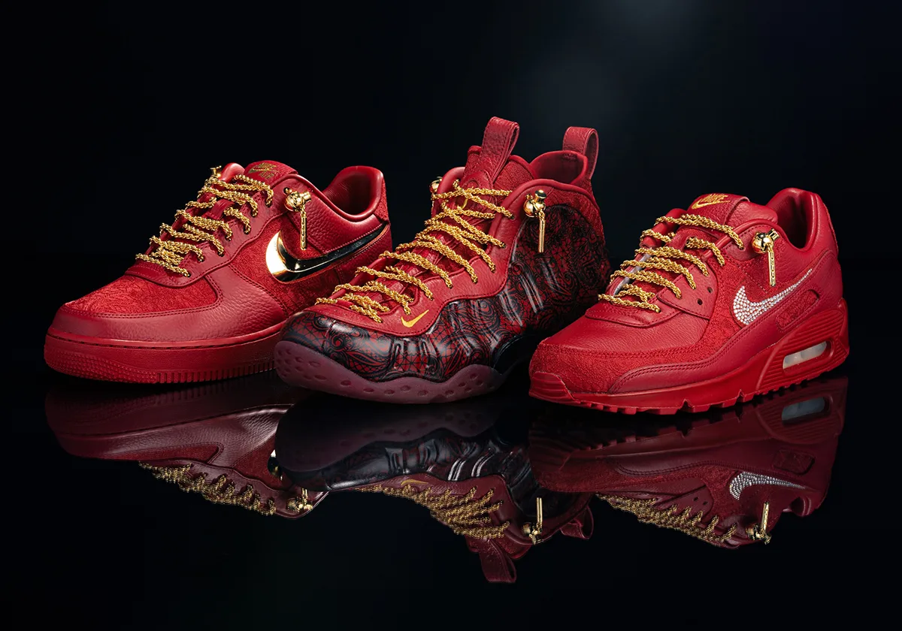
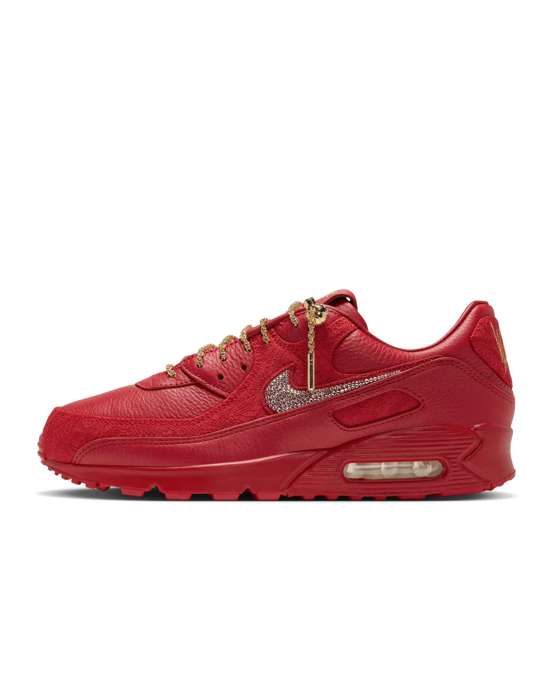
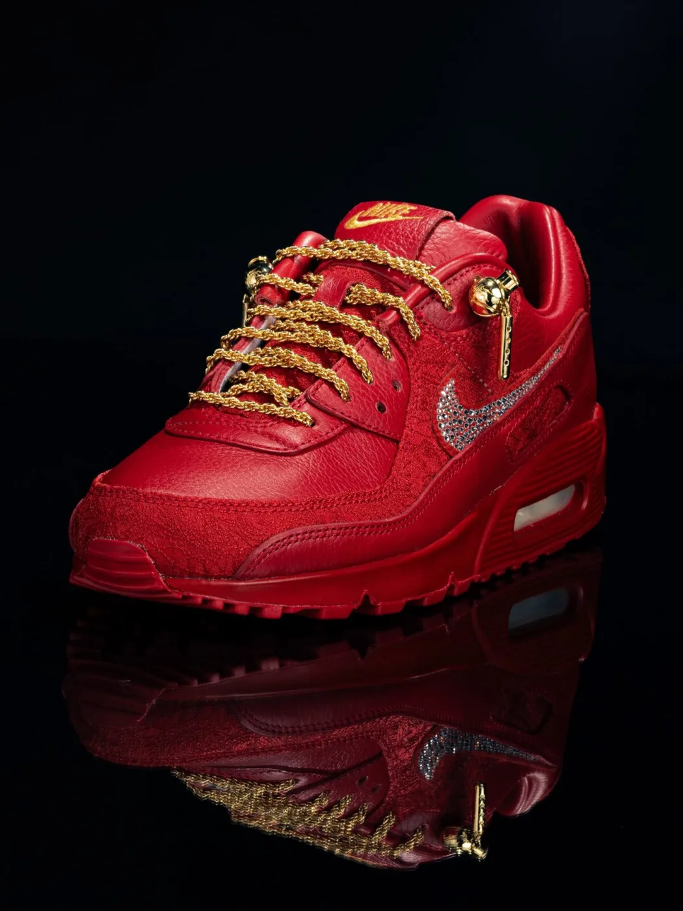
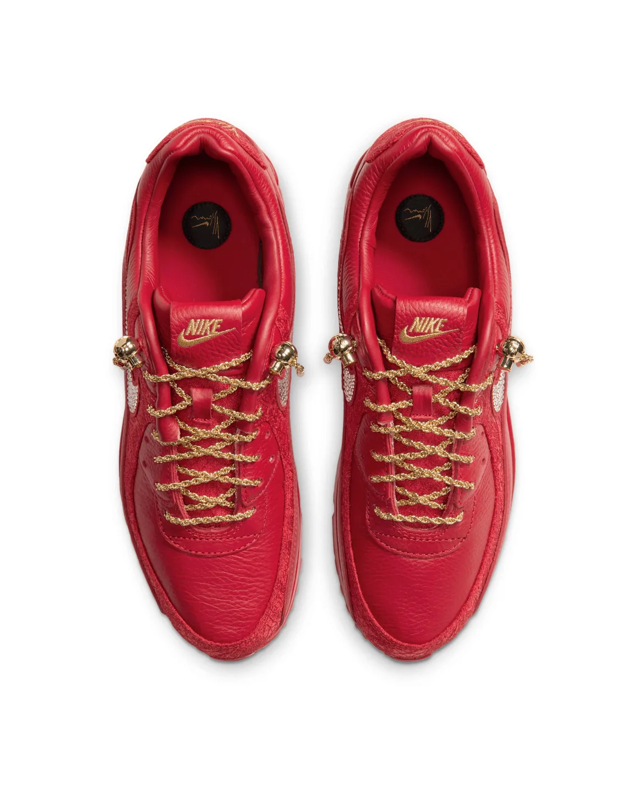
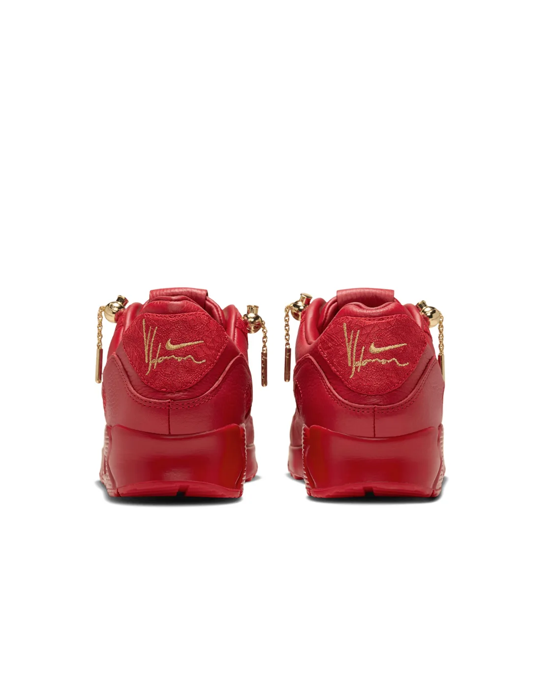
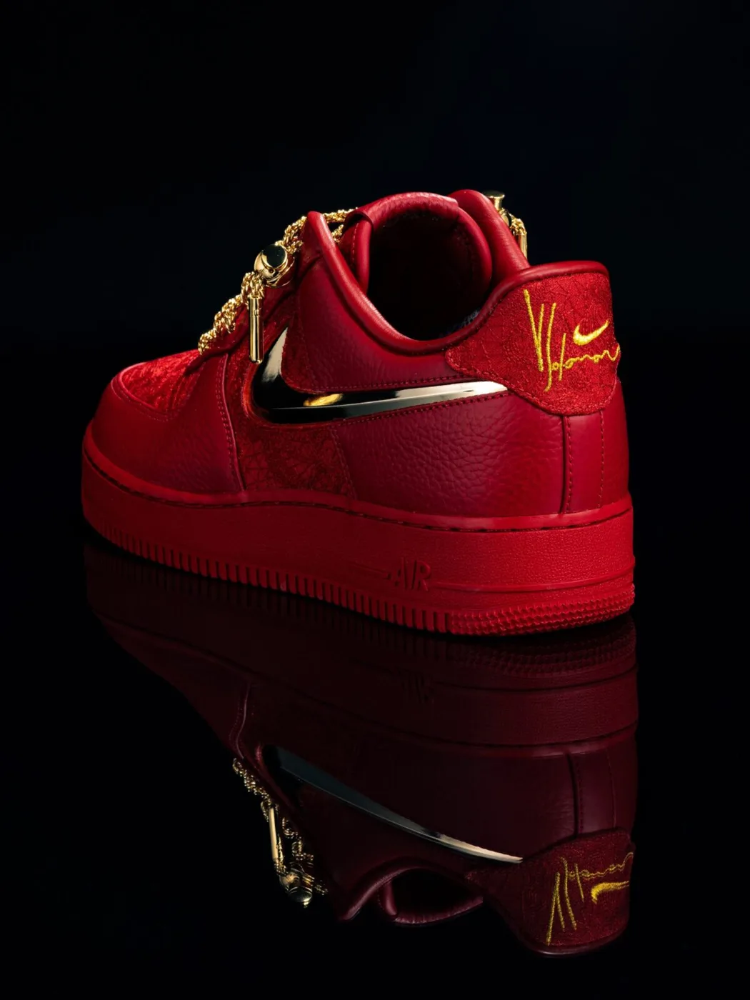
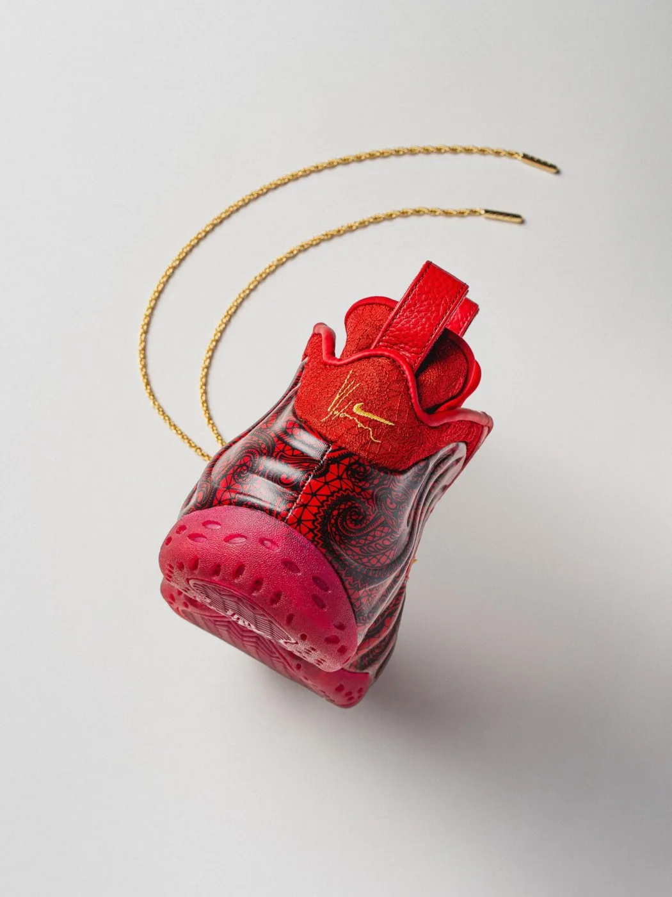

> [中文版 Chinese version](/life/victor-solomon-nike-red-trophies-zh/)

Most sneaker collaborations borrow prestige. They put a famous name next to a Swoosh, charge a premium for the association, and hope nobody asks what the collaborator actually contributed. The Victor Solomon x Nike "Trophies" project has the opposite problem: its collaborator's day job is so specific, and so verifiable, that the shoes have to live up to it. Solomon is the Los Angeles artist Nike and the NBA turned to when basketball's own hardware needed redesigning — the man behind the league's redesigned trophy work, including the Kobe Bryant Trophy awarded to the All-Star Game MVP. When he puts gold chain laces and a crystal-set Swoosh on a sneaker, he is not playing dress-up with luxury codes. He is applying, to footwear, the exact material language he applies to the objects players lift over their heads.

Today that language arrives in its loudest colorway yet. The "Red Trophies" collection — an Air Force 1 '07, an Air Max 90 and an Air Foamposite One, all flooded in Gym Red with metallic gold hardware — released this morning, Tuesday, November 25, 2026, via Nike SNKRS, following an early launch through Solomon's own channels on November 24. It is the fourth chapter of a series that has run all year: a white-and-gold pack for NBA All-Star Weekend in Los Angeles in February, a black-and-gold pack for WNBA All-Star in July, a blue-and-gold trio that surfaced early at Kith in October, and now red, timed — Sneaker News' word is "Christmasy" — for the holiday end of Black Friday week.

The heat is current and documented, not retrospective. Sneaker News published its full breakdown with official images on November 24, the day the Solomon draw closed at 12:00 PM ET. Sole Retriever carried the pack's release story and its individual product pages. Nice Kicks ran studio photography of all three pairs on November 24. House of Heat and Sneaker Bar Detroit both listed the collection in their release calendars, Highsnobiety included the Foamposite in its best-sneakers-of-the-week roundup, and Men's Journal put the Air Max 90 in its five best Black Friday week releases, alongside the Kith x Star Wars ASICS GEL-Lyte III "Darth Vader," the Pharrell adidas Jellyfish restock and Thursday's Air Jordan 4 "Bred." That is the company this pack is keeping this week — and unlike the Jordan 4, it does not have a 1989 original to coast on. Everything it is selling, it designed this year.

## The facts

| | |
|---|---|
| **Collection** | Victor Solomon x Nike "Red Trophies" (also listed as "Gym Red Trophies") |
| **Air Force 1 '07** | IR2076-600 — Gym Red/Black-Metallic Gold — $250 |
| **Air Max 90** | IR2074-600 — Gym Red/Black-Metallic Gold — $250 |
| **Air Foamposite One** | IR2077-600 — Gym Red/Metallic Gold-Black — $350 |
| **Release** | November 24, 2026 via Victor Solomon (draw closed 12:00 PM ET Nov 24); November 25, 2026 via Nike SNKRS |
| **Shared details** | Gold rope-chain laces with basketball-shaped lace locks, alternate red laces with gold aglets, individual dust bags for left and right shoes, Solomon signature branding at the heel |
| **Series so far** | White/gold (Feb 2026, NBA All-Star, LA) · Black/gold (July 2026, WNBA All-Star) · Blue/gold (Oct 2026, early at Kith) · Red/gold (Nov 2026) |
| **Prices** | Retail prices as listed by Nike/SNKRS and reported November 24–25, 2026 — snapshot, subject to change |

*The trio: three silhouettes, one color, one material argument. The Foamposite in the middle is the only one allowed a second color — black, in the paisley. Image: Nike, via Sneaker News.*

## The artist: this is not a metaphor

It is worth pausing on who Victor Solomon is, because the collection's entire premise collapses if he is just another creative with a mood board. Solomon built his name with Literally Balling, a body of gallery work that rebuilds basketball equipment in materials the sport never uses: hand-ground stained-glass backboards on gold-plated hoops, nets strung from crystal, ceramic basketballs broken and rejoined by the Japanese kintsugi method so the repairs themselves show in gold. The through-line of that work is a single argument — that the objects a sport treats as disposable deserve the materials a culture reserves for what it venerates. Stained glass, as he has pointed out in interviews, was once a material only churches and kings could afford to display.

The NBA evidently agreed with the argument. The league announced in February 2022 that its redesigned All-Star trophies, created for its 75th anniversary season and first awarded in Cleveland, were made in partnership with Solomon. The headline piece is the Kobe Bryant Trophy for the All-Star Game MVP — an eight-sided object whose dimensions are keyed to Bryant's numbers, including eighteen stars for his eighteen All-Star selections. Solomon has since redesigned a number of the league's individual award and championship trophies, which is why Sneaker News introduces him, accurately and without much exaggeration, as "the dude who's redesigned a number of individual award and championship trophies."

Hold that fact next to the shoes and the design choices stop reading as decoration. A Swoosh set in stones, a lace that is literally a gold rope chain, a signature embroidered in gold thread at the heel — on another collaboration these are luxury signals, borrowed glamour. On Solomon's they are a citation: the same jeweler's vocabulary he uses on the hardware, miniaturized and made wearable. Nike's own product copy for the Air Force 1 makes the claim plainly — a "gritty canvas of pebbled and smooth leather with textiles that let the accents take the spotlight," hardware that will have you "feeling like a winner." Marketing copy is marketing copy, but for once the underlying credential is real, and it is checkable in about thirty seconds.

## One formula, three very different shoes

The discipline of the Trophies series is that the formula never changes — only the canvas does. Every pack uses the same three silhouettes, the same gold chain laces with basketball-shaped lace locks, the same signature-at-the-heel treatment, the same packaging ritual of individual dust bags for the left and right shoes plus a set of alternate red laces with gold aglets. What changes is the base color, and what the color reveals is how differently the formula behaves on three shoes that have almost nothing in common structurally: a 1982 leather court shoe, a 1990 visible-Air runner, and a 1997 molded-foamposite basketball shoe that still looks like it arrived from the future.

In white, back in February, the pack read as bridal — clean, ceremonial, each shoe themed to a piece of Los Angeles: the Air Force 1 for the Sunset Strip, the Air Max 90 for the downtown Diamond District, the Foamposite for the beaches, in Sole Retriever's account of the original collection, with pairs limited in that first All-Star run. In black, in July, it read as evening wear. Red is the first colorway that reads as sport. Gym Red is a team color before it is a fashion color, and flooding three shoes in it — sole, midsole, upper, tongue, all of it — turns the gold from an accent into a uniform detail, the way gold trim works on a championship banner. Sneaker News calls the result "Christmasy," and it is, unavoidably; but the more precise reading is that red is the first Trophies color that could plausibly be mistaken, at a distance, for something a team issued rather than something a gallery sold. That tension — issued versus exhibited — is the most interesting thing about this chapter.

### Air Max 90 (IR2074-600, $250): the jeweler's shoe

The Air Max 90 takes the most literal version of Solomon's argument. Its Swoosh is built out of clear stones, set in rows the way a jeweler fills a pavé setting rather than the way a factory prints a logo, with a second line of stones tracing the top edge of the mudguard toward the heel. On the lateral shot the effect is total: a monochrome red leather shoe — tumbled leather at the toe and eyestay, smooth leather elsewhere, a crinkled textile with a metallic sheen behind the Swoosh — interrupted by exactly two foreign objects, the crystal Swoosh and the gold chain.

The chain deserves its own sentence, because on this shoe the laces are not laces. They are gold rope chain, finished with barrel aglets and gold ball locks, with a small engraved gold bar hanging off the lateral side. It is the single most impractical detail in the collection and the single most on-thesis: Solomon makes nets out of crystal; of course his shoe is laced with jewelry.

Then there is the heel tab, the detail worth the zoom. Solomon's gold cursive signature is embroidered across the heel badge with a small gold Swoosh worked into the middle of the script — the logo becomes a stroke of the handwriting rather than a mark sitting beside it. Nike's copy tells you to check the back tab for "Victor's official sign-off"; it does not mention that the sign-off has swallowed the Swoosh. That is either the boldest branding move in the pack or the most Solomon one: on his trophies, after all, the maker's craft is the point, and the league's mark is the frame.

Context sharpens it further. Red on an Air Max 90 has historically been an accent — the famous Infrared was a block of color set against grey and white. This pair takes the one color the silhouette is known for and floods the entire shoe with it, leaving the stones and the gold as the only contrast left. It is the inverse of how the model normally works, and it is precisely why the jewelry reads at all.

*Lateral view: red was always this shoe's accent color. Here it is the whole shoe, and the jewelry is the only contrast left. Image: Nike, via Because Sneakers.*

*Studio view: the chain is not a lace in any functional sense — it is the net-from-crystal idea, moved to the throat of a shoe. Image: Nike / Victor Solomon, via Nice Kicks.*

*Top-down: the lacing system as jewelry first, closure second. An alternate set of red laces with gold aglets is included for anyone who wants to actually walk in them. Image: Nike, via Because Sneakers.*

*The sign-off: the signature swallows the Swoosh. On a trophy, the maker's mark works the same way. Image: Nike, via Because Sneakers.*

### Air Force 1 '07 (IR2076-600, $250): the controlled one

If the Air Max 90 is the jeweler's shoe, the Air Force 1 is the diplomat's. It takes the same red flood — tumbled leather from the toe through the sole unit, tonal paisley-patterned textile panels — and spends its entire gold budget on one move: an oversized, dimensional metallic gold Swoosh, polished enough to read as a plate rather than a print. Gold rope laces, tongue branding and the stitched signature at the heel support it, but nothing competes with it.

That restraint is why more than one early reviewer has singled this pair out as the buy of the three. The AF1 is the silhouette with the least structural drama of the trio — no visible Air window doing sculptural work, no molded shell — so the Trophies treatment has nowhere to hide, and on this colorway it doesn't need to. Red tumbled leather, a gold plate Swoosh and rope laces is about as far as you can push an Air Force 1 before it tips into costume, and this pair stays, just, on the wearable side of that line. At $250 — well over double a standard Air Force 1 Low's usual shelf price — what you are paying for is materials and hardware, not technology, and the heel photograph makes the transaction legible: pebbled leather, an embossed paisley panel, a mirror-gold Swoosh and a signature stitched like a hallmark.

*The AF1 spends its whole gold budget on one plate Swoosh — and the signature-as-hallmark at the heel. The most wearable pair of the three, by design. Image: Nike / Victor Solomon, via Nice Kicks.*

### Air Foamposite One (IR2077-600, $350): the trophy itself

The Foamposite is the pack's $350 headline and its conceptual center of gravity, for a simple reason: of the three silhouettes, it is the only one that is already cast rather than stitched. A Foamposite shell is molded, glossy and seamless — the closest thing in Nike's catalog to an object that was poured. Put Solomon's language on it and the metaphor stops being a metaphor. This is the pair that actually looks like a trophy.

It is also the only pair allowed a second color. Where the AF1 and AM90 are monochrome red, the Foamposite lays a large black paisley all-over print — geometric grids filling the space between the paisley forms — across the glossy Gym Red shell, with brighter red leather at the eyestay and collar, red pull tabs, a gold mini Swoosh at the lateral toe, gold chain laces, an exposed carbon-fiber shank and a semi-translucent red outsole in the model's usual build, as catalogued in retail listings. The paisley is the series' recurring textile motif — it appeared on the white and black Foams before this one — but on red it does new work: the black pattern reads almost like engraving on the shell, dark lines cut into a polished surface, which is, again, how trophies are actually decorated.

The heel shot closes the argument. Turn the shoe around and you get the paisley shell wrapping into a red suede-like heel panel carrying Solomon's gold signature, the translucent red outsole below it, and the spare gold chain arcing out of frame — the shoe photographed the way you would photograph an object on a mantel, because that is the object's own claim about itself.

Honesty requires the obvious caveat here, and it applies to the whole pack: this is a release-day review of design, materials and context, not an on-foot wear test. The Red Trophies pairs went on sale this morning; no authoritative long-term wear test of this colorway exists yet, and the Foamposite's known character — a stiff molded upper that breaks in slowly, real weight, a fit that has always run snug — comes from the model's three decades of history, not from miles in this pair. Anyone telling you how the red ones feel after a month is guessing.

*Heel view: the paisley reads as engraving on a cast shell — which is how actual trophies are decorated. The signature, again, is the hallmark. Image: Nike / Victor Solomon, via Nice Kicks.*

## Underfoot: three old platforms, honestly assessed

Nothing underneath any of these shoes is new, and the review should say so plainly. The Air Force 1 rides its encapsulated Air sole unit from 1982 — firm, flat, dependable, a lifestyle ride. The Air Max 90 keeps its visible heel Air window in a red midsole; it is the most cushioned-feeling of the three in everyday wear and the one whose platform is part of the visual design. The Foamposite One keeps its full-length Zoom Air and carbon-fiber shank architecture under the molded shell — the most genuinely performance-derived undercarriage here, wrapped in the least forgiving upper.

That is the pack's real trade, stated once for all three pairs: you are buying surface, material and meaning, not cushioning innovation. The $250 and $350 price tags — snapshots as of November 25, 2026, subject to change — are trophy prices, not technology prices. Judged as performance footwear, all three are outclassed by shoes costing half as much, including several in Nike's own current line. Judged as designed objects with a verifiable author and a coherent argument, the pricing is at least internally consistent: the Foamposite costs $100 more than the other two because its shell is the expensive thing to make and the closest thing to the literal subject.

Sizing guidance follows the base models, with one pack-specific warning. The Air Force 1 and Air Max 90 in leather builds wear close to their standard fits; the Foamposite runs snug and breaks in slowly, as it always has. The pack-specific warning is the lacing: a gold rope chain is a closure the way a crystal net is a net. Every pair includes alternate red laces with gold aglets, and the sensible way to wear these — any of them — is chain for display and photographs, laces for walking. The dust bags, one per shoe, tell you which mode Nike expects to dominate.

## The verdict: which one, and for whom

Four chapters in, the Trophies series has become something Nike rarely sustains anymore: a collaboration with a stable cast, a stable formula and a rotating single variable, building a collection the way a trophy case fills — one ceremony at a time. The red chapter is not the subtlest; it is the most legible. White proved the concept, black proved it could dress down, blue proved Nike would let it travel early through a boutique, and red proves it can wear a team color at full volume in the loudest retail week of the year without the jewelry disappearing into the noise.

So, the buying advice, pair by pair. The Air Force 1 is the rational purchase: the cleanest execution, the most wearable silhouette, the gold spent in one place. The Air Max 90 is the connoisseur's purchase: the stone-set Swoosh and the signature-swallowing heel tab are the two most crafted details in the pack, and the Infrared inversion gives it a story the other two don't have. The Foamposite One is the believer's purchase — the most expensive, the least practical, and the only one that fully becomes the thing the whole project is named after. If the premise of Trophies moves you at all, it moves you most at $350, in paisley over red.

And if the premise doesn't move you? Then this review's honest closing is that no chapter of this series was ever for you, and red — the loudest one — least of all. These are shoes that argue basketball's objects deserve a jeweler. Today, in Gym Red and gold, they made the argument at full volume, on SNKRS, in Black Friday week. The draw at Solomon's own storefront closed at noon ET yesterday; the SNKRS release is today's event. What the aftermarket decides a wearable trophy is worth is a question for next week. What the objects are is settled, and it is more interesting than most of what this industry shipped this year.

*Sources: Sneaker News (November 24, 2026, official images, draw and SNKRS details, series history); Sole Retriever (pack story and product pages, November 2026); Nice Kicks (studio photography and per-model release pages, November 24, 2026); House of Heat and Sneaker Bar Detroit (release calendars and style codes); Because Sneakers (Air Max 90 detail photography and Solomon/NBA trophy background); Men's Journal and Highsnobiety (Black Friday week roundups). Prices are retail snapshots as of November 25, 2026, subject to change. This is a release-day design and context review, not an on-foot wear test.*
