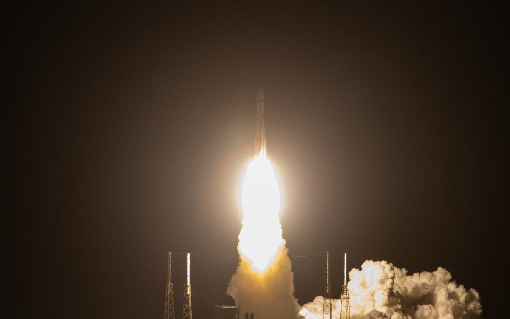
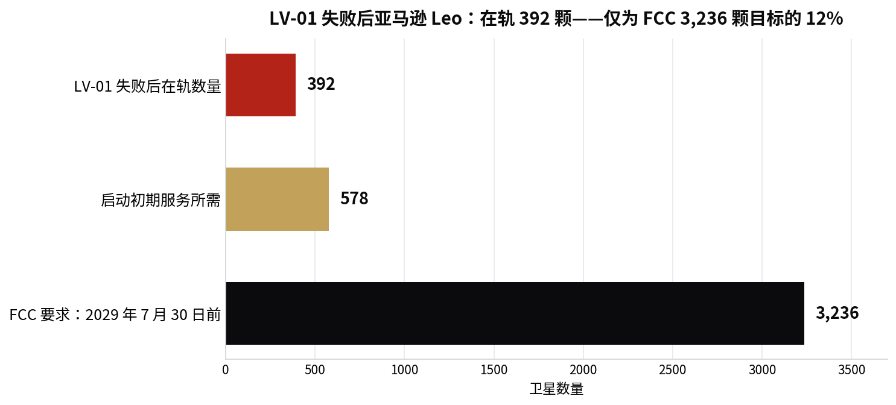
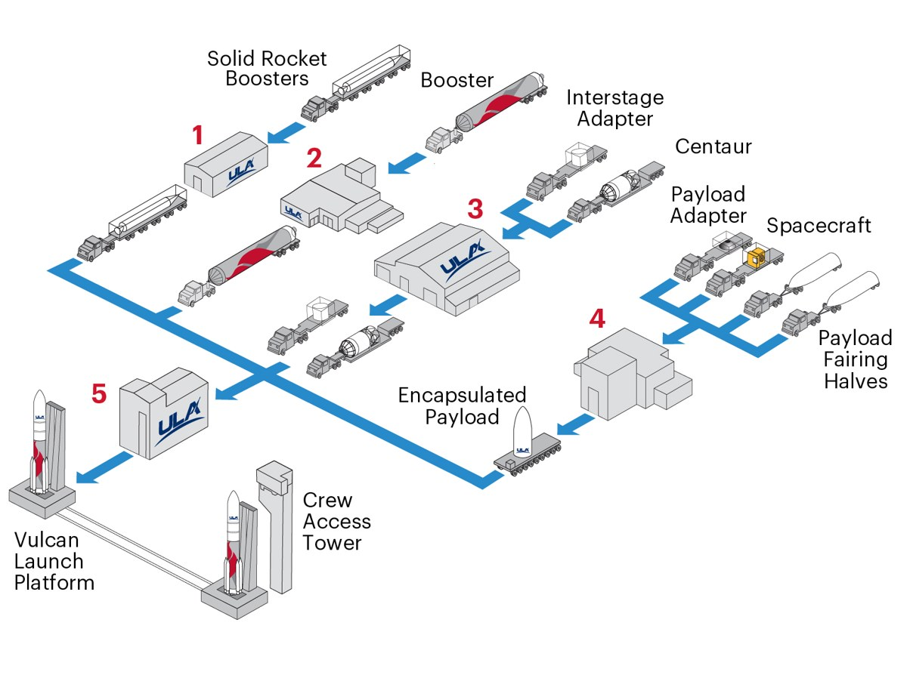
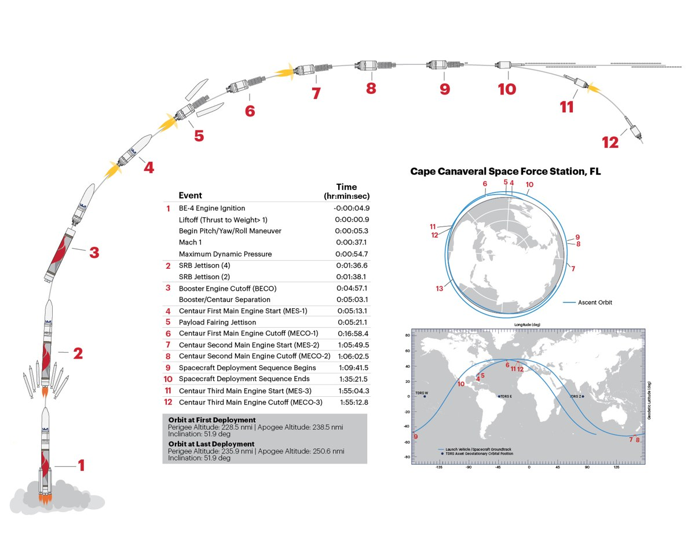

> [English version](/life/vulcan-amazon-leo-launch/)

*一枚 Vulcan 火箭于 2024 年 1 月 8 日首次飞行时从卡纳维拉尔角升空。照片：NASA / Kim Shiflett，经 Wikimedia Commons（公有领域）。注意：这是 Vulcan 首飞的资料照片，不是今天 LV-01 的发射。*

## 发生了什么

美国联合发射联盟（ULA）的 Vulcan 火箭于 11 月 15 日星期日**美东时间 12:40:30** 从卡纳维拉尔角 41 号发射台升空——这是三天内的第三次尝试——约 10 分钟后失败。火箭携带 **40 颗亚马逊 Leo 宽带卫星**，是迄今最大的一批 Leo 卫星，也是亚马逊预订的 38 次 Vulcan 发射中的第一次。没有一颗卫星完成部署。

按 ULA 实时更新和 Florida Today 直播确认的时间线：

- **美东 12:11：** 发射窗口开启。倒计时在 **T-4 分钟**暂停，原因是上面级热调节——冷却问题——ULA 处理后放行。升空发生在窗口的最后一刻，**美东 12:40:30**。
- **T+1:45：** 6 枚固体助推器全部燃尽并干净分离。Florida Today 写道：“6 枚固体火箭助推器（SRB）在平稳升空后与火箭分离。”
- **T+ 约 6 分钟：** 级间分离确认——助推器发动机关闭、Centaur V 上面级点火、整流罩抛离。
- **约 T+10 分钟（美东约 12:50）：** 异常发生。飞行器在 Centaur V 阶段失败，远早于原定升空后约 70 分钟开始的部署程序。
- **美东 13:31：** ULA 在其实时博客上确认，飞行器“在飞行 10 分钟后发生异常，未能将亚马逊任务送入轨道”。Florida Today 于 13:36 转发了确认消息，13:42 结束了直播。

ULA 的声明坦承了它不知道的东西：“由于异常刚刚发生，我们目前还没有具体数据来理解今天发生了什么。”以及：“今天，我们没有达到这个标准。”截至直播结束，亚马逊没有发表任何声明。NASA 局长 Jared Isaacman 发帖表示，NASA 愿意协助调查和补救工作。

## 转折：所有人担心的部件工作正常

这次飞行本应检验一件事：**GEM-63XL 固体火箭助推器的喷管**。Vulcan 自 2026 年 2 月 12 日起停飞，当时 USSF-87 任务在升空不到 30 秒后一枚喷管故障——这是四次飞行中的第二次喷管故障，第一次发生在 2024 年 10 月 4 日火箭第二次飞行、升空后约 37 秒。两次火箭都勉强到达了预定轨道，但美国太空军失去了信心。ULA 表示喷管经过重新设计，但 ULA 和诺斯罗普·格鲁曼都没有公开根本原因。

今天，喷管表现正常。6 枚助推器全部干净分离。故障发生在更晚的 Centaur V 上面级阶段——助推器脱离之后。这个区别对调查很重要：从今天的证据看，停飞的原因不是这次失败的原因。这也意味着，ULA 在刚刚花了九个月修复的问题之上，又面临第二个、独立的问题——没有公开的原因，也没有复飞时间表。

## 这次飞行在升空前就很重要

Vulcan 是 ULA 的旗舰重型火箭——为取代 Atlas V 和 Delta IV 而造的 65 米运载工具——五角大楼已将 2030 年代初之前约一半的重大国家安全发射托付给它。军方希望先从 Vulcan 的商业飞行中拿到数据，再批准它恢复执行国家安全任务，也就是说，至少两次亚马逊 Leo 发射要先飞，五角大楼才可能在 2027 年初把自己的硬件重新放上这枚火箭。军方现在拿到的却是失败数据。

抵达发射台用了三次尝试。第一次是 11 月 13 日星期五，在加注过程中因供应商的商品流问题——向火箭输送液态气氮的工厂断电——而取消。星期六的尝试因地面设备与运载工具之间的网络通信问题而取消。两次 ULA 都表示火箭和航天器状态良好。

## 星座算术：还是 392 颗，还差 2,844 颗

这 40 颗卫星本应让星座在轨数量达到 432 颗。结果数字没有变化——在轨约 **392 颗**，其中截至 11 月初有 368 颗处于运行轨道，6 颗已再入大气层。亚马逊需要 **578 颗**卫星在轨才能启动初期区域服务，而 FCC 执照要求在 **2029 年 7 月 30 日前**部署全部 **3,236 颗**。FCC 于 2026 年 6 月豁免了 2026 年 7 月的中期里程碑，但保留了 2029 年的最后期限，迟到的卫星将面临频谱优先权处罚。

*LV-01 失败后亚马逊 Leo 在轨卫星数（392 颗——丢失的 40 颗本应让总数达到 432 颗），对比启动初期服务所需数量和 FCC 要求。来源：ULA；NASASpaceFlight；FCC。*

392 颗只占目标的约 12%，离最后期限不到三年——这就是为什么发射清单比任何单次发射都重要。这份清单是历史上最大的商业发射采购：五种火箭超过 100 次任务——Atlas V、Ariane 6、Falcon 9、Vulcan 和 New Glenn。Vulcan 占最大份额，**预订 38 次**，LV-01 是其中的第一次。此前八次 Leo 部署任务全部由即将退役的 Atlas V 执行。另一位主力、蓝色起源的 New Glenn，在 5 月的发射台爆炸中损失了首枚火箭。亚马逊位于华盛顿州柯克兰的工厂最近完成了第 1,000 颗 Leo 卫星，曾经六个月才能造出 27 颗卫星的生产线，如今一周就能造 27 颗。卫星已经就绪，瓶颈是火箭——而今天瓶颈更严重了。

## 这项服务本来是什么

亚马逊 Leo——亚马逊花了六年称之为 Project Kuiper（柯伊伯计划）、2025 年 11 月改名后的星座——是 SpaceX 星链的直接对手。初期星座覆盖南北纬 56 度之间的区域，之后逐步扩展到全球覆盖。终端配置说明了亚马逊先卖给谁：企业级 **Leo Ultra** 下行速率最高 **1 Gbps**，紧凑型 **Leo Pro** 和 **Leo Nano** 分别最高 **400 Mbps** 和 **100 Mbps**。亚马逊表示该网络将连接数千万用户，并已宣布与 AT&T、JetBlue、达美航空和苹果达成合作。在 2026 年第三季度财报电话会上，亚马逊表示网络仍有望在今年开始初期服务——这个说法现在取决于 Vulcan 调查需要多长时间。

*一次 Vulcan Leo 任务的组装流程：固体助推器、助推器、Centaur 和航天器在 ULA 位于卡纳维拉尔角的各设施中处理，在新建的垂直集成设施 A 内完成总装，再沿轨道行进 2.7 英里抵达发射台。图：ULA。*

*ULA 为 LV-01 制定的飞行剖面：部署原定于 T+1:09:41 开始、T+1:35:21 结束。本次飞行在约 T+10 分钟结束，未进入第二次 Centaur 点火。图：ULA。*

## ULA：一家由合并而生的公司

要理解一次失败的发射为什么对 ULA 如此重要，得先知道 ULA 是什么。美国联合发射联盟不是由追逐市场的创业者创立的，而是由五角大楼组装起来的。波音的德尔塔火箭系列与洛克希德·马丁的阿特拉斯系列在 1990 年代与 2000 年代初为争夺空军发射合同正面竞争，政府渐渐认为这种竞争既浪费又危险——冷战后的发射需求远低于预期。2005 年，两家公司同意把发射部门合并为一家 50/50 的合资公司，交易于 2006 年 12 月完成，工程部门集中在科罗拉多州丹佛，主要火箭总装留在阿拉巴马州迪凯特。联邦贸易委员会批准了反垄断豁免，把国家安全的太空准入置于竞争之上。

这一安排让 ULA 多年来事实上垄断了美国国家安全发射——直到 SpaceX 拥有了可认证的火箭并发起了直接挑战。2014 年 4 月，SpaceX 就空军一份 36 次发射、约 110 亿美元的无竞标打包合同起诉空军；诉讼于 2015 年 1 月和解，空军同意向竞争开放更多国家安全发射。这场和解就是 ULA 如今必须与 SpaceX 争夺发射、而不是直接获得发射的原因。此后竞争天平已经逆转：2020 年的国家安全太空发射合同中，ULA 拿下 27 次任务、约 45 亿美元，SpaceX 拿下 22 次、约 40 亿美元；但 2025 年的新一轮合同中，SpaceX 赢得了最大份额，五角大楼给 ULA 的是 53 亿美元、19 次任务，执行到 2034 年。ULA 向政府推销的一直是进度确定性与任务保障，而不是价格——二十年来，它是唯一获认证、可运载最重国家安全载荷的供应商。周日的失败直接打击了这个卖点：这家公司的全部价值主张就是它的火箭不失败，而现在它的旗舰火箭在复出飞行中失败了。

领导层的情况更添压力。自 2014 年起担任 CEO、主导 Vulcan 项目的 Tory Bruno 于 2025 年 12 月 22 日意外辞职，去蓝色起源负责国家安全工作——而蓝色起源正是 Vulcan 主发动机的制造商。ULA 还一直面临其母公司波音与洛克希德·马丁考虑出售它的持续报道。一家母公司对其所有权态度暧昧、CEO 刚刚离职、旗舰火箭又以一种新的方式失败的发射供应商，几乎没有再承受一次失败的余地。

## Centaur：一枚 60 岁的上面级

故障的位置——Centaur V 上面级阶段——正是让关注运载火箭的人感到不安的原因，因为 Centaur 是这个行业最古老、最受信任的上面级。Centaur 最初由通用动力公司在 NASA 刘易斯研究中心的指导下研制，诞生于太空时代之初，设计为以液氢与液氧为推进剂的高能低温级。第一次成功的 Centaur 发射于 1963 年 11 月 27 日，由一枚阿特拉斯火箭送上天。此后，Centaur 与它的 RL10 发动机把探测器送往太阳系的每一颗行星——Surveyor、Pioneer、Viking 与 Voyager 都是搭乘 Centaur 升空的——还有无数商业通信卫星、对地静止气象卫星、军用航天器与 X-37B 空天飞机。Centaur 在阿特拉斯火箭上飞行了 247 次，在泰坦火箭上飞行了 23 次，RL10 发动机累计飞行了 522 台。

RL10 本身比它推动的上面级还要老。它是美国建造的第一台液氢火箭发动机，1959 年首次地面点火，1963 年首次成功飞行。它的秘诀是简单：它是一台膨胀循环发动机，利用推进剂自身的热量驱动涡轮泵，故障点远少于分级燃烧发动机。Vulcan 的 Centaur V 上装的是 RL10C-1-1，每台推力 23,825 磅，每枚 Centaur V 装两台。ULA 称 RL10 家族已有 500 多次成功飞行、在太空点火 800 多次。Centaur V 本身是更大、续航更久的演进型号：ULA 称它的能量是前代的 2.5 倍、续航是前代的 450 倍，采用薄壁不锈钢压力稳定结构——壁厚不到一角硬币——其基本构型与 1960 年代初飞行的版本相同。

这段历史正是调查如此重要的原因。一枚全新助推器喷管的故障是一个研制问题；一枚有 60 年历史、500 次飞行记录的上面级的故障，要么是老设计里的新问题——Centaur V 比在阿特拉斯 V 上飞行的 Centaur III 更大、也不同——要么是新飞行器集成方式的问题。无论哪种答案，影响都超出这一次飞行，因为同一款 Centaur V 是每一枚 Vulcan 的上面级，而 NASA 在 2026 年 3 月选定 Vulcan 衍生的 Centaur V 作为空间发射系统（SLS）从阿尔忒弥斯 IV 任务起的新上面级。Centaur 的问题不只是 ULA 的问题，也是阿尔忒弥斯计划的问题。

## BE-4 与它取代的俄罗斯发动机

Vulcan 的存在源于一次地缘政治断裂。它的前任阿特拉斯 V 飞的是 RD-180——俄罗斯 NPO Energomash 制造的发动机——2014 年俄罗斯吞并克里米亚之后，莫斯科威胁停止供货。国会限制了可用于国家安全发射的 RD-180 数量，并把最后期限定在 2022 年底。ULA 需要一台新的一级发动机，2018 年 9 月，它选择了蓝色起源的 BE-4（液态甲烷与液氧推进），而不是 Aerojet Rocketdyne 的 AR1。Vulcan 原定 2020 年年中首飞，实际首飞是 2024 年 1 月——晚了四年多，延迟很大程度上由 BE-4 的研制与鉴定造成。

BE-4 也是蓝色起源 New Glenn 火箭的发动机，这让周日的失败对美国发射行业来说格外尴尬：两枚旨在打破 SpaceX 主导地位的火箭依赖同一款发动机家族，而它们在 2026 年都遭遇了高调失败——New Glenn 在 5 月的发射台爆炸中损失了首枚火箭，Vulcan 则在复出飞行中失败。Vulcan 的首飞是 2024 年 1 月 8 日，携带 Astrobotic 的 Peregrine 月球着陆器，后者因与火箭无关的原因失败；第二次飞行（2024 年 10 月）遭遇第一次喷管故障。美国太空军在 2025 年 3 月认证 Vulcan 执行国家安全任务，首次此类任务 USSF-106 于 2025 年 8 月 12 日飞行。随后是 2026 年 2 月 12 日 USSF-87 任务的第二次喷管故障，以及九个月的停飞。近三年四次飞行、两次喷管故障，如今又在另一个阶段失败。这就是五角大楼在决定是否把自己的硬件重新放上这枚火箭时看到的记录。

## 亚马逊买下的发射生意

亚马逊的问题不是这一次飞行，而是发射清单的算术，而清单从一开始就是 Leo 计划里风险最大的部分。亚马逊的发射采购——五种火箭、100 多次任务——是历史上最大的商业发射采购，但它是作为对冲组装起来的：没有任何一枚火箭应该单独承担整个星座。而对冲正在同时从每一侧破裂。阿特拉斯 V 执行了此前全部八次 Leo 部署任务，如今正在退役，所有剩余的火箭都已分配、不再接受新订单。New Glenn 在 5 月损失了首枚火箭。Vulcan 在第一次 Leo 飞行中失败。剩下的只有猎鹰 9 号——SpaceX 的火箭，在为亚马逊在卫星宽带领域的直接竞争对手飞行——是清单里近期记录干净的唯一运载工具。

与星链的对比是亚马逊最不愿讨论的部分。根据 SpaceX 的 IPO 文件，星链在轨运行约 10,800 颗卫星，截至 2026 年 3 月 31 日，在 164 个国家和地区拥有约 1,030 万用户；其 Connectivity 业务 2025 年收入 114 亿美元，约占 SpaceX 总收入的 61%。亚马逊在轨 392 颗卫星，约为星链的 3.6%，付费用户为零。差距不只是发射次数：星链的卫星是在一条运行了多年的流水线上制造的；亚马逊的柯克兰工厂最近才完成第 1,000 颗卫星，虽然生产已从六个月 27 颗加速到一周 27 颗，公司仍在学习规模化制造。火箭本该是已经解决的部分——亚马逊向五家供应商购买发射，正是为了让任何一次失败都无法阻止它。周日证明了对冲有个洞：当五种火箭里有三种不可用或未经验证时，清单就不是对冲，而是对剩下两种的赌注。

## 调查是什么样的

ULA 没有说调查需要多长时间，这种沉默是正常的。发射失败调查从遥测数据开始——飞行中从飞行器传回的数千个数据通道——第一个问题永远是同一个：最后一个看起来正常的东西是什么，第一个不正常的东西是什么？Centaur V 阶段给了调查人员一个有边界的问题：故障发生在级间分离之后、整流罩抛离之后、第二次 Centaur 点火之前，窗口缩小到第一次 Centaur 点火及其后的滑行段。但窗口有边界不等于答案来得快。喷管调查花了九个月，最终没有公开确认根本原因——ULA 说喷管经过重新设计，但 ULA 与诺斯罗普·格鲁曼都没有公开说明到底是什么坏了。

按顺序看什么：第一，ULA 是否确认了原因、是否公开说明；第二，已经在处理中的 LV-02 运载工具是按计划推进还是停下来；第三，太空军是否重置"两次成功的亚马逊 Leo 发射"这一恢复国家安全任务的前提，还是予以豁免；第四，亚马逊是否在 Vulcan 停飞期间把发射转移到猎鹰 9 号或阿丽亚娜 6 号。FCC 的 2029 年 7 月 30 日最后期限不会为其中任何一个决定而移动。Vulcan 在调查中每花一个月，都是亚马逊无法挽回的一个月，而星座在不到三年里还需要 2,844 颗卫星。

还有一个数字值得在结束前再看一眼：392。这个数字在 LV-01 失败之后没有变，而在失败之前，它每个月都在变——八次阿特拉斯 V 发射把它从零推到 392。亚马逊需要它变成 578 才能开始服务，变成 3,232 才能满足执照。失败没有让这个数字倒退，它只是让它停在了原地。而在卫星宽带这个行业里，停在原地就是落后——因为星链的数字每个月都在变，而且只朝着一个方向变。亚马逊的卫星已经就绪，工厂正在加速，唯一缺的是能把它们送上天的火箭。

## 结论：最糟糕的那种失败

取消发射只是推迟。这更糟：复出飞行失败，败在不在怀疑范围内的阶段，原因未知。ULA 的调查现在要回答一个它没料到要问的问题——Centaur 阶段出了什么问题——而最初那个喷管问题，从技术上说也还没有结案，因为一次干净的分离并不能终结一项调查。

对亚马逊来说，算术毫不留情。即使按每月两次 Vulcan 发射——ULA 从未持续达到过的节奏——37 次 Vulcan 飞行加上清单其余部分也需要几乎完美执行，才能在 2029 年 7 月前达到 3,236 颗，而 FCC 的频谱优先权处罚就是完不成的代价。LV-02 的运载工具已经在处理中；它能否按接近原定的时间表飞行，现在取决于调查发现了什么、以及多快。Vulcan 复飞是必要的，但从来不够。而今天，它甚至没有实现。
