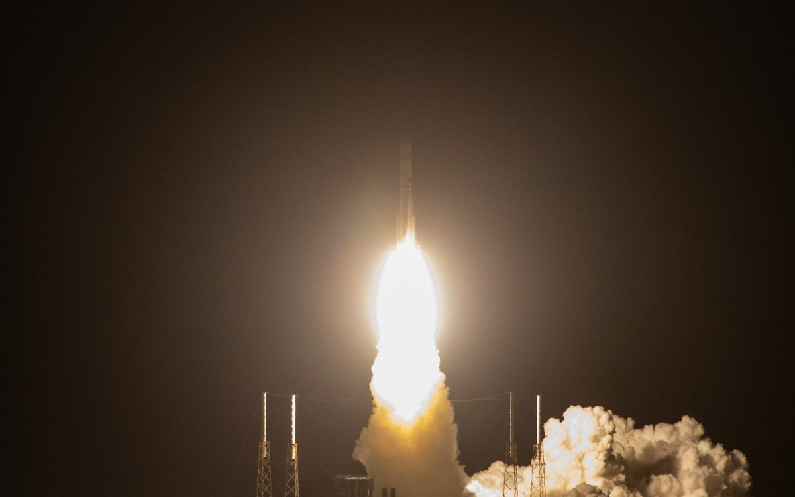
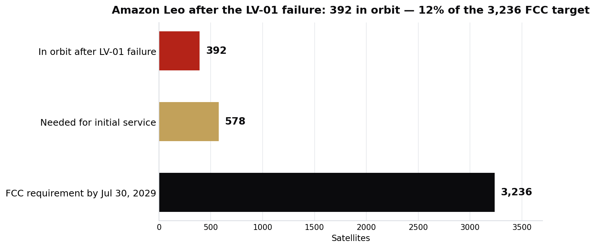
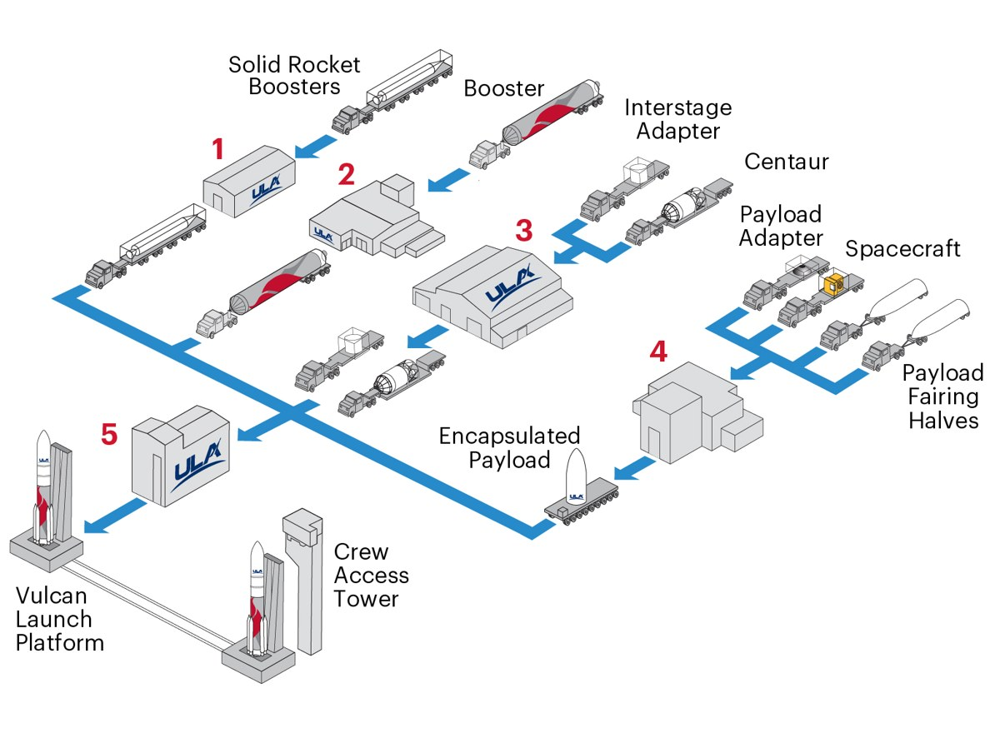
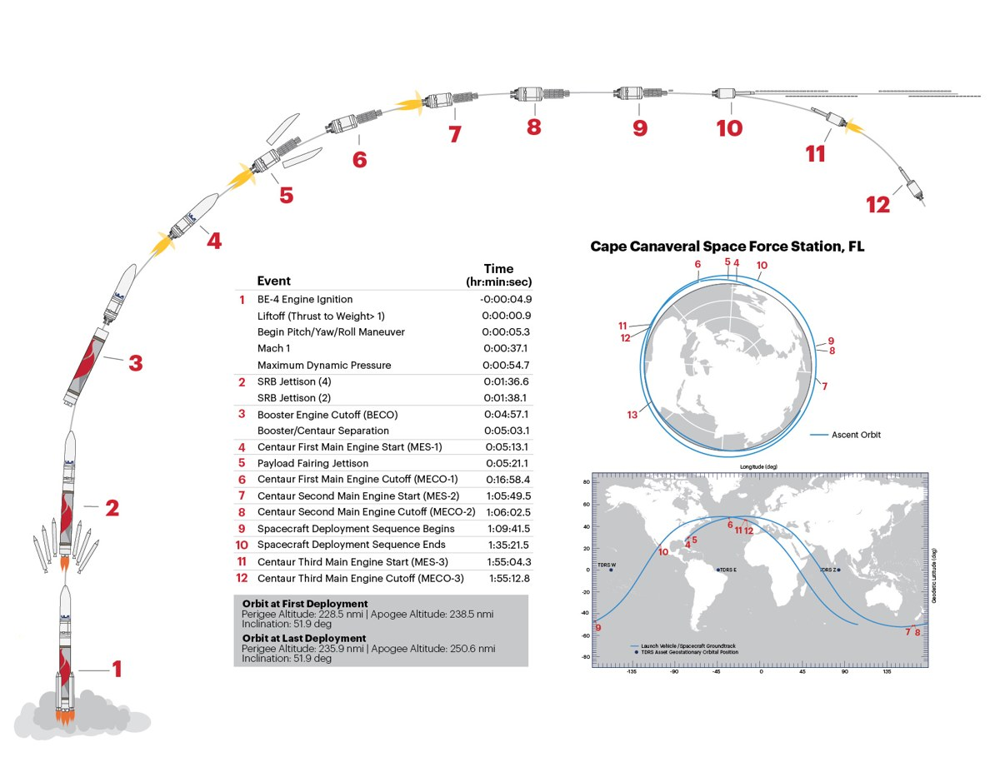

> [中文版 Chinese version](/life/vulcan-amazon-leo-launch-zh/)

*A Vulcan rocket lifts off from Cape Canaveral on its first flight, January 8, 2024. Photo: NASA / Kim Shiflett, via Wikimedia Commons (public domain). Note: this is a file photo of Vulcan's debut flight, not today's LV-01 launch.*

## What happened

United Launch Alliance's Vulcan rocket lifted off from Space Launch Complex 41 at Cape Canaveral at **12:40:30 PM ET on Sunday, November 15**, on its third attempt in three days — and failed about ten minutes later. The vehicle was carrying **40 Amazon Leo broadband satellites**, the largest Leo batch yet and the first of 38 Vulcan launches Amazon has booked. None of the satellites was deployed.

The sequence, as confirmed by ULA's live updates and Florida Today's live blog:

- **12:11 PM ET:** the launch window opened. The countdown held at **T-4 minutes** for upper-stage thermal conditioning — a chilldown issue — and ULA worked it, clearing the team to proceed. Liftoff came at the very end of the window, **12:40:30 PM ET**.
- **T+1:45:** all six solid rocket boosters burned out and separated cleanly. Florida Today: "all six solid rocket boosters (SRBs) separated from the rocket following a smooth liftoff."
- **T+~6 minutes:** staging confirmed — booster engine cutoff, Centaur V upper-stage ignition, and payload fairing jettison.
- **~T+10 minutes (~12:50 PM ET):** the anomaly. The vehicle failed during the Centaur V phase, before the planned deployment sequence that was to begin about 70 minutes after liftoff.
- **1:31 PM ET:** ULA confirmed on its live blog that the vehicle "suffered an anomaly 10 minutes into the flight and failed to deliver the Amazon mission to orbit." Florida Today carried the confirmation at 1:36 PM ET and ended live coverage at 1:42 PM ET.

ULA's statement was blunt about what it does not know: "Since the anomaly just occurred, we don't have any specific data yet to understand what occurred today." And: "Today, we did not meet that standard." No Amazon statement had appeared as of the end of live coverage. NASA Administrator Jared Isaacman posted that NASA is available to assist in the investigation and remediation effort.

## The twist: the part everyone feared worked fine

This was supposed to be a test of one thing: the **GEM-63XL solid rocket booster nozzle**. Vulcan had been grounded since February 12, 2026, when a nozzle failed less than 30 seconds into the USSF-87 mission — the second nozzle failure in four flights, after the first on October 4, 2024, about 37 seconds into the rocket's second flight. Both times the rocket still reached orbit, but the Space Force lost confidence. ULA says the nozzle was redesigned, though neither ULA nor Northrop Grumman has publicly identified the root cause.

Today, the nozzles performed. All six boosters separated cleanly. The failure came later, in the Centaur V upper-stage phase — after the boosters were gone. That distinction matters for the investigation: the grounding's cause is, on today's evidence, not the failure's cause. It also means ULA now faces a second, separate problem on top of the one it just spent nine months fixing, with no public cause and no timeline for a return to flight.

## Why this flight mattered before it left the ground

Vulcan is ULA's flagship heavy-lift rocket — the 65-meter vehicle built to replace the Atlas V and Delta IV — and the Pentagon has entrusted it with roughly half of its major national security launches through the early 2030s. The military wants data from Vulcan's commercial flights before clearing it to resume national security missions, meaning at least two Amazon Leo launches were to fly before the Pentagon put its own hardware back on the rocket, possibly in early 2027. What the Pentagon gets now is failure data instead.

Getting to the pad took three tries. The first attempt, Friday, November 13, was scrubbed during fueling over a commodity flow issue with a supplier — a power interruption at the plant that pumps liquid gaseous nitrogen into the rocket. Saturday's attempt was scrubbed over a network communication issue between ground equipment and the launch vehicle. Both times ULA reported the rocket and spacecraft remained healthy.

## The constellation math: still 392, with 2,844 to go

The 40 satellites were to take the constellation to 432 in orbit. Instead, the count is unchanged — about **392 satellites in orbit**, with 368 in operational orbit as of early November and six having reentered. Amazon needs **578 satellites** in orbit to start initial regional service, and its FCC license requires all **3,232 satellites by July 30, 2029**. The FCC granted a waiver in June 2026 on the July 2026 halfway milestone but kept the 2029 deadline, with a spectrum-priority penalty for late satellites.

*Amazon Leo satellites in orbit after the LV-01 failure (392 — the 40 lost satellites would have taken the total to 432), versus the number needed for initial service and the FCC requirement. Sources: ULA; NASASpaceFlight; FCC.*

At 392, Amazon is at about 12% of the target with less than three years left — which is why the launch manifest matters more than any single launch. That manifest is the largest commercial launch procurement in history: more than 100 missions across five rockets — Atlas V, Ariane 6, Falcon 9, Vulcan, and New Glenn. Vulcan carries the biggest share, with **38 launches booked**, and LV-01 was the first of them. The eight previous Leo deployment missions all flew on Atlas V, a rocket ULA is retiring. The other workhorse, Blue Origin's New Glenn, lost its first rocket in a May launch-pad explosion. Amazon's factory in Kirkland, Washington recently completed its 1,000th Leo satellite, and production that once took six months to yield 27 satellites now turns out 27 a week. The satellites are ready. The rockets are the bottleneck — and today the bottleneck got worse.

## What the service was supposed to be

Amazon Leo — the constellation Amazon spent six years calling Project Kuiper before renaming it in November 2025 — is a direct rival to SpaceX's Starlink. The initial constellation covers latitudes between 56 degrees north and south, expanding over time toward global coverage. The terminals tell the story of who Amazon is selling to first: the enterprise-grade **Leo Ultra** offers downlink speeds up to **1 Gbps**, while the compact **Leo Pro** and **Leo Nano** offer up to **400 Mbps** and **100 Mbps** respectively. Amazon says the network will connect tens of millions of customers, and it has already announced deals with AT&T, JetBlue, Delta, and Apple. On its Q3 2026 earnings call, Amazon said the network remains on track to begin initial service this year — a claim that now depends on how long the Vulcan investigation takes.

*How a Vulcan Leo mission comes together: solid boosters, booster, Centaur, and spacecraft are processed across ULA's Cape Canaveral facilities and stacked in the new Vertical Integration Facility-A before rolling 2.7 miles to the pad. Diagram: ULA.*

*ULA's planned flight profile for LV-01: deployment was to begin at T+1:09:41 and end at T+1:35:21. The flight ended at about T+10 minutes, before the second Centaur burn. Diagram: ULA.*

## ULA: a company built by a merger

To understand why a single failed launch matters so much to ULA, it helps to know what ULA is. United Launch Alliance was not founded by entrepreneurs chasing a market. It was assembled by the Pentagon. Boeing's Delta rocket family and Lockheed Martin's Atlas family had competed head to head for Air Force launch contracts through the 1990s and early 2000s, a rivalry the government came to see as wasteful and risky once launch demand fell short of Cold War-era projections. In 2005 the two companies agreed to fold their launch divisions into a single 50/50 joint venture, and the transaction closed in December 2006, consolidating engineering in Denver, Colorado, while keeping major rocket assembly at Decatur, Alabama. The Federal Trade Commission granted antitrust clearance, prioritising national-security access to space over competition concerns.

The arrangement gave ULA a de facto monopoly on US national-security launches for years — a position that drew a direct challenge once SpaceX had a certifiable rocket of its own. In April 2014 SpaceX sued the Air Force over a no-bid, 36-launch, roughly $11 billion block-buy award to ULA; the suit settled in January 2015 with the Air Force agreeing to open more national-security launches to competition. That settlement is the reason ULA now has to win launches against SpaceX rather than simply receive them. The competitive balance has since reversed: in the 2020 National Security Space Launch award, ULA captured 27 missions worth approximately $4.5 billion against SpaceX's 22 missions valued at approximately $4 billion, but in the 2025 round SpaceX won the lion's share, and the Pentagon awarded ULA a $5.3 billion contract for 19 missions running out to 2034. ULA's pitch to the government has always been schedule certainty and mission assurance rather than price, and for most of two decades it was the only provider certified to carry the heaviest national-security payloads. Sunday's failure strikes directly at that pitch: the company's entire value proposition is that its rockets do not fail, and now its flagship has failed on its comeback flight.

The leadership picture adds to the pressure. Tory Bruno, the chief executive since 2014 who led the Vulcan program, resigned on December 22, 2025, in an unexpected departure to run national-security work at Blue Origin — the same Blue Origin that builds Vulcan's main engines. ULA has also faced persistent reporting that its corporate parents, Boeing and Lockheed Martin, have considered selling it. A launch provider whose parents are ambivalent about owning it, whose chief executive has just left, and whose flagship rocket has just failed in a new way is a company with very little margin for a second failure.

## Centaur: the 60-year-old upper stage

The failure's location — the Centaur V upper-stage phase — is what makes it so unsettling to people who follow launch vehicles, because Centaur is the oldest and most trusted upper stage in the business. Centaur was originally developed by General Dynamics under NASA's Lewis Research Center at the dawn of the space age, conceived as a high-energy cryogenic stage fed with liquid hydrogen and liquid oxygen. The first successful Centaur launch flew atop an Atlas booster on November 27, 1963. Since then, Centaur and its RL10 engine have powered missions to every planet in the solar system — Surveyor, Pioneer, Viking, and Voyager all rode Centaurs — along with countless commercial communications satellites, geostationary weather observatories, military spacecraft, and the X-37B spaceplane. Centaurs have flown 247 times on Atlas and 23 times on Titan, and the RL10 has flown on 522 production engines.

The RL10 itself is older than the stage it powers. The first liquid-hydrogen rocket engine built in the United States, it was first test-fired on the ground in 1959 and first flew successfully in 1963. Its secret is simplicity: it is an expander-cycle engine, which uses the heat of its own propellant to drive its turbopumps, with far fewer failure points than a staged-combustion engine. The version on Vulcan's Centaur V, the RL10C-1-1, produces 23,825 pounds of thrust, and two of them power each Centaur V. ULA says the RL10 family has more than 500 successful flights and more than 800 firings in space. The Centaur V itself is a larger, longer-endurance evolution: ULA says it enables 2.5 times the energy and 450 times the endurance of its predecessor, with a thin-walled stainless-steel pressure-stabilised structure — walls less than the thickness of a dime — that is fundamentally the same architecture as the versions flown in the early 1960s.

That history is why the investigation matters so much. A failure in a brand-new booster nozzle is a development problem; a failure in a 60-year-old upper stage with 500 flights behind it is either a new problem in an old design — the Centaur V is larger and different from the Centaur III that flew on Atlas V — or a problem in how the new vehicle was integrated. Either answer has consequences beyond this one flight, because the same Centaur V is the upper stage for every Vulcan, and NASA selected a Vulcan-derived Centaur V as the new upper stage for the Space Launch System's Artemis IV mission onward in March 2026. A Centaur problem is not a ULA problem. It is a problem for the Artemis program too.

## The BE-4 and the Russian engine it replaced

Vulcan exists because of a geopolitical rupture. Its predecessor, Atlas V, flew on the RD-180 — a Russian engine, built by NPO Energomash — and after Russia's annexation of Crimea in 2014, Moscow threatened to stop delivering it. Congress capped the number of RD-180s that could be used for national-security launches and set the end of 2022 as a deadline. ULA needed a new first-stage engine, and in September 2018 it chose Blue Origin's BE-4, which burns liquid methane and liquid oxygen, over Aerojet Rocketdyne's AR1. Vulcan was originally on track for a first flight in mid-2020. It actually flew in January 2024 — more than four years late — and the delay was driven substantially by BE-4 development and qualification.

The BE-4 is also the engine on Blue Origin's New Glenn, which makes Sunday's failure doubly awkward for the American launch industry: the two rockets meant to break SpaceX's dominance both depend on the same engine family, and both have now suffered high-profile failures in 2026 — New Glenn lost its first rocket in a May launch-pad explosion, and Vulcan has now lost its comeback flight. Vulcan's first flight, on January 8, 2024, carried Astrobotic's Peregrine lunar lander, which failed for reasons unrelated to the rocket. Its second flight, in October 2024, suffered the first nozzle failure. The Space Force certified Vulcan for national-security missions in March 2025, and its first such mission, USSF-106, flew on August 12, 2025. Then came the second nozzle failure on February 12, 2026, on USSF-87, and the nine-month grounding. Four flights in nearly three years, two nozzle failures, and now a failure in a different phase entirely. That is the record the Pentagon is looking at when it decides whether to put its own hardware back on the rocket.

## The launch business Amazon bought into

Amazon's problem is not this one flight. It is the arithmetic of the manifest, and the manifest was always the riskiest part of the Leo plan. Amazon's launch procurement — more than 100 missions across five rockets — is the largest commercial launch purchase in history, but it was assembled as a hedge: no single rocket was supposed to carry the constellation. The hedge is fraying on every side at once. Atlas V, which flew all eight previous Leo deployment missions, is being retired, with all remaining vehicles assigned and no new orders accepted. New Glenn lost its first rocket in May. Vulcan has now failed on its first Leo flight. That leaves Falcon 9 — SpaceX's rocket, flying for Amazon's direct rival in satellite broadband — as the only vehicle in the manifest with a clean recent record.

The comparison with Starlink is the part Amazon least wants to discuss. Starlink operates roughly 10,800 satellites and serves about 10.3 million subscribers across 164 countries and territories as of March 31, 2026, according to SpaceX's IPO filing — and its Connectivity segment generated $11.4 billion in 2025 revenue, about 61 percent of SpaceX's total. Amazon, at 392 satellites, has about 3.6 percent as many spacecraft in orbit as Starlink, and zero paying customers. The gap is not just a matter of launches. Starlink's satellites are built on an assembly line that has been running for years; Amazon's Kirkland factory only recently completed its 1,000th satellite, and while production has accelerated from 27 satellites in six months to 27 a week, the company is still learning to build at scale. The rockets were supposed to be the solved part of the problem — Amazon bought launches from five different providers precisely so that no single failure could stop it. Sunday showed that the hedge has a hole: when three of the five rockets are unavailable or unproven, the manifest is not a hedge. It is a bet on the two that are left.

## What an investigation looks like

ULA has not said how long its investigation will take, and that silence is normal. A launch failure investigation begins with telemetry — the thousands of data channels streaming from the vehicle during flight — and the first question is always the same: what was the last thing that looked normal, and what was the first thing that did not? The Centaur V phase gives investigators a bounded problem: the failure happened after staging, after fairing jettison, and before the second Centaur burn, which narrows the window to the first Centaur burn and the coast that followed. But a bounded window is not a quick answer. The nozzle investigation took nine months, and it ended without a publicly identified root cause — ULA says the nozzle was redesigned, but neither ULA nor Northrop Grumman has publicly identified what failed.

What to watch, in order: first, whether ULA identifies a cause at all, and whether it names it publicly; second, whether the LV-02 vehicle, already being processed, stays on its schedule or is stood down; third, whether the Space Force, which needs two successful Amazon Leo launches before returning its own missions to Vulcan, resets that count or waives it; and fourth, whether Amazon shifts launches to Falcon 9 or Ariane 6 while Vulcan is grounded. The FCC's July 30, 2029 deadline does not move for any of those decisions. Every month Vulcan spends in investigation is a month Amazon cannot get back, and the constellation needs 2,844 more satellites in less than three years.

## The verdict: the worst kind of failure

A scrub is a delay. This is worse: a failure on the comeback flight, in a phase that was not the one under suspicion, with no known cause. ULA's investigation now has to answer a question it did not expect to be asking — what failed in Centaur's phase — while the original nozzle question, the one the nine-month grounding was about, is still technically open too, because a single clean separation does not close an investigation.

For Amazon, the arithmetic is unforgiving. Even at two Vulcan launches a month — a cadence ULA has never sustained — 37 more Vulcan flights plus the rest of the manifest would need to run almost perfectly to hit 3,232 satellites by July 2029, and the FCC's spectrum-priority penalty is the price of falling short. The LV-02 vehicle was already being processed; whether it flies on anything like its schedule now depends on what the investigation finds, and how fast. Vulcan's return to flight was necessary. It was never sufficient. And today it did not even happen.

<!-- rebuild trigger 2026-11-15 -->
