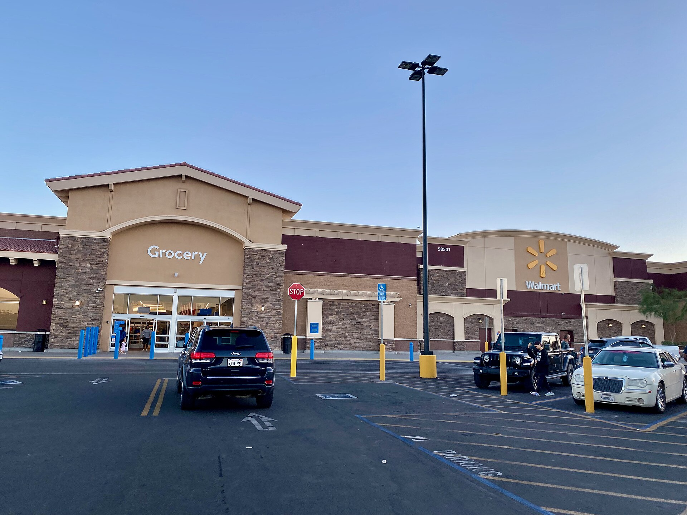
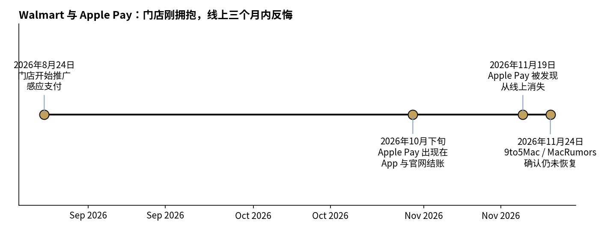

> [English version 英文版](/life/walmart-apple-pay-online-rollback/)

*美国加州 Yucca Valley 的一家 Walmart Supercenter。照片：YosemiteYamper，经 Wikimedia Commons。*

## 事情经过，按时间顺序

Walmart 与 Apple Pay 的关系，是美国零售支付领域持续最久的一场冷战。而今年秋天，它在一个季节之内先解冻、又重新冻上。以下时间线来自 Walmart 自己的公告，以及 Appleosophy、9to5Mac、MacRumors、AppleInsider、Notebookcheck 的报道，均可核对：

- **2026年8月：** Walmart——多年来在全美 4,500 多家门店完全不接受感应支付、一直把顾客导向自家扫码支付 Walmart Pay——宣布将开始接受包括 Apple Pay、Google Pay 在内的感应支付。推广自 **8月24日** 起在部分门店开始，计划在 2026 年底前覆盖全美所有 Walmart 与 Sam's Club 门店，加油站则在 2027 年年中前跟上。
- **2026年10月下旬：** Apple Pay 出现在 Walmart iPhone App 与 Walmart.com 的结账选项中，Appleosophy 于 10月30日发现并报道。这是 Walmart 历史上第一次在所有销售渠道都接受 Apple Pay。
- **2026年11月19日：** Appleosophy 的 David Becker 报道该选项已消失：结账页面的"Payment method"区域没有它，"Other ways to pay"和"More ways to pay"里也没有，App 与网站皆然。
- **2026年11月24日：** 9to5Mac 与 MacRumors 独立核查确认：在 Walmart 官网与 App 上都看不到 Apple Pay。Walmart 至今**没有给出任何解释**。截至今天（11月25日），没有任何迹象显示它已恢复。

两个事实框定了这个故事。第一，撤下只发生在**线上**：Apple Pay 在 Walmart 实体收银台仍然可用，门店感应支付的推广仍在继续。第二，这次反转**没有官方解释**：报道此事的每一家媒体——9to5Mac、MacRumors、MacTech、MacTrast、Notebookcheck——都指出 Walmart 未予置评，而诚实的可能性包括：主动撤回、限时试运行结束、A/B 测试（MacTrast 指出仍有部分用户能看到该选项），或者一个 bug。下文分析"为什么只撤线上对 Walmart 是理性的"——请注意这是分析、是推断，Walmart 并未证实。

*作者自制图。日期：Walmart 感应支付公告与门店推广（2026年8月）；Appleosophy 报道线上出现（10月30日）与消失（11月19日）；9to5Mac 与 MacRumors 确认（2026年11月24日）。*

## 为什么门店和 App 是两门生意

谜题在于这种分裂。如果 Walmart 在原则上反对 Apple Pay，它就不会在门店推广感应支付；如果它在原则上接受了，App 里就不会撤下。一旦你意识到实体收银台和线上结账是两种完全不同的资产，分裂就不再是谜题。

在实体收银台，支付方式几乎只是成本与便利问题。感应一拍比扫码快，排队是敌人，而顾客的身份早已明确——购物篮、会员行为、小票。Walmart 在门店接受感应支付，几乎不损失什么，还能换来吞吐量与口碑——毕竟它当了多年的著名"钉子户"。

在线上结账，支付方式是一个**数据与关系层**。用 Apple Pay 付款的顾客，在商家眼里是一个"准匿名"的抽象存在：Apple Pay 把卡号令牌化，最大限度减少商家能获得的信息，并把客户关系留在 Apple 的钱包里。而在 Walmart 自有体系里付款的顾客——账户里绑定的卡、Walmart Pay、或公司的 OnePay 金融产品——是可识别、可营销、可度量的，并且离 Walmart 多年投入巨资构建的生态又近一步：Walmart+ 会员、OnePay 卡（Walmart 现在正引导顾客把它们加入数字钱包）、广告归因，以及驱动其零售媒体生意的购买历史。在线上，Walmart 的利润栈里包含数据这一层。而 Apple Pay 的设计目的，恰恰就是让商家少拿到这一层。

手续费的方向也一致，尽管它是次要因素。Apple Pay 本身不向商家收取超出卡组织成本的额外费用（线下感应），但线上支付的路由正是大型商家在交换费、路由与欺诈责任上谈判最凶的地方——也是把顾客导向自有支付通道（包括以发卡方身份赚取交换费的 OnePay）能改变每单经济模型的地方。对地球上最大的零售商来说，线上交易量上零点几个百分点，就是九位数的金额。

这不需要 Walmart"讨厌"Apple。它只需要 Walmart 把线上结账的价格算对：门店里，便利赢；线上，身份赢。Apple Pay 在 Walmart.com 只活了三周，用这个视角看，更像一次得出了答案的测试，或者一次推广推进到了公司里某个"职责就是对这类事说不"的层级。

## 这场"钉子户"的简史，因为它能解释现在

Walmart 不是漂进这场争斗的；十多年来，它一次次主动选择了它。2014 年 Apple Pay 推出时，Walmart 是商家联盟的创始力量之一，该联盟主推扫码支付——正是它今天仍在使用的 Walmart Pay 路线的直系祖先。当年的逻辑就是今天的逻辑：商家控制的支付产生商家拥有的数据，而对 Walmart 这种规模的零售商来说，数据是会复利的。在 2010 年代后期到 2020 年代，Walmart 一直是美国大型零售中那个显眼的例外——感应支付就是用不了的那家店——并把多年的顾客抱怨当作这一立场的代价收下。这正是 2026 年 8 月门店公告重要的原因：它是十年高墙上的第一道裂缝，被广泛解读为 Walmart 终于承认顾客预期赢了。10 月线上的出现，把让步扩展到了最后的堡垒。因此，11 月的消失并不算完全回到旧现状——收银台仍能感应——而是一次非常精确的重划界线：让步恰好停在数据开始的地方。

## 反证，公平地摆出来

有三个事实与上面这个整齐的"策略故事"相冲突，认真的文章必须带上它们。

第一，**仍有部分购物者能在线上看到 Apple Pay**。MacTrast 11月24日的报道确认其在美国东南部已消失，同时指出另有用户仍然能看到——这是 A/B 测试或分阶段变更的典型特征，而不是干净利落的下架。第二，**时机对"蓄意冒犯"来说糟得离谱**。在黑五前几天、悄无声息地移除一个受欢迎的支付选项，会在最糟糕的时刻最大化顾客摩擦与媒体报道；一次有计划的战略撤回，更可能选在安静的 1 月，或者至少配一份声明。第三，**Walmart 的门店推广仍在扩张**，朝着 2026 年底完成的目标推进——这对一个据说要重新对感应支付设防的公司来说，姿态颇为矛盾。

Bug 假说也应得到应有的尊重：大型零售商的结账系统是层层实验的沉积物，选项因事故消失并不罕见。但以这个规模——影响全球市值最高公司的旗舰支付选项、发生在全国最大零售商身上、正值黑五周——的 bug，通常会在六天内被修复或被承认。六天的沉默本身，就是一种数据。今天最站得住的读法是：**原因未知，持续时间看起来像故意的**。

## 对这周购物者的实际含义

黑五在两天后，给出可执行的信息：

- **在 Walmart 门店里：** 凡感应支付推广已到达的门店，Apple Pay 可用——按 Walmart 计划 2026 年底前完成全覆盖，目前已是大多数门店——Google Pay 与感应式银行卡同样可用。如果你本地的店还没有，那是推广排期问题，与线上撤下无关。
- **在 Walmart.com 与 App 里：** 不要指望 Apple Pay。截至 11月24–25日 9to5Mac、MacRumors 等的核查，结账时不提供该选项；你需要用银行卡、礼品卡，或 Walmart 自家的支付方式。
- **Sam's Club：** 在同一份门店推广公告范围内；加油站排在最后，2027 年年中前完成。

## 更大的故事：结账口就是平台

退一步看，这三周的插曲干净地展示了零售权力如今所在的位置。过去十年的支付之争发生在收银台：刷卡对现金、感应对应刷卡。这一仗已经打完了——连 Walmart 都感应了。还活着的争论已经上移了一层，到了线上结账：在这里，问题不是钱如何流动，而是**钱流动时，客户归谁所有**。Apple 向商家出售转化率的提升，交换条件是匿名与距离。Walmart 规模独特，可以拒绝这笔交易：它的 App 已经装在你的手机里，它的会员体系已经存了你的卡，它的广告生意变现的恰恰是 Apple Pay 扣下的那份身份。

预计这个模式会重复出现。大到能自建钱包的商家，会继续把第三方快捷结账当作一个可以测试、可以定价、可以周期性撤下的"功能"，而不是管道。小到建不起的商家，会永远留着那个按钮，因为对他们来说转化比数据值钱。Walmart 线上那三周的 Apple Pay，从来就不是关于 Apple Pay。它是一次测量：这个按钮能赚多少、又要花掉多少？Walmart 没有公布答案。它只是照着答案行动了。

## 结论

在 Walmart 开口之前，事实很窄：Apple Pay 10月下旬在线上出现，11月19日消失，11月25日仍未恢复，同时在门店继续可用。与该公司十年行为最吻合的解释——守住自有结账、让出实体感应——是推断，本文已如实标注。而不是推断的，是零售业的方向：争夺的不再是你能不能"拍一拍"，而是零售商还能不能知道你的名字。这个黑五，在 Walmart.com，它打算知道。

*来源：9to5Mac《Walmart drops Apple Pay support from its app and website》，2026年11月24日；MacRumors Walmart 指南，2026年11月24日更新；MacTech、MacTrast，2026年11月24日；Notebookcheck《Walmart removes Apple Pay after just a few weeks》，2026年11月；Appleosophy 报道（线上出现，10月30日；消失，11月19日，经上述媒体转引）；Walmart《More Ways to Pay: Tap to Pay Is Coming to Walmart and Sam's Club》（2026年8月24日起推广，2026年底覆盖全美门店，加油站 2027 年年中），经 Axios 确认感应支付包括 Apple Pay 与 Google Pay。截至 2026年11月25日，Walmart 未就线上撤下一事置评。*
