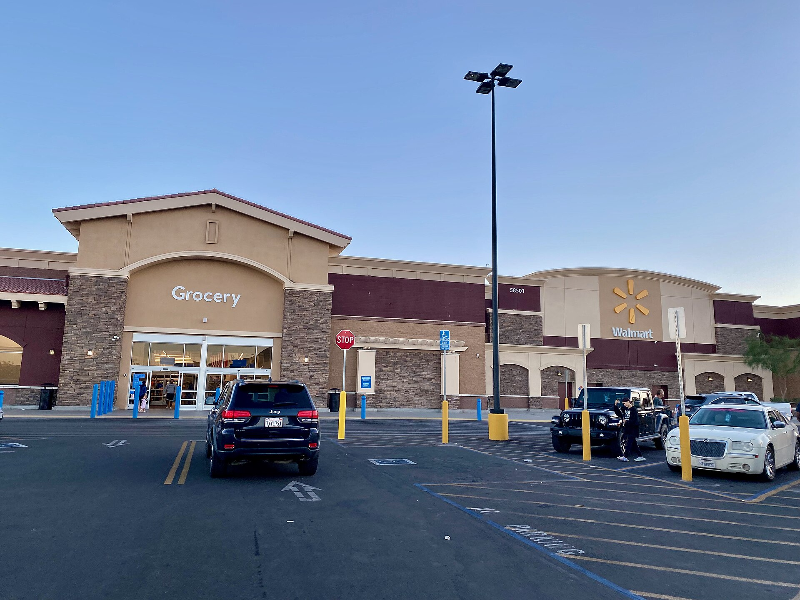
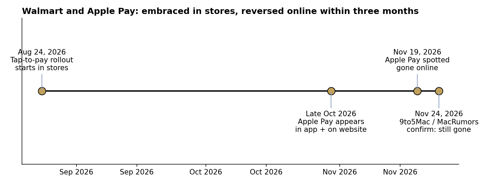

> [中文版 Chinese version](/life/walmart-apple-pay-online-rollback-zh/)

*A Walmart Supercenter in Yucca Valley, California. Photo: YosemiteYamper, via Wikimedia Commons.*

## What happened, in order

Walmart's relationship with Apple Pay is the longest-running cold war in American retail payments, and this autumn it thawed and refroze inside a single season. The confirmed timeline, assembled from Walmart's own announcement and the reporting of Appleosophy, 9to5Mac, MacRumors, AppleInsider and Notebookcheck:

- **August 2026:** Walmart — which for years accepted no tap-to-pay at all in its more than 4,500 US stores, steering shoppers to its QR-code-based Walmart Pay instead — announced it would begin accepting contactless payments, including Apple Pay and Google Pay, in stores. The rollout began **August 24** at select locations, with plans to reach all US Walmart and Sam's Club locations by the end of 2026 and fuel stations by mid-2027.
- **Late October 2026:** Apple Pay appeared as a payment option at checkout in the Walmart iPhone app and on Walmart.com, spotted and reported by Appleosophy on October 30. For the first time, Walmart took Apple Pay everywhere it sold things.
- **November 19, 2026:** Appleosophy's David Becker reported the option was gone. It no longer appeared in the "Payment method" section of checkout, nor under "Other ways to pay" or "More ways to pay," on either the app or the website.
- **November 24, 2026:** 9to5Mac and MacRumors independently checked and confirmed they do not see Apple Pay on Walmart's website or in its app. Walmart has given **no explanation**. As of today, November 25, there is no indication it has returned.

Two facts bound the story. First, the removal is **online only**: Apple Pay still works at Walmart's physical registers, where the tap-to-pay rollout continues. Second, the reversal is **unexplained**: every outlet covering it — 9to5Mac, MacRumors, MacTech, MacTrast, Notebookcheck — notes that Walmart has not commented, and the honest possibilities include a deliberate rollback, a limited trial ending, an A/B test (MacTrast noted some users still report seeing the option), or a bug. What follows is analysis of why a deliberate online-only reversal would make sense for Walmart — labelled as analysis, because Walmart has not confirmed one.

*Author's chart. Dates: Walmart tap-to-pay announcement and store rollout (August 2026); Appleosophy reports of Apple Pay online (October 30) and its disappearance (November 19); 9to5Mac and MacRumors confirmation (November 24, 2026).*

## Why the store and the app are different businesses

The puzzle is the split. If Walmart opposed Apple Pay on principle, it would not have rolled out tap-to-pay in stores. If it had accepted Apple Pay on principle, the app would still have it. The split stops being puzzling once you see that a store register and an online checkout are different assets.

At a physical register, the payment method is nearly pure cost and convenience. A tap is faster than a QR scan, queues are the enemy, and the shopper is already identified — by their basket, their loyalty behaviour, their receipt. Walmart gives up little by accepting a tap in store, and gains throughput and goodwill after years of being the famous holdout.

At an online checkout, the payment method is a **data and relationship layer**. A shopper who pays with Apple Pay checks out as a guest-like abstraction: Apple Pay tokenises the card, minimises what the merchant learns, and keeps the customer relationship inside Apple's wallet. A shopper who pays inside Walmart's own stack — a saved card on a Walmart account, Walmart Pay, or the company's OnePay financial products — is identified, marketable, measurable, and one step closer to the ecosystem Walmart has spent years and billions building: Walmart+ membership, OnePay cards (which Walmart now prompts shoppers to add to digital wallets), advertising attribution, and the purchase history that powers its retail media business. Online, Walmart's margin stack includes data. Apple Pay is designed, on purpose, to give the merchant less of it.

Fees point the same direction, though they are the smaller part. Apple Pay itself charges merchants no additional fee beyond card network costs for in-person taps, but online payment routing is where large merchants negotiate hardest over interchange, routing and fraud liability — and where steering shoppers to owned payment rails (with their own economics, including OnePay's interchange as issuer) changes the arithmetic per order. For the largest retailer on earth, fractions of a percent on online volume are nine-figure numbers.

None of this requires Walmart to dislike Apple. It requires Walmart to price the online checkout correctly: in store, convenience wins; online, identity wins. The three-week life of Apple Pay at Walmart.com looks, under this lens, less like an accident and more like a test that returned its answer — or a rollout that reached a layer of the company whose job is to say no to exactly this.

## A short history of the holdout, because it explains the present

Walmart did not drift into this fight; it chose it, repeatedly, over more than a decade. When Apple Pay launched in 2014, Walmart was a founding force behind a rival merchant consortium built around QR-code payments — the direct ancestor of the Walmart Pay approach it still uses today. The logic then is the logic now: a payment the merchant controls produces data the merchant owns, and data, for a retailer of Walmart's scale, compounds. Through the late 2010s and into the 2020s, Walmart remained the conspicuous exception in American big-box retail — the store where the tap simply did not work — and absorbed years of customer complaints as the price of that position. That is why the August 2026 store announcement mattered: it was the first crack in a decade-old wall, widely read as Walmart finally conceding that shopper expectation had won. The October online appearance extended the concession to the last redoubt. The November disappearance is therefore not a return to the old status quo in full — the registers still tap — but it is a very precise redrawing of the line: the concession stops exactly where the data begins.

## The counter-evidence, stated fairly

Three facts argue against the tidy strategy story, and a serious post has to carry them.

First, **some shoppers still see Apple Pay online.** MacTrast's November 24 report confirmed its absence in the southeastern US while noting other users still had it — the signature of an A/B test or a phased change, not a clean kill. Second, **the timing is terrible for a deliberate snub.** Removing a popular payment option days before Black Friday, silently, maximises shopper friction and press coverage at the worst moment; a planned strategic rollback would more likely come with a quiet January timing or at least a statement. Third, **Walmart's store rollout is still expanding** toward its end-of-2026 completion target — an odd posture for a company supposedly re-entrenching against contactless payments.

The bug hypothesis deserves its due: large retailers' checkout stacks are accretions of experiments, and options vanish by accident. But bugs at this scale, affecting the flagship payment option of the world's most valuable company, on the country's largest retailer, during Black Friday week, usually get fixed or acknowledged within six days. Silence for six days is itself data. The most defensible reading today is: *unknown cause, deliberate-looking duration.*

## What this means for shoppers this week

Practical guidance, because Black Friday is in two days:

- **In a Walmart store:** Apple Pay works where the tap-to-pay rollout has arrived — most locations, per Walmart's plan to finish by the end of 2026 — along with Google Pay and contactless cards. If your local store still lacks it, that is the rollout schedule, not the online reversal.
- **On Walmart.com and in the app:** do not budget around Apple Pay. As of November 24–25 checks by 9to5Mac, MacRumors and others, it is not offered at checkout; you will need a card, a gift card, or Walmart's own payment options.
- **Sam's Club:** covered by the same store rollout announcement; fuel stations are scheduled last, by mid-2027.

## The bigger story: the checkout is the platform

Step back and this three-week episode is a clean illustration of where retail power now sits. For a decade the payments argument was about the register: cards versus cash, then taps versus swipes. That argument is over — even Walmart taps now. The live argument has moved one layer up, to the online checkout, where the question is not how the money moves but **who owns the customer while it moves**. Apple sells merchants a conversion boost in exchange for anonymity and distance. Walmart, uniquely scaled, can refuse the trade: its app is already on the phones, its membership already has the card on file, and its advertising business monetises exactly the identity Apple Pay withholds.

Expect this pattern to repeat. The merchants big enough to build wallets will keep treating third-party express checkouts as a feature to be tested, priced and periodically withdrawn — not as plumbing. The ones too small to build will keep the button forever, because for them the conversion is worth more than the data. Walmart's three weeks of Apple Pay online were never really about Apple Pay. They were a measurement: what does the button earn, and what does it cost? Walmart has not published the answer. It has simply acted on it.

## The verdict

Until Walmart speaks, the facts are narrow: Apple Pay arrived online in late October, vanished by November 19, and remains absent on November 25, while continuing to work in stores. The explanation that fits the company's decade of behaviour — protect the owned checkout, concede the physical tap — is an inference, and this post labels it as one. What is not inference is the direction of travel in retail: the fight is no longer over whether you can tap. It is over whether the retailer ever learns your name. At Walmart.com this Black Friday, it intends to.

*Sources: 9to5Mac, "Walmart drops Apple Pay support from its app and website," November 24, 2026; MacRumors Walmart guide, updated November 24, 2026; MacTech and MacTrast, November 24, 2026; Notebookcheck, "Walmart removes Apple Pay after just a few weeks," November 2026; Appleosophy reporting via the above (online launch spotted October 30; disappearance spotted November 19); Walmart, "More Ways to Pay: Tap to Pay Is Coming to Walmart and Sam's Club" (rollout from August 24, 2026; all US stores by end of 2026; fuel stations by mid-2027), via Axios confirmation that contactless includes Apple Pay and Google Pay. Walmart had not commented on the online removal as of November 25, 2026.*
