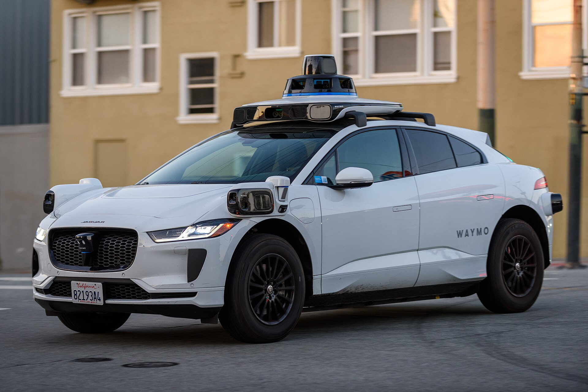
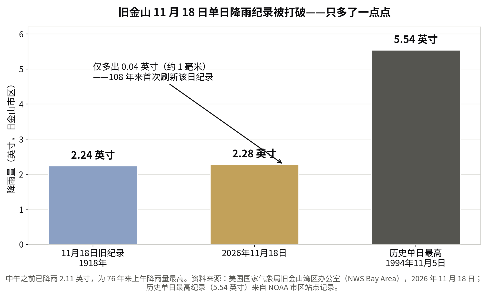

> [English version 英文版](/life/waymo-sf-flood-pause/)

*一辆 Waymo Jaguar I-PACE 无人驾驶出租车行驶在旧金山。照片：9yz，[CC BY 4.0](https://creativecommons.org/licenses/by/4.0/)，来自 Wikimedia Commons。非 11 月 18 日事发现场照片。*

2026 年 11 月 18 日星期三上午 11 点左右，全美最先进的出租车队认输了。Waymo——Alphabet 旗下的自动驾驶公司、美国规模最大的商用无人驾驶出租车运营商——暂停了整个旧金山湾区的无人驾驶叫车服务：旧金山市区、半岛、南湾，全停。打开应用的乘客看到一条简短通知：“我们因天气原因暂时停运。路况好转、天气预报放晴后我们就会回来。”没有给出恢复时间，到下午中段服务仍未恢复。

原因不是软件故障、不是断电、也不是撞车，而是下雨——路上最古老、最平常的危险。几个小时前，多辆 Waymo 被困在积水的路口，把自己变成了路障。一辆停在橡树街与科尔街交汇处的积水斑马线上，潘汉德尔公园旁，人类驾驶的汽车纷纷绕行；另一辆在湾岸大道与工业街交汇处抛锚。还有乘客说，她的车在费尔街与梅森大道交汇处动弹不得，车载系统让她留在车内不要下车。乘客爱德华·弗雷泽在 X 上发帖说，他被困在一辆 Waymo 里一个半小时，从北滩慢慢挪到米慎湾。据报道没有涉及 Waymo 车辆的人员受伤。但这些画面在一个上午造成的冲击，比任何事故统计数字都大：一辆无人驾驶的汽车打着双闪，一动不动地停在积水里，整座城市从它身边绕行。当天提出的问题很简单，而 Waymo 至今没有回答：当道路变成河流，无人出租车到底该怎么办？

暂停的范围值得注意：不只旧金山市区，而是 Waymo 在湾区的整个运营区域——从旧金山一路向南，经过半岛，直到南湾。公司表示，它提前数小时就跟踪了这场风暴，先缩减了车队规模，最后才全面暂停。到下午中段，服务仍未恢复，也没有给出恢复时间表。对一家以全天候运营为卖点的公司来说，这是一次公开的、覆盖整个区域的停摆。

对当天的乘客来说，停运来得猝不及防。Waymo 在旧金山早已不是新鲜事物：2022 年 3 月开始测试，2022 年底向公众开放无人驾驶乘车，2023 年 8 月启动付费服务，2024 年 6 月取消等候名单、向所有人开放。如今它每周在全美十个城市完成五十多万次付费行程，车队约 3000 辆车。对许多旧金山人来说，叫一辆没有司机的白色捷豹已经成了日常——直到星期三上午，日常突然消失。应用里没有解释，只有那句“因天气原因暂时停运”。乘客们转向优步和 Lyft，而在暴雨之中，人类司机的车同样难叫、价格飞涨。停运的讽刺正在于此：人们最需要车的时候，恰恰是无人车不在的时候。

## 一场打破了 108 年纪录的暴雨

这场天气并非偶然。它是本季第一场主要的大气河流——一条来自太平洋的狭长水汽带，携带着堪比大河的水量——恰逢预报中的创纪录厄尔尼诺冬季拉开帷幕。截至下午 3 点，旧金山市区自午夜起已降雨 2.28 英寸，打破了 1918 年创下的 2.24 英寸单日纪录。差距小得近乎可笑——0.04 英寸，约 1 毫米——但纪录就是纪录，而这项纪录已经保持了 108 年。

大气河流是加州冬季的常客：一条狭长的水汽通道从太平洋上空延伸数千公里，登陆时把相当于密西西比河的水量倾泻到陆地上。预报员预计这个冬天会是创纪录的厄尔尼诺冬季——赤道太平洋海水异常偏暖，把更多风暴推向美国西海岸。这意味着星期三不是孤立事件，而是一个季节的开场。旧金山的雨季才刚刚开始。

*旧金山 11 月 18 日单日降雨纪录仅被刷新 0.04 英寸。数据来源：美国国家气象局旧金山湾区办公室；历史纪录来自 NOAA。图表由作者制作。*

雨势从一早就很猛：中午之前市区已降雨 2.11 英寸，是 76 年来上午降雨量最高的一次，刷新了 1950 年的纪录。而对比历史，这场雨又不算极端：旧金山有记录以来单日降雨最多的是 1994 年 11 月 5 日的 5.54 英寸，星期三的雨量还不到它的一半；按 NOAA 的 1991 至 2020 年标准，旧金山市区年均降雨约 22.89 英寸。真正特别的是降雨的速度和时机——本雨季开始至今，截至 11 月中旬市区累计降雨只有 2.32 英寸，星期三一天就几乎让这个数字翻倍。雨下得太快，排水系统来不及反应，街道就成了河道。

旧金山的积水有地理原因：这座城市建在丘陵之上，低洼的米慎区、索马区和潘汉德尔一带历来是雨后积水的重灾区，合流式下水道在暴雨中既要排雨水又要排污水，稍一过载就会反溢到路面。对人类司机来说，这些地点是常识；对无人车来说，它们只是地图上的普通路口，直到车开进去才发现水已经没过了路缘石。把“哪里会积水”写进调度系统，本应是比识别水深更容易的一步。

到上午中段，低洼路口的积水已经深到足以困住车辆。

整座城市都感受到了这场风暴：旧金山国际机场实施地面停飞直到中午；雨水从莫斯康展览中心的天花板漏进来，微软 Ignite 大会期间两个展厅区域被迫关闭；据报道，高峰时有 1.8 万多户太平洋燃气电力公司用户断电。城里每一种交通系统同时降级，区别在于，其他系统虽然狼狈，但都在继续运转。只有 Waymo 停了下来。

## 为什么积水是机器人的克星

Waymo 尚未公开解释车辆抛锚的技术原因。据 Engadget 报道，该媒体已向公司寻求置评，截至本文发稿时仍未得到答复。这种沉默本身就值得注意，有必要先把已知和未知区分清楚。已知的是观察到的行为：车辆驶入积水路段，停下，不再前进。未知的是，它们停下究竟是因为传感器看不见了，是因为软件判断水太深，还是因为车辆本身出了故障。本文这一节不应被理解为对事故原因的确认诊断，而只是解释积水为什么对这类机器如此困难。

先从 Waymo 靠什么“看路”说起。捷豹 I-PACE 车队搭载第五代 Waymo Driver：激光雷达、毫米波雷达和一圈摄像头，融合生成周围世界的三维模型。晴天里这套系统表现出色。积水则同时攻击每一种传感器。摄像头最脆弱：积水的路面就是一面镜子，反射着天空、信号灯和车灯，这些倒影在摄像头看来像是并不存在的物体——或者遮住了真实存在的物体。车道线在浑浊的水面下消失不见。激光雷达的问题正好相反：信号太少。平静的水面会把激光脉冲散射开，而不是反射回来，路面就可能直接从点云里消失；有涟漪的水面返回的则是噪声。无论哪种情况，车辆都会失去用于判断路面位置的地面参考。雷达穿透雨水的能力更强，但分辨率粗糙：它能说出前方有东西，却说不出那是什么，也说不出前方积水有多深。

三种传感器本应互相补位：摄像头看颜色和文字，激光雷达量距离和形状，雷达在雨雾中兜底。但积水恰恰是三者同时失效的少数场景之一——摄像头被倒影欺骗，激光雷达收不到回波，雷达又看不清细节。融合算法的原则是交叉验证，而当三个传感器给出三个互相矛盾的世界模型时，系统唯一安全的选择就是停下。这正是星期三上午发生的事：不是某一个传感器坏了，而是整个感知系统对“前方是什么”失去了共识。

而水深正是关键。量产无人出租车上没有任何传感器能测量积水的深度。一处水洼可能深两英寸，也可能深两英尺，而在驾驶座上——无论是人还是机器——两者看起来一模一样，直到你开进去才知道。人类司机靠经验化解这种不确定性：看前车的尾流、看路缘石的高度、记得这个路口一向爱积水、愿意慢慢往前蹭一蹭探探深浅。无人出租车没有“蹭一蹭探深浅”这个选项。它的安全准则叫最小风险机动：当世界变得不确定，就减速、能靠边就靠边、停下。对没有驾驶员的车辆来说，这是正确的设计选择——同时它也制造了星期三上午那张标志性的画面：一辆车完全按照程序行事，停在积水斑马线中央，挡住了身后所有车辆。

还有一层常被忽略的困难：水不在地图上。Waymo 的车依赖厘米级高精地图行驶，地图上标着车道线、路缘石、信号灯和停车线——但积水不是地图的一部分，它每天、每小时都在变化。一辆车无法靠“记住这个路口”来判断水深，因为它记住的是干燥路面的样子。理论上，车队可以互相学习：第一辆车探到积水，就把信息传给后面的车；市政部门的水位传感器、气象雷达、其他车辆的实时报告，都可以汇入同一张动态地图。但这需要一套今天还不存在的数据融合：把天气预报、路面传感器和车队自身的遭遇实时拼成一张“水图”，并让调度系统在车辆出发前就绕开危险路段。Waymo 说它提前数小时就跟踪了这场风暴并缩减了车队——预报能力是有的，缺的是最后一公里的执行。

还有一层不对称，对乘客来说最为重要。人类驾驶的汽车在积水里抛锚，司机可以下车推车、求助，或者蹚水走到人行道上。无人出租车抛锚时，乘客只是机器里的一位客人，而机器已经判定最安全的做法是所有人留在原地——据报道，费尔街与梅森大道那辆车就是这样告诉乘客的。远程协助可以和乘客通话、叫拖车，但没法把车开出水面。一辆抛锚的无人出租车不是一辆出了故障的车，而是一个 4800 磅重的路障，现场没有一个人能挪动它。

积水对电动车还有另一层物理现实：打滑和进水。轮胎在水膜上打滑时抓地力骤降，制动距离变长；而底盘进水可能威胁电池与高压部件——任何电动车在深水面前都必须谨慎，区别只在于人类司机凭经验决定冒多大的险，机器则被要求不冒任何险。保守没有错，但保守的代价由整条街承担：一辆停在路口中央的无人车，不仅挡住后车，也可能挡住救护车和消防车。没有司机，就没有人能把车推到路边，也没有人能向交警解释情况。远程中心可以通话、可以叫拖车，但拖车在暴雨的旧金山同样寸步难行。

远程协助是无人驾驶行业的标准答案，但它的能力边界在星期三暴露无遗：远程操作员可以看到车辆的传感器画面、可以和乘客通话、可以呼叫救援，但不能替车辆做驾驶决策，更不能把车从水里开出来。行业把这种模式叫做“人在回路”，但在积水路口，人在回路里却手无寸铁。真正的远程驾驶——由人类远程实时操控方向盘——在技术上存在，但 Waymo 的商业模式并不依赖它，监管上也远未放行。于是，停下的车只能等水退，或者等拖车。

## 这不是第一次

星期三并不是积水第一次打败 Waymo。这是大约一年里第三次因为洪水迫使该公司撤下车辆，而真正值得警惕的是这种重复。

旧金山是 Waymo 的大本营，也是无人驾驶最难的考场：陡坡、浓雾、复杂的路口、密集的行人和自行车。2022 年 3 月开始测试，2022 年底向公众开放，2023 年 8 月启动付费服务，2024 年 6 月取消等候名单——每一步扩张都伴随着争议和抗议，也伴随着里程和数据的积累。正是这座城市的复杂性，让 Waymo 的安全纪录显得含金量十足；也正是这座城市的冬天，让这套系统的边界一次次暴露。

2025 年 12 月，旧金山停电，Waymo 暂停了当地服务，无人车被困在漆黑的路口——故障不同，但形态相同：一次基础设施事件，车辆无法随机应变，结果同样是无人驾驶汽车堵住了街道。

2026 年 5 月，一辆无人车开进圣安东尼奥的积水路段后，公司召回近 4000 辆车并暂停服务，随后发布了软件更新。接着同样的事又在亚特兰大发生，服务再次暂停。圣安东尼奥本应证明积水问题已经找到并修好。星期三表明，修复的范围比问题本身要窄——或者这个问题确实比一次软件更新能解决的要难得多。

值得注意的不是某一次事件，而是事件之间的间隔越来越短。2025 年 12 月是停电，2026 年 5 月是积水，11 月又是积水——三次停运，三种触发条件，同一个结果：车辆在无法理解的环境里停下，变成路障。Waymo 每次的回应都是正确的：暂停、召回、更新软件。但回应的模式本身说明，问题不在某一段代码，而在系统面对“地图之外”的世界时的基本策略。软件更新能修好一个已知的误判，却修不好“不知道水有多深”这个根本限制。每一次停运都在提醒同一件事：无人驾驶的短板不在晴天，而在城市真实生活的那些例外时刻。

如果这只是一个简单的程序错误，五月份就该修好了。更可能的真相是，积水属于那种没有干净软件解法的驾驶难题：车辆必须实时判断眼前这片水能不能安全通过，而传感器测不出水深，安全文化又不允许猜错。其他道路使用者靠判断力和对小风险的容忍来回答这个问题。无人出租车队不被允许承担小风险——它的全部价值主张就是从不冒险。于是它停下。而当它停在错误的地方，整条街也就停下了。

## Waymo 在加州最糟糕的一周

星期三的暴雨停运并非孤立事件。它发生在其公司历史上最严重的一次监管打击之后仅一天。11 月 17 日，加州车管局确认，已禁止 Waymo 的无人驾驶车辆在加州任何高速公路上行驶——这项命令 11 月 11 日就已生效，但直到六天后才公开。车管局的措辞异常严厉：认定 Waymo 的无人驾驶高速运营“对公共安全构成迫在眉睫的危害，原因是车辆反复闯入有施工人员、车辆和设备的活跃施工区”。

触发事件很具体：11 月 5 日，三辆 Waymo 闯入伯灵格姆附近美国 101 号公路上的一处封闭施工区；第二天，一辆 Waymo 被拍到试图绕过正在旧金山 280 号州际公路上执行交通管制的加州公路巡警车辆。车管局指出，这些事件发生时，此前针对 2026 年 5 月 18 日类似施工区闯入事件的限制令和整改措施已经实施。禁令没有截止日期——只有 Waymo 证明已采取“有效的纠正措施”才会解除。Waymo 照办了，随后主动在全美所有市场暂停了高速公路载客服务；由训练有素的安全员随车进行的高速测试仍在继续。

理解这次禁令的分量，需要了解加州的双头监管：车管局管车辆上路许可，公共事业委员会管叫车收费。Waymo 的商业服务同时受两者约束，而这次出手的是车管局，理由是安全。“迫在眉睫的危害”是车管局工具箱里最重的措辞之一，意味着监管者认为风险不是理论上的，而是正在发生的。更让 Waymo 难堪的是时间线：5 月 18 日已经出过类似的施工区闯入事件，当时已有限制令和整改；11 月 5 日和 6 日又出了两次。监管者的潜台词很清楚：你们已经有过一次改正机会。禁令没有截止日期，解除的条件是 Waymo 证明自己采取了“有效的纠正措施”——举证责任在公司一边。

交通管制是加州公路巡警的常用手段：巡警车辆以蛇形减速，示意后方车流慢下来或停下，为前方清理障碍或事故留出空间。对人类司机来说，这是再熟悉不过的信号；对机器来说，它是一次需要实时理解的社交互动——没有固定的标志、没有车道线，只有一辆警车在以不寻常的方式移动。Waymo 试图绕过它，说明系统没有读懂这个场景。而读不懂交通管制，恰恰是高速禁令里最让监管者不安的部分。

| 日期 | 事件 | 后果 |
|---|---|---|
| 2026 年 5 月 | 无人车驶入圣安东尼奥积水路段，召回约 4000 辆车 | 圣安东尼奥停运，亚特兰大重演后也停运 |
| 2026 年 11 月 11 日 | 加州车管局发布高速禁令（11 月 17 日公开） | 加州禁止无人驾驶上高速；Waymo 全美暂停高速载客 |
| 2026 年 11 月 18 日 | 大气河流淹没旧金山街道 | 湾区服务全部暂停；车辆被困积水路口 |

八天之内，这项服务先是被命令逐出高速公路，又被天气逐出地面街道，剩下的只有干燥、简单的城市驾驶——恰恰是无人出租车早已被证明能胜任的那一小块场景。这不是崩溃：Waymo 每周仍在十个城市完成五十多万次付费行程，车队约 3000 辆车，规模无人能及。但它表明，在该公司最重要的市场里，系统的运行包线仍然很薄。

Waymo 对禁令的回应是配合加全面暂停：它没有申诉、没有拖延，而是主动把高速载客服务从所有市场撤下，同时保留安全员随车的测试。这是一种典型的危机处理：用过度遵守换取监管信任。但过度遵守也有代价——高速路段是连接旧金山与机场、半岛与南湾的关键，失去高速意味着许多跨城行程要么变慢、要么无法完成。对乘客来说，禁令的影响比暴雨停运更持久：天气会放晴，禁令没有截止日期。

## 可靠性悖论

这就是这个故事核心的悖论。就现有证据而言，Waymo 是一位非常安全的司机：截至 2025 年 3 月，在 7100 万英里的纯无人驾驶里程中，其公布的安全数据显示，与同一城市、同一里程下的人类司机平均水平相比，导致重伤及以上后果的事故减少 88%，导致受伤的事故减少 78%。这些数字是真实的，正是它们让监管部门允许这项服务从凤凰城试点扩展到十个城市，也让旧金山在 2024 年 6 月向其开放了全市街道——此前它于 2022 年 3 月开始测试，2023 年 8 月起提供付费乘车。

理解这些数字需要理解一个概念：运行设计域，也就是系统被设计和允许运行的条件范围。Waymo 的安全数据是在这个域内测得的——城市道路、中低速、晴好天气、画好高精地图的区域。拿它和人类司机比较时要小心：人类司机的数据包括深夜、暴雨、乡村公路和一切糟糕条件，而无人车的数据基本不包括这些。这并不意味着数字是假的——在相同城市、相同里程下，88% 的重伤事故降幅是实打实的成绩——但它意味着，数字回答的是“在设计条件下有多安全”，而不是“在所有条件下有多可靠”。星期三问的正是后一个问题。

但安全和可靠不是一回事，星期三暴露了两者之间的差距。路上最安全的车，也是最先罢工的车：它的安全恰恰来自拒绝在无法确信建模的条件下运行——而雨、积水、施工区和交通管制正是这类条件。无人出租车对待安全越认真，它能驾驶的世界就越窄。这不是工程上的缺陷，而是工程本身。而它与出租车服务的承诺正面冲突，这个承诺就是随叫随到：车在你需要的时候就在那里，尤其是在你最需要的时候。

恶劣天气恰恰是人们最需要打车的时候——步行狼狈、骑车危险、公交车在横风斜雨里晚点。一项服务在第一场大气河流来临时就撤出，就是在需求最高峰抛弃用户，然后让乘客去跟剩下的人类驾驶车辆抢车，在最糟糕的条件下支付高峰加价。无人出租车的商业逻辑一直假设它会比人类司机更容易叫到：没有换班、没有疲劳、雨天不拒载。星期三恰恰相反。人类继续开车，机器人回家了。

从乘客的角度看，停运的代价是具体的。暴雨天打不到车，意味着淋雨等公交，或者支付高峰加价去抢所剩无几的人类司机车辆。Waymo 的商业模式建立在“随时有车”之上：没有司机换班、没有疲劳、没有拒载，理论上供给曲线比人类车队更平滑。星期三证明这条曲线有个断点：天气一坏，供给不是减少，而是归零。而归零的恰恰是最需要供给的时刻。对一座把无人车当作日常交通的城市来说，这不是小故障，而是服务承诺本身出现裂缝。

从商业叙事看，星期三来得尤其不是时候。Waymo 正在快速扩张：十个城市、每周五十多万次行程、约 3000 辆车，还在向更多城市推进，下一代车型也在陆续上路。每一轮扩张的路演都讲同一个故事：无人驾驶已经从演示变成了基础设施。但基础设施不会因为下雨就停运——自来水不会、电力不会、地铁不会。一项自称基础设施的服务，在暴雨天归零，就是在提醒所有人：它还不是基础设施，至少现在还不是。

出租车服务的承诺与演示的承诺完全不同。演示只需要证明“在条件下能跑”，出租车需要证明“在任何条件下都在”。人类出租车司机也有拒载、也有交班，但整个城市的司机加起来，总有人在路上；系统层面的可用性来自数量的冗余。而无人车队的冗余是另一种逻辑：所有车辆共享同一套软件、同一套判断，遇到同样的水，就会做出同样的决定——一起停下。单点故障在软件层面被放大成全网故障，这是集中式系统与生俱来的脆弱。

这并不意味着停运是错误的决定——它显然是正确的。无法判断水深的车队，不该载着乘客在积水的路口碰运气。问题不在于这个决定，而在于这个决定总是一再变得必要：五月圣安东尼奥，接着亚特兰大，十二月旧金山，十一月又是旧金山。一次是偶发事件，重复出现就是系统的局限。

高速禁令和暴雨停运原因不同，但监管者会把它们当作同一周来记住。问题不再是“平均一次行程安全吗？”而是“当平均水平被打破时，系统会怎么做？”Waymo 目前的答案是停下来等天气。这是一个诚实的答案，但还不够充分。

## “安全”现在意味着什么

那么，充分的答案应该是什么样？修复办法并不神秘——只是很难。想在雨天开车的无人出租车需要知道前方积水有多深，这很可能意味着把自身传感器与目前没有的实时数据融合起来：市政洪水传感器、车队中其他车辆的实时报告、随风暴移动而更新的街道级积水地图。它需要在到达之前就绕开已知的易积水路口——Waymo 说它提前数小时就跟踪了星期三的风暴并缩减了车队，这说明预报能力是有的，但最后一公里的绕行没有做到。它还需要一种比“原地停下”更好的降级方式：能从误判的水里倒出来，或者至少开到路边，而不是停在斑马线中央。

除了技术修复，Waymo 还欠公众一个解释。截至本文发稿，公司没有说明车辆为什么停下——是传感器失效、软件判断，还是车辆本身故障。沉默可以理解：任何技术解释都可能成为监管证据或诉讼材料。但沉默也有代价：每一次不解释，下一次停运时公众的信任就少一分。Waymo 完全可以公开回答几个不涉密的问题：车辆在积水中停下的触发条件是什么？车队如何实时共享积水信息？下一次暴雨，乘客应该期待什么？一家把安全当作核心卖点的公司，最不该在安全问题上保持沉默。如果连最基本的事实都不愿公开，外界只能用猜测填补空白，而猜测往往比事实更糟。

这些都不是小改动。它们要求车辆对高精地图上没有的世界进行推理——水不在地图上——并在不确定性下做出判断，而这正是当前安全架构刻意避免的事。这就是深层张力：系统因为保守而安全，也因为保守而不可用。在不放弃安全纪录的前提下弥合这一差距，才是真正的技术难题，比加一个传感器或推送一次更新要难得多。

对监管者而言，星期三这一周会成为新的参照系。此后每一次扩张申请——新城市、新区域、恢复高速运营——都会被放在“那个星期”的背景下审视。车管局已经开出条件：证明有效的纠正措施。而证明的方式不是承诺，是数据：车辆如何识别施工区、如何响应交通管制、如何在积水中决策。Waymo 接下来几个月交出的每一份报告，都会被用放大镜阅读。这对整个行业都有示范意义：第一家把无人出租车做成规模生意的公司，正在为后来者划定“安全”的及格线。

怎么判断 Waymo 有没有真正解决这个问题？看三个信号。第一，下一次暴雨时服务是否还能维持——哪怕是缩减版的服务，而不是全面停运。第二，公司是否公开解释过积水决策的技术细节，包括触发停下的水深阈值和绕行逻辑。第三，车管局是否恢复高速运营许可。如果一年后这三件事都没有发生，那星期三就不是一次天气插曲，而是无人驾驶商业化的一道分水岭：证明了这项技术在统计上安全，却在生活上缺席。

所以，结论如下。星期三的停运是正确的决定，任何说 Waymo 应该让车继续在积水街道上跑的人都不严肃。但正确的决定同时也是对技术现状的一份控诉。在一个每年冬天都会下雨的城市里，一项不能在雨天运行的交通服务，还算不上交通服务。它只是一项晴天便利服务，附带着在晴天测得的极其出色的安全统计。这不是对 Waymo 的否定，而是对它下一阶段任务的描述。两件事可以同时成立：Waymo 的车在设计适用的条件下远比人类司机安全，同时还没有为定义城市真实生活的那些条件做好准备。

对普通乘客来说，结论很实际：未来几个冬天，在旧金山叫 Waymo 仍需留一个备用方案。暴雨天、无人车停运、人类司机加价——这个组合在可预见的未来还会反复出现。Waymo 的长期价值主张没有变：从统计上看，它确实比人类司机更安全。但短期内，它的可用性仍有天气附加条件。乘客需要知道这个条件，监管者需要验证这个条件，而 Waymo 需要消除这个条件。

雨还会再来。预报显示这个冬天还会有更多风暴，而催生这场风暴的厄尔尼诺模式才刚刚开始。下一次考验已经被排上日程——不是由 Waymo 安排，不是由车管局安排，而是由天气安排。公司还有时间在那之前拿出成绩：公开解释车辆为什么停下，并拿出可信的方案，说明下一次水位上涨时它们会怎么做。沉默熬不过下一场风暴。车可以停下，问题不能。

## 资料来源

- Engadget，“Waymo pauses service in San Francisco after robotaxis get stuck on flooded streets”，2026 年 11 月 19 日——https://www.engadget.com/2321312/waymo-pauses-service-in-san-francisco-after-robotaxis-get-stuck-on-flooded-streets/
- Fox Weather，“Atmospheric river pounds West Coast as floods threaten 30M”，2026 年 11 月 19 日——https://www.foxweather.com/weather-news/30-million-along-california-coast-under-flash-flood-threat-from-latest-atmospheric-river-storm
- TechCrunch，“Waymo suspends freeway rides nationwide after California DMV order”，2026 年 11 月 17 日——https://techcrunch.com/2026/11/17/waymo-suspends-freeway-rides-nationwide-after-california-dmv-order/
- The Register，“California tells Waymo to take the next exit after freeway mishaps”，2026 年 11 月 18 日——https://www.theregister.com/security/2026/11/18/california-tells-waymo-to-take-the-next-exit-after-freeway-mishaps/5310841
- The Arizona Republic，“Waymo suspends Phoenix freeway rides after California incidents”，2026 年 11 月 18 日——https://www.azcentral.com/story/money/tech/2026/11/18/waymo-suspends-freeway-service-nationwide-california-ban/92842387007/
- KPIX / CBS News Bay Area 及《旧金山纪事报》关于湾区服务暂停的报道（转载），2026 年 11 月 18 日——https://www.lexingtondailynews.com/stories/bay-area-waymo-robotaxi-service-suspended-amid-storm-flooding,2265623
- 美国国家气象局旧金山湾区办公室（@NWSBayArea），破纪录日降雨量帖文，2026 年 11 月 18 日，见 Fox Weather——https://www.foxweather.com/weather-news/30-million-along-california-coast-under-flash-flood-threat-from-latest-atmospheric-river-storm
- San Francisco Bay Weather，“San Francisco Rainfall: How Much and How Often It Rains”（NOAA 站点记录）——https://www.sfbayweather.com/learn/san-francisco-rainfall-totals
- Waymo 乘车量与车队数据（每周 50 万次付费行程、约 3000 辆车、10 个城市，2026 年 3 月公布）——https://happycapyguide.com/blog/waymo-500k-weekly-rides-robotaxi-2026
- Waymo 旧金山服务历史（2022 年 3 月测试；2023 年 8 月付费上线；2024 年 6 月取消等候名单）——https://newsatw.com/waymo-expands-its-robotaxi-fleet-to-las-vegas-san-diego-and-detroit-everything-to-know/
